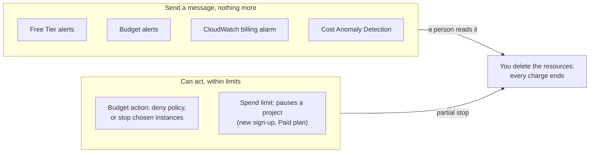

# Simulation S14: Follow a runaway cost through a weekend, and see which guardrails alert and which stop it

## Before you start: your account, your responsibility

This guide is provided as is, without warranty. We work hard to keep it correct and current, but AWS changes often, and its services, prices, and free offers may differ from what is written here. The labs run in your own AWS account. You are responsible for that account, for its security, and for any charges it incurs, including charges from resources you forget to delete. Automate the Cloud Inc. is not liable for any costs, losses, or security incidents that result from following, or failing to follow, this material. Technical guidance here is general information, not advice about your specific systems.

**Who this is for:** you have set up the alarms on [primer page 05](https://github.com/AutomateTheCloud/atc-study-aws_account_guardrails/blob/main/primer/05-money-alarms.md) and read [08.03 Watching workloads](../08-building-and-operating/03-watching-workloads.md). Lesson [11.03 Estimate, watch, analyze](03-estimate-watch-analyze.md) explains each tool. **Time:** about 30 minutes. **Cost:** $0; no AWS account is used.

**Why a simulation:** the only way to watch a real runaway is to pay for one, and testing a budget action means letting it change your account.

**Goal:** follow one **runaway cost**, spending that keeps growing because something nobody is watching keeps running, from Friday evening to Monday morning. For each guardrail, decide when it could first act and whether it alerts or stops anything. **End state:** a timeline in your notes, and a guardrail plan for the bakery's production account.

**Why this matters:** watching spend as it happens is [COST01-BP06 Monitor cost proactively](https://docs.aws.amazon.com/wellarchitected/latest/cost-optimization-pillar/cost_cloud_financial_management_proactive_process.html); limits that act are [COST02-BP05 Implement cost controls](https://docs.aws.amazon.com/wellarchitected/latest/cost-optimization-pillar/cost_govern_usage_controls.html); alerts that someone will act on are [OPS08-BP04 Create actionable alerts](https://docs.aws.amazon.com/wellarchitected/latest/operational-excellence-pillar/ops_workload_observability_create_alerts.html).

## The rules of this simulation

**The account.** Your lab account, after you upgraded it to the Paid plan, with primer page 05's guardrails: a zero-spend budget, a $5 monthly budget (email verified), anomaly alerts at $5 as a daily summary, and a CloudWatch billing alarm above $1. It is the 3rd of the month; month-to-date cost is $0.

**The runaway.** On Friday at 18:00 you follow a tutorial from the web. It launches four `m7i.large` instances in a private subnet, each with an 8 GB disk, and a NAT gateway. You close the laptop for the weekend.

| Item | Price, US East (N. Virginia), as of 2026-10-24 | Per hour |
|---|---|---|
| 4 × `m7i.large`, On-Demand | $0.1008 each | $0.4032 |
| NAT gateway (data processing left out) | $0.045 | $0.045 |
| 4 × 8 GB gp3 disks | $0.08 per GB-month | about $0.0035 |
| **Total** | | **about $0.45** |

Prices from AWS's Price List ([EC2 On-Demand pricing](https://aws.amazon.com/ec2/pricing/on-demand/), [Amazon VPC pricing](https://aws.amazon.com/vpc/pricing/)).

**The timing.** Cost tools don't see usage as it happens. **Billing data lag** is the delay between using something and its cost reaching the tools that watch it. This simulation uses made-up refresh times that sit inside the ranges AWS documents (checked 2026-10-24):

| Guardrail | Rule in this simulation | What AWS documents |
|---|---|---|
| Budgets (zero-spend, $5) | Data refreshes at 06:00 and 18:00 and covers usage up to 8 hours earlier | Budgets data updates up to three times a day; alerts can arrive after the cost has been incurred ([Managing your costs with AWS Budgets](https://docs.aws.amazon.com/cost-management/latest/userguide/budgets-managing-costs.html)) |
| Budget forecast alerts | Never fire in this account | About 5 weeks of usage data are needed before forecasts work ([Best practices for AWS Budgets](https://docs.aws.amazon.com/cost-management/latest/userguide/budgets-best-practices.html)) |
| CloudWatch billing alarm | Same refreshes as Budgets | Estimated charges are sent to CloudWatch several times a day ([billing alarm guide](https://docs.aws.amazon.com/AmazonCloudWatch/latest/monitoring/monitor_estimated_charges_with_cloudwatch.html)) |
| Cost Anomaly Detection | Daily summary at 00:00 UTC | Runs about three times a day on data up to 24 hours old, and needs at least 10 days of history for a service ([Cost Anomaly Detection FAQs](https://aws.amazon.com/aws-cost-management/aws-cost-anomaly-detection/faqs/)) |

*Notice that both boxes end at the same place: a person deleting what is running.*

**Long description.** Left box, send a message and nothing more: Free Tier alerts, budget alerts, the CloudWatch billing alarm, Cost Anomaly Detection. Right box, can act within limits: a budget action, which applies a deny policy or stops chosen EC2 or RDS instances; a spend limit, on the new sign-up experience's Paid plan, which pauses a project. Arrows from both boxes lead to "you delete the resources: every charge ends", labeled "a person reads it" and "partial stop".

## Part 1: watch the weekend

### Decision 1: for each guardrail, when does it first email you, and what does it stop?

Use the rules above. Assume you read email only once you wake up on Saturday, at 08:00.

Model answer

*Notice that the first email comes 12 hours after the start, and that the line keeps climbing after every alert.*

**Long description.** Cumulative cost, Friday 18:00 to Monday 08:00, at about $0.45 an hour. Dotted lines mark data refreshes at 06:00 and 18:00. Orange line, nobody acts: $28.01 by Monday 08:00. Blue line, you delete everything at Saturday 08:00: it flattens at $6.32. Point 1, Saturday 06:00: the zero-spend budget and the billing alarm email, based on data to Friday 22:00, $1.81. Point 2, Saturday 18:00: the $5 budget's 85% and 100% alerts, based on data to Saturday 10:00, $7.23.

| Guardrail | First email | Stops anything? |
|---|---|---|
| Zero-spend budget | Saturday 06:00 | No |
| CloudWatch billing alarm (above $1) | Saturday 06:00 | No |
| $5 monthly budget, actual | Saturday 18:00, both the 85% and the 100% alert at once | No |
| $5 monthly budget, forecast | Never: the account has no 5 weeks of history | No |
| Cost Anomaly Detection | Probably never this weekend (Decision 2) | No |

Every guardrail you set up on primer page 05 alerts; none stops. The difference between $6.32 and $28.01 is a person reading the first email and deleting the instances **and** the NAT gateway.

### Decision 2: why is Cost Anomaly Detection silent?

Model answer

Three reasons, any one enough. It needs at least 10 days of history for a service before it detects anomalies there, and this account has barely used EC2 since Lab 08. It works on data up to 24 hours old. And a daily summary goes out at 00:00 UTC for the previous day's anomalies, so even a detection on Saturday arrives on Sunday. Anomaly detection is a backstop for established accounts, not a fast alarm for a new one.

## Part 2: what would have stopped it?

### Decision 3: last month you added a budget action to the $5 budget. Which version would have helped?

- **Version A:** at 100% of actual cost, stop the EC2 instances you chose when you set up the action.
- **Version B:** at 100% of actual cost, attach an IAM policy that denies launching EC2 instances to your admin user's group.

Model answer

**Neither stops this bill.** Both run only when the budget sees 100%, at Saturday 18:00, with about $10.84 already spent.

- **A** names instances chosen last month. The tutorial's four instances are new, so the action doesn't touch them. Even if it did, stopping leaves the NAT gateway ($0.045 an hour) and the disks billing ([Configuring budget actions](https://docs.aws.amazon.com/cost-management/latest/userguide/budgets-controls.html)).
- **B** blocks *new* launches. The four instances already run and keep running.

Budget actions are useful guardrails for known, repeated risks, such as a test fleet you name in advance or a sandbox where new launches should stop. Your first two action-enabled budgets are free; after that each costs $0.10 a day (as of 2026-10-24, [AWS Budgets pricing](https://aws.amazon.com/aws-cost-management/aws-budgets/pricing/)).

### Decision 4: replay the weekend on the Free plan. What changes?

Model answer

- **Your card isn't charged.** Credits pay, and the Free plan has no charges unless you upgrade ([Choosing a plan](https://docs.aws.amazon.com/awsaccountbilling/latest/aboutv2/free-tier-plans.html), checked 2026-10-24). We haven't checked whether the Free plan allows these instance types at all.
- **The zero-spend budget should still email,** because it counts cost before credits. Primer page 05 confirmed that setting; we haven't seen one fire on credits.
- **The billing alarm may stay at $0** while credits pay. That comes from an expert's answer on AWS re:Post, which we haven't confirmed.
- **The only stop is a blunt one.** At about $10.84 a day, $120 of credits lasts about 11 days. Then the Free plan ends and the account closes: everything stops, and you lose access to your resources and data, with 90 days to upgrade before AWS deletes them.

On the new sign-up experience's Paid plan, a **spend limit** is AWS's feature built to stop: at the limit, AWS pauses the project and stops its resources, keeping the data (as of 2026-10-23, [Create a spend limit](https://docs.aws.amazon.com/accounts/latest/reference/create-spend-limit.html)). The classic sign-up this guide uses doesn't have it.

### Decision 5 (challenge): write the bakery's production guardrails

The bakery's production account runs the live site. Write four lines: what alerts, who reads it, what (if anything) acts automatically, and what must never be stopped automatically.

Model answer

1. **Alerts:** a monthly cost budget a little above the estimate from Lab 15, with actual and (after 5 weeks) forecast alerts; Cost Anomaly Detection once there is history.
2. **Who reads it:** alerts go to an SNS topic that reaches a shared team address or chat channel, not one person's inbox, so someone sees it on a weekend.
3. **What acts:** in a separate sandbox or test account, a budget action that denies new launches; in production, an action that waits for approval.
4. **Never automatic:** stopping the live web servers or the order database. A budget action that takes the shop offline to save $5 costs more than it saves.

## Recap

Every alert arrives after the money is spent, by hours or by a day. Alerts tell a person; only a person deleting resources, or an action set up in advance for a known risk, stops anything, and a budget action stops only what it names or blocks only what comes next. On the Free plan the backstop is the account closing, which is a stop you don't want.

**Next:** [the Module 11 mastery check](09-check.md). First, retry the practice questions at the end of [11.03](03-estimate-watch-analyze.md) and [11.04](04-many-accounts-one-bill.md) without looking back.

## Where to check the current details

- [Managing your costs with AWS Budgets](https://docs.aws.amazon.com/cost-management/latest/userguide/budgets-managing-costs.html) and [Configuring budget actions](https://docs.aws.amazon.com/cost-management/latest/userguide/budgets-controls.html) (checked 2026-10-24)
- [AWS Budgets pricing](https://aws.amazon.com/aws-cost-management/aws-budgets/pricing/) (checked 2026-10-24)
- [Getting started with AWS Cost Anomaly Detection](https://docs.aws.amazon.com/cost-management/latest/userguide/getting-started-ad.html) and its [FAQs](https://aws.amazon.com/aws-cost-management/aws-cost-anomaly-detection/faqs/) (checked 2026-10-24)
- [Create a billing alarm to monitor your estimated AWS charges](https://docs.aws.amazon.com/AmazonCloudWatch/latest/monitoring/monitor_estimated_charges_with_cloudwatch.html) (checked 2026-10-23)
- [Choosing a plan](https://docs.aws.amazon.com/awsaccountbilling/latest/aboutv2/free-tier-plans.html), AWS Billing User Guide (checked 2026-10-24)

---

"Simulation S14: Follow a runaway cost and see which guardrails alert and which stop it" by Automate the Cloud Inc., licensed under CC BY-NC 4.0 with the Additional Permission for Internal Training from Automate the Cloud Inc.
License: https://creativecommons.org/licenses/by-nc/4.0/
Permission: https://automatethe.cloud/licenses/atc-internal-training-permission.txt
