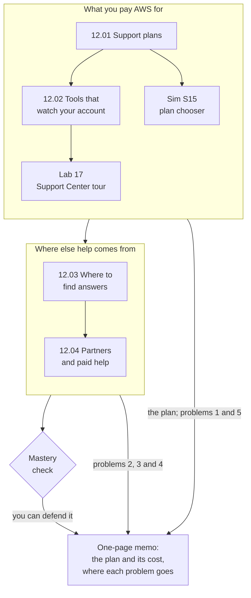

# Module 12: Recommend a Support plan for the bakery, and send five problems to the right place

This module teaches where help with AWS comes from: the Support plans you can pay for, the tools that watch your account, the free places to find answers, and the people you can hire. By the end, you write the bakery's owner a recommendation and a "who do we call?" sheet.

**For:** an adult studying alone, possibly new to IT, who wants to understand AWS and use it safely. You have finished [Module 07](../07-connecting-it/00-brief.md) and the [guardrails primer](https://github.com/AutomateTheCloud/atc-study-aws_account_guardrails/blob/main/primer/00-read-this-first.md). Modules 08 to 11 come just before this one. **Time:** about 3 hours, over several sessions.

## The scenario: the site has become business-critical

The bakery's site runs in US East (N. Virginia): web servers on EC2, the order database on Amazon RDS, functions in AWS Lambda, cake photos in S3, all inside the network from Module 07. Online orders are now most of the bakery's sales, and its AWS bill has grown with them: from about $210 a month in Module 11, "Paying for AWS", to about $1,200 a month a year later (both figures are made up). An hour of downtime in the bakery's busiest week now costs real money.

The owner asks: **"Do we need to pay AWS for support, and which plan?"** Then five problems arrive in one week:

| # | The problem | Where you'll learn to send it |
|---|---|---|
| 1 | "There's a charge on our bill we don't recognize." | Lessons 12.01 and 12.02 |
| 2 | "How do we make the photo bucket delete old versions?" | Lesson 12.03 |
| 3 | "Before our busiest week, can someone check that our design will hold up?" | Lessons 12.01 and 12.04 |
| 4 | "Something on an AWS IP address keeps hammering our login page." | Lesson 12.03 |
| 5 | "The site is slow, and we think AWS may be having an outage." | Lesson 12.02 |

The bakery is made up for teaching. At the end you hand the owner a one-page memo: the Support plan you recommend and what it costs, and where each kind of problem goes.

## You'll be able to

Tags: the kind of knowledge (C concept, J judgment) and what you do with it (Un understand, Ap apply).

| Objective | Lesson |
|---|---|
| **12.01a** Choose the cheapest Support plan that fits a need [J·Ap] | 12.01 |
| **12.02a** Say what Trusted Advisor, AWS Health and Support Center each show, and who gets them [C·Un] | 12.02 |
| **12.03a** Route a question to the right place [C·Ap] | 12.03 |
| **12.04a** Choose the right kind of paid help: a partner, AWS Professional Services or AWS Support [C·Ap] | 12.04 |

## What this covers on the exam

This module covers task [4.3](https://docs.aws.amazon.com/aws-certification/latest/cloud-practitioner-02/cloud-practitioner-02-domain4.html#cloud-practitioner-02-task4.3), AWS technical resources and Support options, in Domain 4 of the AWS Certified Cloud Practitioner (CLF-C02) exam. It also covers the customer enablement part of task [3.8](https://docs.aws.amazon.com/aws-certification/latest/cloud-practitioner-02/cloud-practitioner-02-domain3.html#cloud-practitioner-02-task3.8), choosing support for a business, and the security resources of task [2.4](https://docs.aws.amazon.com/aws-certification/latest/cloud-practitioner-02/cloud-practitioner-02-domain2.html#cloud-practitioner-02-task2.4): Trusted Advisor, the Knowledge Center and the AWS security site. We checked the exam guide on 2026-10-24.

## How the module is laid out

**Lessons** (about 25 minutes each):

1. [Support plans](01-support-plans.md)
2. [Tools that watch your account](02-tools-that-watch-your-account.md)
3. [Where to find answers](03-where-to-find-answers.md)
4. [Partners and paid help](04-partners-and-paid-help.md)

**Hands-on:**

- [Lab 17: tour the help every AWS account gets](05-lab-17-support-center-tour.md), where you look at what the free Basic plan gives your own account: Support Center's case types, the AWS Health Dashboard and the free Trusted Advisor checks. You open no case and change no plan, so it costs $0.
- [Simulation S15: choose the cheapest Support plan that fits](06-sim-support-plan-chooser.md), where you pick the cheapest plan that fits several businesses. It runs on this site, not in AWS.

**Before the lab:** check that you still have [root MFA](https://github.com/AutomateTheCloud/atc-study-aws_account_guardrails/blob/main/primer/02-secure-the-root-user.md), [your IAM admin user with MFA](https://github.com/AutomateTheCloud/atc-study-aws_account_guardrails/blob/main/primer/03-your-everyday-admin-identity.md) and [money alarms](https://github.com/AutomateTheCloud/atc-study-aws_account_guardrails/blob/main/primer/05-money-alarms.md). The lessons need no AWS account.

**Mastery check:** the module ends with a check; you pass at 80%. Each miss points you to the section to reread, then to a parallel retest.

**Numbers and names that change:** AWS replaced its Support plans on 2025-12-02, and the old ones end on 2027-01-01 ([end of support notice](https://docs.aws.amazon.com/awssupport/latest/user/support-plans-eos.html), checked 2026-10-24). Lesson 12.01 teaches the current plans, with one dated box that translates the old names still found in much study material. Prices, response times and Trusted Advisor's checks carry the date we checked them.

*Notice that the plan answers only part of the owner's question: three of the five problems go somewhere other than a Support case.*

**Long description.** A top-to-bottom map. Box one, "What you pay AWS for": lesson 12.01 leads to 12.02; 12.01 also leads to Simulation S15, and 12.02 to Lab 17. Box one leads to box two, "Where else help comes from": lesson 12.03 leads to 12.04, which leads to the mastery check. Box one feeds the one-page memo with the plan and problems 1 and 5; box two with problems 2, 3 and 4; the check leads to the memo, labeled "you can defend it".

## Coming back

Warm-ups bring back Module 11, "Paying for AWS" (budgets and the bill), [Module 09, "Protecting, governing and proving compliance"](../09-protecting-and-governing/00-brief.md) (Trusted Advisor's security checks and the Shield Response Team), Module 04 (who may change the Support plan) and Module 02 (the Well-Architected Framework's pillars).

---

"Module 12: Getting help" by Automate the Cloud Inc., licensed under CC BY-NC 4.0 with the Additional Permission for Internal Training from Automate the Cloud Inc.
License: https://creativecommons.org/licenses/by-nc/4.0/
Permission: https://automatethe.cloud/licenses/atc-internal-training-permission.txt
