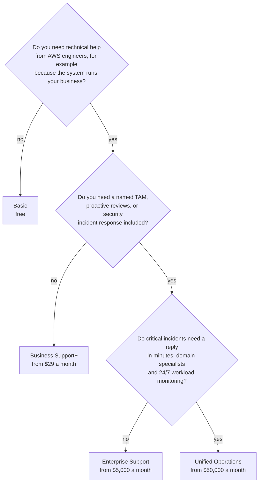
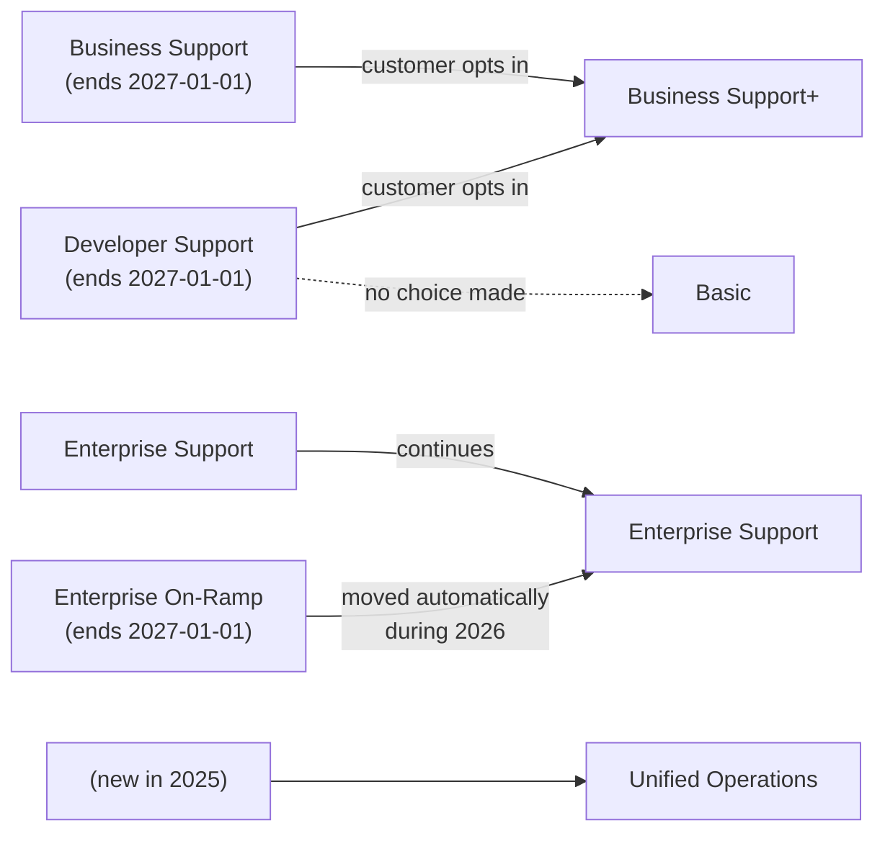

# Choose the cheapest Support plan that covers your worst day: Basic, Business Support+, Enterprise or Unified Operations

AWS sells help with your account in four plans. Each plan includes everything in the one below it and adds faster replies, more people and more tools, for a higher monthly fee. By the end of this lesson you can read a business's needs, pick the cheapest plan that meets them, and explain why the next plan up isn't worth its price yet.

**For:** an adult studying alone, possibly new to IT, who wants to understand AWS and use it safely. **Time:** about 25 minutes. Reading works on a phone.

**Before you start:** this lesson builds on [AWS changes fast](../00-start-here/04-aws-changes-fast.md), which warned that the Support plans changed, and [Identities](../04-shared-responsibility-and-access/03-identities.md), which showed that changing the plan isn't a root-only task. [Module 09, "Protecting, governing and proving compliance"](../09-protecting-and-governing/00-brief.md), and Module 11, "Paying for AWS", come just before this one; if you skipped them, the warm-up feedback gives you what you need. The bakery scenario is in the [module brief](00-brief.md).

## Warm-up: what you remember

Answer from memory before you look anything up.

1. From Module 11, "Paying for AWS": the bakery set a monthly budget of $300, and this month's costs pass it. Does AWS stop the bakery's servers?
2. From Module 09, lesson ["The front door"](../09-protecting-and-governing/04-the-front-door.md): what two things did AWS's page say you need before the Shield Response Team will help you during a DDoS attack?
3. From lesson 04.03: the bakery's owner wants to change the account's Support plan. Must she sign in as the root user?

Feedback

1. **No.** A budget alerts you; on its own it stops nothing. Only budget actions you set up yourself take any action. A Support plan is the same kind of thing: it gets you help, it doesn't run your systems for you.
2. **AWS Shield Advanced, and a qualifying Support plan.** AWS's page names the Business Support or Enterprise Support plan (checked 2026-10-24). This lesson shows why "Business" in that sentence is out of date: AWS's page doesn't yet say whether Business Support+ qualifies, so check the page before you rely on it.
3. **No.** Changing the Support plan needs IAM permissions, not the root user. It isn't on AWS's list of root-only tasks, although much older material says it is.

## What you'll learn

By the end of this lesson, you can:

- say what each of the four current plans adds, and roughly what it costs;
- explain why response times are targets for a first reply, not guarantees;
- choose the cheapest plan that fits a business's needs, and defend the choice (objective 12.01a);
- translate an old plan name from older study material into today's lineup.

Try these before you read on. Guess if you're unsure; the answers are in the lesson.

1. A plan lists "under 30 minutes" for a business-critical system that is down. Does AWS promise to fix the problem in 30 minutes?
2. What is the cheapest plan that lets you ask AWS engineers a technical question?

## The big picture: four steps, each including the one before

![Four steps rise from left to right. Basic, free for every account: cases about your account and bill, quota increase requests, docs and re:Post, some Trusted Advisor checks, the AWS Health Dashboard, and no technical cases. Business Support+, highlighted, from $29 a month: technical cases 24/7, under 30 minutes for a business-critical system down, all Trusted Advisor checks, the Health API. Enterprise Support, from $5,000 a month: a designated Technical Account Manager, under 15 minutes, Well-Architected reviews. Unified Operations, from $50,000 a month: domain specialists, under 5 minutes, 24/7 workload monitoring.](../../images/12-01-plan-ladder.svg)

*Notice the highlighted step. The biggest change in the whole ladder is between Basic and Business Support+: that's where technical help from AWS starts.*

**Long description.** Four steps rise from left to right; each includes everything to its left. Basic: free, on every account; cases about your account and bill; service quota increase requests; documentation, whitepapers and re:Post; some Trusted Advisor checks; the AWS Health Dashboard; no technical cases. Business Support+, highlighted: from $29 a month; technical cases 24/7 by phone, web and chat; under 30 minutes for a business-critical system down; all Trusted Advisor checks; the AWS Health API and Support API; AI help that uses your account's context. Enterprise Support: from $5,000 a month; a designated Technical Account Manager (TAM); under 15 minutes for business-critical cases; Well-Architected reviews; Trusted Advisor Priority; Security Incident Response included. Unified Operations: from $50,000 a month; a TAM plus designated domain specialists; under 5 minutes for critical incidents, from an Incident Management Engineer; 24/7 workload monitoring; critical workload reviews. Prices are monthly minimums as of 2026-10-24. Response times are targets for a first reply.

## Key terms (skip if you know them)

- **AWS Support:** AWS's own help service for its customers. The exam guide files it under "customer enablement".
- **Support plan:** the level of AWS Support an account subscribes to. Every account has one; the free one is Basic.
- **Support case:** one request for help, opened in the AWS Support Center and tracked until it's closed. "Case" here means a ticket, not a lawsuit or a box.
- **Case severity:** how serious you say the problem is when you open a case, from "general guidance" to "business-critical system down". The severity sets which response target applies.
- **First-response time:** how quickly AWS aims to reply to a new case for the first time. It isn't the time to fix the problem.
- **Technical Account Manager (TAM):** a named AWS person assigned to your company, who knows your setup and guides you.

## Every account starts on Basic, which answers account questions but not technical ones

**Basic Support** is free and included with every AWS account. It gives you, around the clock ([Compare AWS Support plans](https://aws.amazon.com/premiumsupport/plans/) and [AWS Support Plans](https://docs.aws.amazon.com/awssupport/latest/user/aws-support-plans.html), checked 2026-10-24):

- **Cases about your account and your bill**, answered one to one by AWS customer service.
- **Service quota increase requests**, when you need more of something than your account is allowed by default.
- **Documentation, whitepapers and AWS re:Post**, AWS's community question-and-answer site (lesson 12.03).
- **Some AWS Trusted Advisor checks** and the **AWS Health Dashboard** (lesson 12.02).

What Basic can't do is open a **technical** case. "Our database stopped accepting connections" or "why does this Lambda function time out?" needs a paid plan ([Case management](https://docs.aws.amazon.com/awssupport/latest/user/case-management.html), checked 2026-10-24). The [guardrails primer, page 08](https://github.com/AutomateTheCloud/atc-study-aws_account_guardrails/blob/main/primer/08-when-something-goes-wrong.md), already showed you the free part: a charge you don't recognize goes in an account and billing case, which every account can open.

Two limits apply to every plan, paid ones included. AWS Support doesn't write your code, debug your own software, administer your systems or log in to them for you, and you can't buy support for just one service ([AWS Support FAQs](https://aws.amazon.com/premiumsupport/faqs/), checked 2026-10-24). Paid help with your own systems is a different product: lesson 12.04 covers partners and AWS Professional Services.

> **Your turn:** The bakery is on Basic. For each problem, say whether Basic can open a case for it, and why. (a) A charge on the bill nobody recognizes. (b) The order database stopped accepting connections after a settings change. (c) The bakery needs more EC2 instances than its account allows for its busiest week.

Model answer

(a) **Yes:** an account and billing case, open to every plan. (b) **No:** that's a technical case, which needs Business Support+ or higher. On Basic, the bakery would search the documentation and re:Post. (c) **Yes:** a service quota increase request, open to every plan.

## Business Support+ adds technical help around the clock

**AWS Business Support+** is the first paid plan, and the one AWS calls the minimum it recommends for production workloads ([Compare AWS Support plans](https://aws.amazon.com/premiumsupport/plans/)). On top of Basic it adds ([AWS Support Plans](https://docs.aws.amazon.com/awssupport/latest/user/aws-support-plans.html), checked 2026-10-24):

- **Technical cases, 24/7, by phone, web and chat**, with Cloud Support Engineers, and as many cases as you like, opened by anyone in the account with permission.
- **Under 30 minutes** to a first reply from a person when a business-critical system is down.
- **AI help** that answers using the context of your own account.
- **All Trusted Advisor checks**, and the **AWS Health API** and **AWS Support API**, so your own tools can read them (lesson 12.02).
- **Help with third-party software**: the operating systems on your EC2 instances and popular software that runs on AWS.

You pay the **greater** of a monthly minimum and a percentage of your AWS bill, and the percentage falls as the bill grows ([AWS Support Plan Pricing](https://aws.amazon.com/premiumsupport/pricing/)):

> **What you pay for (as of 2026-10-24):** Business Support+ costs $29 a month or a share of that account's AWS charges, whichever is greater: 9% of the first $10,000, 7% from $10,000 to $80,000, 5% from $80,000 to $250,000 and 3% above that. It is charged **per account**. The share is worked out on your charges **before** credits and discounts. Paid plans are billed monthly with no long-term contract, but you pay for at least one month once you sign up. AWS Security Incident Response is an extra fee on this plan ([Compare AWS Support plans](https://aws.amazon.com/premiumsupport/plans/)). Check [AWS Support Plan Pricing](https://aws.amazon.com/premiumsupport/pricing/) for current figures.

*Notice the gap between the two lines at the bakery's dot. For a small business, Enterprise's minimum alone is many times what Business Support+ costs.*

**Long description.** A line chart. Horizontal axis: the monthly AWS bill before credits and discounts, $0 to $20,000. Vertical axis: the monthly Support fee, $0 to $6,000. Enterprise Support is a flat line at $5,000, its minimum, across the whole range; it stays there until the bill passes $50,000. Business Support+ starts at its $29 minimum, rises at 9% of the bill to $900 at $10,000, then at 7% to $1,600 at $20,000. A dot marks the bakery's made-up bill of $1,200 a month, where Business Support+ costs $108. Unified Operations starts at $50,000 a month, off the scale. Prices as of 2026-10-24.

| Monthly AWS bill | Business Support+ | Enterprise Support |
|---|---|---|
| $200 | $29 (the minimum) | $5,000 (the minimum) |
| $1,200 (the bakery) | $108 | $5,000 |
| $10,000 | $900 | $5,000 |
| $20,000 | $1,600 | $5,000 |

> **Your turn:** Work out the Business Support+ fee for two months. (a) The bakery's bill in Module 11, about $210. (b) Its busiest month now: a bill of $2,000.

Model answer

(a) 9% of $210 is $18.90, which is below the minimum, so the fee is **$29**. (b) 9% of $2,000 is **$180**, above the minimum, so that's the fee. The fee follows the bill, which is one reason Module 11's budgets should include it.

## Enterprise Support adds a named person who knows your setup

**AWS Enterprise Support** is for business-critical workloads across a company that wants expert guidance. Its biggest addition is a **designated Technical Account Manager (TAM)**: one person at AWS assigned to you, who learns your setup, guides your plans and pulls in AWS specialists ([AWS Enterprise Support](https://aws.amazon.com/premiumsupport/plans/enterprise/), checked 2026-10-24). On top of Business Support+ it adds:

- **Under 15 minutes** to a first reply for a business-critical system that is down.
- **Well-Architected reviews** led by the TAM, and a proactive security review.
- **Strategic business reviews**, and **AWS Countdown** support around big events such as a launch or a migration.
- **AWS Security Incident Response** included: help to prepare for, respond to and recover from incidents such as an account takeover or ransomware.
- **Trusted Advisor Priority:** your account team picks out the Trusted Advisor recommendations that matter most for you (lesson 12.02).

It costs the greater of **$5,000 a month** or 10% of the first $150,000 of monthly charges, with lower shares above that, worked out on the total for all the accounts you enroll ([AWS Support Plan Pricing](https://aws.amazon.com/premiumsupport/pricing/), as of 2026-10-24). AWS lowered that minimum from $15,000.

## Unified Operations is for systems where minutes matter

**AWS Unified Operations** is the top plan, for mission-critical workloads. It adds ([What is AWS Unified Operations](https://docs.aws.amazon.com/awssupport/latest/user/unified-operations-intro.html) and [AWS Support Plans](https://docs.aws.amazon.com/awssupport/latest/user/aws-support-plans.html), checked 2026-10-24):

- **Under 5 minutes** to a first reply for a critical incident, from an **Incident Management Engineer**.
- **24/7 monitoring** of your workloads for security and performance problems.
- A designated TAM **plus designated Domain Specialist Engineers** for your applications, and a Senior Billing and Account Specialist.
- **Critical workload reviews**, personalized runbooks, architecture guidance and help with planned events.

It starts at **$50,000 a month**, with an initial commitment of 90 days and then month to month ([AWS Support Plan Pricing](https://aws.amazon.com/premiumsupport/pricing/), as of 2026-10-24). You sign up through AWS sales, not with a button in the console ([Change AWS Support Plans](https://docs.aws.amazon.com/awssupport/latest/user/changing-support-plans.html)).

| | Basic | Business Support+ | Enterprise Support | Unified Operations |
|---|---|---|---|---|
| **Monthly minimum** | Free | $29 per account | $5,000 | $50,000 |
| **Technical cases** | No | Yes, 24/7 | Yes, 24/7 | Yes, 24/7 |
| **Fastest target** | — | Under 30 min | Under 15 min | Under 5 min |
| **A named person** | No | No | A TAM | A TAM and domain specialists |
| **Trusted Advisor** | Some checks | All checks | All, plus Priority | All, plus Priority |
| **AWS Health API** | No | Yes | Yes | Yes |
| **Security Incident Response** | Not included | Extra fee | Included | Included |

Prices and features as of 2026-10-24, from [Compare AWS Support plans](https://aws.amazon.com/premiumsupport/plans/) and [AWS Support Plan Pricing](https://aws.amazon.com/premiumsupport/pricing/).

**What's the same:** every plan includes the ones below it, and every paid plan is billed monthly with no long-term contract, though each has a minimum commitment: 30 days, or 90 days for Unified Operations (as of 2026-10-24). **What differs:** how fast AWS aims to reply, whether a named person knows your setup, and how much AWS watches for you. **The principle:** move up one step only when your business needs what that step adds.

> **Check:** A company wants a designated Technical Account Manager and has no need for 5-minute responses. Which is the cheapest plan that fits?
>
> A. Business Support+\
> B. Enterprise Support\
> C. Unified Operations\
> D. Basic

Feedback

**B is right.** Enterprise Support is the first plan with a designated TAM.

- **A is wrong.** Business Support+ has 24/7 engineers but no named TAM.
- **C is wrong.** Unified Operations includes a TAM too, but it costs far more and adds 5-minute responses the company doesn't need.
- **D is wrong.** Basic has no technical help at all.

## Response times are targets for a first reply, not guarantees

When you open a technical case you choose its severity, and each severity has a **first-response time**: how soon AWS aims to reply ([Case management](https://docs.aws.amazon.com/awssupport/latest/user/case-management.html), checked 2026-10-24).

*Notice that the paid plans differ only in the top row. For everything short of a business-critical outage, Business Support+ aims for the same reply times as the plans above it.*

**Long description.** A grid with five severity rows and four plan columns. Basic has a dash in every row: it can't open technical cases. Business-critical system down, highlighted: Business Support+ under 30 minutes, Enterprise Support under 15 minutes, Unified Operations under 5 minutes, from an Incident Management Engineer. Production system down: under 1 hour on all three paid plans. Production system impaired: under 4 hours. System impaired: under 12 hours. General guidance: under 24 hours. A note quotes AWS's footnote that it will make every reasonable effort to respond to the initial request within these times. Checked 2026-10-24.

Choose the severity honestly. AWS's advice is to use the highest severities only for problems you can't work around, or that directly affect production.

### "Response times are guaranteed" is wrong

You may have read that a Support plan guarantees a response, or even a fix, within its stated time. That's not right on two counts.

- **They are targets, not promises.** AWS's own footnote says it will make "every reasonable effort" to respond within the stated times ([Compare AWS Support plans](https://aws.amazon.com/premiumsupport/plans/), checked 2026-10-24), and its FAQ calls them service level objectives: goals AWS aims for.
- **They are about the first reply, not the fix.** "Under 30 minutes" means a person engages with your case within about 30 minutes. How long the fix takes depends on the problem.

It's tempting because the times sit in a neat table that looks like a contract, and some study material labels them "SLAs". Plan your own recovery so that it doesn't depend on AWS replying in time: that's why [Surviving failure](../03-aws-around-the-world/03-surviving-failure.md) had the bakery design for failure.

> **Check:** Answer the first prequestion. The bakery buys Business Support+, and its site goes down at 9 p.m. on a Sunday. Which statement is right?
>
> A. AWS guarantees the site is back within 30 minutes\
> B. AWS aims for an engineer to engage within 30 minutes if the bakery opens the case as business-critical\
> C. AWS replies within 30 minutes only during business hours\
> D. Business Support+ has no response target for outages

Feedback

**B is right.** The target is for a first reply on a business-critical case, and AWS makes "every reasonable effort" to meet it.

- **A is wrong.** Nothing promises a fix in 30 minutes; the target is for the first reply, and it's a target.
- **C is wrong.** Paid plans give technical support 24/7.
- **D is wrong.** Business Support+ has the 30-minute target for business-critical cases.

## Choose by starting at Basic and moving up only for a reason

To choose a plan, start at the bottom and ask one question per step. Stop at the first "no":

*Notice that each question names what the next plan adds. If the business doesn't need that, the cheaper plan is the right answer.*

**Long description.** A decision flowchart with three questions in order. First: do you need technical help from AWS engineers, for example because the system runs your business? No: Basic, free. Yes: second question: do you need a named TAM, proactive reviews, or security incident response included? No: Business Support+, from $29 a month. Yes: third question: do critical incidents need a reply in minutes, domain specialists and 24/7 workload monitoring? No: Enterprise Support, from $5,000 a month. Yes: Unified Operations, from $50,000 a month. Prices as of 2026-10-24.

Two needs sound like Support plan features but aren't:

- **DDoS help from the Shield Response Team** needs AWS Shield Advanced as well as a Support plan: AWS's page names Business Support or Enterprise Support, and doesn't yet say whether Business Support+ qualifies (checked 2026-10-24), so check the page before you rely on it. Module 09's lesson ["The front door"](../09-protecting-and-governing/04-the-front-door.md) covers it, and the section on old plan names at the end of this lesson explains why the page names a retiring plan.
- **Someone to build or run your system** is consulting, not support: partners and AWS Professional Services, in lesson 12.04.

## Worked example: the bakery's recommendation

The owner's question: "Do we need to pay AWS for support, and which plan?" A year after Module 11, the bakery's AWS bill has grown from about $210 to about $1,200 a month, all in one account. Both figures are made up for this example. Here is how an expert reasons.

1. **Start from the worst day.** The site is now most of the bakery's sales. The worst day is the site down during its busiest week, with a problem the bakery can't solve alone. On Basic, the bakery couldn't open a technical case at all. So Basic fails the first question.
2. **Check what Business Support+ adds against that day.** Engineers 24/7 by phone and chat, and a 30-minute target for a business-critical case. It also unlocks all Trusted Advisor checks, which may save money (lesson 12.02). That covers the worst day.
3. **Price it.** 9% of $1,200 is $108 a month, about $1,300 a year, rising in the busy months as the bill rises.
4. **Ask whether the next step is worth it.** Enterprise's TAM would be useful, but its $5,000 monthly minimum is about 46 times the Business Support+ fee. The owner's wish for a design review before the busiest week (problem 3 in the brief) can be met for far less: a self-review with the Well-Architected Tool ([lesson 02.05](../02-why-the-cloud/05-the-well-architected-framework.md)) or a partner (lesson 12.04).
5. **Write down how to use it.** Who may open a case (anyone with the IAM permission), what severity to choose for an outage, and when to revisit the decision: if the bakery grows into many accounts or needs a named contact.

**The answer:** Business Support+ on the bakery's production account, about $108 a month at today's bill (as of 2026-10-24), with a one-page "how we open a case" note. Revisit it when the bill or the business changes.

> **Your turn:** A company runs a payment system in 30 accounts, spends $400,000 a month on AWS, and its board wants a named AWS contact and help planning a big product launch. Its payment application is complex, so it also wants designated AWS engineers who specialize in that kind of application and review it continuously. Which plan fits, and why not the one below it?

Model answer

**Unified Operations.** A named contact and launch planning would point to Enterprise Support, but designated Domain Specialist Engineers, who learn the company's applications, come only with Unified Operations ([Compare AWS Support plans](https://aws.amazon.com/premiumsupport/plans/), checked 2026-10-24). Enterprise Support gives a designated TAM, not domain specialists. At this spend, Unified Operations costs its $50,000 minimum, $17,500 a month more than Enterprise's $32,500. If the company dropped the specialist need, Enterprise Support would be the cheaper fit.

## Older material uses plan names that are being retired

AWS replaced its Support lineup on 2025-12-02. The current exam guide uses the new names, but much study material, and some of AWS's own pages, still use the old ones.

> **Dated (checked 2026-10-24):** Three older plans are being retired ([end of support notice](https://docs.aws.amazon.com/awssupport/latest/user/support-plans-eos.html); [AWS Support FAQs](https://aws.amazon.com/premiumsupport/faqs/)):
>
> - **Developer Support** and **Business Support** have taken no new subscriptions since 2025-12-02 and end on 2027-01-01. Existing customers can keep them until then or move to Business Support+. AWS doesn't move them automatically: a Developer Support customer who doesn't choose a new plan falls back to Basic.
> - **Enterprise On-Ramp** ends on 2027-01-01. During 2026, AWS is moving its customers to Enterprise Support automatically.
> - All three stay available in the AWS GovCloud (US) Regions.
> - Enterprise Support continues, with its monthly minimum lowered from $15,000 to $5,000.

*Notice that no old plan maps to Unified Operations, and that the two retiring plans with "Developer" and "Business" in their names need the customer to act.*

**Long description.** Old names on the left, today's plans on the right. Developer Support, ending 2027-01-01, leads to Business Support+ if the customer opts in; a dashed arrow labeled "no choice made" leads to Basic. Business Support, ending 2027-01-01, leads to Business Support+ if the customer opts in. Enterprise On-Ramp, ending 2027-01-01, leads to Enterprise Support, moved automatically during 2026. Enterprise Support continues as Enterprise Support. Unified Operations is new in 2025, with no old plan behind it. Basic continues unchanged.

### "Developer, Business and Enterprise On-Ramp are current plans" is out of date

You may have studied a lineup of five plans: Basic, Developer, Business, Enterprise On-Ramp and Enterprise. That was correct until December 2025. Today, three of those take no new customers or are being phased out, and all three end on 2027-01-01. It's tempting to trust because so much material was written before the change, and because AWS's own pages lag: the Shield Response Team page still names "Business Support" and doesn't yet say whether Business Support+ qualifies, and the Well-Architected best practice on Support plans still says "Business Support or greater" (both checked 2026-10-24).

If a practice question lists only the old plans, translate before you answer: "Developer" or "Business" means today's Business Support+, and "Enterprise On-Ramp" means Enterprise Support. Learn the four current plans; the exam guide lists exactly those.

## In real work: decide before the outage, and write it down

Teams choose a Support plan as part of getting ready to run a production system, not in the middle of an outage. The Well-Architected Framework's operational excellence pillar names this habit: [OPS07-BP06 Create support plans for production workloads](https://docs.aws.amazon.com/wellarchitected/latest/operational-excellence-pillar/ops_ready_to_support_enable_support_plans.html). It asks you to pick a support level that matches your service-level needs, and to document how to request support and how to escalate, so that the knowledge doesn't leave with one person. The cost optimization pillar adds the other half: the fee is part of your bill, so budget for it and revisit it as the bill grows.

## Summary

- **Basic is free and on every account.** It handles account and billing cases and quota increases, but no technical cases.
- **Business Support+ adds technical help around the clock** from $29 a month per account, with a 30-minute target for business-critical outages, all Trusted Advisor checks and the Health API.
- **Enterprise Support adds a named Technical Account Manager**, 15-minute targets, Well-Architected reviews and included security incident response, from $5,000 a month.
- **Unified Operations adds replies in minutes**, domain specialists and 24/7 workload monitoring, from $50,000 a month.
- **Response times are targets for a first reply,** not guarantees of a fix.
- **Choose by moving up only for a reason:** the cheapest plan that covers your worst day.
- **Old names are being retired:** Business Support+ replaces Developer and Business, and Enterprise On-Ramp customers move to Enterprise Support; all three old plans end on 2027-01-01 (as of 2026-10-24).

**For the bakery's memo:** Business Support+ on the production account, about $108 a month at a $1,200 bill. Lesson 12.02 adds what that plan unlocks in Trusted Advisor and AWS Health.

## Practice

1. **Which is the lowest-cost plan that lets a company open technical support cases at any hour?**

   A. Basic\
   B. Business Support+\
   C. Enterprise Support\
   D. Developer Support

   

Feedback

   **B is right.**

   - **A is wrong.** Basic can't open technical cases.
   - **C is wrong.** Enterprise Support can, but it costs more and adds things the company didn't ask for.
   - **D is wrong.** Developer Support takes no new subscriptions and ends on 2027-01-01 (as of 2026-10-24).

   

2. **Which plan is the first to include a designated Technical Account Manager?**

   A. Business Support+\
   B. Enterprise Support\
   C. Unified Operations\
   D. Basic

   

Feedback

   **B is right.** Unified Operations also has a TAM, but it isn't the first.

   - **A and D are wrong.** Neither has a named TAM.
   - **C is wrong.** It includes a TAM, but Enterprise Support already does, for much less.

   

3. **A colleague says, "With Enterprise Support, AWS guarantees a critical outage is fixed within 15 minutes." In two sentences, correct them.**

   

Feedback

   **Model answer:** The 15 minutes is a target for AWS's first reply to a business-critical case, not for the fix. AWS says it makes every reasonable effort to meet it, so it isn't a guarantee either.

   

4. **A practice question asks which plan gives the cheapest access to technical support, and its choices are Basic, Developer, Business and Enterprise. How would you answer it today?**

   

Feedback

   **Model answer:** The question uses the old lineup, where the answer was Developer. Developer takes no new customers today and ends on 2027-01-01 (as of 2026-10-24); both Developer and Business map to Business Support+, which is today's cheapest plan with technical cases.

   

5. **(From lesson 04.03.) Which of these needs the root user: closing the AWS account, or changing the Support plan?**

   

Feedback

   **Closing the account** is root-only. Changing the Support plan needs only IAM permissions (as of 2026-10-23).

   

6. **(From lesson 02.05.) Which Well-Architected pillar does choosing a Support plan before an outage belong to, and why?**

   

Feedback

   **Operational excellence.** It's about being ready to run and support a workload: knowing in advance how to get help and escalate ([OPS07-BP06](https://docs.aws.amazon.com/wellarchitected/latest/operational-excellence-pillar/ops_ready_to_support_enable_support_plans.html)). Cost optimization comes in when you weigh the fee.

   

**Next:** [Tools that watch your account](02-tools-that-watch-your-account.md). To practice choosing, try [Simulation S15: choose the cheapest Support plan that fits](06-sim-support-plan-chooser.md).

## Where to check the current details

- [Compare AWS Support plans](https://aws.amazon.com/premiumsupport/plans/): features and response targets (checked 2026-10-24)
- [AWS Support Plan Pricing](https://aws.amazon.com/premiumsupport/pricing/): minimums, percentages and billing terms (checked 2026-10-24)
- [AWS Support Plans](https://docs.aws.amazon.com/awssupport/latest/user/aws-support-plans.html) and [Case management](https://docs.aws.amazon.com/awssupport/latest/user/case-management.html), AWS Support User Guide (checked 2026-10-24)
- [Developer, Business, and Enterprise On-Ramp end of support](https://docs.aws.amazon.com/awssupport/latest/user/support-plans-eos.html) and the [AWS Support FAQs](https://aws.amazon.com/premiumsupport/faqs/) (checked 2026-10-24)
- [AWS Certified Cloud Practitioner (CLF-C02) exam guide](https://docs.aws.amazon.com/aws-certification/latest/cloud-practitioner-02/cloud-practitioner-02.html), tasks [4.3](https://docs.aws.amazon.com/aws-certification/latest/cloud-practitioner-02/cloud-practitioner-02-domain4.html#cloud-practitioner-02-task4.3) and [3.8](https://docs.aws.amazon.com/aws-certification/latest/cloud-practitioner-02/cloud-practitioner-02-domain3.html#cloud-practitioner-02-task3.8) (checked 2026-10-24)

---

"Support plans" by Automate the Cloud Inc., licensed under CC BY-NC 4.0 with the Additional Permission for Internal Training from Automate the Cloud Inc.
License: https://creativecommons.org/licenses/by-nc/4.0/
Permission: https://automatethe.cloud/licenses/atc-internal-training-permission.txt
