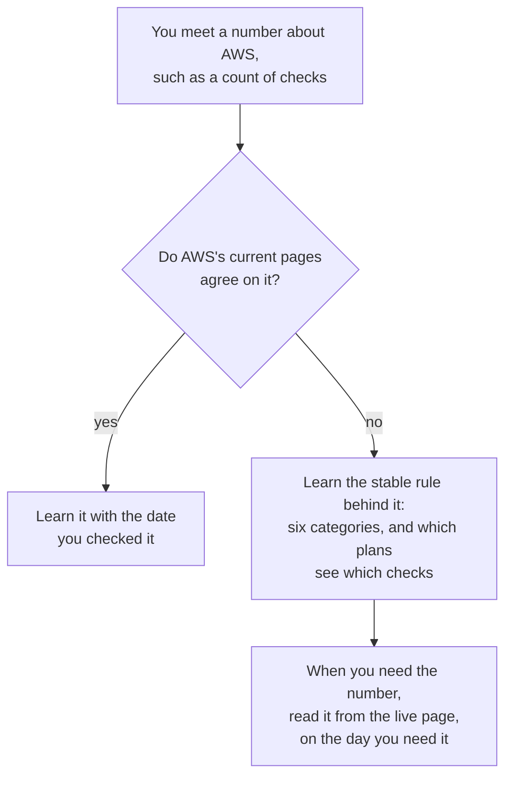
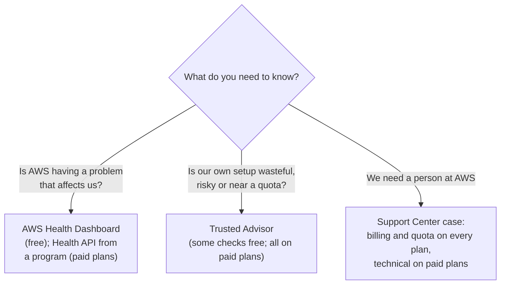

# Trusted Advisor checks what you built, AWS Health reports what AWS runs, and Support Center is where you ask a person

Three AWS tools keep an eye on your account for you, and each one looks in a different direction. AWS Trusted Advisor compares your own setup with AWS's best practices. AWS Health tells you when something on AWS's side affects you. AWS Support Center is where you open a case and talk to AWS. By the end of this lesson you can say what each one shows, and how much of it your Support plan gives you.

**For:** an adult studying alone, possibly new to IT, who wants to understand AWS and use it safely. **Time:** about 25 minutes. Reading works on a phone.

**Before you start:** this lesson builds on [Support plans](01-support-plans.md), and you met the AWS Health Dashboard in [Lab 02](../03-aws-around-the-world/05-lab-02-see-the-global-infrastructure.md). Module 09's lesson ["Finding threats and weaknesses"](../09-protecting-and-governing/03-finding-threats-and-weaknesses.md) introduced Trusted Advisor's security checks; this lesson covers the rest of Trusted Advisor. If you skipped any of these, the key terms below give you enough to follow.

## Warm-up: what you remember

Answer from memory before you look anything up.

1. From Module 11, "Paying for AWS": the owner wants to see how the bakery's costs for each service changed over the last six months. AWS Budgets or AWS Cost Explorer?
2. From Module 09, lesson "Finding threats and weaknesses": which service told the bakery, for free on the Basic Support plan, that its root user had no MFA: AWS Trusted Advisor, AWS Security Hub CSPM or Amazon Inspector?
3. From lesson 02.05: what is the difference between the AWS Well-Architected Tool and AWS Trusted Advisor?

Feedback

1. **Cost Explorer.** It shows past and current costs, broken down by service and by month. Budgets compares spending against a limit you set and alerts you.
2. **Trusted Advisor.** Its root MFA check is one of the few security checks every plan gets. Security Hub CSPM checks settings against named standards, and Inspector looks for software flaws and open network paths.
3. **The Well-Architected Tool** is a question-by-question review of one workload that you run, against the Framework's pillars. **Trusted Advisor** runs automatic checks on the resources in your account and groups them into categories, not pillars.

## What you'll learn

By the end of this lesson, you can:

- say what Trusted Advisor checks, name its six categories, and say what each Support plan sees;
- tell the AWS Health Dashboard's two views apart from each other and from the AWS Health API;
- say what you can do in AWS Support Center on each plan;
- pick the tool that answers a question, and say who gets it (objective 12.02a).

Try these before you read on. Guess if you're unsure; the answers are in the lesson.

1. How many Trusted Advisor checks does an account on the free Basic plan get?
2. A study guide asks you to choose between the "Personal Health Dashboard" and the "Service Health Dashboard". Which one do you open today?

## The big picture: three tools, three directions

*Notice which side each tool looks at. Trusted Advisor can't tell you AWS is having an outage, and AWS Health can't tell you your bucket is open to the world.*

**Long description.** A dashed line splits the picture into your side, your account and its resources, on the left, and AWS's side on the right. On your side: AWS Trusted Advisor answers "Is anything in our setup wasteful, risky or near a limit?" It checks your settings against AWS's best practices in six categories; Basic gets some checks and paid plans all of them. An arrow labeled "reads settings" runs up to it from the bakery's account: the EC2 web servers, the RDS orders database, Lambda functions, the S3 photo bucket and the VPC. AWS Support Center answers "We need a person at AWS to help." It is where you open cases and request quota increases; Basic gets account, billing and quota cases, and paid plans technical cases too. On AWS's side, highlighted: AWS Health answers "Is AWS having a problem that affects us?" It reports AWS's own events, such as issues, planned maintenance and account notices; its dashboard is free for everyone, and its API needs a paid plan. An arrow labeled "reports events" runs up to it from AWS's services, Regions and data centers.

## Key terms (skip if you know them)

- **AWS Trusted Advisor:** a service that inspects your account and recommends changes where you could save money, improve availability or performance, or close a security gap.
- **Trusted Advisor check:** one test Trusted Advisor runs, such as "Is MFA on the root user?". Checks are grouped into **check categories**.
- **AWS Health:** the AWS service that reports **AWS Health events**: issues with AWS services, planned maintenance and other notices that can affect your resources.
- **AWS Health Dashboard:** AWS Health's console page, free for everyone.
- **AWS Support Center:** the console where you open and follow support cases.
- **Service quota:** the most of something an account may have or use, such as how many of a resource it can run in a Region. Older pages call quotas "limits", which is why Trusted Advisor's category is still named "service limits".

## Trusted Advisor checks your setup against AWS's best practices, in six categories

**AWS Trusted Advisor** draws on what AWS has learned from many customers. It inspects your account and flags where you could save money, improve availability and performance, or close a security gap ([AWS Trusted Advisor](https://docs.aws.amazon.com/awssupport/latest/user/trusted-advisor.html), checked 2026-10-24). It has no separate price: what you see comes with your Support plan.

Its checks fall into six categories. Each line below gives one real check as an example ([check reference](https://docs.aws.amazon.com/awssupport/latest/user/trusted-advisor-check-reference.html), checked 2026-10-24):

| Category | What it looks for | One example check |
|---|---|---|
| **Cost optimization** | Money spent on things you don't use | Low utilization Amazon EC2 instances |
| **Performance** | Resources working too hard, or set up slower than they could be | High CPU Utilization Amazon EC2 Instances |
| **Security** | Settings that leave a door open | MFA on root account |
| **Fault tolerance** | Single points of failure, missing backups | Amazon RDS Multi-AZ |
| **Service limits** | Usage close to a service quota | One check per quota it watches |
| **Operational excellence** | Missing logs and operating practices | Amazon VPC Without Flow Logs |

Two naming notes. AWS's product page calls the fault tolerance category "resilience" ([Trusted Advisor product page](https://aws.amazon.com/premiumsupport/technology/trusted-advisor/), checked 2026-10-24). And many older sources list only five categories: operational excellence is the one they leave out.

The categories sound like the Well-Architected pillars from [lesson 02.05](../02-why-the-cloud/05-the-well-architected-framework.md), and they point in the same directions: cost optimization, performance efficiency, security, reliability and operational excellence. They aren't the same thing. The pillars are guidance you apply in a review; Trusted Advisor's categories are folders of automatic checks. Fault tolerance and service limits both belong to the reliability pillar's concerns, and sustainability has no category.

Trusted Advisor only reports. It changes nothing: if it flags an open port, you fix the security group. Module 09's lesson "Finding threats and weaknesses" set it beside Security Hub CSPM and Amazon Inspector, which also report and don't block.

> **Your turn:** Name the category each finding belongs to. (a) The bakery has an Elastic IP address attached to nothing. (b) The order database runs in one Availability Zone only. (c) The account is close to the number of a resource it may run in N. Virginia. (d) The VPC records no flow logs.

Model answer

(a) **Cost optimization:** an unused address still costs money (the check is "Unassociated Elastic IP Addresses"). (b) **Fault tolerance:** one AZ is a single point of failure, as lesson 05.05 showed with Multi-AZ. (c) **Service limits:** usage near a quota. (d) **Operational excellence:** missing logs make problems harder to investigate.

## What you see in Trusted Advisor depends on your Support plan

Every account can open Trusted Advisor, but a Basic account sees only part of it ([AWS Trusted Advisor](https://docs.aws.amazon.com/awssupport/latest/user/trusted-advisor.html), checked 2026-10-24):

![A grid of Trusted Advisor categories and features against three plan columns. Basic, highlighted: all service limits checks, a few selected security checks such as root MFA, one selected fault tolerance check, and nothing in cost optimization, performance or operational excellence; security checks refreshed by hand; no API; no Priority. Business Support+: all checks, automatic refresh, the API and EventBridge. Enterprise and Unified Operations: the same, plus Trusted Advisor Priority from the account team.](../../images/12-02-ta-access.svg)

*Notice the empty rows in the Basic column. A free account sees no cost optimization checks at all: the money-saving part of Trusted Advisor starts with Business Support+.*

**Long description.** A grid with three plan columns: Basic, on every account; Business Support+; and Enterprise and Unified Operations. Six category rows. Service limits: all checks on every plan. Security: Basic gets a few selected checks, such as root MFA; paid plans get all checks. Fault tolerance: Basic gets one selected check; paid plans get all. Cost optimization, performance and operational excellence: none on Basic; all checks on paid plans. Three feature rows. Refresh: on Basic you refresh the security checks by hand; paid plans refresh automatically. API and EventBridge: not on Basic; yes on paid plans. Trusted Advisor Priority: only on Enterprise and Unified Operations, from the account team. Basic's cells are highlighted, and unavailable cells are dashed. No check counts are given.

- **Basic Support:** every check in the service limits category, plus a few chosen security and fault tolerance checks. When we checked, these were public EBS snapshots, public RDS snapshots, S3 bucket permissions, MFA on the root account, security groups with specific ports open to everyone, and one fault tolerance check on AWS STS endpoint use. You refresh the security checks yourself, with the refresh button on each check.
- **Business Support+, Enterprise Support and Unified Operations:** all checks in all six categories, refreshed automatically, plus the **Trusted Advisor API** for your own tools, and alerts through Amazon EventBridge when a check's status changes.
- **Enterprise Support and Unified Operations** also get **Trusted Advisor Priority**: your AWS account team picks out the recommendations that matter most for your business, so you work on those first ([Trusted Advisor product page](https://aws.amazon.com/premiumsupport/technology/trusted-advisor/), checked 2026-10-24).

> **Warning:** on a new Free plan account, Trusted Advisor showed a button to upgrade the Support plan, with no price next to it (our test account, 2026-10-23). A paid Support plan is a monthly charge with a minimum term. Nothing in this guide asks you to upgrade; don't click it to see what happens.

### "Basic gets a fixed number of checks" is wrong

You may have learned that Basic Support gets a set number of "core checks", and that the paid plans get a certain larger number. That's not a safe thing to learn. What AWS defines is a **rule**: Basic sees the whole service limits category plus a few chosen security and fault tolerance checks, and paid plans see everything. The number of checks behind that rule changes as AWS adds checks, retires them and adds quotas to watch. It's tempting because a single number is easy to memorize, and a practice question can ask for one.

This is also the guide's clearest example of [AWS as a moving target](../00-start-here/04-aws-changes-fast.md). When we checked, three AWS pages each gave a different total for Trusted Advisor's checks: the product page, the Support plans guide and the Enterprise Support page. None of them was careless; they were updated at different times. So this guide teaches the categories and the plan rule, which hold steady, and leaves the count to the live page.

*Notice that both paths end with a date. A number about AWS is only as good as the day it was read.*

**Long description.** A flowchart. Start: you meet a number about AWS, such as a count of checks. Question: do AWS's current pages agree on it? Yes: learn it with the date you checked it. No: learn the stable rule behind it, which for Trusted Advisor is the six categories and which plans see which checks; then, when you need the number, read it from the live page on the day you need it.

> **Check:** Answer the first prequestion. Which statement about Trusted Advisor on the Basic plan is correct?
>
> A. Basic gets all cost optimization checks
> B. Basic gets every service limits check and a few selected security and fault tolerance checks
> C. Basic gets no Trusted Advisor checks
> D. Basic gets all checks, but without the API

Feedback

**B is right**, as of 2026-10-24.

- **A is wrong.** Basic gets no cost optimization checks; they start with Business Support+.
- **C is wrong.** Every account sees the service limits checks and a few security checks.
- **D is wrong.** All checks need Business Support+ or higher.

## AWS Health reports problems on AWS's side, through one dashboard with two views

**AWS Health** tells you about events on AWS's side that can affect you: a service having trouble in a Region, maintenance AWS has planned on hardware your resources use, or a notice about your account ([What is AWS Health?](https://docs.aws.amazon.com/health/latest/ug/what-is-aws-health.html), checked 2026-10-24). It reports AWS's side only. For how your own resources are performing, you use Amazon CloudWatch, from Module 08's lesson ["Watching workloads"](../08-building-and-operating/03-watching-workloads.md).

![An outer box, AWS Health. Inside it, highlighted, the AWS Health Dashboard, free with no setup, with two views. Service health: public events for all services and Regions, no sign-in needed, 12 months of history, once called the Service Health Dashboard. Your account health: after you sign in, events that affect your own resources, once called the Personal Health Dashboard. Below, two feeds: Amazon EventBridge, free for every customer, and the AWS Health API, which needs Business Support+, Enterprise or Unified Operations.](../../images/12-02-health-views.svg)

*Notice that the two old names are now two views inside one highlighted box. One product, two views.*

**Long description.** An outer box, AWS Health: events on AWS's side that can affect you. Inside it, highlighted, the AWS Health Dashboard, free for every customer with no setup, holds two views. Service health: public events for all services and Regions, with no sign-in and no account needed, and 12 months of service history; its older name was the Service Health Dashboard. Your account health: after you sign in, events that affect your own resources, such as planned maintenance on an instance you run, plus the public events; its older name was the Personal Health Dashboard. Below the dashboard, two feeds. Amazon EventBridge sends Health events to your own rules and tools, free for every customer. The AWS Health API lets your programs ask AWS Health directly; it needs Business Support+, Enterprise or Unified Operations, and on Basic it refuses the call. AWS announced the single dashboard on 2022-02-28.

The **AWS Health Dashboard** is free for every customer and needs no setup. It has two views ([AWS Health Dashboard](https://docs.aws.amazon.com/health/latest/ug/aws-health-dashboard-status.html), checked 2026-10-24):

- **Service health** is public. Anyone can open it, with no sign-in and no AWS account. It shows **public events**, which aren't about any one account, for every service and Region, and a history of the last 12 months.
- **Your account health** appears after you sign in. It shows **account-specific events** that affect your own resources, such as maintenance planned for a server you run, as well as the public events. You saw it in Lab 02.

Two ways let your own tools hear about events without anyone watching a screen:

- **Amazon EventBridge:** every customer can receive Health events through EventBridge at no extra cost, and route them to an email, a chat channel or an automated fix.
- **The AWS Health API:** programs can ask AWS Health directly. It needs Business Support+, Enterprise Support or Unified Operations; on Basic, the API refuses the call ([What is AWS Health?](https://docs.aws.amazon.com/health/latest/ug/what-is-aws-health.html)).

| | AWS Health Dashboard | AWS Health API |
|---|---|---|
| **Who uses it** | People, in a browser | Programs, such as an operations tool |
| **Shows** | Public events, and your account's events once you sign in | Your account's events, on request |
| **Plan needed** | None: free on every plan | Business Support+, Enterprise or Unified Operations |
| **Same underneath** | Both read the same AWS Health events | |

**What's the same:** both report AWS's side, from the same events. **What differs:** who reads them, and whether you pay for the plan. **The principle:** people look at the dashboard; programs call the API, or listen through EventBridge, which every plan can use.

### "The Personal and Service Health Dashboards are separate products" is out of date

You may have read about two dashboards: a Service Health Dashboard showing AWS's overall status, and a Personal Health Dashboard showing your account. That was true once. On 2022-02-28, AWS announced a single **AWS Health Dashboard** bringing the two together ([What's New post](https://aws.amazon.com/about-aws/whats-new/2022/02/aws-health-dashboard-first-iteration/)). The two old products now live on as its two views: Service health and Your account health. It's tempting because the old names survive in older material, and even in a few AWS pages: the AWS Support FAQ still lists the "Service Health Dashboard" under Basic (checked 2026-10-24). If an answer choice names either old dashboard, read it as the matching view of the AWS Health Dashboard.

> **Check:** Answer the second prequestion. The bakery's site is slow, and the owner wonders whether AWS is having trouble in N. Virginia. She is on Basic. Where should she look first?
>
> A. The AWS Health Dashboard: Service health for AWS-wide events, and Your account health for anything affecting her own resources
> B. The AWS Health API
> C. Trusted Advisor's performance checks
> D. The Personal Health Dashboard, a separate product

Feedback

**A is right.** The dashboard is free on every plan and reports AWS's side.

- **B is wrong.** The API needs a paid plan, and it's for programs, not a person checking quickly.
- **C is wrong.** Trusted Advisor checks her own setup, not AWS's events, and Basic has no performance checks.
- **D is wrong.** That's the old name for Your account health, now part of the one AWS Health Dashboard.

## Support Center is where you open cases and ask for more quota

**AWS Support Center**, which AWS's documentation calls the Support Center Console, is where you ask AWS for help. In some Regions, N. Virginia among them, you can first describe the problem in your own words and get AI troubleshooting suggestions, then open a case if you still need one ([AI-enhanced troubleshooting](https://docs.aws.amazon.com/awssupport/latest/user/ai-enhanced-support.html), checked 2026-10-24). You choose one of three case types ([Case management](https://docs.aws.amazon.com/awssupport/latest/user/case-management.html)):

| Case type | For | Who can open it |
|---|---|---|
| **Account and billing** | Questions about your account, charges and payments | Every plan, Basic included |
| **Service limit increase** | Asking for a higher service quota | Every plan, Basic included |
| **Technical** | Help with how a service behaves, from AWS engineers | Business Support+ and higher only |

A few details matter in practice:

- **Any IAM identity with the right permissions** can open cases. The root user isn't needed, the same as for changing the plan.
- **Severity** is chosen when you open a technical case (lesson 12.01). On a paid plan you can raise or lower it later as the situation changes; on Basic, you can't change a case's severity after you open it.
- **Quota increases** can also be requested in the Service Quotas console. Trusted Advisor's service limits checks warn you; Support Center or Service Quotas is where you ask for more.

The [guardrails primer, page 08](https://github.com/AutomateTheCloud/atc-study-aws_account_guardrails/blob/main/primer/08-when-something-goes-wrong.md), already sent you here for an unexplained charge, with a free account and billing case.

> **Your turn:** Problem 1 in the brief: "There's a charge on our bill we don't recognize." The bakery is on Basic. Where does the owner go, which case type does she choose, and does she need the root user?

Model answer

**Support Center**, with an **account and billing** case. Every plan can open one, so Basic is enough. She doesn't need the root user: her IAM admin identity with the right permissions can open it. Before opening it, she can look in the bill's details herself (Module 11), so the case can name the line she doesn't recognize.

## Pick the tool by the question you're asking

*Notice that the first branch is about AWS's side and the second about yours. Mixing them up is the most common wrong answer.*

**Long description.** A flowchart that starts with "What do you need to know?" Three branches. "Is AWS having a problem that affects us?" leads to the AWS Health Dashboard, free, or the Health API from a program on a paid plan. "Is our own setup wasteful, risky or near a quota?" leads to Trusted Advisor, with some checks free and all checks on paid plans. "We need a person at AWS" leads to a Support Center case: billing and quota cases on every plan, technical cases on paid plans.

| | Trusted Advisor | AWS Health | Support Center |
|---|---|---|---|
| **Looks at** | Your account's settings | AWS's services and events that touch you | Your request to AWS |
| **Answers** | "What should we fix or save?" | "Is it AWS, and what's planned?" | "Who at AWS can help us?" |
| **On Basic** | Service limits and a few security checks | The full dashboard | Billing and quota cases |
| **On paid plans** | All checks, API, Priority on Enterprise and up | Adds the Health API | Adds technical cases, 24/7 |

## Worked example: the bakery's week

The bakery has just moved to Business Support+, as lesson 12.01 recommended. Three things happen. Here is how an expert decides where each goes.

1. **Monday: a slow site at lunchtime.** First question: is it AWS or us? She opens the AWS Health Dashboard. Service health shows no event in N. Virginia, and Your account health shows nothing for her resources. So the cause is probably on the bakery's side, and she turns to CloudWatch and the bakery's own logs. Had there been an AWS event, she would have followed its updates instead of changing her own setup.
2. **Wednesday: Trusted Advisor's first full refresh.** With all checks now visible, cost optimization flags an Elastic IP address attached to nothing and an underused EBS volume. Fault tolerance flags that the order database runs in one Availability Zone. She deletes the unused address and volume, and puts the Multi-AZ change on next week's list, because it raises the database bill.
3. **Friday: a confusing charge.** She opens an account and billing case in Support Center. This needed no paid plan, but the case and her earlier technical questions now sit in one place.

**The answer for the brief:** problem 5 ("we think AWS may be having an outage") goes to the **AWS Health Dashboard**, free on every plan. Problem 1 (the charge) goes to an **account and billing case** in Support Center, also free. The paid plan adds Trusted Advisor's full checks, which may save the bakery more each month than its $108 fee costs.

> **Your turn:** The bakery's operations tool should open a ticket automatically whenever AWS posts an event affecting the bakery's resources. Name two ways to feed it, and say which one Basic could use.

Model answer

**Amazon EventBridge** receives AWS Health events on every plan, Basic included, and can pass them to the tool. The **AWS Health API** lets the tool ask AWS Health directly, but it needs Business Support+ or higher. On Basic, EventBridge is the way.

## In real work: watch both sides, automatically

Teams watch AWS Health and their own monitoring together, so that the first question in any outage, "is it us or AWS?", takes a minute to answer. They route Health events into the tools they already watch, instead of relying on someone remembering to open a dashboard. They read Trusted Advisor regularly and treat its findings as a to-do list. The Well-Architected Framework names one of these habits directly: [REL01-BP04 Monitor and manage quotas](https://docs.aws.amazon.com/wellarchitected/latest/reliability-pillar/rel_manage_service_limits_monitor_manage_limits.html) suggests Trusted Advisor's service limits checks as one way to see a quota coming before it stops you. Its cost optimization findings serve the cost optimization pillar, and its security checks the security pillar.

## Summary

- **Trusted Advisor checks what you built** against AWS's best practices, in six categories: cost optimization, performance, security, fault tolerance, service limits and operational excellence. It reports; you fix.
- **Your Support plan sets how much of Trusted Advisor you see.** Basic: all service limits checks plus a few security and fault tolerance checks, refreshed by hand. Paid plans: all checks, the API and EventBridge. Enterprise and Unified Operations add Trusted Advisor Priority. Don't learn a count: AWS's own pages disagree (checked 2026-10-24).
- **AWS Health reports what AWS runs:** one free dashboard with two views, Service health (public) and Your account health (signed in). The old Service and Personal Health Dashboard names are these two views.
- **The Health API is for programs and needs a paid plan;** EventBridge delivery is free on every plan.
- **Support Center is where you ask a person:** account and billing and quota cases on every plan, technical cases on paid plans, opened by anyone with the permissions.

**For the bakery's memo:** problem 1 goes to an account and billing case, and problem 5 to the AWS Health Dashboard. Lesson 12.03 routes problems 2 and 4.

## Practice

1. **Which AWS tool tells a company that AWS has scheduled maintenance on hardware that one of its EC2 instances uses?**

   A. AWS Trusted Advisor
   B. AWS Health, in Your account health
   C. AWS Support Center
   D. AWS Health, in Service health only

   

Feedback

   **B is right.** Planned maintenance on your resources is an account-specific event, shown once you sign in.

   - **A is wrong.** Trusted Advisor checks your settings; it doesn't report AWS's events.
   - **C is wrong.** Support Center is for cases you open.
   - **D is wrong.** Service health shows public events that aren't about any one account.

   

2. **A startup on Basic Support wants Trusted Advisor's recommendations for cutting costs. What must change?**

   A. Nothing: Basic includes all cost optimization checks
   B. It must move to Business Support+ or higher
   C. It must turn on AWS Health
   D. It must enable Trusted Advisor Priority on Basic

   

Feedback

   **B is right.** Cost optimization checks come with Business Support+ and higher.

   - **A is wrong.** Basic gets service limits and a few security and fault tolerance checks only.
   - **C is wrong.** AWS Health reports AWS's events, not savings.
   - **D is wrong.** Priority is only on Enterprise Support and Unified Operations.

   

3. **Name Trusted Advisor's six check categories, and say which one most older material leaves out.**

   

Feedback

   Cost optimization, performance, security, fault tolerance, service limits and **operational excellence**, the one often missing.

   

4. **In two sentences, explain to a colleague why this guide won't tell you how many checks Trusted Advisor runs.**

   

Feedback

   **Model answer:** AWS's own pages gave different totals when we checked, because the checks change as AWS adds and retires them. What stays steady is the six categories and which plans see which checks, so learn that and read the count from the live page when you need it.

   

5. **(From lesson 12.01.) The bakery wants its operations tool to call the AWS Health API. What is the cheapest plan that allows it?**

   

Feedback

   **Business Support+.** Basic can't use the Health API, though it can receive Health events through EventBridge.

   

6. **(From lesson 02.05.) A manager wants a structured review of the ordering site against the six pillars, saved to compare next quarter. Trusted Advisor or the Well-Architected Tool?**

   

Feedback

   **The Well-Architected Tool.** It reviews one workload question by question and saves milestones. Trusted Advisor runs automatic checks and groups them into categories, not pillars.

   

**Next:** [Where to find answers](03-where-to-find-answers.md). To see these tools in your own account, try [Lab 17: tour the help every AWS account gets](05-lab-17-support-center-tour.md).

## Where to check the current details

- [AWS Trusted Advisor](https://docs.aws.amazon.com/awssupport/latest/user/trusted-advisor.html) and its [check reference](https://docs.aws.amazon.com/awssupport/latest/user/trusted-advisor-check-reference.html), AWS Support User Guide: categories and plan access (checked 2026-10-24)
- [AWS Trusted Advisor product page](https://aws.amazon.com/premiumsupport/technology/trusted-advisor/): Trusted Advisor Priority (checked 2026-10-24)
- [What is AWS Health?](https://docs.aws.amazon.com/health/latest/ug/what-is-aws-health.html) and [AWS Health Dashboard](https://docs.aws.amazon.com/health/latest/ug/aws-health-dashboard-status.html) (checked 2026-10-24)
- [Case management](https://docs.aws.amazon.com/awssupport/latest/user/case-management.html), AWS Support User Guide: case types and severity (checked 2026-10-24)
- [AWS Certified Cloud Practitioner (CLF-C02) exam guide](https://docs.aws.amazon.com/aws-certification/latest/cloud-practitioner-02/cloud-practitioner-02.html), tasks [4.3](https://docs.aws.amazon.com/aws-certification/latest/cloud-practitioner-02/cloud-practitioner-02-domain4.html#cloud-practitioner-02-task4.3) and [2.4](https://docs.aws.amazon.com/aws-certification/latest/cloud-practitioner-02/cloud-practitioner-02-domain2.html#cloud-practitioner-02-task2.4) (checked 2026-10-24)

---

"Tools that watch your account" by Automate the Cloud Inc., licensed under CC BY-NC 4.0 with the Additional Permission for Internal Training from Automate the Cloud Inc.
License: https://creativecommons.org/licenses/by-nc/4.0/
Permission: https://automatethe.cloud/licenses/atc-internal-training-permission.txt
