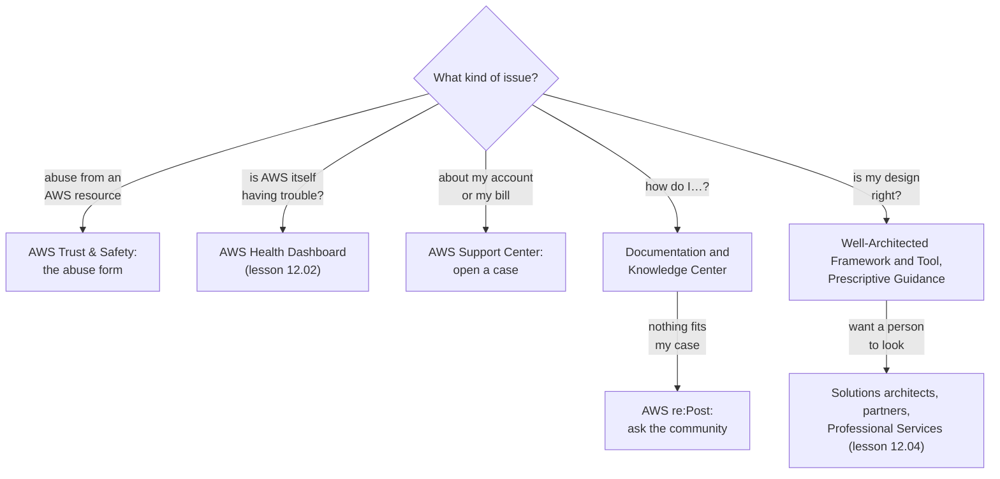

# Send each question where it can be answered: AWS's pages for how things work, re:Post for odd cases, Support Center for your account, and Trust & Safety for abuse

AWS publishes a lot of help, and most of it is free. The skill is routing: knowing which source can answer which kind of question, so you don't wait two days for a support case that a Knowledge Center article answers in two minutes, or open a support case for something AWS Support isn't allowed to handle. By the end you can route each of the bakery's issues to the right place.

**For:** an adult studying alone, possibly new to IT, who wants to understand AWS and use it safely. **Time:** about 25 minutes. Reading works on a phone.

**Before you start:** this lesson builds on [Compliance and governance](../09-protecting-and-governing/05-compliance-and-governance.md), whose last section listed where AWS publishes security information, and on [The Well-Architected Framework](../02-why-the-cloud/05-the-well-architected-framework.md). The Support plans themselves are in [Support plans](01-support-plans.md), and the AWS Health Dashboard is in [Tools that watch your account](02-tools-that-watch-your-account.md); this lesson only routes to them. If you skipped any of these, the key terms below give you enough to follow. The bakery's five issues are in the [module brief](00-brief.md).

## Warm-up: what you remember

Answer from memory before you look anything up.

1. From Module 11, "Paying for AWS": before anyone builds the new cake designer, the owner wants to know what it will cost each month. Which AWS tool gives that estimate?
2. From lesson 09.05: the owner reads about a flaw in widely used software and wants to know whether AWS's own services are affected. Where does AWS publish that?
3. From lesson 02.05: what's the difference between the AWS Well-Architected Framework and the AWS Well-Architected Tool?

Feedback

1. **AWS Pricing Calculator.** It estimates costs before you build; Cost Explorer and Budgets work on costs you already have. Picking the tool by the question it answers is the same skill this lesson applies to sources of help.
2. **AWS Security Bulletins.** Lesson 09.05 gave each security source one job. This lesson does the same for every source of help.
3. **The Framework is guidance you read** (a set of AWS whitepapers); **the Tool is a service in the console** that asks the Framework's questions about one of your workloads. Both return in this lesson's design review.

## What you'll learn

By the end of this lesson, you can:

- say what AWS documentation, whitepapers, blogs, AWS re:Post, the AWS Knowledge Center and AWS Prescriptive Guidance each offer;
- tell re:Post, the Knowledge Center, Prescriptive Guidance and AWS Support Center apart;
- report abuse that comes from AWS resources, and say why it doesn't go to AWS Support;
- route a question to the source that can answer it (objective 12.03a).

Try these before you read on. Guess if you're unsure; the answers are in the lesson.

1. A server at an address that belongs to AWS keeps trying passwords on the bakery's order page. Should the bakery open a support case?
2. Is the AWS Knowledge Center a separate website from AWS re:Post?

## The big picture: five issues, five doors

The bakery's site is becoming business-critical, and the owner has a list of five issues. Each one belongs somewhere different. Ask three questions in order: is someone misusing an AWS resource, is AWS itself having trouble, and is the question about *your* account or about how AWS works in general?

*Notice that only one door, Support Center, is about your own account. Every other source answers questions that many customers share, which is why it can be public and free.*

**Long description.** A flowchart that starts from one question, "What kind of issue?", with five branches. Abuse from an AWS resource leads to AWS Trust & Safety and its abuse form. "Is AWS itself having trouble?" leads to the AWS Health Dashboard, lesson 12.02. A question about my account or my bill leads to AWS Support Center, where you open a case. "How do I…?" leads to the documentation and the Knowledge Center, and on to AWS re:Post if nothing fits the case. "Is my design right?" leads to the Well-Architected Framework and Tool and to Prescriptive Guidance, and on to solutions architects, partners and Professional Services, lesson 12.04, if you want a person to look.

## Key terms (skip if you know them)

- **AWS documentation:** AWS's reference pages for each service, at docs.aws.amazon.com: user guides, developer guides, API and CLI references, tutorials and code examples.
- **AWS re:Post:** AWS's public question-and-answer site, where anyone can ask and anyone can answer.
- **AWS Knowledge Center:** AWS's own articles on the questions customers ask most, published on re:Post.
- **AWS Prescriptive Guidance:** guides and step-by-step patterns from AWS experts for planning and building on AWS.
- **AWS Support Center** (from lesson 12.02): the place in the AWS console where you open and track support cases about your own account.
- **Abuse:** using a computing resource to harm others: spam, attacks, scanning, or hosting stolen or illegal content. Not the everyday sense of "misusing a service you pay for".
- **AWS Trust & Safety team:** the AWS team that handles reports of abuse coming from AWS resources.

## AWS's own pages explain how AWS works: documentation, whitepapers and blogs

Start with what AWS has written down. These sources are free, public, and the same for every customer, so they answer "how does this work?" and "how do I do this?", never "what's wrong with *my* account?".

| Source | What you find there | Use it for |
|---|---|---|
| [AWS documentation](https://docs.aws.amazon.com/) | For each service: user guides, developer guides, API and CLI references, tutorials, code examples | How a service behaves, its limits, the exact steps and settings |
| [AWS whitepapers and guides](https://aws.amazon.com/whitepapers/) | Longer papers on one topic: technical whitepapers, decision guides, reference architecture diagrams | Concepts and best practice across services, such as the Well-Architected Framework (lesson 02.05) or disaster recovery (lesson 03.03) |
| AWS blogs, such as the [AWS News Blog](https://aws.amazon.com/blogs/aws/) and the [AWS Security Blog](https://aws.amazon.com/blogs/security/) | Dated posts by topic: announcements on the News Blog, walk-throughs of features and solutions on the others | What's new, and walk-throughs of a feature or solution |

The exam guide asks you to locate whitepapers, blogs and documentation on AWS's official websites (task [4.3](https://docs.aws.amazon.com/aws-certification/latest/cloud-practitioner-02/cloud-practitioner-02-domain4.html#cloud-practitioner-02-task4.3)), and the AWS documentation home page also links to re:Post and Prescriptive Guidance (checked 2026-10-24).

**Check the date on everything.** This is where AWS's speed of change bites. Two AWS whitepapers that much study material still quotes, *How AWS Pricing Works* and *Introduction to AWS Security*, now carry AWS's banner "for historical reference only", and some of their figures disagree with current pages (checked 2026-10-23). A blog post describes the world on the day it was written. When a whitepaper or post disagrees with a service's current documentation, trust the documentation, and note the date of what you read.

> **Your turn:** The bakery's developer wants to know the largest object S3 can store. Which source answers that best, and why not a blog post?

Model answer

The **Amazon S3 documentation** (or the S3 FAQ), because limits are reference facts that AWS keeps current there. A blog post is dated and may describe an old limit; lesson 05.01 showed that widely repeated material still gives an old S3 object size limit.

## re:Post is where people answer questions; the Knowledge Center is AWS's own articles inside it

When the documentation doesn't cover your exact problem, someone has often met it before.

**AWS re:Post** is AWS's public question-and-answer site, at repost.aws. You search or ask a question; members of the community, AWS employees and recognized experts answer it, and the best answers are marked so later readers can find them. It also offers articles and curated collections ([AWS re:Post](https://repost.aws/), checked 2026-10-24). Every AWS customer can use it on any Support plan, including the free Basic plan, and the paid plans get prioritized responses there ([Compare AWS Support plans](https://aws.amazon.com/premiumsupport/plans/), checked 2026-10-24).

**The AWS Knowledge Center** is part of re:Post, not a separate site. It holds AWS's official articles and videos on the questions customers ask most often, each written by AWS and marked as AWS official ([Knowledge Center](https://repost.aws/knowledge-center), checked 2026-10-24). Typical titles start "How do I…?" or "Why can't I…?": connecting to an EC2 instance that won't answer, objects that won't replicate between S3 buckets, reactivating a suspended account. Older links to the Knowledge Center on aws.amazon.com now land on re:Post.

The difference that matters:

- **A Knowledge Center article** is AWS's answer to a *common* problem, kept up to date by AWS.
- **A re:Post question** gets answers from whoever responds, for *your* particular problem. Answers vary in quality, so check them against the documentation.

re:Post is public. Describe your problem in general terms, and never post access keys, passwords, or anything that identifies your customers. [Primer page 10](https://github.com/AutomateTheCloud/atc-study-aws_account_guardrails/blob/main/primer/10-bad-practices-and-checklist.md) explains how keys leak through chats and screenshots.

> **Dated (checked 2026-10-24):** AWS also sold **AWS re:Post Private**, a separate, private knowledge site for one organization's own teams. It's a different product from re:Post, and AWS has announced its end of support on 2027-06-30 ([re:Post Private end of support](https://docs.aws.amazon.com/repostprivate/latest/userguide/repost-private-end-of-support.html)). The exam's "re:Post" is the public site.

> **Check:** Answer the second prequestion. The bakery's developer says, "I searched the Knowledge Center, so there's no point searching re:Post." Is that right?
>
> A. Yes: the Knowledge Center and re:Post are separate sites with separate content\
> B. No: the Knowledge Center is part of re:Post, and re:Post also holds community questions and answers the Knowledge Center doesn't have\
> C. Yes: re:Post only covers AWS certification exams

Feedback

**B is right.** The Knowledge Center is a section of re:Post, and the community questions are the other part.

- **A is wrong.** They are one site; the Knowledge Center is AWS's official section of it.
- **C is wrong.** re:Post covers every AWS topic; certification is only one of them.

## Prescriptive Guidance is for planning and building, not for fixing one error

**AWS Prescriptive Guidance** collects material from AWS experts for bigger jobs: moving to AWS, modernizing an application, setting up security for a company. It comes in two main kinds ([AWS Prescriptive Guidance](https://aws.amazon.com/prescriptive-guidance/), checked 2026-10-24):

- **Guides:** planning and implementation advice with best practices and tools, written for architects, managers, technical leads and executives.
- **Patterns:** hands-on steps, architectures, tools and code for a specific migration, optimization or modernization task, written for the people building it.

Related guides and patterns are also grouped into collections by topic, such as large migrations or the AWS Security Reference Architecture. Module 13, "Moving to AWS", uses Prescriptive Guidance's description of the seven migration strategies.

Documentation tells you how one service works, and whitepapers explain a topic; Prescriptive Guidance tells you how to carry out a plan, often across several services. A quick test: if your question starts "We want to…" (move ten databases, set up accounts for a new team), look in Prescriptive Guidance. If it starts "Why does…" or "How do I…" for one setting, look in the documentation and the Knowledge Center first.

> **Your turn:** Route each to documentation, the Knowledge Center or Prescriptive Guidance: (a) "We plan to move all our company's servers to AWS over a year; how should we organize the work?" (b) "What does the `--recursive` option of `aws s3 cp` do?" (c) "Why do I get 'Access Denied' when I open an object in my S3 bucket?"

Model answer

(a) **Prescriptive Guidance:** a large plan across many services; its migration guides are written for this. (b) **Documentation:** the AWS CLI reference describes every option of every command. (c) **Knowledge Center:** a common error that AWS has an official troubleshooting article for. If none of these fit, the next step is re:Post.

## Support Center is the only door about your own account

Everything so far is public and general. **AWS Support Center**, in the AWS console, is where you open a **support case**: a private conversation between your account and AWS Support, about your situation ([Getting started with AWS Support](https://docs.aws.amazon.com/awssupport/latest/user/getting-started.html), checked 2026-10-24).

What you can open depends on your Support plan, which lesson 12.01 covers. Two facts matter for routing:

- **Every account, even on the free Basic plan, can open cases about its account and billing, and requests to raise a service quota.** A billing question always has a door ([AWS Support FAQ](https://aws.amazon.com/premiumsupport/faqs/), checked 2026-10-24).
- **Technical cases**, such as "my database stopped accepting connections", need a paid plan.

AWS Support also has limits on what it does. It helps with AWS services, not with writing or debugging your own code, and, as the next section shows, it can't take abuse reports.

*Notice the highlighted row. Three of the four sources are written for everyone, so none of them can see your account; Support Center is the one place where AWS looks at your account.*

**Long description.** Four columns compared on four rows. Who answers: re:Post questions, anyone, including community members, AWS staff and recognized experts; Knowledge Center, AWS, as official articles and videos; Prescriptive Guidance, AWS experts, as guides and patterns; Support Center, AWS Support staff, in a case only you and AWS see. Sees your account, highlighted: re:Post, no, it's public, so describe the problem and never post keys or secrets; Knowledge Center, no, the same article for every customer; Prescriptive Guidance, no, written for many organizations; Support Center, yes, the case is opened from your account and is about your account. Best for: re:Post, an unusual problem nobody has written up; Knowledge Center, a common problem fixed step by step; Prescriptive Guidance, planning a change or building a tested design; Support Center, billing and account questions, and technical cases on a paid plan. Cost: re:Post is free with every plan and paid plans get prioritized responses; Knowledge Center is free, as part of re:Post; Prescriptive Guidance is free to read; Support Center account and billing cases come with every plan, and technical cases need a paid plan.

| | re:Post questions | Knowledge Center | Prescriptive Guidance | Support Center |
|---|---|---|---|---|
| **Who answers** | Anyone | AWS | AWS experts | AWS Support |
| **Sees your account** | No | No | No | Yes |
| **Best for** | Your unusual problem | A common problem | Planning or building | Billing, account, and (paid plans) technical cases |

**What's the same:** all four come from AWS or run on AWS's sites, and all are free to read or use at some level. **What differs:** who writes the answer and whether it can be about your account. **The principle:** search the public sources first, because the answer is often already there; open a case when the answer depends on your account or bill.

## Abuse from an AWS address goes to AWS Trust & Safety, not to Support

**Abuse** here means someone using an AWS resource to harm others: sending spam, scanning or attacking networks, flooding a site, or hosting stolen or illegal content. If the bakery is on the receiving end, it reports it to the **AWS Trust & Safety team**, which handles reports of abuse coming from AWS resources (task [4.3](https://docs.aws.amazon.com/aws-certification/latest/cloud-practitioner-02/cloud-practitioner-02-domain4.html#cloud-practitioner-02-task4.3)).

How it works, from AWS's Knowledge Center article on reporting abuse ([Report abuse of AWS resources](https://repost.aws/knowledge-center/report-aws-abuse), checked 2026-10-24):

- **Report it through the Amazon AWS abuse form**, linked from that article. For automated reports, or if you can't use the form, the article gives an email address.
- **Include evidence.** For activity such as scanning or login floods: the address that was attacked (yours), the time with its time zone, and log lines that show the activity. For many attacking addresses, a CSV file. For content: its URL and a description.
- **Trust & Safety investigates** and deals with the customer who controls the resource. It may ask you for more information by email, and it shares information only with the permission of the party that controls the resource, so it won't tell you who the attacker is.
- It handles objectionable or illegal content, spam, network attacks such as intrusion attempts, denial-of-service attacks and port scans, and copyright takedown requests under the US DMCA.

How do you know the address belongs to AWS? AWS publishes its **IP address ranges** as a file, `ip-ranges.json`, that anyone can download and search ([AWS IP address ranges](https://docs.aws.amazon.com/vpc/latest/userguide/aws-ip-ranges.html), checked 2026-10-24).

### "Abuse goes to AWS Support" is wrong

A common assumption is that you open a support case to report an attack from an AWS address. You don't. AWS's own article says that AWS Support can't help with abuse reports, or with questions about notifications from Trust & Safety. Abuse goes through the abuse form, on any Support plan, and a support case only delays it.

The mistake is natural, because Support is the AWS contact most people know and some security problems really do go to Support. The difference is whose resource is misbehaving:

*Notice that rows 1 and 2 are about a resource harming other people, and go to Trust & Safety. Only row 3, an intruder in your own account, is a support case.*

**Long description.** Three rows, each with what happens on the left, an arrow, and where to go on the right. Row 1, highlighted: traffic from someone else's AWS resource is attacking you, such as scans, login floods, spam or stolen content from an address in AWS's published ranges. Go to AWS Trust & Safety through the abuse report form; it investigates and deals with the resource's owner, and shares details only with that owner's permission. Row 2: AWS tells you that your resource is causing abuse, in an abuse report from Trust & Safety about one of your resources. Answer Trust & Safety and fix the resource; AWS Support can't help with questions about Trust & Safety notifications. Row 3: someone is inside your own account, such as unknown users, keys or resources, or a GuardDuty finding about your credentials. Open a support case from that account, marked as an urgent security incident; AWS's incident responders, the AWS CIRT, can help at no extra charge on any Support plan.

If someone has broken into *your* account (row 3), AWS's Prescriptive Guidance says to open a support case from the affected account, choose the service closest to the problem, and say it's an urgent security incident. The **AWS Customer Incident Response Team (AWS CIRT)** can then help, at no additional charge and whatever your Support plan ([Security incident response and resources](https://docs.aws.amazon.com/prescriptive-guidance/latest/aws-startup-security-baseline/security-incident-response-and-resources.html), checked 2026-10-24). Opening the case from that account lets AWS confirm you own it. [Primer page 08](https://github.com/AutomateTheCloud/atc-study-aws_account_guardrails/blob/main/primer/08-when-something-goes-wrong.md) has the full steps for a suspected break-in. That page doesn't say which case type to pick on the Basic plan, which can't open technical cases. If no technical option is offered, open an account and billing case, which every account can, and say the same thing (our reading, as of 2026-10-24).

**Reporting doesn't protect your site.** Trust & Safety acts on the attacker's resource, on its own schedule. Blocking the traffic now stays the bakery's job: a network ACL deny rule (lesson 07.02) or AWS WAF (lesson 09.04).

> **Check:** Answer the first prequestion. A server at an address in AWS's published ranges keeps trying passwords on the bakery's order page. What should the bakery do?
>
> A. Open a technical support case, which needs a paid Support plan\
> B. Report it to AWS Trust & Safety through the abuse form, with log lines and timestamps, and block the address itself meanwhile\
> C. Post the attacker's address on re:Post and ask for help\
> D. Nothing: AWS Shield Standard stops all attacks automatically

Feedback

**B is right.** Abuse from an AWS resource goes to Trust & Safety, and the bakery's own filters do the blocking.

- **A is wrong.** AWS Support can't assist with abuse reports, on any plan.
- **C is wrong.** re:Post is a public Q&A site; it can't act on another customer's resource.
- **D is wrong.** Shield Standard defends against common network-layer floods (lesson 09.04); repeated login attempts are application traffic it doesn't judge.

## Worked example: routing the bakery's five issues

The table shows where an expert sends each item on the owner's list, but the thinking matters more than the answers: for each issue, ask whose problem it is and whether the answer depends on the bakery's own account.

| Issue | Whose problem? | Depends on the bakery's account? | Where it goes |
|---|---|---|---|
| 1. "There's a charge on our bill we don't recognize." | The bakery's bill | Yes | **Support Center**: an account and billing case, open on every plan (after a look at the billing tools from Module 11) |
| 2. "How do we make the photo bucket delete old versions?" | General how-to | No | The **S3 documentation** on lifecycle rules (lesson 05.03), and the **Knowledge Center**; **re:Post** if nothing matches |
| 3. "Can someone check that our design will hold up?" | A design question | Partly | The **Well-Architected Framework and Tool** (lesson 02.05) and **Prescriptive Guidance**; for a person to review it, lesson 12.04 |
| 4. "Something on an AWS IP address keeps hammering our login page." | Another customer's resource | No | **AWS Trust & Safety**, through the abuse form |
| 5. "The site is slow, and we think AWS may be having an outage." | Possibly AWS's | Partly | The **AWS Health Dashboard** first: its public service health view, then your account's view (lesson 12.02) |

The expert's thinking, step by step:

1. **Sort out abuse first.** Issue 4 involves someone else's resource, so it goes straight to Trust & Safety.
2. **Check AWS's side before your own.** For issue 5, the Health Dashboard shows whether AWS has a problem in the Region. If it doesn't, look on the bakery's side of the line (lesson 04.01).
3. **Public before private.** Issues 2 and 3 have free public answers written for every customer.
4. **Private only when it must be.** Issue 1 depends on the bakery's own bill, so only a case can answer it, and the Basic plan allows it.

> **Your turn:** The bakery receives an email from AWS Trust & Safety saying that one of its EC2 instances is sending spam. The developer wants to open a support case to ask what's going on. Route it, and explain in two sentences.

Model answer

Reply to Trust & Safety, as the notice asks, and investigate the instance: it may have been compromised. AWS Support can't help with questions about Trust & Safety notifications; if the investigation shows that someone has broken into the bakery's account, that part becomes a support case marked as an urgent security incident.

## In real work: write down the doors before you need them

Teams that run business-critical systems decide in advance where each kind of problem goes, and write it down where the team will look, so nobody spends an outage searching for the right contact. The Well-Architected Framework names this habit:

- [SEC10-BP01 Identify key personnel and external resources](https://docs.aws.amazon.com/wellarchitected/latest/security-pillar/sec_incident_response_identify_personnel.html): keep a list of who to contact during a security event, including outside providers, and have the right level of AWS Support to reach AWS experts through a case.
- [PERF01-BP02 Use guidance from your cloud provider or an appropriate partner to learn about architecture patterns and best practices](https://docs.aws.amazon.com/wellarchitected/latest/performance-efficiency-pillar/perf_architecture_guidance_architecture_patterns_best_practices.html): documentation, whitepapers, blogs and the Knowledge Center are the first sources it lists.
- The security design principle "[Prepare for security events](https://docs.aws.amazon.com/wellarchitected/latest/framework/sec-design.html)": knowing that abuse goes to Trust & Safety and an intrusion to a support case is part of that preparation.

## Summary

- **AWS's own pages** explain how AWS works: documentation for each service, whitepapers for topics, blogs for news and examples. Check dates; some whitepapers are marked "for historical reference only".
- **re:Post is AWS's public Q&A site; the Knowledge Center is AWS's official articles inside it.** Search there for common and unusual problems; never post secrets.
- **Prescriptive Guidance** offers guides for planning and patterns for building, for bigger jobs such as migrations.
- **Support Center is the only door about your own account.** Account and billing cases work on every plan; technical cases need a paid plan.
- **Abuse from an AWS resource goes to AWS Trust & Safety through the abuse form, not to AWS Support.** An intruder in your own account is different: a support case marked as an urgent security incident.

**For the bakery:** the unknown charge goes to Support Center, the how-to to the documentation, the design review to the Framework and Prescriptive Guidance (and to people, in lesson 12.04), the attack from an AWS address to Trust & Safety, and the suspected outage to the Health Dashboard.

## Practice

1. **Which source holds AWS's official articles on the questions customers ask most often?**

   A. AWS Prescriptive Guidance\
   B. AWS Knowledge Center\
   C. AWS Support Center\
   D. AWS Trust & Safety Center

   

Feedback

   **B is right.** The Knowledge Center, on re:Post, collects AWS-written answers to common questions.

   - **A is wrong.** Prescriptive Guidance offers guides and patterns for planning and building, not answers to frequent questions.
   - **C is wrong.** Support Center is where you open cases about your own account.
   - **D is wrong.** Trust & Safety handles abuse reports.

   

2. **A company plans to move its data center to AWS over 18 months and wants AWS's recommended approach, written for its architects and managers. Where should it look first?**

   

Feedback

   **AWS Prescriptive Guidance**, whose guides are written for architects, managers and executives planning work of this size. Documentation explains single services, and a support case is for problems with the company's own account.

   

3. **A website owner's logs show a port scan from an address in AWS's published IP address ranges. Which TWO steps are right?**

   A. Report it to AWS Trust & Safety through the abuse form, with the target address, timestamps and log samples\
   B. Open an account and billing case in Support Center\
   C. Block the address with the owner's own firewall rules\
   D. Ask on re:Post who owns the address\
   E. Wait for the AWS Health Dashboard to show the event

   

Feedback

   **A and C are right.** Trust & Safety acts on the resource's owner; the website owner protects its own site meanwhile.

   - **B is wrong.** AWS Support can't assist with abuse reports.
   - **D is wrong.** re:Post is public, and Trust & Safety itself shares an owner's details only with the owner's permission.
   - **E is wrong.** The Health Dashboard reports events affecting AWS services and your account, not other customers' attacks.

   

4. **In two sentences, explain why a question about a charge on your bill can be answered in Support Center even on the Basic plan, while "why won't my database accept connections?" may not be.**

   

Feedback

   **Model answer:** Every plan, including Basic, can open account and billing cases, because those are about the customer's relationship with AWS. Technical cases about how a service is behaving need a paid Support plan; on Basic, the database question goes to the documentation, the Knowledge Center and re:Post.

   

5. **(From lesson 09.05.) Where does AWS publish documents such as its SOC 2 reports, and how is that different from the AWS Security Blog?**

   

Feedback

   **AWS Artifact** gives AWS's audit reports and agreements, on demand, in the console. The **Security Blog** publishes dated posts on how to use security features and what's new. One proves AWS's controls; the other teaches you to use them.

   

6. **(From lesson 02.05.) Is the AWS Well-Architected Framework a source you read, or a service you run against a workload?**

   

Feedback

   **A source you read:** it's a set of AWS whitepapers. The **AWS Well-Architected Tool** is the service that asks the Framework's questions about one workload and records the risks.

   

**Next:** [Partners and paid help](04-partners-and-paid-help.md), for when you need people rather than pages. You'll open Support Center and a Knowledge Center article yourself in [Lab 17: a Support Center tour](05-lab-17-support-center-tour.md).

## Where to check the current details

- [AWS Certified Cloud Practitioner (CLF-C02) exam guide](https://docs.aws.amazon.com/aws-certification/latest/cloud-practitioner-02/cloud-practitioner-02.html), task [4.3](https://docs.aws.amazon.com/aws-certification/latest/cloud-practitioner-02/cloud-practitioner-02-domain4.html#cloud-practitioner-02-task4.3) and task [2.4](https://docs.aws.amazon.com/aws-certification/latest/cloud-practitioner-02/cloud-practitioner-02-domain2.html#cloud-practitioner-02-task2.4) (checked 2026-10-24)
- [AWS documentation](https://docs.aws.amazon.com/), [AWS whitepapers and guides](https://aws.amazon.com/whitepapers/) and the [AWS News Blog](https://aws.amazon.com/blogs/aws/) (checked 2026-10-24)
- [AWS re:Post](https://repost.aws/) and its [Knowledge Center](https://repost.aws/knowledge-center) (checked 2026-10-24)
- [AWS Prescriptive Guidance](https://aws.amazon.com/prescriptive-guidance/) (checked 2026-10-24)
- [Getting started with AWS Support](https://docs.aws.amazon.com/awssupport/latest/user/getting-started.html), the [AWS Support FAQ](https://aws.amazon.com/premiumsupport/faqs/) and [Compare AWS Support plans](https://aws.amazon.com/premiumsupport/plans/) (checked 2026-10-24)
- [Report abuse of AWS resources](https://repost.aws/knowledge-center/report-aws-abuse), Knowledge Center (checked 2026-10-24)
- [AWS IP address ranges](https://docs.aws.amazon.com/vpc/latest/userguide/aws-ip-ranges.html), Amazon VPC User Guide (checked 2026-10-24)
- [Security incident response and resources](https://docs.aws.amazon.com/prescriptive-guidance/latest/aws-startup-security-baseline/security-incident-response-and-resources.html), AWS Prescriptive Guidance (checked 2026-10-24)

---

"Where to find answers" by Automate the Cloud Inc., licensed under CC BY-NC 4.0 with the Additional Permission for Internal Training from Automate the Cloud Inc.
License: https://creativecommons.org/licenses/by-nc/4.0/
Permission: https://automatethe.cloud/licenses/atc-internal-training-permission.txt
