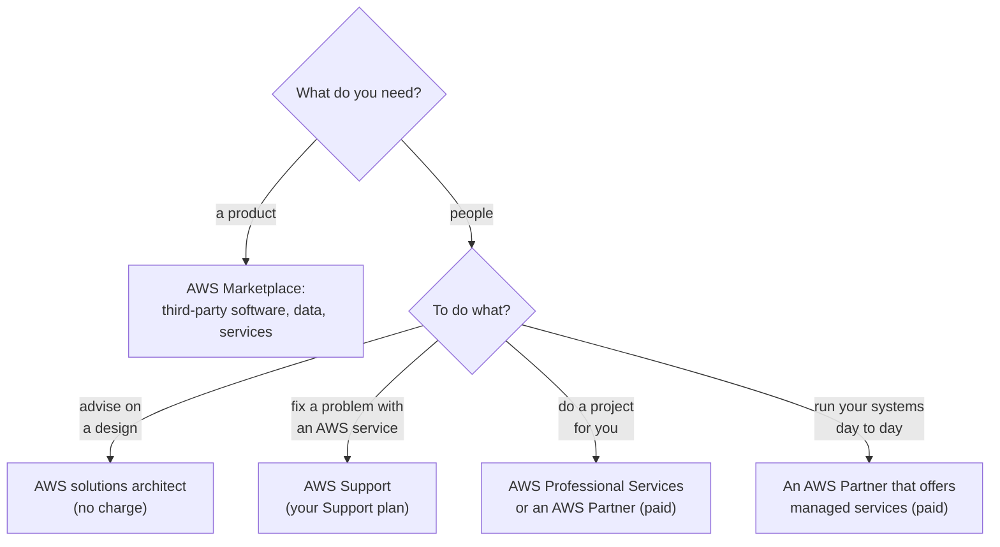

# When you need people, ask who will do the work: Support fixes, solutions architects advise, Professional Services and partners build, and Marketplace sells

Lesson 12.03 found answers on pages. Some jobs need people: someone to review a design, to carry out a migration, or to sell you a product that AWS doesn't make. The exam names four kinds of human help, and they're easy to mix up. By the end you can choose the right one for a need, and say what AWS Marketplace does for the people who buy there.

**For:** an adult studying alone, possibly new to IT, who wants to understand AWS and use it safely. **Time:** about 25 minutes. Reading works on a phone.

**Before you start:** this lesson builds on [Where to find answers](03-where-to-find-answers.md) (the free sources and Support Center), [Finding threats and weaknesses](../09-protecting-and-governing/03-finding-threats-and-weaknesses.md), which introduced AWS Marketplace for security products, and [Shared, inherited and customer-specific](../04-shared-responsibility-and-access/02-shared-inherited-customer-specific.md). The Support plans are in [Support plans](01-support-plans.md). If you skipped any of these, the key terms below give you enough to follow.

## Warm-up: what you remember

Answer from memory before you look anything up.

1. From Module 11, "Paying for AWS": the bakery added the tag `team=web` to its resources this morning. Why doesn't Cost Explorer show costs by team yet?
2. From lesson [09.03](../09-protecting-and-governing/03-finding-threats-and-weaknesses.md): the bakery buys a firewall product through AWS Marketplace. Who configures it?
3. From lesson 04.01: if the bakery hires another company to run its EC2 servers, does responsibility for the servers' operating systems move to AWS?

Feedback

1. **A user-defined tag must be activated as a cost allocation tag** before it appears in the billing tools, and it applies only from then on. Marketplace's cost features rely on the same tags.
2. **The bakery.** Buying through Marketplace changes who you pay, not who configures the product.
3. **No.** The operating system stays on the customer's side of the line; the bakery can hire a company to do that work, but AWS doesn't take it over. The same holds for every kind of paid help in this lesson.

## What you'll learn

By the end of this lesson, you can:

- say what AWS Support, AWS solutions architects, AWS Professional Services and AWS Partners each do, and which of them does hands-on work;
- describe the AWS Partner Network, the exam's two kinds of partner, and what partners get from joining;
- name AWS Marketplace's three services for buyers: cost management, governance and entitlement;
- choose the right kind of help for a need (objective 12.04a).

Try these before you read on. Guess if you're unsure; the answers are in the lesson.

1. Will AWS Support rewrite the part of the bakery's code that makes its database slow?
2. Does it cost anything to ask an AWS solutions architect to look at a design?

## The big picture: product or people, advice or hands-on

Two questions sort most requests. Do you need a **product** or **people**? And if people: do you want **advice**, a **fix** for something AWS runs, or someone to **do the work**?

*Notice that only the last two branches put someone else's hands on your systems. Support and solutions architects help you do the work; they don't do it for you.*

**Long description.** A flowchart starting with "What do you need?". A product leads to AWS Marketplace, for third-party software, data and services. People leads to a second question, "To do what?", with four branches: advise on a design leads to an AWS solutions architect, at no charge; fix a problem with an AWS service leads to AWS Support, under your Support plan; do a project for you leads to AWS Professional Services or an AWS Partner, paid; run your systems day to day leads to an AWS Partner that offers managed services, paid.

## Key terms (skip if you know them)

- **AWS solutions architect:** an AWS technical adviser who helps customers design their systems on AWS. A role, not a product.
- **Account team:** the AWS people assigned to a customer, such as an account manager and a solutions architect.
- **AWS Professional Services:** AWS's own consulting organization, which you hire for projects.
- **AWS Partner:** another company that builds products or offers services for AWS customers, as a member of the **AWS Partner Network (APN)**.
- **Independent software vendor (ISV):** a company that makes and sells its own software, here software that runs on or works with AWS.
- **System integrator:** a company that designs, builds and connects systems for its customers; the exam's word for a partner that sells services rather than software.
- **Entitlement:** your right to use a product you've bought, recorded as a license. Not the everyday sense of "feeling owed something".

## AWS Support fixes problems with AWS; it doesn't build or run your systems

You met AWS Support in lesson 12.03 as the door for your own account. What it covers matters as much as how to reach it. AWS Support helps with AWS services: how to use them, errors from them, and problems with your account. Its scope doesn't include **custom code development, software debugging or system administration**, and Support staff don't log in to your systems ([AWS Support FAQ](https://aws.amazon.com/premiumsupport/faqs/), checked 2026-10-24).

So if the bakery's database is slow because of the bakery's own code, a support engineer can explain the database's metrics and settings, but rewriting the code is the bakery's job, or the job of someone it hires. Lesson 12.01 covers which plans include technical cases, and the higher plans' extras, such as the designated technical account manager that comes with Enterprise Support and Unified Operations ([Getting started with AWS Support](https://docs.aws.amazon.com/awssupport/latest/user/getting-started.html), checked 2026-10-24).

> **Your turn:** Answer the first prequestion. Will AWS Support rewrite the bakery's slow database code? Who could, and why would the answer change nothing about responsibility?

Model answer

No: custom code development and debugging are outside AWS Support's scope. A developer the bakery employs, AWS Professional Services or a partner could rewrite it. Whoever does the work, the code is on the customer's side of the shared responsibility line; hiring help changes who does the task, not whose task it is.

## Solutions architects advise on design, free, through your account team

**AWS solutions architects** are AWS's technical advisers. AWS describes them as a free resource for customers: they review architectures, run Well-Architected reviews (lesson 02.05) as a conversation rather than an audit, sketch designs with you, pass your feature requests to AWS's service teams, and run hands-on learning days. AWS suggests involving one before you build ([Maximizing your cloud journey: Engaging an AWS Solutions Architect](https://aws.amazon.com/blogs/training-and-certification/engaging-a-solutions-architect/), AWS blog, 2024-12-19, checked 2026-10-24).

How you reach one: a new customer fills in AWS's contact form for sales, and a sales representative connects them with a solutions architect; an existing customer asks its **account team**, the AWS people assigned to it. What they don't do is the build itself: for that, they point customers to AWS Professional Services or to partners, and for technical problems, to AWS Support.

> **Dated (checked 2026-10-24):** AWS publishes no product page for solutions architects; what's above comes from an AWS blog post dated 2024-12-19. How you're matched with one can depend on your account and how much you spend with AWS, so ask AWS through its contact form rather than counting on a fixed offer.

## AWS Professional Services does the project for you, for a fee

**AWS Professional Services** is AWS's own consulting organization. You hire it to design, build, migrate and manage workloads on AWS. Its practice areas include data and AI, migration, modernization, and scale and security, and it works alongside AWS Partners, which bring their own industry knowledge and long-term support ([AWS Professional Services](https://aws.amazon.com/professional-services/), checked 2026-10-24). You reach it through AWS's contact form, and some of its offerings are listed in AWS Marketplace.

Professional Services and solutions architects are both AWS people, so they're easy to confuse. The difference is the hands: a solutions architect advises you while you build; Professional Services builds with you or for you, under a contract.

> **Warning:** On AWS's Free plan, creating a Professional Services contract upgrades the account to the Paid plan automatically, and so does joining the AWS Partner Network ([Choosing a plan](https://docs.aws.amazon.com/awsaccountbilling/latest/aboutv2/free-tier-plans.html), checked 2026-10-24). Neither is needed for this guide. Read about them; don't sign up from your lab account.

## AWS Partners are other companies: software vendors and services firms

An **AWS Partner** is a company, not part of AWS, that builds solutions or offers services for AWS customers. Together they form the **AWS Partner Network (APN)**, which AWS describes as a global community with thousands of software and services partners ([AWS Partner Network](https://aws.amazon.com/partners/), checked 2026-10-24).

The exam names two kinds (task [4.3](https://docs.aws.amazon.com/aws-certification/latest/cloud-practitioner-02/cloud-practitioner-02-domain4.html#cloud-practitioner-02-task4.3)):

- **Independent software vendors (ISVs)** make software that runs on or works with AWS, and often sell it through AWS Marketplace. A backup tool, a firewall, or an online accounting app are examples.
- **System integrators** sell services: they design, build, migrate and connect systems for customers. Some also run a customer's systems day to day, as a managed service provider.

AWS itself now groups partners by **Partner Path**, the route a company takes into the APN according to what it offers. There are five (checked 2026-10-24):

*Notice that the exam's two words line up with two of today's five paths, by what each path covers.*

**Long description.** Two columns, the exam's words on the left and today's AWS Partner Paths on the right, joined by arrows. Row 1, highlighted: independent software vendor, ISV, called Technology Partner in older material, maps to the Software Path, for software that runs on or works with AWS; device makers use the Hardware Path. Row 2, highlighted: system integrator, called Consulting Partner in older material, maps to the Services Path, for consulting, professional, managed and resale services. Row 3: no exam term, the Training Path, for companies that sell or deliver AWS training. Row 4: no exam term, the Distribution Path, for distributors that recruit and support resellers. A note says the pairing with the exam's words is ours, joining the AWS Partner Network is free, and on the Free plan, joining upgrades the account to the Paid plan.

The paths and what each one covers come from [AWS Partner Paths](https://aws.amazon.com/partners/paths/). AWS says the paths replaced its older "technology" and "consulting" partner types ([AWS News Blog](https://aws.amazon.com/blogs/aws/aws-partner-network-apn-10-years-and-going-strong/), 2022-04-18), so treat "Technology Partner" and "Consulting Partner" in study material as old names. AWS publishes no table from the old types to the paths: the figure pairs the exam's words with the paths by what each path covers, and that pairing is ours.

**Finding a partner.** Customers search the **AWS Partner Solutions Finder** by industry, use case, workload, solution or AWS Specialization. A partner with an **AWS Specialization** has had its expertise in an area validated by AWS against a technical bar; the specializations include AWS Competency and AWS Managed Service Provider ([Work with an AWS Partner](https://aws.amazon.com/partners/work-with-partners/), checked 2026-10-24).

### What partners get from joining

The exam asks you to recognize the benefits of being a partner (task [4.3](https://docs.aws.amazon.com/aws-certification/latest/cloud-practitioner-02/cloud-practitioner-02-domain4.html#cloud-practitioner-02-task4.3)). From AWS's partner pages (checked 2026-10-24):

- **Training and certification:** partner-only digital and classroom training, so their staff can earn AWS certifications.
- **Events:** partner webinars, workshops and in-person events, and the chance to sponsor AWS Summits.
- **Selling with AWS:** listing products and services in AWS Marketplace, and co-selling with AWS's sales teams.
- **Programs and incentives:** AWS lists funding incentives and reseller programs for partners.

The exam guide also names **partner volume discounts**. AWS's current partner pages list reseller programs and funding incentives but don't publish discount levels, so learn the idea, that partners who resell AWS or buy at scale can get better terms through partner programs, without any figure. Joining the APN itself is free.

> **Check:** A company makes accounting software that runs on AWS and wants to sell it to AWS customers, billed through their AWS bills. In the exam's words, what kind of partner is it, and where would it list the product?
>
> A. A system integrator, in AWS Support Center
> B. An independent software vendor (ISV), in AWS Marketplace
> C. AWS Professional Services, in AWS Marketplace
> D. A solutions architect, in the AWS Partner Solutions Finder

Feedback

**B is right.** It makes and sells its own software; Marketplace bills buyers through their AWS bills.

- **A is wrong.** A system integrator sells services, and Support Center is for support cases.
- **C is wrong.** Professional Services is part of AWS, not a partner.
- **D is wrong.** A solutions architect is an AWS role, not a company.

## AWS Marketplace sells partners' products, with three services for the buyer

Lesson 09.03 met **AWS Marketplace** as the place to buy third-party security products. It's broader than that: a curated catalog of third-party software, data and services, from thousands of listings in categories such as security, networking, storage, machine learning and DevOps. Products come as machine images, software as a service, CloudFormation templates, rules for AWS WAF, and professional services. Pricing can be free, a free trial, hourly, monthly, annual, multi-year, or **bring your own license (BYOL)**, and every charge arrives on your AWS bill, after which AWS pays the seller. A buyer can accept a product's public price or a **private offer**, with pricing and terms negotiated for that buyer ([What is AWS Marketplace?](https://docs.aws.amazon.com/marketplace/latest/buyerguide/what-is-marketplace.html), checked 2026-10-24).

The exam names three things Marketplace does for buyers: cost management, governance and entitlement. They matter most when a company has several accounts in one organization (lesson 09.05):

*Notice the governance limit: Private Marketplace stops people subscribing to unapproved products, but it doesn't control what can be deployed in an account.*

**Long description.** Three columns compared on four rows. Cost management: the question, what is each team spending on Marketplace products; the feature, highlighted, the Procurement insights dashboard and cost allocation tags in Cost Explorer; what it does, shows costs and agreements across the organization's accounts, and tags split usage by team; its limit, tags appear in Cost Explorer only after you activate them. Governance: the question, can staff buy only products we've approved; the feature, Private Marketplace; what it does, approved catalogs per organization, OU or account, and users can request more for admins to approve; its limit, it blocks new subscriptions only and doesn't control what can be deployed. Entitlement: the question, who may use what we bought, and where; the feature, licenses created at subscription, shared through AWS License Manager; what it does, shares subscriptions with other accounts in the organization and tracks license use; its limit, sharing covers machine image, container, machine learning and data products.

- **Cost management:** the **Procurement insights** dashboard shows Marketplace costs and agreements for all the accounts in an organization, and cost allocation tags let Cost Explorer split Marketplace usage, for example by team ([Managing costs](https://docs.aws.amazon.com/marketplace/latest/buyerguide/cost-and-procurement-insights.html)).
- **Governance:** **Private Marketplace** lets administrators give each part of the organization a catalog of approved products. Users can still browse everything and request more; administrators approve or decline. It blocks new subscriptions to unapproved products, but it doesn't stop existing subscriptions or control what can be deployed ([Private Marketplace](https://docs.aws.amazon.com/marketplace/latest/buyerguide/private-marketplace-current.html)).
- **Entitlement:** subscribing creates licenses automatically. Through **AWS License Manager**, a company can share those subscriptions with its other accounts, track license use, and switch license types without redeploying ([Managing licenses in AWS Marketplace](https://docs.aws.amazon.com/marketplace/latest/buyerguide/managing-licenses.html)).

All three were checked on 2026-10-24. A product bought here is still yours to configure and secure, as lesson 09.03 said.

> **Dated (checked 2026-10-24):** On AWS's Free plan, certain AWS Marketplace offers that can incur charges aren't available until you upgrade ([Choosing a plan](https://docs.aws.amazon.com/awsaccountbilling/latest/aboutv2/free-tier-plans.html)). Lab 17 only looks at a listing; it subscribes to nothing.

> **Your turn:** The bakery now has three accounts in one organization. The owner wants three things: staff may buy only an approved backup product; the backup product's cost should show per account; and the license bought once in the production account should also cover the test account. Name the Marketplace feature for each.

Model answer

**Private Marketplace** for the approved product (governance); the **Procurement insights** dashboard, and cost allocation tags in Cost Explorer, for cost per account and team (cost management); **sharing the license through AWS License Manager** with the test account (entitlement). Note that Private Marketplace blocks new subscriptions to unapproved products; it doesn't stop someone deploying software from elsewhere, so the bakery still needs its IAM permissions (lesson 04.04).

## Professional Services, partners, Support or a solutions architect: compare them side by side

*Notice the highlighted row. Exam questions about "who can help" usually turn on whether the customer wants advice or wants the work done.*

**Long description.** Four columns compared on five rows. Who they are: AWS Support, AWS's support engineers; solutions architects, AWS technical advisers on your account team; Professional Services, AWS's own consulting experts; partners, other companies in the AWS Partner Network. What they do: Support answers cases about problems with AWS services and your account; solutions architects advise on design, such as architecture and Well-Architected reviews; Professional Services designs, builds, migrates and manages workloads as a project; services partners deliver projects and run systems, and software partners sell products. Do the hands-on work, highlighted: Support, no, they guide you and don't write or debug your code or run your systems; solutions architects, no, they advise and point you to people who build; Professional Services, yes, on a project you hire them for; partners, yes for services partners, under your contract with them. What it costs you: Support, your Support plan, and Basic is free; solutions architects, no charge; Professional Services, a paid contract, with some offerings sold in AWS Marketplace; partners, the partner's own prices, and many sell in AWS Marketplace. How you reach them: a case in Support Center; your account team or AWS's contact form; AWS's contact form or AWS Marketplace; AWS Partner Solutions Finder or AWS Marketplace.

| | AWS Support | Solutions architects | AWS Professional Services | AWS Partners |
|---|---|---|---|---|
| **Part of AWS?** | Yes | Yes | Yes | No |
| **Does the work?** | No | No | Yes | Yes (services partners) |
| **Cost** | Support plan | No charge | Paid contract | Partner's prices |
| **Choose when** | Something AWS runs is misbehaving | You want a design checked | You want AWS's experts to deliver a project | You want a project, a product, or day-to-day operations from another company |

**What's the same:** all four are ways to get expert help with AWS, and none of them changes the shared responsibility line. **What differs:** whether they're AWS or another company, whether they do the work, and how you pay. **The principle:** advice is free or included; hands-on work is bought. A solutions architect often starts the conversation and then points you to Support, Professional Services or a partner.

Two more names you may see as wrong answers: **AWS Managed Services (AMS)**, in which AWS operates a customer's infrastructure for an extra fee, and AWS IQ, a service for hiring outside experts that older material describes and that AWS discontinued on 2026-05-28 (checked 2026-10-24). The exam guide lists both as out of scope.

> **Check:** Answer the second prequestion. The bakery wants an expert at AWS to look over its design before its busiest sales week. It has no budget for consultants. What's the best first step?
>
> A. Buy AWS Professional Services
> B. Ask AWS, through its contact form or the bakery's account team, for a solutions architect, and run the Well-Architected Tool meanwhile
> C. Open a Basic plan technical support case
> D. Hire an AWS Partner from Marketplace

Feedback

**B is right.** Solutions architects advise at no charge, and the Well-Architected Tool is free to use.

- **A is wrong.** Professional Services is a paid engagement, and more than a review needs.
- **C is wrong.** The Basic plan can't open technical cases, and Support fixes problems rather than reviewing designs.
- **D is wrong.** A partner can review a design, but at the partner's prices.

## Worked example: five requests, five kinds of help

The bakery's site is now business-critical, and the owner brings five requests. The expert asks two questions each time: product or people, and advice or hands-on work?

| Request | Product or people? | Advice or hands-on? | Choose |
|---|---|---|---|
| "Check our design before our busiest week." | People | Advice | A **solutions architect** (no charge), with the Well-Architected Tool |
| "Our RDS database stopped accepting connections." | People | A fix for an AWS service | **AWS Support**, a technical case (paid plan; lesson 12.01) |
| "Move the head office's on-premises servers to AWS in three months." | People | Hands-on project | **AWS Professional Services** or a **services partner** (system integrator) |
| "We need a better web firewall rule set." | Product | — | **AWS Marketplace**: an ISV's managed rule group for AWS WAF |
| "Watch and patch our servers at night." | People | Hands-on, ongoing | A **partner** that offers managed services |

The expert's thinking, step by step:

1. **Product first.** The firewall rules are a product; Marketplace sells it and bills it on the AWS bill. The bakery still configures it.
2. **Advice is cheap; use it early.** The design check needs no contract. A solutions architect advises, and the Well-Architected Tool records the review.
3. **A fix for AWS's service is Support's job.** The database problem is a technical case, which is one reason lesson 12.01 recommends a paid plan for a business-critical site.
4. **Hands-on work is bought.** The migration is a project, so it goes to Professional Services or a partner. Night-time operations are ongoing work, which partners that offer managed services provide; AWS Support doesn't run systems.

> **Your turn:** A teammate says, "We pay for Business Support+, so AWS Support will migrate our servers for us." Correct this in two sentences, and say who could.

Model answer

AWS Support helps with problems using AWS services, but migrating and running the bakery's systems is outside its scope. A migration is a project for AWS Professional Services or a services partner, hired separately; a solutions architect can help plan it.

## In real work: buy help where it changes the outcome

Teams use free advice early, buy hands-on help for work they can't staff, and check what each contract really costs. The Well-Architected Framework names these habits:

- [PERF01-BP02 Use guidance from your cloud provider or an appropriate partner to learn about architecture patterns and best practices](https://docs.aws.amazon.com/wellarchitected/latest/performance-efficiency-pillar/perf_architecture_guidance_architecture_patterns_best_practices.html): it names solutions architects, AWS Professional Services and AWS Partners as the people to ask.
- [COST07-BP03 Select third-party agreements with cost-efficient terms](https://docs.aws.amazon.com/wellarchitected/latest/cost-optimization-pillar/cost_pricing_model_third_party.html): check that a product's or a partner's pricing grows with the value it gives, which applies to anything bought in Marketplace.
- [OPS03-BP06 Team members are encouraged to maintain and grow their skill sets](https://docs.aws.amazon.com/wellarchitected/latest/operational-excellence-pillar/ops_org_culture_team_enc_learn.html): hired help works best when your own team learns alongside it.

> **Note:** Going deeper, beyond the exam guide. The exam asks about training and certification only as a partner benefit. Anyone can use **AWS Skill Builder**, AWS's platform for digital training: AWS says it offers more than 600 free digital courses, with hands-on labs in a paid subscription, alongside classroom training and the certification exams ([AWS Training and Certification](https://aws.amazon.com/training/), checked 2026-10-24).

## Summary

- **AWS Support fixes problems with AWS services and your account.** It doesn't develop or debug your code or administer your systems.
- **Solutions architects advise on design, at no charge,** through your account team or AWS's contact form; they don't build.
- **AWS Professional Services is AWS's own consulting team,** hired under a contract to design, build, migrate and manage workloads.
- **AWS Partners are other companies in the AWS Partner Network:** ISVs sell software, system integrators sell services. Partners get training and certification, events, selling with AWS, and programs and incentives; joining is free.
- **AWS Marketplace sells third-party software, data and services on your AWS bill,** with cost management (Procurement insights, tags), governance (Private Marketplace) and entitlement (licenses shared through License Manager).

**For the bakery:** the design check goes to a solutions architect, the database outage to Support, the migration to Professional Services or a partner, the firewall rules to Marketplace, and night-time operations to a partner that offers managed services.

## Practice

1. **Which option gives a company AWS's own experts to carry out a migration project under a contract?**

   A. AWS Support
   B. AWS Professional Services
   C. AWS re:Post
   D. AWS Trusted Advisor

   

Feedback

   **B is right.** Professional Services is AWS's consulting organization.

   - **A is wrong.** Support helps with problems using AWS services; it doesn't run projects.
   - **C is wrong.** re:Post is a public Q&A site.
   - **D is wrong.** Trusted Advisor checks your account against best practices (lesson 12.02); it does no work for you.

   

2. **A company wants to make sure employees in its 40 AWS accounts can subscribe only to approved third-party products. Which AWS Marketplace feature does this?**

   

Feedback

   **Private Marketplace**, the governance feature: administrators set catalogs of approved products for the organization, its OUs or its accounts, and new subscriptions to anything else are blocked. It doesn't control what can be deployed, so IAM permissions still matter.

   

3. **Which TWO are benefits AWS offers companies that join the AWS Partner Network?**

   A. Free AWS Support at the Unified Operations level
   B. Partner training and certification
   C. Partner events such as webinars and workshops
   D. AWS takes over responsibility for the partner's customers' data
   E. A free AWS Professional Services engagement for each customer

   

Feedback

   **B and C are right.** AWS's partner pages list training and certification, events, selling with AWS, and programs and incentives.

   - **A is wrong.** Support plans are bought separately; a free plan isn't a partner benefit AWS lists.
   - **D is wrong.** Customer data stays on the customer's side of the shared responsibility line.
   - **E is wrong.** Professional Services is a separate, paid AWS offering.

   

4. **In two sentences, explain the difference between an AWS solutions architect and AWS Professional Services.**

   

Feedback

   **Model answer:** A solutions architect is an AWS adviser who reviews and recommends designs at no charge, but doesn't build them. Professional Services is AWS's consulting organization that you hire, under a contract, to design, build, migrate or manage workloads for you.

   

5. **(From lesson 12.03.) An address in AWS's published IP ranges is flooding the bakery's login page. Where does the report go?**

   

Feedback

   **AWS Trust & Safety, through the abuse form,** with timestamps and log samples. AWS Support can't take abuse reports; meanwhile the bakery blocks the traffic itself.

   

6. **(From lesson 04.02.) Patch management is a shared control. If the bakery hires a partner to patch its EC2 servers, does the customer's half of that control move to AWS?**

   

Feedback

   **No.** AWS patches its own infrastructure, and patching the guest operating systems stays the customer's half. Hiring a partner changes who does the patching, not whose responsibility it is.

   

**Next:** try the [Support plan chooser](06-sim-support-plan-chooser.md) to put this module's choices together, and look at a Marketplace listing in [Lab 17: a Support Center tour](05-lab-17-support-center-tour.md).

## Where to check the current details

- [AWS Certified Cloud Practitioner (CLF-C02) exam guide](https://docs.aws.amazon.com/aws-certification/latest/cloud-practitioner-02/cloud-practitioner-02.html), task [4.3](https://docs.aws.amazon.com/aws-certification/latest/cloud-practitioner-02/cloud-practitioner-02-domain4.html#cloud-practitioner-02-task4.3) (checked 2026-10-24)
- [AWS Support FAQ](https://aws.amazon.com/premiumsupport/faqs/): what Support covers (checked 2026-10-24)
- [Maximizing your cloud journey: Engaging an AWS Solutions Architect](https://aws.amazon.com/blogs/training-and-certification/engaging-a-solutions-architect/), AWS blog, 2024-12-19 (checked 2026-10-24)
- [AWS Professional Services](https://aws.amazon.com/professional-services/) (checked 2026-10-24)
- [AWS Partner Network](https://aws.amazon.com/partners/), [AWS Partner Paths](https://aws.amazon.com/partners/paths/), [partner programs](https://aws.amazon.com/partners/programs/) and [Work with an AWS Partner](https://aws.amazon.com/partners/work-with-partners/) (checked 2026-10-24)
- [What is AWS Marketplace?](https://docs.aws.amazon.com/marketplace/latest/buyerguide/what-is-marketplace.html), [Managing costs](https://docs.aws.amazon.com/marketplace/latest/buyerguide/cost-and-procurement-insights.html), [Private Marketplace](https://docs.aws.amazon.com/marketplace/latest/buyerguide/private-marketplace-current.html) and [Managing licenses](https://docs.aws.amazon.com/marketplace/latest/buyerguide/managing-licenses.html), AWS Marketplace Buyer Guide (checked 2026-10-24)
- [Choosing a plan](https://docs.aws.amazon.com/awsaccountbilling/latest/aboutv2/free-tier-plans.html), AWS Billing User Guide: what upgrades a Free plan (checked 2026-10-24)
- [AWS Training and Certification](https://aws.amazon.com/training/) (checked 2026-10-24)

---

"Partners and paid help" by Automate the Cloud Inc., licensed under CC BY-NC 4.0 with the Additional Permission for Internal Training from Automate the Cloud Inc.
License: https://creativecommons.org/licenses/by-nc/4.0/
Permission: https://automatethe.cloud/licenses/atc-internal-training-permission.txt
