# Lab 17: Tour the help every AWS account gets, on the Basic plan

## Before you start: your account, your responsibility

This guide is provided as is, without warranty. We work hard to keep it correct and current, but AWS changes often, and its services, prices, and free offers may differ from what is written here. The labs run in your own AWS account. You are responsible for that account, for its security, and for any charges it incurs, including charges from resources you forget to delete. Automate the Cloud Inc. is not liable for any costs, losses, or security incidents that result from following, or failing to follow, this material. Technical guidance here is general information, not advice about your specific systems.

**Who this is for:** you have done [Lab 02](../03-aws-around-the-world/05-lab-02-see-the-global-infrastructure.md) and the guardrails primer, and read this module's lessons: [Support plans](01-support-plans.md), [Tools that watch your account](02-tools-that-watch-your-account.md), [Where to find answers](03-where-to-find-answers.md) and [Partners and paid help](04-partners-and-paid-help.md). **Time:** about 45 minutes.

**Goal:** before recommending a paid Support plan for the bakery, find out what every account already gets for free. You visit six places, note what each offers on the Basic plan, and route the bakery's five issues. **End state:** notes in your lab log, and nothing created, bought or submitted.

```mermaid
flowchart LR
  accTitle: The six stops of Lab 17
  accDescr: Check which Support plan the account is on, look at the case types in Support Center, check AWS Health, read the free Trusted Advisor checks, read one Knowledge Center article, and open one AWS Marketplace listing. Every stop only reads. Then route the bakery's five issues and confirm nothing was created.
  A["1 Support Plans:<br/>which plan am I on?"] --> B["2 Support Center:<br/>which case types?"]
  B --> C["3 AWS Health:<br/>is it AWS or us?"]
  C --> D["4 Trusted Advisor:<br/>free checks → pillars"]
  D --> E["5 Knowledge Center:<br/>one article"]
  E --> F["6 Marketplace:<br/>one listing, no purchase"]
  F --> G["Route the five issues;<br/>confirm nothing created"]
```

*Notice that every stop only reads. Two of them have a button that costs money, and the steps say which.*

**Long description.** Seven boxes from left to right: the Support Plans console (which plan), Support Center (which case types), AWS Health (AWS's problem or yours), Trusted Advisor (free checks mapped to pillars), the Knowledge Center (one article), AWS Marketplace (one listing, no purchase), and last, routing the five issues and confirming nothing was created.

**What it creates:** nothing. **What it costs:** $0; these pages are free to look at. **Worst case on a Paid plan:** still $0, unless you press a button this lab tells you not to.

> **Warning:** two buttons in this lab spend money. **Upgrading the Support plan** starts a monthly fee: Business Support+ is at least $29 a month per account, with a 30-day minimum (as of 2026-10-24, [AWS Support pricing](https://aws.amazon.com/premiumsupport/pricing/)). It doesn't need the root user, so your admin user can do it by accident. **Subscribing in AWS Marketplace** can add the seller's charges to your AWS bill. On the Free plan, AWS also blocks "certain AWS Marketplace offers" ([Choosing a plan](https://docs.aws.amazon.com/awsaccountbilling/latest/aboutv2/free-tier-plans.html), checked 2026-10-23). We haven't tested what a Support plan upgrade does to a Free plan account. Never choose **Upgrade plan**, **Upgrade**, **Get started**, **Confirm upgrade**, **Request Offer**, **Subscribe** or **View purchase options** in this lab. If a page asks you to agree to subscription terms, you have gone too far: leave the page.

**Before you start, you need these guardrails in place:** [root MFA](https://github.com/AutomateTheCloud/atc-study-aws_account_guardrails/blob/main/primer/02-secure-the-root-user.md) (primer page 02), [an IAM admin user with MFA](https://github.com/AutomateTheCloud/atc-study-aws_account_guardrails/blob/main/primer/03-your-everyday-admin-identity.md), which you use for this lab (page 03), [budgets and billing alerts](https://github.com/AutomateTheCloud/atc-study-aws_account_guardrails/blob/main/primer/05-money-alarms.md) (page 05), [the safe defaults](https://github.com/AutomateTheCloud/atc-study-aws_account_guardrails/blob/main/primer/06-safe-defaults.md), where you first refreshed Trusted Advisor (page 06), and [the habits for every lab](https://github.com/AutomateTheCloud/atc-study-aws_account_guardrails/blob/main/primer/07-habits-for-every-lab.md) (page 07).

**Why this matters:** knowing in advance where each kind of problem goes, and who answers, is [OPS10-BP04 Define escalation paths](https://docs.aws.amazon.com/wellarchitected/latest/operational-excellence-pillar/ops_event_response_define_escalation_paths.html). Choosing a Support plan that fits before production depends on it is [OPS07-BP06 Create support plans for production workloads](https://docs.aws.amazon.com/wellarchitected/latest/operational-excellence-pillar/ops_ready_to_support_enable_support_plans.html).

> **New sign-up path:** AWS lists Trusted Advisor as not supported there (as of 2026-10-23, [Supported AWS services](https://docs.aws.amazon.com/accounts/latest/reference/supported-services-sign-up-new.html)). We haven't run this lab on that path. Do the stops that open for you, and use the screenshots in steps 9 and 12 for Trusted Advisor. Steps 14 to 16 need no AWS account.

**About the screens:** the Trusted Advisor screens are what our test account showed on 2026-10-23, on the Free plan with Basic Support. The other labels come from AWS's documentation. We haven't yet run this lab end to end, so if a label differs, look for the option with the same meaning.

## Steps

### Get ready

1. In your lab log, write today's date, the Region `us-east-1`, and "Lab 17: nothing created". Under it, copy this table; you fill the last column in the Recap.

   | Issue at the bakery | Where it goes |
   |---|---|
   | 1. "There's a charge on our bill we don't recognize." | |
   | 2. "How do we make the photo bucket delete old versions?" | |
   | 3. "Before our busiest week, can someone check that our design will hold up?" | |
   | 4. "Something on an AWS IP address keeps hammering our login page." | |
   | 5. "The site is slow, and we think AWS may be having an outage." | |

2. Sign in as your **IAM admin user**, not the root user, and check that the Region selector shows N. Virginia.

### Stop 1: which Support plan are you on?

3. Go to the **AWS Support Plans console**, the page that shows your plan and where plans are changed: `https://console.aws.amazon.com/support/plans/home` ([Change AWS Support Plans](https://docs.aws.amazon.com/awssupport/latest/user/changing-support-plans.html)).
   **You should see:** your current plan, **Basic**, beside the paid plans. This is the page where plans are changed, so only read it: don't choose any button in the paid plans' sections.
4. If the page offers a **Pricing calculator**, choose Business Support+ and enter `1200`, the bakery's grown monthly AWS bill in this module (made up). The calculator only shows an estimate; it changes nothing. Write the estimate in your lab log. If there is no calculator, work it out by hand from the dated prices in [12.01](01-support-plans.md).
   **You should see:** about **$108 a month**: the greater of $29 or 9% of a bill under $10,000 (as of 2026-10-24, [AWS Support pricing](https://aws.amazon.com/premiumsupport/pricing/)).

### Stop 2: which cases can you open?

A **support case** is a request you open with AWS Support and follow in Support Center until it's resolved.

5. In the console, choose the question mark icon at the top right, then **Support Center**.
   **You should see:** Support Center. In N. Virginia it may first ask you to describe your issue and offer AI-generated troubleshooting before any case form ([AI-enhanced troubleshooting](https://docs.aws.amazon.com/awssupport/latest/user/ai-enhanced-support.html), checked 2026-10-24).
6. Choose the option to create a case (or describe a made-up billing question until the page offers one), and look at the case types.
   **You should see:** **Account and billing** and **service limit increase** requests, open to every account, and **Technical**, which Basic can't open ([Case management](https://docs.aws.amazon.com/awssupport/latest/user/case-management.html)). The quota request may be a link such as **Looking for service quota increases?**. Write which types you can choose.
7. Stop here. Choose **Discard draft**, **Cancel** or simply leave the page; don't submit.
   > **If something went wrong:** if you submitted a case by mistake, open it in Support Center and reply that it was opened in error and can be closed. An account and billing case costs nothing.

A genuine account or billing question belongs here, free. Never open a case just to practice: real people answer them.

### Stop 3: is it AWS or us?

8. Open the **AWS Health Dashboard**, as in [Lab 02, steps 13 to 15](../03-aws-around-the-world/05-lab-02-see-the-global-infrastructure.md#look-at-the-aws-health-dashboard): your account's events, then **Service health** for `us-east-1`.
   **You should see:** account events (probably none) and AWS's public events for N. Virginia, if any. Finish this line in your log: "If the site is slow, I look here first, because…".

The dashboard is free for every account. The **AWS Health API**, which lets the bakery's own tools read the same events, needs Business Support+, Enterprise or Unified Operations ([AWS Health API](https://docs.aws.amazon.com/health/latest/ug/health-api.html), checked 2026-10-24).

### Stop 4: the free Trusted Advisor checks, mapped to pillars

9. In the console search bar, type `Trusted Advisor` and open it.
   **You should see:** **Trusted Advisor Recommendations**, a checks summary, and a box offering all checks with an **Upgrade** button. Don't choose it: it buys a paid Support plan.

   

   *Screenshot: Trusted Advisor on Basic Support, captured 2026-10-23 in our test account. Notice the six categories on the left and the Upgrade box. AWS console screenshots are AWS material used as limited fair use and are not covered by this guide's license.*

10. Write the six categories from the left menu in your lab log: on 2026-10-23 they were Cost optimization, Performance, Security, Fault tolerance, Service limits and Operational excellence.
11. Choose **Refresh all checks**. On Basic, checks don't refresh on their own; you refresh the Security checks by hand ([AWS Trusted Advisor](https://docs.aws.amazon.com/awssupport/latest/user/trusted-advisor.html)).
12. Choose **Security**.
    **You should see:** a few checks you can open, then the Upgrade box, then paid checks shown faded.

    

    *Screenshot: the Security checks open on Basic Support, captured 2026-10-23 in our test account; the two snapshot checks show green. AWS console screenshots are AWS material used as limited fair use and are not covered by this guide's license.*

    > **If something went wrong:** if **MFA on Root Account** turns red after the refresh, the root user has no MFA. Fix that today with [primer page 02](https://github.com/AutomateTheCloud/atc-study-aws_account_guardrails/blob/main/primer/02-secure-the-root-user.md).
13. Open **Fault tolerance**, then **Service limits**. Basic gets one fault tolerance check, on AWS STS global endpoint usage, and every service limits check ([check reference](https://docs.aws.amazon.com/awssupport/latest/user/trusted-advisor-check-reference.html), checked 2026-10-24); these turn yellow at 80% of a quota ([Service limits](https://docs.aws.amazon.com/awssupport/latest/user/service-limits.html)).
14. Trusted Advisor's categories are not the Well-Architected pillars, although some share a name. Copy and finish this table: name the pillar each free check serves.

    | Free check (category) | What it looks for | Pillar | A best practice it supports |
    |---|---|---|---|
    | MFA on Root Account (Security) | Root user without MFA | Security | [SEC01-BP02 Secure account root user and properties](https://docs.aws.amazon.com/wellarchitected/latest/security-pillar/sec_securely_operate_aws_account.html) |
    | Amazon S3 Bucket Permissions (Security) | Buckets open to everyone | ? | [SEC03-BP07 Analyze public and cross-account access](https://docs.aws.amazon.com/wellarchitected/latest/security-pillar/sec_permissions_analyze_cross_account.html) |
    | Security Groups - Specific Ports Unrestricted (Security) | Ports open to `0.0.0.0/0` | ? | ? |
    | Service limits checks (Service limits) | Usage past 80% of a quota | ? | ? |
    | STS global endpoint usage (Fault tolerance) | Calls that depend on one Region's endpoint | ? | ? |

Model answer

- **S3 Bucket Permissions:** Security.
- **Security Groups - Specific Ports Unrestricted:** Security; [SEC05-BP02 Control traffic flow within your network layers](https://docs.aws.amazon.com/wellarchitected/latest/security-pillar/sec_network_protection_layered.html), as in Module 07.
- **Service limits:** Reliability; [REL01-BP01 Aware of service quotas and constraints](https://docs.aws.amazon.com/wellarchitected/latest/reliability-pillar/rel_manage_service_limits_aware_quotas_and_constraints.html): a quota hit in the busiest week stops the site growing.
- **STS global endpoint usage:** Reliability; the nearest fit is [REL10-BP01 Deploy the workload to multiple locations](https://docs.aws.amazon.com/wellarchitected/latest/reliability-pillar/rel_fault_isolation_multiaz_region_system.html): it flags calls that depend on N. Virginia when they could stay in their own Region.

Two categories map to Reliability, and none to Sustainability: the free checks serve mainly two of the six pillars. A page of green checks isn't a Well-Architected review.

### Stop 5: one Knowledge Center article

The **AWS Knowledge Center** is a set of AWS-written articles answering common questions, hosted on AWS re:Post with an AWS Official badge since 2023 ([announcement](https://aws.amazon.com/about-aws/whats-new/2023/03/aws-re-post-includes-knowledge-center-articles/)).

15. Go to `https://repost.aws/knowledge-center` and search for `report abuse of AWS resources`. Open the article on reporting abuse ([Report abuse of AWS resources](https://aws.amazon.com/premiumsupport/knowledge-center/report-aws-abuse/), checked 2026-10-24).
    **You should see:** the AWS abuse form, what to include, and a note that AWS Support doesn't handle abuse reports. Write the three things it asks for about network activity. Don't submit the form.
16. **Challenge.** On your own, find an AWS-written answer to issue 2 in your table, in the Knowledge Center or AWS documentation. Write its title, who wrote it, and when it was last updated.

Model answer

Any AWS page about **S3 Lifecycle rules** that expire noncurrent (old) versions after a set number of days answers it (you made one in [Lab 05](../05-storing-data/07-lab-05-versions-and-lifecycle.md)). Prefer AWS Official articles and documentation to community answers, and check the date: an article older than a feature change may be stale. For step 15: the target IP address, the time with its time zone, and samples of your logs.

### Stop 6: one Marketplace listing, no purchase

A **product detail page** is AWS Marketplace's page for one product: what it is, who sells it, how it's delivered and how it's priced.

17. In the console search bar, type `Marketplace` and open **AWS Marketplace**. Choose the option to discover or browse products, and search for `WAF rules`.
18. Open one listing's product detail page. Write its seller, how it's delivered (for example SaaS or a rule group for AWS WAF), and its pricing model (free trial, hourly, monthly, annual or BYOL).
    **You should see:** pricing and terms set by the seller. Charges for a subscription would appear on your AWS bill ([What is AWS Marketplace?](https://docs.aws.amazon.com/marketplace/latest/buyerguide/what-is-marketplace.html), checked 2026-10-24).
    > **Warning:** **View purchase options** starts a subscription ([SaaS usage-based subscriptions](https://docs.aws.amazon.com/marketplace/latest/buyerguide/saas-subscriptions.html)). Stop at the product detail page.

## Check your work

- [ ] Your lab log names your plan (Basic) and the Business Support+ estimate for a $1,200 bill.
- [ ] It lists the case types you could and couldn't choose.
- [ ] It has the six Trusted Advisor categories and your finished pillar table.
- [ ] It has the abuse article's three items, your challenge article, and one Marketplace listing's seller, delivery and pricing.

## Clean up

Nothing was created, but confirm it, as in every lab.

19. **Support plan:** reload the Support Plans console. **You should see:** still **Basic**.
    > **If something went wrong:** if the page shows Business Support+, an upgrade went through. To go back, choose **Review downgrade** in the Basic Support section ([Change AWS Support Plans](https://docs.aws.amazon.com/awssupport/latest/user/changing-support-plans.html), checked 2026-10-24). You still pay for at least one month of the paid plan, so note the date and check your bill.
20. **Cases:** in Support Center, open your case history. **You should see:** no case from today, unless you meant to open one.
21. **Marketplace:** in AWS Marketplace, open the page that lists your subscriptions (for example **Manage subscriptions**). **You should see:** none.
22. **Confirm:** in Tag Editor, search all Regions and all resource types for `lab` = `17`, as in [Lab 02, step 16](../03-aws-around-the-world/05-lab-02-see-the-global-infrastructure.md#clean-up). Expect no resources. Tick "Lab 17: nothing created" in your lab log.

## Recap

Basic already gives you billing help, quota requests, AWS Health, a few Trusted Advisor checks and AWS's articles. A paid plan adds technical cases, every check and the Health API.

> **Reflect:** fill the last column of the table from step 1, using only what you saw today. For each issue, say where it goes, and whether Basic is enough.
>
> 

Model answer

>
> 1. **Unknown charge:** an account and billing case in Support Center, free on every plan. Basic is enough.
> 2. **How-to:** AWS documentation, the Knowledge Center or re:Post. Basic is enough; a technical case would need a paid plan.
> 3. **Design review:** not Trusted Advisor. A free Well-Architected Tool review by the owner, an AWS solutions architect at no charge, or a paid review by an AWS Partner ([12.04](04-partners-and-paid-help.md)). Enterprise Support includes reviews, but at a price far above what the bakery needs ([12.01](01-support-plans.md)).
> 4. **Hammering from an AWS address:** the AWS abuse form, to AWS Trust & Safety, not AWS Support. Basic is enough.
> 5. **Slow site, suspected AWS outage:** the Health Dashboard first. If the site is down and AWS shows nothing, only a paid plan lets you open a business-critical technical case.
>
> Issues 3 and 5 are where Basic runs out: that's the plan choice in the simulation.
>
> 

**Next:** choose a plan for the bakery and four other businesses in [Simulation S15](06-sim-support-plan-chooser.md).

## Where to check the current details

- [Case management](https://docs.aws.amazon.com/awssupport/latest/user/case-management.html), [Change AWS Support Plans](https://docs.aws.amazon.com/awssupport/latest/user/changing-support-plans.html) and [AWS Support pricing](https://aws.amazon.com/premiumsupport/pricing/) (checked 2026-10-24)
- [AWS Trusted Advisor check reference](https://docs.aws.amazon.com/awssupport/latest/user/trusted-advisor-check-reference.html) and [AWS Health API](https://docs.aws.amazon.com/health/latest/ug/health-api.html) (checked 2026-10-24)
- [Report abuse of AWS resources](https://aws.amazon.com/premiumsupport/knowledge-center/report-aws-abuse/) and [What is AWS Marketplace?](https://docs.aws.amazon.com/marketplace/latest/buyerguide/what-is-marketplace.html) (checked 2026-10-24)

---

"Lab 17: Tour the help every AWS account gets, on the Basic plan" by Automate the Cloud Inc., licensed under CC BY-NC 4.0 with the Additional Permission for Internal Training from Automate the Cloud Inc.
License: https://creativecommons.org/licenses/by-nc/4.0/
Permission: https://automatethe.cloud/licenses/atc-internal-training-permission.txt
