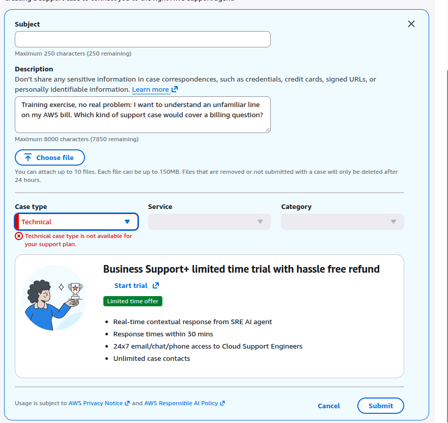
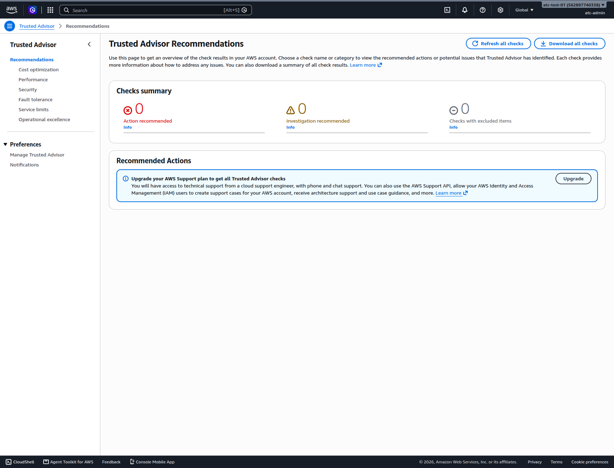
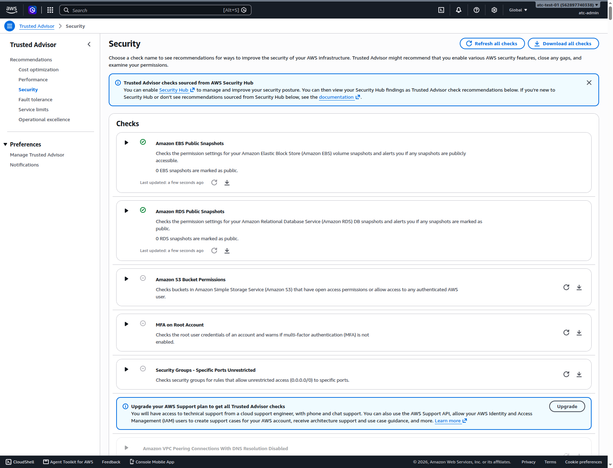

# Lab 17: Tour the help every AWS account gets, on the Basic plan

**Exam guide:** [Domain 2, Security and Compliance](https://docs.aws.amazon.com/aws-certification/latest/cloud-practitioner-02/cloud-practitioner-02-domain2.html) (30% of the exam): task [2.4](https://docs.aws.amazon.com/aws-certification/latest/cloud-practitioner-02/cloud-practitioner-02-domain2.html#cloud-practitioner-02-task2.4); [Domain 3, Cloud Technology and Services](https://docs.aws.amazon.com/aws-certification/latest/cloud-practitioner-02/cloud-practitioner-02-domain3.html) (34% of the exam): task [3.8](https://docs.aws.amazon.com/aws-certification/latest/cloud-practitioner-02/cloud-practitioner-02-domain3.html#cloud-practitioner-02-task3.8); [Domain 4, Billing, Pricing, and Support](https://docs.aws.amazon.com/aws-certification/latest/cloud-practitioner-02/cloud-practitioner-02-domain4.html) (12% of the exam): task [4.3](https://docs.aws.amazon.com/aws-certification/latest/cloud-practitioner-02/cloud-practitioner-02-domain4.html#cloud-practitioner-02-task4.3).

## Before you start: your account, your responsibility

This guide is provided as is, without warranty. We work hard to keep it correct and current, but AWS changes often, and its services, prices, and free offers may differ from what is written here. The labs run in your own AWS account. You are responsible for that account, for its security, and for any charges it incurs, including charges from resources you forget to delete. Automate the Cloud Inc. is not liable for any costs, losses, or security incidents that result from following, or failing to follow, this material. Technical guidance here is general information, not advice about your specific systems.

**Who this is for:** you have done [Lab 02](../03-aws-around-the-world/05-lab-02-see-the-global-infrastructure.md) and the guardrails primer, and read this module's three lessons, from [Support plans](01-support-plans.md) to [Where to find answers and who can help](03-where-to-find-answers.md). **Time:** about 40 minutes.

**Goal:** before recommending a paid Support plan for the bakery, find out what every account already gets for free, in six places, and route the bakery's five issues. **End state:** notes in your lab log, and nothing created, bought or submitted.

**What it creates:** nothing. **What it costs:** $0; these pages are free to look at. **Worst case on a Paid plan:** still $0, unless you press a button this lab tells you not to.

> **Warning:** two buttons in this lab spend money. **Upgrading the Support plan** starts a monthly fee: Business Support+ is at least $29 a month per account, with a 30-day minimum (as of 2026-10-24, [AWS Support pricing](https://aws.amazon.com/premiumsupport/pricing/)). It doesn't need the root user, so your admin user can do it by accident. **Subscribing in AWS Marketplace** can add the seller's charges to your AWS bill. On the Free plan, AWS also blocks "certain AWS Marketplace offers" ([Choosing a plan](https://docs.aws.amazon.com/awsaccountbilling/latest/aboutv2/free-tier-plans.html), checked 2026-10-23), and a Support upgrade starts with an upgrade to the Paid plan (as of 2026-10-25). Never choose **Upgrade plan**, **Upgrade**, **Get started**, **Start trial**, **Try for free**, **Confirm upgrade**, **Request Offer**, **Subscribe** or **View purchase options** in this lab. If a page asks you to agree to subscription terms, you have gone too far: leave the page.

**Before you start, you need these guardrails in place:** [root MFA](https://github.com/AutomateTheCloud/atc-study-aws_account_guardrails/blob/main/primer/02-secure-the-root-user.md), [an IAM admin user with MFA](https://github.com/AutomateTheCloud/atc-study-aws_account_guardrails/blob/main/primer/03-your-everyday-admin-identity.md), which you use for this lab, [budgets and billing alerts](https://github.com/AutomateTheCloud/atc-study-aws_account_guardrails/blob/main/primer/05-money-alarms.md), [the safe defaults](https://github.com/AutomateTheCloud/atc-study-aws_account_guardrails/blob/main/primer/06-safe-defaults.md), and [the habits for every lab](https://github.com/AutomateTheCloud/atc-study-aws_account_guardrails/blob/main/primer/07-habits-for-every-lab.md).

> **New sign-up path:** AWS lists Trusted Advisor as not supported there (as of 2026-10-23, [Supported AWS services](https://docs.aws.amazon.com/accounts/latest/reference/supported-services-sign-up-new.html)). We haven't run this lab on that path. Do the stops that open for you, and use the screenshots in steps 9 and 12 for Trusted Advisor. Step 14 needs no AWS account.

**About the screens:** labels in **bold** are what we saw when we ran this lab end to end in our test account, on the Free plan with Basic Support, on 2026-10-25. AWS changes its console often. If a label differs, look for the option with the same meaning.

## Steps

### Get ready

1. In your lab log, write today's date, the Region `us-east-1`, and "Lab 17: nothing created". Under it, copy this table; you fill the last column in the Recap.

   | Issue at the bakery | Where it goes |
   |---|---|
   | 1. "There's a charge on our bill we don't recognize." | |
   | 2. "How do we make the photo bucket delete old versions?" | |
   | 3. "Before our busiest week, can someone check that our design will hold up?" | |
   | 4. "Something on an AWS IP address keeps hammering our login page." | |
   | 5. "The site is slow, and we think AWS may be having an outage." | |

2. Sign in as your **IAM admin user**, not the root user, and check that the Region selector shows N. Virginia.

### Stop 1: which Support plan are you on?

3. Go to the **AWS Support Plans console**, the page that shows your plan and where plans are changed: `https://console.aws.amazon.com/support/plans/home` ([Change AWS Support Plans](https://docs.aws.amazon.com/awssupport/latest/user/changing-support-plans.html)).
   **You should see:** your current plan, **Basic Support**, marked **Current plan**, beside the paid plans. On the Free plan, a line at the top says only Basic Support is available until you upgrade to a Paid plan. This is the page where plans are changed, so only read it: don't choose any button in the paid plans' sections.

   

   *Screenshot: the Support Plans page on a Free plan account, captured 2026-10-25 in our test account. Read it, but don't choose any of its buttons. AWS console screenshots are AWS material used as limited fair use and are not covered by this guide's license.*

### Stop 2: which cases can you open?

4. In the console, choose the question mark icon at the top right, then **Support Center**.
   **You should see:** Support Center. In N. Virginia it may first ask you to describe your issue and offer AI-generated troubleshooting before any case form ([AI-enhanced troubleshooting](https://docs.aws.amazon.com/awssupport/latest/user/ai-enhanced-support.html), checked 2026-10-24).
5. In **Hi. How can we help?**, describe a made-up billing question, say so in the text ("Training exercise, no real problem"), and send it. After the AI answer, choose **Create a case**: a form opens. Open its **Case type** list.
   **You should see:** **Account and billing** and **service limit increase** requests, open to every account, and **Technical**, which Basic can't open ([Case management](https://docs.aws.amazon.com/awssupport/latest/user/case-management.html)). The quota request may be a link such as **Looking for service quota increases?**. On 2026-10-25 all three appeared in the list; choosing **Technical** showed "Technical case type is not available for your support plan" and an offer of a **Business Support+** trial with a **Start trial** button. Don't choose it. Write which types you can choose.

   

   *Screenshot: choosing **Technical** on Basic, and the trial offer you leave alone, captured 2026-10-25 in our test account. AWS console screenshots are AWS material used as limited fair use and are not covered by this guide's license.*

6. Stop here. Choose **Discard draft**, **Cancel** or just leave the page; don't submit.
   > **If something went wrong:** if you submitted a case by mistake, open it in Support Center and reply that it was opened in error and can be closed. An account and billing case costs nothing.

A genuine account or billing question belongs here, free. Never open a case just to practice: real people answer them.

### Stop 3: is it AWS or us?

7. In the console search bar, type `Health` and open **AWS Health Dashboard**.
   **You should see:** your account's view: open and recent issues, scheduled changes and other notifications. A new account may have none.
8. In the left menu, under **Service health**, choose **Open and recent issues**. It opens AWS's public status page.
   **You should see:** AWS's public events, if any, which you can filter to N. Virginia. Finish this line in your log: "If the site is slow, I look here first, because…".

### Stop 4: the free Trusted Advisor checks

9. In the console search bar, type `Trusted Advisor` and open it.
   **You should see:** **Trusted Advisor Recommendations**, a checks summary, and a box offering all checks with an **Upgrade** button. Don't choose it: it buys a paid Support plan.

   

   *Screenshot: Trusted Advisor on Basic Support, captured 2026-10-23 in our test account. Notice the six categories on the left and the Upgrade box. AWS console screenshots are AWS material used as limited fair use and are not covered by this guide's license.*

10. Write the six categories from the left menu in your lab log: on 2026-10-23 they were Cost optimization, Performance, Security, Fault tolerance, Service limits and Operational excellence.
11. Choose **Refresh all checks**. On Basic, checks don't refresh on their own; you refresh the Security checks by hand ([AWS Trusted Advisor](https://docs.aws.amazon.com/awssupport/latest/user/trusted-advisor.html)).
12. Choose **Security**.
    **You should see:** a few checks you can open, then the Upgrade box, then paid checks shown faded.

    

    *Screenshot: the Security checks open on Basic Support, captured 2026-10-23 in our test account; the two snapshot checks show green. AWS console screenshots are AWS material used as limited fair use and are not covered by this guide's license.*

    > **If something went wrong:** if **MFA on Root Account** turns red after the refresh, the root user has no MFA. Fix that today with [primer page 02](https://github.com/AutomateTheCloud/atc-study-aws_account_guardrails/blob/main/primer/02-secure-the-root-user.md).
13. Open **Fault tolerance**, then **Service limits**. Basic gets one fault tolerance check, on AWS STS global endpoint usage, and every service limits check ([check reference](https://docs.aws.amazon.com/awssupport/latest/user/trusted-advisor-check-reference.html), checked 2026-10-24).

### Stop 5: one Knowledge Center article

14. Go to `https://repost.aws/knowledge-center` and search for `report abuse of AWS resources`. Open the article on reporting abuse ([Report abuse of AWS resources](https://repost.aws/knowledge-center/report-aws-abuse), checked 2026-10-25). It carries an **AWS OFFICIAL** badge and the date it was last updated.
    **You should see:** the AWS abuse form, what to include, and a note that AWS Support doesn't handle abuse reports. Write the three things it asks for about network activity. Don't submit the form.

Model answer

The target IP address, the time with its time zone, and samples of your logs.

### Stop 6: one Marketplace listing, no purchase

A **product detail page** is AWS Marketplace's page for one product: what it is, who sells it, how it's delivered and how it's priced.

15. In the console search bar, type `Marketplace` and open **AWS Marketplace**. Choose the option to discover or browse products, and search for `WAF rules`. Some results carry a **Try for free** button: don't choose it; open the product by its title.
16. Open one listing's product detail page. Write its seller, how it's delivered (for example SaaS or a rule group for AWS WAF), and its pricing model (free trial, hourly, monthly, annual or BYOL).
    **You should see:** pricing and terms set by the seller. Charges for a subscription would appear on your AWS bill ([What is AWS Marketplace?](https://docs.aws.amazon.com/marketplace/latest/buyerguide/what-is-marketplace.html), checked 2026-10-24).
    > **Warning:** **View purchase options** starts a subscription ([SaaS usage-based subscriptions](https://docs.aws.amazon.com/marketplace/latest/buyerguide/saas-subscriptions.html)). Stop at the product detail page.

## Check your work

- [ ] Your lab log names your plan (Basic).
- [ ] It lists the case types you could and couldn't choose.
- [ ] It has the six Trusted Advisor categories.
- [ ] It has the abuse article's three items, and one Marketplace listing's seller, delivery and pricing.

## Clean up

Nothing was created, but confirm it, as in every lab.

17. **Support plan:** reload the Support Plans console. **You should see:** still **Basic**.
    > **If something went wrong:** if the page shows Business Support+, an upgrade went through. To go back, choose **Review downgrade** in the Basic Support section ([Change AWS Support Plans](https://docs.aws.amazon.com/awssupport/latest/user/changing-support-plans.html), checked 2026-10-24). You still pay for at least one month of the paid plan, so note the date and check your bill.
18. **Cases:** in Support Center, open your case history. **You should see:** no case from today, unless you meant to open one.
19. **Marketplace:** in AWS Marketplace, open the page that lists your subscriptions (for example **Manage subscriptions**). **You should see:** none.
20. **Confirm:** in Tag Editor, search all Regions and all resource types for `lab` = `17`, as in every lab. Expect no resources. Tick "Lab 17: nothing created" in your lab log. (task card: [Find everything a lab left behind, in every Region](../98-how-to/03-find-what-a-lab-left-behind.md))

## Recap

Basic already gives you billing help, quota requests, AWS Health, a few Trusted Advisor checks and AWS's articles. A paid plan adds technical cases and every check.

> **Reflect:** fill the last column of the table from step 1, using only what you saw today. For each issue, say where it goes, and whether Basic is enough.
>
> 

Model answer

>
> 1. **Unknown charge:** an account and billing case in Support Center. Basic is enough.
> 2. **How-to:** AWS documentation, the Knowledge Center or re:Post. Basic is enough.
> 3. **Design review:** not Trusted Advisor. A free Well-Architected Tool review, an AWS solutions architect at no charge, or a paid AWS Partner ([12.03](03-where-to-find-answers.md)).
> 4. **Hammering from an AWS address:** the abuse form, to AWS Trust & Safety, not AWS Support. Basic is enough.
> 5. **Suspected AWS outage:** the Health Dashboard first. If the site is down and AWS shows nothing, only a paid plan lets you open a technical case.
>
> Issues 3 and 5 are where Basic runs out: that's the plan choice in the simulation.
>
> 

**Next:** [Simulation S15](06-sim-support-plan-chooser.md).

## Where to check the current details

- [Case management](https://docs.aws.amazon.com/awssupport/latest/user/case-management.html), [Change AWS Support Plans](https://docs.aws.amazon.com/awssupport/latest/user/changing-support-plans.html) and [AWS Support pricing](https://aws.amazon.com/premiumsupport/pricing/) (checked 2026-10-24)
- [AWS Trusted Advisor check reference](https://docs.aws.amazon.com/awssupport/latest/user/trusted-advisor-check-reference.html) (checked 2026-10-24)
- [Report abuse of AWS resources](https://repost.aws/knowledge-center/report-aws-abuse) and [What is AWS Marketplace?](https://docs.aws.amazon.com/marketplace/latest/buyerguide/what-is-marketplace.html) (checked 2026-10-24)

---

"Lab 17: Tour the help every AWS account gets, on the Basic plan" by Automate the Cloud Inc., licensed under CC BY-NC 4.0 with the Additional Permission for Internal Training from Automate the Cloud Inc.
License: https://creativecommons.org/licenses/by-nc/4.0/
Permission: https://automatethe.cloud/licenses/atc-internal-training-permission.txt
