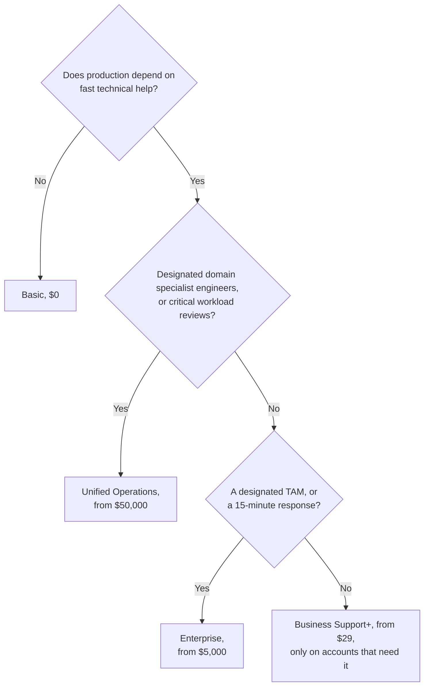

# Optional simulation S15: Choose the cheapest Support plan that fits the bakery and four other businesses

**Exam guide:** [Domain 3, Cloud Technology and Services](https://docs.aws.amazon.com/aws-certification/latest/cloud-practitioner-02/cloud-practitioner-02-domain3.html) (34% of the exam): task [3.8](https://docs.aws.amazon.com/aws-certification/latest/cloud-practitioner-02/cloud-practitioner-02-domain3.html#cloud-practitioner-02-task3.8); [Domain 4, Billing, Pricing, and Support](https://docs.aws.amazon.com/aws-certification/latest/cloud-practitioner-02/cloud-practitioner-02-domain4.html) (12% of the exam): task [4.3](https://docs.aws.amazon.com/aws-certification/latest/cloud-practitioner-02/cloud-practitioner-02-domain4.html#cloud-practitioner-02-task4.3).

> **Note:** This simulation is optional practice for learners who want more decisions to make; the main path and the module's hours leave it out.

## Before you start: your account, your responsibility

This guide is provided as is, without warranty. We work hard to keep it correct and current, but AWS changes often, and its services, prices, and free offers may differ from what is written here. The labs run in your own AWS account. You are responsible for that account, for its security, and for any charges it incurs, including charges from resources you forget to delete. Automate the Cloud Inc. is not liable for any costs, losses, or security incidents that result from following, or failing to follow, this material. Technical guidance here is general information, not advice about your specific systems.

**Who this is for:** you have read [12.01 Support plans](01-support-plans.md) and done [Lab 17](05-lab-17-support-center-tour.md). **Time:** about 15 minutes. **Cost:** $0; no AWS account is used.

**Why a simulation:** a paid Support plan can't be tried for a lab. It bills at least $29 a month with a 30-day minimum (as of 2026-10-24).

**Goal:** for six situations, choose the cheapest plan that covers every must-have, and say in one line why the plan below it fails and the plan above it is more than needed. The businesses and their bills are made up.

## The rules of this simulation

> **Dated (checked 2026-10-24):** the four current plans, from [Compare AWS Support plans](https://aws.amazon.com/premiumsupport/plans/) and [AWS Support pricing](https://aws.amazon.com/premiumsupport/pricing/).
>
> | | Basic | Business Support+ | Enterprise | Unified Operations |
> |---|---|---|---|---|
> | Monthly minimum | $0 | $29, **per account** | $5,000 | $50,000 |
> | Technical cases | No: account and billing, and quota requests only | 24/7 by phone, web and chat | Same | Same |
> | First response, business-critical system down | None | Under 30 minutes | Under 15 minutes | Under 5 minutes |
> | First response, production system down | None | Under 1 hour | Under 1 hour | Under 1 hour |
> | Named people | No | No | A Technical Account Manager (TAM) | A TAM plus designated domain specialist engineers |
> | Trusted Advisor; AWS Health API | A few checks; no API | All checks; API | All checks and Priority; API | Same as Enterprise |
> | Also | | | Well-Architected reviews; Security Incident Response | 24/7 workload monitoring; critical workload reviews |

Response times are targets for a first reply, not guarantees ([Case management](https://docs.aws.amazon.com/awssupport/latest/user/case-management.html)).

**How to choose:** list the must-haves, cross out every plan that misses one, then take the cheapest plan left. A wish that isn't a must-have doesn't move you up.

## Decisions

### Decision 1: your own study account

No customers depend on it. You want billing questions answered.

Model answer

**Basic.** Account and billing cases are free on every plan, and documentation, re:Post and the Knowledge Center answer how-to questions. Business Support+ would add technical cases nobody depends on, and on the Free plan you can't buy it anyway (as of 2026-10-25).

### Decision 2: the bakery, now business-critical

Online orders are most of its sales, all in one account. When the order database fails at 2 a.m. on a Saturday in its busiest month, the developer needs an AWS engineer on the phone within the hour.

Model answer

**Business Support+.** It's the cheapest plan with 24/7 technical cases by phone, and "production system down" has a first-response target under 1 hour. **Basic** fails: no technical cases. **Enterprise** and **Unified Operations** add a TAM and faster targets the bakery doesn't need. Tell the owner the times are targets for a first reply, not a promise of a fix.

### Decision 3: the bakery's developer wants more

"While we're at it, I'd like a named technical account manager who knows our setup, and a design review before our busiest week."

Model answer

**Stay on Business Support+.** A request isn't a must-have, and the cheapest plan with a TAM, Enterprise, has a $5,000 monthly minimum. For the review, the developer can run a free Well-Architected Tool review, ask an AWS solutions architect at no charge, or pay an AWS Partner (lesson [12.03](03-where-to-find-answers.md)). Revisit Enterprise if the stakes grow.

### Decision 4: a design studio with four accounts

One production account runs client websites that must be fixed fast if they fail. Three development accounts hold experiments.

Model answer

**Business Support+ on the production account only.** Its fee is worked out per account, so the development accounts can stay on Basic. **Basic** everywhere fails the production must-have; **Enterprise** adds a TAM nobody asked for.

### Decision 5: an online retailer

Checkout down for 15 minutes loses thousands of dollars. The retailer needs a first response under 15 minutes when checkout fails, and a TAM to plan its big sales.

Model answer

**Enterprise Support.** **Business Support+** misses both must-haves: its fastest target is 30 minutes, and it has no TAM. **Unified Operations** fits too, but it costs far more for a 5-minute target the retailer didn't ask for.

### Decision 6: a payments processor

It needs designated AWS engineers who specialize in its payment applications, and critical workload reviews of those applications.

Model answer

**Unified Operations**, with its 90-day minimum term. **Enterprise** is cheaper, but it gives a designated TAM, not designated domain specialist engineers, and has no critical workload reviews. AWS lists both only for Unified Operations ([Compare AWS Support plans](https://aws.amazon.com/premiumsupport/plans/), checked 2026-10-24).

> **Dated (checked 2026-10-24):** older material may offer Developer, Business or Enterprise On-Ramp Support. Developer and Business take no new subscriptions since 2025-12-02, and all three end on 2027-01-01, except in AWS GovCloud (US) ([end of support](https://docs.aws.amazon.com/awssupport/latest/user/support-plans-eos.html)). Never pick one as an answer for a new customer.

## Recap

Ask the same questions in the same order, from the top:

*Notice that every "no" moves you to a cheaper plan.*

**Long description.** A flowchart of three questions, top to bottom. First: does production depend on fast technical help? No leads to Basic, $0. Yes leads to: designated domain specialist engineers, or critical workload reviews? Yes leads to Unified Operations, from $50,000 a month. No leads to: a designated TAM or a 15-minute response? Yes leads to Enterprise, from $5,000. No leads to Business Support+, from $29, only on the accounts that need it. Prices as of 2026-10-24.

**Next:** [the Module 12 mastery check](07-check.md).

---

"Optional simulation S15: Choose the cheapest Support plan that fits" by Automate the Cloud Inc., licensed under CC BY-NC 4.0 with the Additional Permission for Internal Training from Automate the Cloud Inc.
License: https://creativecommons.org/licenses/by-nc/4.0/
Permission: https://automatethe.cloud/licenses/atc-internal-training-permission.txt
