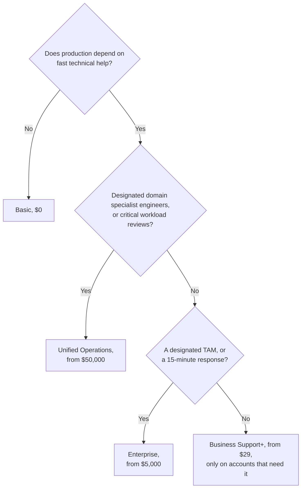

# Simulation S15: Choose the cheapest Support plan that fits the bakery and four other businesses

## Before you start: your account, your responsibility

This guide is provided as is, without warranty. We work hard to keep it correct and current, but AWS changes often, and its services, prices, and free offers may differ from what is written here. The labs run in your own AWS account. You are responsible for that account, for its security, and for any charges it incurs, including charges from resources you forget to delete. Automate the Cloud Inc. is not liable for any costs, losses, or security incidents that result from following, or failing to follow, this material. Technical guidance here is general information, not advice about your specific systems.

**Who this is for:** you have read [12.01 Support plans](01-support-plans.md) and done [Lab 17](05-lab-17-support-center-tour.md). **Time:** about 25 minutes. **Cost:** $0; no AWS account is used.

**Why a simulation:** a paid Support plan can't be tried for a lab. It bills at least $29 a month with a 30-day minimum (as of 2026-10-24).

**Goal:** for the bakery at three moments and four other businesses, choose the cheapest plan that covers every must-have, and work out its monthly fee. **End state:** seven choices, each with a fee and a one-line reason.

**Why this matters:** [OPS07-BP06 Create support plans for production workloads](https://docs.aws.amazon.com/wellarchitected/latest/operational-excellence-pillar/ops_ready_to_support_enable_support_plans.html) asks for support that matches what the workload needs; paying for more than that works against the cost optimization pillar.

## The rules of this simulation

The businesses and their bills are made up. The plans and prices are AWS's ([Compare AWS Support plans](https://aws.amazon.com/premiumsupport/plans/), [AWS Support pricing](https://aws.amazon.com/premiumsupport/pricing/)).

> **Dated (checked 2026-10-24):** the four current plans, as AWS published them.
>
> | | Basic | Business Support+ | Enterprise | Unified Operations |
> |---|---|---|---|---|
> | Monthly fee | $0 | The greater of $29 or 9% of the bill up to $10K, 7% to $80K, 5% to $250K, 3% above; **per account** | The greater of $5,000 or 10% up to $150K, 7% to $500K, 5% to $1M, 3% above | The greater of $50,000 or 10% up to $1M, 6% to $5M, 5% above |
> | Minimum term | None | 30 days | 30 days | 90 days |
> | Technical cases | No: account and billing, and quota requests only | 24/7 by phone, web and chat | Same | Same |
> | First response, business-critical system down | — | Under 30 minutes | Under 15 minutes | Under 5 minutes, from an Incident Management Engineer |
> | First response, production system down | — | Under 1 hour | Under 1 hour | Under 1 hour |
> | Designated Technical Account Manager (TAM) | No | No | Yes | Yes, plus designated domain specialist engineers |
> | Trusted Advisor; AWS Health API | Service limits and a few security and fault tolerance checks; no API | All checks; API | All checks and Trusted Advisor Priority; API | Same as Enterprise |
> | Also | | | Well-Architected reviews; AWS Security Incident Response | 24/7 workload monitoring; critical workload reviews |

Response times are targets for a first reply, not guarantees: AWS says it makes "every reasonable effort" to meet them ([Case management](https://docs.aws.amazon.com/awssupport/latest/user/case-management.html)).

*Notice the flat starts: each paid plan charges its minimum until the percentage passes it. At the bakery's $1,200 bill, the three paid plans cost $108, $5,000 and $50,000 a month.*

**Long description and data.** Both axes are logarithmic. Monthly fee, in US dollars, at seven monthly bills, from the tiers above:

| Monthly AWS bill | Business Support+ | Enterprise | Unified Operations |
|---|---|---|---|
| $300 | $29 | $5,000 | $50,000 |
| $1,200 | $108 | $5,000 | $50,000 |
| $5,000 | $450 | $5,000 | $50,000 |
| $20,000 | $1,600 | $5,000 | $50,000 |
| $120,000 | $7,800 | $12,000 | $50,000 |
| $400,000 | $18,800 | $32,500 | $50,000 |
| $1,500,000 | $51,800 | $79,500 | $130,000 |

**How to choose:** list the must-haves, cross out every plan that misses one, then take the cheapest plan left.

## Decisions

### Decision 1: your own study account

Bill: about $0. No customers. You want billing questions answered.

Model answer

**Basic, $0.** Account and billing cases are free on every plan, and documentation, re:Post and the Knowledge Center answer how-to questions. **Business Support+** would add technical cases that nobody depends on. **Enterprise** and **Unified Operations** cost more in a month than most study accounts spend in years.

### Decision 2: the bakery in Module 11

Bill: about $210 a month, as in Module 11, "Paying for AWS". The site shows the menu and takes a share of the orders. If it's down for a day, the owner phones her regular customers; a friend fixes things at the weekend.

Model answer

**Basic, $0.** Nothing breaks badly if a fix waits a day, so no must-have needs a paid plan. **Business Support+** would cost its $29 minimum (9% of $210 is only $18.90): reasonable insurance, but not required yet.

### Decision 3: the bakery, now business-critical

Bill: about $1,200 a month a year later, all in one account (made up, like every bill here). Online orders are now most of its sales. When the order database fails at 2 a.m. on a Saturday in its busiest month, the developer needs an AWS engineer, on the phone, within the hour.

Model answer

**Business Support+, $108 a month.** It's the cheapest plan with 24/7 technical cases by phone; "production system down" has a first-response target under 1 hour, and "business-critical system down" under 30 minutes. **Basic** fails: no technical cases. **Enterprise** ($5,000) and **Unified Operations** ($50,000) add a TAM and faster targets the bakery doesn't need, at 4 and 40 times its whole AWS bill. Tell the owner the times are targets for a first reply, not a promise of a fix.

### Decision 4: the bakery's developer wants more

"While we're at it, I'd like a named technical account manager who knows our setup, and a design review before our busiest week."

Model answer

**Stay on Business Support+.** The cheapest plan with a TAM is Enterprise, at $5,000 a month for a $1,200 bill: a request is not a must-have. For the review, the developer can run a free Well-Architected Tool review, or pay an AWS Partner for a one-off review (lesson [12.04](04-partners-and-paid-help.md)). Revisit Enterprise if the bill and the stakes grow.

### Decision 5: a design studio with four accounts

One production account (bill $3,000 a month) runs client websites that must be fixed fast if they fail. Three development accounts ($200 a month each) hold experiments.

Model answer

**Business Support+ on the production account only: $270 a month** (9% of $3,000). Its fee is worked out per account, so the development accounts can stay on Basic. All four on Business Support+ would cost $357 ($270 plus 3 × $29 minimums). **Basic** everywhere fails the production must-have; **Enterprise** adds a TAM nobody asked for.

### Decision 6: an online retailer and a payments processor

- **Retailer:** bill $120,000 a month. Checkout down for 15 minutes loses thousands of dollars. Needs a first response under 15 minutes when checkout fails, and a TAM to plan its big sales.
- **Payments processor:** bill $400,000 a month. Needs designated AWS engineers who specialize in its payment applications, and critical workload reviews of those applications.

Model answer

- **Retailer: Enterprise, $12,000 a month** (10% of $120,000, above the $5,000 minimum). **Business Support+** ($7,800) misses both must-haves: 30 minutes, no TAM. **Unified Operations** ($50,000) fits but costs four times as much for a 5-minute target the retailer didn't ask for.
- **Payments processor: Unified Operations, $50,000 a month.** The percentage ($40,000) is below the minimum, so the minimum applies, with a 90-day minimum term. **Enterprise** ($32,500) is cheaper, but it gives a designated TAM, not designated domain specialist engineers, and has no critical workload reviews. AWS lists both only for Unified Operations, and neither among Enterprise's paid add-ons ([Compare AWS Support plans](https://aws.amazon.com/premiumsupport/plans/), checked 2026-10-24).

> **Dated (checked 2026-10-24):** older material may offer Developer, Business or Enterprise On-Ramp Support. Developer and Business take no new subscriptions since 2025-12-02, and all three end on 2027-01-01, except in AWS GovCloud (US) ([end of support](https://docs.aws.amazon.com/awssupport/latest/user/support-plans-eos.html)). Never pick one as an answer for a new customer.

## Recap

Ask the same questions in the same order, from the top; each answer either ends at a plan or leads to the next question:

*Notice that every "no" moves you to a cheaper plan.*

**Long description.** A flowchart of four questions, top to bottom. First: does anything in production depend on fast technical help? No leads to Basic, $0. Yes leads to: designated domain specialist engineers, or critical workload reviews? Yes leads to Unified Operations, from $50,000 a month. No leads to: a designated TAM or a 15-minute response? Yes leads to Enterprise, from $5,000. No leads to Business Support+, from $29, only on the accounts that need it.

**Next:** the Module 12 mastery check. First, retry the practice at the end of [12.01](01-support-plans.md) without looking back.

---

"Simulation S15: Choose the cheapest Support plan that fits" by Automate the Cloud Inc., licensed under CC BY-NC 4.0 with the Additional Permission for Internal Training from Automate the Cloud Inc.
License: https://creativecommons.org/licenses/by-nc/4.0/
Permission: https://automatethe.cloud/licenses/atc-internal-training-permission.txt
