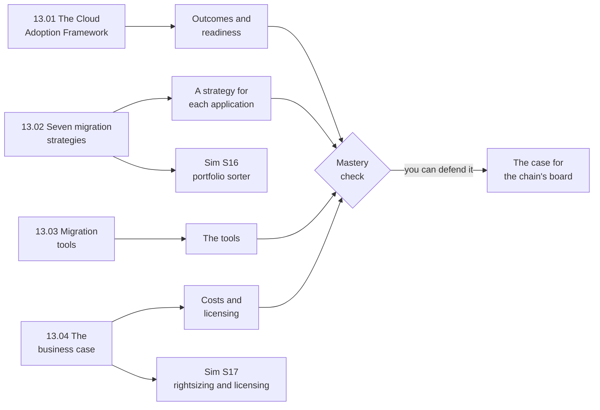

# Module 13: Build the case for moving a bakery chain's ten applications to AWS

This module teaches how an organization decides to move to the cloud, and how it moves each application.

**For:** an adult studying alone, possibly new to IT, who wants to understand AWS and use it safely. You have finished Modules 02 to 12. **Time:** about 3.5 hours, over several sessions. No AWS account needed.

## The scenario: a chain buys the bakery

The bakery grew: it opened ten shops of its own and gathered its AWS accounts into one organization (Simulations S4 and S11). Its site still runs on AWS (EC2, RDS, Lambda and S3 in the Module 07 network). Now a larger regional bakery chain has bought it. In this module, **the chain** means that buyer. The chain runs its own systems in a rented data center whose lease ends in 18 months. Its board asks: **should we move too, and how?**

The chain's ten applications (all made up for teaching):

| # | Application | What you know about it |
|---|---|---|
| 1 | Recipe archive | No sign-ins for over a year; operating system out of support; old recipes must be kept |
| 2 | Oven control | Talks directly to the controllers on the central bakery's ovens |
| 3 | Accounting | New servers and license eight months ago |
| 4 | Email and calendars | Its own mail servers take two staff much of their week |
| 5 | Payroll | A vendor's package; the vendor now sells it as a service |
| 6 | Stock and ordering | Custom, on Linux servers; works well; no time to change it before the lease ends |
| 7 | Loyalty database | Microsoft SQL Server; days each month go on patches and backups |
| 8 | Shop tools | About 30 small internal apps on a VMware cluster; the team knows VMware well |
| 9 | Wholesale portal | One large program; each release takes a month; the business wants five times the café customers |
| 10 | Chain website | Two servers that slow down every December; the bakery's AWS site does much the same job |

At the end you hand the board a short case: the outcomes (13.01), a strategy per application (13.02), the tools (13.03), and costs with a licensing decision (13.04).

## You'll be able to

Tags: knowledge type (C concept, J judgment) and thinking (Ap apply, An analyze, Ev evaluate).

| Objective | Lesson |
|---|---|
| **13.01a** Map a concern to a perspective of the AWS Cloud Adoption Framework [C·Ap] | 13.01 |
| **13.02a** Assign and justify a migration strategy for each application [J·An] | 13.02 |
| **13.03a** Choose a migration tool for a job [C·Ap] | 13.03 |
| **13.04a** Build a cost comparison and make a licensing decision [J·Ev] | 13.04 |

## What this covers on the exam

Task [1.3](https://docs.aws.amazon.com/aws-certification/latest/cloud-practitioner-02/cloud-practitioner-02-domain1.html#cloud-practitioner-02-task1.3), migration strategies and the AWS CAF, and the on-premises costs, licensing and rightsizing parts of task [1.4](https://docs.aws.amazon.com/aws-certification/latest/cloud-practitioner-02/cloud-practitioner-02-domain1.html#cloud-practitioner-02-task1.4), in Domain 1 of the AWS Certified Cloud Practitioner (CLF-C02) exam. Lesson 13.03 returns to task [3.4](https://docs.aws.amazon.com/aws-certification/latest/cloud-practitioner-02/cloud-practitioner-02-domain3.html#cloud-practitioner-02-task3.4)'s database migration services. We checked the exam guide on 2026-10-24.

## How the module is laid out

**Lessons** (about 35 minutes each):

1. [The Cloud Adoption Framework](01-the-cloud-adoption-framework.md)
2. [Seven migration strategies](02-seven-migration-strategies.md)
3. [Migration tools](03-migration-tools.md)
4. [The business case](04-the-business-case.md)

**Simulations**, on this site, not in AWS:

- [Simulation S16: the portfolio sorter](05-sim-portfolio-sorter.md): a strategy for each of the ten applications.
- [Simulation S17: rightsizing and licensing](06-sim-rightsizing-and-licensing.md): size servers and choose how to license their software.

**Why no lab:** the migration services bill while they run, and two planning tools no longer accept new customers. The simulations teach the same decisions for free.

**Mastery check:** the module ends with a check; you pass at 80%, and each miss points to the section to reread.

> **Dated (checked 2026-10-24):** the exam's AWS Application Migration Service is now AWS Transform MGN; AWS Application Discovery Service and AWS Migration Hub closed to new customers on 2025-11-07 (AWS points to AWS Transform). Lesson 13.03 gives both names.

*Notice that 13.01 works on the whole organization and 13.02 on one application at a time.*

**Long description.** Left to right: 13.01 leads to outcomes and readiness; 13.02 to a strategy per application and to Simulation S16; 13.03 to the tools; 13.04 to costs and licensing and to Simulation S17. All four lead to the mastery check, then to the case for the board, labeled "you can defend it".

## Coming back

Warm-ups bring back [Module 12, "Getting help"](../12-getting-help/00-brief.md) (Professional Services, partners, Prescriptive Guidance, Trusted Advisor), [Module 11, "Paying for AWS"](../11-paying-for-aws/00-brief.md) (tags, Savings Plans, the Pricing Calculator, Dedicated Hosts), Module 04 (who patches what, and the three kinds of control) and Module 02 (the Well-Architected Framework).

---

"Module 13: Moving to AWS" by Automate the Cloud Inc., licensed under CC BY-NC 4.0 with the Additional Permission for Internal Training from Automate the Cloud Inc.
License: https://creativecommons.org/licenses/by-nc/4.0/
Permission: https://automatethe.cloud/licenses/atc-internal-training-permission.txt
