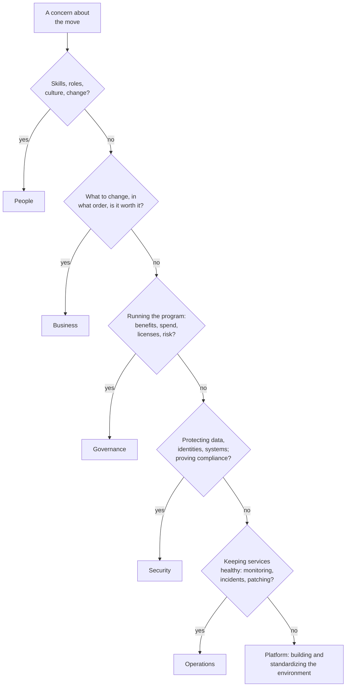
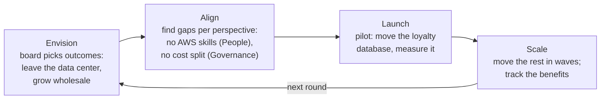

# The Cloud Adoption Framework plans a move around the outcomes a business wants and six groups of people who must be ready for it

Moving to the cloud changes more than where servers sit. The **AWS Cloud Adoption Framework (AWS CAF)** is AWS's guide to that wider change: the business results to aim for, the parts of the organization that change, the abilities each group of people needs, and the order to work in. By the end of this lesson you can take a worry someone raises about a migration and say which part of the CAF deals with it.

**For:** an adult studying alone, possibly new to IT, who wants to understand AWS and use it safely. **Time:** about 35 minutes. Reading works on a phone.

**Before you start:** this lesson builds on [The Well-Architected Framework](../02-why-the-cloud/05-the-well-architected-framework.md) (a different AWS framework, which this lesson compares with the CAF) and [What a data center really costs](../02-why-the-cloud/04-what-a-data-center-really-costs.md). The chain and its ten applications are in the [module brief](00-brief.md). If you skipped those pages, the key terms below give you enough to follow.

## Warm-up: what you remember

Answer from memory before you look anything up.

1. From Module 12, "Getting help": the chain wants experts *employed by AWS* to help plan its move. Which kind of paid help is that, as opposed to an AWS Partner?
2. From Module 11, "Paying for AWS": the chain tags every resource with the shop it belongs to. What else must happen before those tags show up as a way to split costs in the billing tools?
3. From lesson 02.05: what does the AWS Well-Architected Framework help you review, a whole organization or one workload?

Feedback

1. **AWS Professional Services**, AWS's own team of experts ([lesson 12.04](../12-getting-help/04-partners-and-paid-help.md)). AWS Partners are other companies, such as consulting firms, that build or run solutions for AWS customers. This lesson returns to both: they help organizations carry out a large migration.
2. **The tag keys must be activated as cost allocation tags** in the billing console. A tag on a resource alone doesn't show costs. Splitting costs this way is part of one of the CAF capabilities below, cloud financial management.
3. **One workload**, against six pillars. The CAF works one level up: the whole organization and its readiness. Keep the two apart; the practice at the end tests it.

## What you'll learn

By the end of this lesson, you can:

- name the four business outcomes the CAF aims for, and the four transformation domains;
- name the six perspectives, say what each one covers, and give two or three of its capabilities;
- map a concern raised during a migration to the perspective that deals with it (objective 13.01a);
- tell the Business perspective from the Governance perspective, and the CAF from the 7 Rs;
- put the four phases (Envision, Align, Launch, Scale) in order and say what happens in each.

Try these before you read on. Guess if you're unsure; the answers are in the lesson.

1. Is "process" one of the CAF's six perspectives?
2. The chain's finance director asks how the cloud bill will be split by shop and kept within budget. Which perspective deals with that?

## The big picture: capabilities enable change, change delivers outcomes

The CAF has four parts. Read the picture from the bottom up: the organization builds **capabilities**, grouped in six **perspectives**. Those capabilities make change possible in four **transformation domains**, each enabling the next. The change delivers four **business outcomes**. The four **phases** on the right are the order of work, repeated for each round of change.

![The AWS CAF in three layers and a column. Bottom: six perspectives with their number of capabilities: Business (8), People (7), Governance (7), Platform (7), Security (9), Operations (9). Middle: four transformation domains in a chain: Technology, Process (highlighted: a domain, not a perspective), Organization, Product. Top: four business outcomes: reduce business risk, improve ESG performance, grow revenue, increase operational efficiency. Right: four phases: Envision, Align, Launch, Scale, then back to Envision.](../../images/13-01-big-picture.svg)

*Notice where "Process" sits: in the middle layer, among the things that change. It isn't one of the six perspectives at the bottom.*

**Long description.** Three layers, read from the bottom up, and a column of phases. Bottom layer, six perspectives, each with its number of capabilities: Business (8), strategy and outcomes; People (7), culture and change; Governance (7), control and oversight; Platform (7), infrastructure and applications; Security (9), compliance and assurance; Operations (9), health and availability. An arrow labeled "enable" leads up to the middle layer, four transformation domains in a chain, each enabling the next: Technology, Process (highlighted: a domain, not a perspective), Organization, Product. An arrow labeled "deliver" leads up to the top layer, four business outcomes: reduce business risk; improve ESG performance; grow revenue; increase operational efficiency. On the right, four phases in order, Envision, Align, Launch, Scale, then back to Envision for the next round. Source: the AWS CAF whitepaper and page, checked 2026-10-24.

## Key terms (skip if you know them)

- **AWS Cloud Adoption Framework (AWS CAF):** AWS's guidance for changing a whole organization to use the cloud well, built from AWS's experience with many customers. It is advice, not a service you switch on.
- **Business outcome:** a result the business wants, such as lower risk or more revenue. Not a technical result such as "faster servers".
- **Transformation domain:** one of four areas of the organization that change: technology, process, organization, product.
- **Perspective:** one of six groups of related capabilities, each owned by a set of related people.
- **Capability:** something an organization is able to do well, such as managing its cloud spending. Not a product feature: a capability is a skill of the organization, built from people, processes and tools.
- **Stakeholder:** a person with a say in, or a stake in, the change, such as the CFO.
- **Cloud readiness:** how well an organization can use the cloud to change, which the CAF says rests on its capabilities.

## The CAF aims at four business outcomes

The CAF starts from what the business wants, not from technology. AWS names four **business outcomes**, the same four the exam guide lists in task [1.3](https://docs.aws.amazon.com/aws-certification/latest/cloud-practitioner-02/cloud-practitioner-02-domain1.html#cloud-practitioner-02-task1.3) ([AWS CAF page](https://aws.amazon.com/cloud-adoption-framework/), checked 2026-10-24):

| Outcome | What AWS says it covers | The chain's version |
|---|---|---|
| **Reduce business risk** | Better reliability and performance, stronger security | The website slows every December; the recipe archive runs on an operating system nobody patches any more |
| **Improve ESG performance** | Insights that improve sustainability and corporate transparency | A supermarket customer asks for the chain's energy and carbon figures |
| **Grow revenue** | New products and services, new customers, new market segments | Five times as many wholesale café customers |
| **Increase operational efficiency** | Lower operating costs, more productivity, a better experience for staff and customers | Stop paying for a data center; free the two staff who look after the mail servers |

**ESG** stands for environmental, social and governance: how an organization treats the planet, people and its own management. Investors and large customers increasingly ask for it.

> **Your turn:** Match each of the chain's board statements to an outcome. (a) "Our bread could sell in the next state if we took online orders there." (b) "If the data center's cooling fails in summer, we can't take orders." (c) "Our IT team spends Mondays restarting servers by hand."

Model answer

(a) **Grow revenue:** a new market segment. (b) **Reduce business risk:** the risk is a failure that stops sales, and the cloud offers more reliable infrastructure. (c) **Increase operational efficiency:** staff time spent on manual work that automation could remove.

## Four domains change, each enabling the next

The CAF describes the change itself as four **transformation domains** that form a chain: technology enables process, process enables organization, and organization enables product ([Accelerating business outcomes](https://docs.aws.amazon.com/whitepapers/latest/overview-aws-cloud-adoption-framework/accelerating-business-outcomes.html), checked 2026-10-24):

- **Technology:** migrate and modernize old infrastructure, applications and data platforms. For the chain: get out of the data center.
- **Process:** digitize, automate and improve how the business runs, for example with analytics or machine learning. For the chain: forecast how much bread each shop needs.
- **Organization:** change how teams work, for example organizing them around products. For the chain: one team owns wholesale ordering from end to end.
- **Product:** new offers and new ways to earn money. For the chain: a subscription service for cafés.

The chain matters. Moving servers alone (technology) delivers some savings; most of the larger outcomes come from what the move makes possible next.

### "Process is one of the CAF perspectives" is wrong

You may have read a list of CAF perspectives that includes "process". Process isn't one of them. The six perspectives are **Business, People, Governance, Platform, Security and Operations**. Process is a **transformation domain**: one of the things that changes, not one of the groups of capabilities that make change possible ([Foundational capabilities](https://docs.aws.amazon.com/whitepapers/latest/overview-aws-cloud-adoption-framework/foundational-capabilities.html), checked 2026-10-24).

The slip is natural because "people, process and technology" is a familiar trio in IT management, and the CAF really does use all three words: People is a perspective, while process and technology are domains. The list that swaps in "process" also tends to drop Governance. If an answer option offers "process perspective", it's a distractor.

> **Check:** Answer the first prequestion. Which list gives the six CAF perspectives?
>
> A. Business, People, Process, Platform, Security, Operations\
> B. Business, People, Governance, Platform, Security, Operations\
> C. Technology, Process, Organization, Product, People, Security

Feedback

**B is right.**

- **A is wrong.** It swaps Governance for Process, which is a transformation domain.
- **C is wrong.** Its first four are the transformation domains, not perspectives.

## Six perspectives group the capabilities, each owned by different people

The CAF lists the capabilities an organization needs, grouped into six **perspectives**. Each perspective is owned by a set of related people, its common **stakeholders** ([AWS CAF whitepaper](https://docs.aws.amazon.com/whitepapers/latest/overview-aws-cloud-adoption-framework/foundational-capabilities.html), checked 2026-10-24). The whitepaper gives each a short focus, used as the second column here. You don't need all 47 capabilities for the exam; know what each perspective is for and recognize its typical capabilities.

| Perspective | Focus | Typical capabilities (of its total) | Common stakeholders | A chain concern it owns |
|---|---|---|---|---|
| **Business** | Strategy and outcomes | Strategy management, portfolio management, innovation management (of 8) | CEO, CFO, COO, CIO, CTO | "Which applications go first, and is it worth it?" |
| **People** | Culture and change | Cloud fluency, workforce transformation, change acceleration (of 7) | CIO, COO, CTO, cloud director, cross-functional leaders | "Nobody here has used AWS. Who trains them?" |
| **Governance** | Control and oversight | Program and project management, benefits management, risk management, cloud financial management (of 7) | Chief transformation officer, CIO, CTO, CFO, chief data officer, chief risk officer | "Split the bill by shop and keep it in budget" |
| **Platform** | Infrastructure and applications | Platform architecture, provisioning and orchestration, continuous integration and continuous delivery (of 7) | CTO, technology leaders, architects, engineers | "One standard way to set up accounts and networks" |
| **Security** | Compliance and assurance | Identity and access management, threat detection, data protection, incident response (of 9) | CISO, chief compliance officer, internal audit, security architects and engineers | "Protect card data and pass the payment audit" |
| **Operations** | Health and availability | Observability, incident and problem management, patch management (of 9) | Infrastructure and operations leaders, site reliability engineers, IT service managers | "Who is alerted at 3 a.m. when ordering slows?" |

Two traps among the capability names:

- **Security has "security governance"**, and Operations has "incident and problem management" while Security has "incident response". Words like "governance" and "incident" don't settle the perspective. Ask what is at stake: protecting data and systems belongs to Security; keeping a service running at the level the business agreed belongs to Operations; overseeing the whole program belongs to Governance.
- **Several people appear in more than one perspective.** The CFO is a stakeholder in Business and Governance; the CIO in three perspectives and the CTO in four. A job title alone can't tell you the perspective.

> **Your turn:** The chain's head of IT says: "When we move, our server engineers will need new skills, and some of their jobs will change." Which perspective covers this, and which capability?

Model answer

**People**, through capabilities such as **cloud fluency** (building the skills to use the cloud) and **workforce transformation** (planning how roles and talent change). The worry is about people's skills and roles, not about the technology itself, so it isn't Platform, even though the people are engineers.

## Map a concern by asking what is at stake, not who is asking

Here is a method that works for the exam and for real meetings. Read the concern, ignore the job title, and ask in turn what the concern is really about. The first match is usually the perspective.

*Notice that every question is about the subject of the concern. None asks who raised it.*

**Long description.** A flowchart that asks five questions in order; the first "yes" gives the perspective. One: is it about skills, roles, culture or organizational change? Yes: People. Two: is it about what to change, in what order, and whether it is worth it? Yes: Business. Three: is it about running the program: benefits, spending, licenses or risk? Yes: Governance. Four: is it about protecting data, identities and systems, or proving compliance? Yes: Security. Five: is it about keeping services healthy: monitoring, incidents, patching? Yes: Operations. Otherwise: Platform, building and standardizing the environment. The order of questions is our teaching aid, not part of the CAF.

### Worked example: six concerns from the chain's first meeting

The chain's managers raise six concerns. Here is how an expert sorts them, thinking aloud.

| Concern | Expert's reasoning | Perspective |
|---|---|---|
| "Which of our ten applications do we move first, and will the move pay off?" | Choosing and ordering initiatives for their value: that's portfolio and strategy | **Business** |
| "Finance must see each shop's cloud spend monthly, and we must not pay twice for software licenses." | The CFO asked, but the subject is controlling spend and licenses: cloud financial management | **Governance** |
| "Our bakers have never used a cloud app. How do we bring them along?" | Change and skills for people, not technology | **People** |
| "We need one standard way to create accounts and networks for each new team." | Building the environment: platform architecture, provisioning | **Platform** |
| "Card data must stay protected, and we must still pass our payment audit." | Protecting data and proving compliance | **Security** |
| "Who gets an alert at 3 a.m. if the ordering system slows down?" | Keeping a service healthy: observability, incident management | **Operations** |

The second row is the one experts slow down on. A CFO, the word "finance" and money all suggest Business. But Business decides *whether* a move is worth paying for; tracking and controlling the spending once it starts is Governance's **cloud financial management**, which AWS says includes managing the licenses you own and those included with cloud resources ([Governance perspective](https://docs.aws.amazon.com/whitepapers/latest/overview-aws-cloud-adoption-framework/governance-perspective.html), checked 2026-10-24). That answers the second prequestion. Lesson 13.04 picks up the licensing question itself.

> **Your turn:** Map each concern to a perspective, with one sentence of reasoning. (a) "Every new server must be patched within a week of a fix being released." (b) "We want to sell our sales data, made anonymous, to flour suppliers." (c) "The migration projects for our ten applications keep blocking each other; somebody must coordinate them."

Model answer

(a) **Operations:** patch management keeps services healthy. Security cares about the vulnerabilities, but applying patches as routine work is an Operations capability. (b) **Business:** earning money from data is the data monetization capability. (c) **Governance:** coordinating related projects is program and project management.

## Business or Governance: deciding what to do, or overseeing how it goes

These two are the pair people mix up most, because both talk about money, value and portfolios, and both include the CFO.

![Two columns, Business perspective (8 capabilities) and Governance perspective (7), compared on five rows: focus, common stakeholders, the question each answers, portfolio and money (highlighted), and all capabilities. Business: strategy and outcomes; asks what to change, in what order, and why it is worth it; portfolio management uses the 7 Rs to build the business case. Governance: control and oversight; asks whether the change is delivered as planned, whether benefits are real and whether spending is under control; cloud financial management, benefits management and application portfolio management.](../../images/13-01-business-vs-governance.svg)

*Notice the highlighted row: both have a "portfolio" capability, but Business chooses what to invest in, and Governance keeps the inventory and tracks spend and results.*

**Long description.** Two columns compared on five rows. Focus: Business, strategy and outcomes, making sure cloud spending speeds up the business's goals; Governance, control and oversight, running the cloud initiatives so the benefits arrive and the risks stay small. Common stakeholders: Business, CEO, CFO, COO, CIO, CTO; Governance, chief transformation officer, CIO, CTO, CFO, chief data officer, chief risk officer. The question it answers: Business, what should we change, in what order, and why is it worth it; Governance, is the change being delivered as planned, are the benefits real, and is spending under control. Portfolio and money, highlighted: Business, portfolio management, choosing and ordering initiatives and using the 7 Rs to build the business case; Governance, cloud financial management, benefits management and application portfolio management, tracking spend and licenses, measuring results and keeping the application inventory. All capabilities: Business has strategy management, portfolio management, innovation management, product management, strategic partnership, data monetization, business insights and data science; Governance has program and project management, benefits management, risk management, cloud financial management, application portfolio management, data governance and data curation.

**What's the same:** both are about value and money, both report to senior leaders, and the CFO sits in both. **What differs:** Business sets direction and decides what is worth doing; Governance runs the work once it is decided, measuring benefits, controlling spending and managing risk. **The principle:** "should we, and in what order?" is Business; "is it going as planned, and within budget?" is Governance.

> **Check:** The chain's board has approved the move. Six months in, the chief transformation officer must show that the promised savings are actually arriving, and adjust the plan if they aren't. Which capability is this?
>
> A. Strategy management (Business)\
> B. Benefits management (Governance)\
> C. Portfolio management (Business)\
> D. Observability (Operations)

Feedback

**B is right.** Benefits management makes sure the benefits of the cloud investment are realized and keeps measuring them against a plan.

- **A is wrong.** Strategy management sets the long-term goals; the goal here is already set.
- **C is wrong.** Portfolio management chose and ordered the initiatives before approval; this is about tracking results afterwards.
- **D is wrong.** Observability watches the health of systems, not business benefits.

## Four phases, repeated: Envision, Align, Launch, Scale

The CAF suggests working in four phases, and repeating them, so that each round shows value quickly instead of betting everything on one large plan ([Your cloud transformation journey](https://docs.aws.amazon.com/whitepapers/latest/overview-aws-cloud-adoption-framework/your-cloud-transformation-journey.html), checked 2026-10-24):

- **Envision phase:** show how the cloud will speed up business outcomes; choose and prioritize opportunities in the four domains, each tied to a stakeholder and a measurable outcome.
- **Align phase:** find the gaps in capabilities across the six perspectives and the dependencies between teams; surface stakeholders' concerns; plan how to close the gaps.
- **Launch phase:** deliver **pilots** in production and show value step by step. A pilot is a small first project run for real, chosen so its lessons shape what follows.
- **Scale phase:** expand the pilots to the size the business needs, and make sure the benefits are realized and kept.

*Notice that the six perspectives appear in Align: that is where the CAF's capability lists are put to work.*

**Long description.** Four boxes in a loop, left to right. Envision: the board picks outcomes, leaving the data center and growing wholesale. Align: gaps found per perspective, for example no AWS skills (People) and no cost split by shop (Governance). Launch: a pilot moves the loyalty database and measures it. Scale: the rest move in waves, and the benefits are tracked. An arrow labeled "next round" returns from Scale to Envision.

> **Your turn:** Put these in phase order, and name each phase: (a) workshops find that nobody can read an AWS bill; (b) the loyalty database moves first and serves real customers for a month; (c) the board agrees that leaving the data center within 18 months is the goal; (d) the other applications move in three waves, and the savings are reported each quarter.

Model answer

(c) **Envision**, then (a) **Align**, then (b) **Launch**, then (d) **Scale**. The pilot in (b) is small and real, so the chain learns before it commits the rest.

## The CAF and the 7 Rs work at different levels

The exam puts both in task [1.3](https://docs.aws.amazon.com/aws-certification/latest/cloud-practitioner-02/cloud-practitioner-02-domain1.html#cloud-practitioner-02-task1.3), and they are easy to blur. The CAF is about the **organization**: is it ready, and what outcomes is it after? The 7 Rs, the next lesson's subject, are about **one application at a time**: retire it, keep it, move it as it is, or change it on the way.

| | AWS CAF | The 7 Rs |
|---|---|---|
| **Works on** | The whole organization | One application |
| **Question** | Are we ready to change, and what do we want from it? | What do we do with this application? |
| **Result** | Outcomes, capability gaps, a roadmap | One strategy per application, grouped into waves |
| **Who uses it** | Leaders across six perspectives | Application owners, architects, the migration team |

They connect at one point. The Business perspective's **portfolio management** capability uses automated discovery tools and the 7 Rs to sort the existing applications and build a business case ([Business perspective](https://docs.aws.amazon.com/whitepapers/latest/overview-aws-cloud-adoption-framework/business-perspective.html), checked 2026-10-24). So the 7 Rs are a tool used inside the CAF, not a part of the CAF's structure. And the Well-Architected Framework from lesson 02.05 is a third level: it reviews one workload against six pillars, after or during its design.

> **Check:** A team decides to move the chain's stock system onto Amazon EC2 without changing it. Which statement is right?
>
> A. That's a CAF perspective decision\
> B. That's a 7 Rs decision about one application, and the CAF's portfolio management capability is where such decisions are organized\
> C. That's a Well-Architected pillar

Feedback

**B is right.** Choosing what happens to one application is a migration strategy (here, rehost).

- **A is wrong.** Perspectives group an organization's capabilities; they don't decide one application's fate.
- **C is wrong.** The pillars judge how well a workload is built; they don't choose a migration strategy.

## In real work: help with the CAF, and where it shows up

Few organizations run the CAF alone. These resources, which task [1.3](https://docs.aws.amazon.com/aws-certification/latest/cloud-practitioner-02/cloud-practitioner-02-domain1.html#cloud-practitioner-02-task1.3) calls resources for the migration journey, build on it:

- **AWS Professional Services** and **AWS Partners** with validated migration skills do the hands-on work of a large migration for a fee; in the program below, they carry out its migrate and modernize phase ([MAP page](https://aws.amazon.com/migration-acceleration-program/), checked 2026-10-24).
- A **Migration Readiness Assessment** is AWS's process for finding how ready an organization is to migrate and planning how to close the gaps, using the CAF. AWS Prescriptive Guidance places it at the start of a large migration ([Mobilize your organization to accelerate large-scale migrations](https://docs.aws.amazon.com/pdfs/prescriptive-guidance/latest/strategy-migration/strategy-migration.pdf), checked 2026-10-24).
- The **AWS Migration Acceleration Program (MAP)** is AWS's migration program for organizations moving at scale, in three phases: assess, mobilize, and migrate and modernize. Its assess phase looks for capability gaps across the CAF's perspectives. AWS describes it as offering tools, training, expertise from partners, and funding that can offset early migration costs ([MAP page](https://aws.amazon.com/migration-acceleration-program/), checked 2026-10-24). Check the page for its current terms.

The CAF also meets the Well-Architected Framework in places. Governance's cloud financial management is what the cost optimization pillar asks for in [COST01-BP01 Establish ownership of cost optimization](https://docs.aws.amazon.com/wellarchitected/latest/cost-optimization-pillar/cost_cloud_financial_management_function.html): someone owns spending and how it is controlled. The Operations perspective's capabilities match much of the operational excellence pillar.

> **Dated (checked 2026-10-24):** the CAF whitepaper AWS publishes is the edition of 2021-11-22, which added the transformation domains and the four phases; AWS reviewed it in 2023 without changes. The exam guide's outcome wording matches it. Check the [whitepaper page](https://docs.aws.amazon.com/whitepapers/latest/overview-aws-cloud-adoption-framework/welcome.html) for a newer edition.

## Summary

- **The CAF aims at four business outcomes:** reduce business risk, improve ESG performance, grow revenue, increase operational efficiency.
- **Four transformation domains change, each enabling the next:** technology, process, organization, product. Process is a domain, not a perspective.
- **Six perspectives group the capabilities:** Business, People, Governance, Platform, Security, Operations, each with its own stakeholders.
- **Map a concern by what is at stake, not by who asks.** Job titles appear in several perspectives.
- **Business decides what is worth doing; Governance oversees how it goes:** benefits, spending and licenses, risk, program management.
- **Four phases, repeated:** Envision, Align, Launch, Scale. The perspectives are used in Align.
- **The CAF works on the organization; the 7 Rs on one application.** Portfolio management, in the Business perspective, is where they meet.

**For the chain's case:** the board's outcomes are operational efficiency (leave the data center, free the mail staff), lower business risk (December slowdowns, unsupported systems) and revenue growth (wholesale). The Align workshops must cover all six perspectives, starting with People (skills) and Governance (spending by shop and licenses).

## Practice

1. **The chain's chief risk officer wants someone to coordinate the migration projects and report each quarter whether the promised savings are arriving. Which perspective?**

   A. Business\
   B. Governance\
   C. Operations\
   D. People

   

Feedback

   **B is right.** Program and project management and benefits management are Governance capabilities.

   - **A is wrong.** Business chose the projects; overseeing their delivery and benefits is Governance.
   - **C is wrong.** Operations keeps services healthy, not the migration program.
   - **D is wrong.** People covers skills, culture and organizational change.

   

2. **Which of these is a business outcome the AWS CAF names, rather than a transformation domain?**

   A. Process\
   B. Improve environmental, social and governance (ESG) performance\
   C. Organization\
   D. Technology

   

Feedback

   **B is right.** The four outcomes are reduce business risk, improve ESG performance, grow revenue and increase operational efficiency.

   - **A, C and D are wrong.** They are three of the four transformation domains (the fourth is product): the areas that change, not the results.

   

3. **The chain moves its loyalty database to AWS, serves real customers from it for six weeks, and measures the results before deciding how to move the rest. Which CAF phase is this?**

   

Feedback

   **Launch.** A pilot in production that shows value and shapes what follows. Envision chose the outcomes, Align found the gaps, and Scale will move the rest.

   

4. **The chain's security architect says: "We need to know within minutes if someone signs in to our AWS accounts from an unusual place." Which perspective and capability, and why not Operations?**

   

Feedback

   **Security, threat detection** (with identity and access management close by). The concern is about protecting the accounts from misuse. Operations watches whether services are healthy and available; a strange sign-in is a security event even if every service is running fine.

   

5. **Explain in two sentences why "the CAF perspectives are Business, People, Process, Platform, Security and Operations" is wrong, and why people believe it.**

   

Feedback

   **Model answer:** Process is a transformation domain, one of the areas that change, and the missing sixth perspective is Governance. People believe it because "people, process, technology" is a familiar trio and the CAF uses all three words, just in different parts.

   

6. **(From lesson 02.05.) The chain wants to check whether its new wholesale portal on AWS follows good practice for reliability and cost. Which framework fits better, the CAF or the Well-Architected Framework?**

   

Feedback

   **The Well-Architected Framework,** ideally through a review in the Well-Architected Tool. It judges one workload against six pillars. The CAF works on the organization's readiness, not on one workload's design.

   

7. **(From Module 12, "Getting help".) The chain wants AWS's own experts, not another company, to carry out part of its migration for a fee. Which kind of help is that?**

   

Feedback

   **AWS Professional Services.** AWS Partners offer similar help, but they are other companies; AWS Support answers technical problems with your account and services rather than doing the project, and solutions architects advise without doing the build.

   

**Next:** [Seven migration strategies](02-seven-migration-strategies.md), where the chain decides what happens to each of its ten applications.

## Where to check the current details

- [An Overview of the AWS Cloud Adoption Framework](https://docs.aws.amazon.com/whitepapers/latest/overview-aws-cloud-adoption-framework/welcome.html), AWS whitepaper: [foundational capabilities](https://docs.aws.amazon.com/whitepapers/latest/overview-aws-cloud-adoption-framework/foundational-capabilities.html), [the journey's phases](https://docs.aws.amazon.com/whitepapers/latest/overview-aws-cloud-adoption-framework/your-cloud-transformation-journey.html), and one page per perspective, such as [Business](https://docs.aws.amazon.com/whitepapers/latest/overview-aws-cloud-adoption-framework/business-perspective.html) and [Governance](https://docs.aws.amazon.com/whitepapers/latest/overview-aws-cloud-adoption-framework/governance-perspective.html) (checked 2026-10-24)
- [AWS Cloud Adoption Framework](https://aws.amazon.com/cloud-adoption-framework/) page: outcomes, perspectives, phases and domains on one page (checked 2026-10-24)
- [Mobilize your organization to accelerate large-scale migrations](https://docs.aws.amazon.com/pdfs/prescriptive-guidance/latest/strategy-migration/strategy-migration.pdf), AWS Prescriptive Guidance: the Migration Readiness Assessment (checked 2026-10-24)
- [AWS Migration Acceleration Program](https://aws.amazon.com/migration-acceleration-program/) (checked 2026-10-24)
- [AWS Certified Cloud Practitioner (CLF-C02) exam guide](https://docs.aws.amazon.com/aws-certification/latest/cloud-practitioner-02/cloud-practitioner-02.html), task [1.3](https://docs.aws.amazon.com/aws-certification/latest/cloud-practitioner-02/cloud-practitioner-02-domain1.html#cloud-practitioner-02-task1.3) (checked 2026-10-24)

---

"The Cloud Adoption Framework" by Automate the Cloud Inc., licensed under CC BY-NC 4.0 with the Additional Permission for Internal Training from Automate the Cloud Inc.
License: https://creativecommons.org/licenses/by-nc/4.0/
Permission: https://automatethe.cloud/licenses/atc-internal-training-permission.txt
