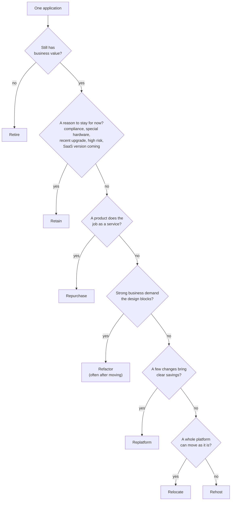

# Give each application one of seven migration strategies, and justify it with AWS's own criteria

An organization doesn't move "to the cloud" in one piece. It decides, application by application, whether to switch it off, leave it, move it as it is, or change it on the way. AWS names seven such strategies, the **7 Rs**, and gives criteria for each. By the end of this lesson you can choose a strategy for an application and defend the choice against the strategies you ruled out.

**For:** an adult studying alone, possibly new to IT, who wants to understand AWS and use it safely. **Time:** about 35 minutes. Reading works on a phone.

**Before you start:** this lesson builds on [The Cloud Adoption Framework](01-the-cloud-adoption-framework.md) (portfolio management, where these decisions sit), [Security of the cloud vs security in the cloud](../04-shared-responsibility-and-access/01-security-of-vs-in-the-cloud.md), [Managed or self-managed databases](../05-storing-data/05-managed-or-self-managed-databases.md) and [Choosing a database](../05-storing-data/06-choosing-a-database.md) (AWS DMS). The chain's ten applications are in the [module brief](00-brief.md). If you skipped those pages, the key terms below give you enough to follow.

## Warm-up: what you remember

Answer from memory before you look anything up.

1. From Module 12, "Getting help": where does AWS publish its tested strategies, guides and patterns for jobs such as large migrations: AWS re:Post, AWS Prescriptive Guidance, or the Support Center?
2. From Module 11, "Paying for AWS": an application will run on EC2 around the clock for at least three years. Which purchasing option lowers its price in exchange for a commitment?
3. From lesson 04.01: a database runs on an EC2 instance. Who patches its operating system and database software? And if it moves to Amazon RDS?

Feedback

1. **AWS Prescriptive Guidance** ([lesson 12.03](../12-getting-help/03-where-to-find-answers.md)). The 7 Rs in this lesson come from its guide to large migrations. re:Post is a community question-and-answer site, and the Support Center is where you open cases.
2. **A Savings Plan** (or Reserved Instances): a commitment to a steady amount of use, measured in dollars an hour for Savings Plans, for one or three years, in return for a lower price ([lesson 11.02](../11-paying-for-aws/02-purchasing-options.md)). Simulation S17 adds a rule for migrations: rightsize a moved server before you commit to it.
3. **On EC2, the customer patches both.** On RDS, AWS patches the operating system and the database software. Several strategies in this lesson change that line, which is part of why teams choose them.

## What you'll learn

By the end of this lesson, you can:

- name all seven migration strategies and say what each does to an application;
- apply AWS's criteria for retiring and retaining, including what "zombie" and "idle" mean;
- tell rehost, relocate, replatform and refactor apart;
- assign a strategy to an application and justify it, including why you didn't choose the others (objective 13.02a).

Try these before you read on. Guess if you're unsure; the answers are in the lesson.

1. How many migration strategies does AWS list today?
2. Moving a Microsoft SQL Server database from your own server onto Amazon RDS for SQL Server: is that rehost or replatform?

## The big picture: seven strategies in three groups

A **migration strategy** is the approach used to move one workload into the AWS Cloud. AWS lists seven, known as the **7 Rs**: retire, retain, rehost, relocate, repurchase, replatform, and refactor or re-architect ([About the migration strategies](https://docs.aws.amazon.com/prescriptive-guidance/latest/large-migration-guide/migration-strategies.html), AWS Prescriptive Guidance, checked 2026-10-24). Grouping them by what happens to the application makes them easier to hold apart. The grouping is ours, not AWS's.

![Seven cards in three groups. Doesn't move: Retire, switch it off and archive the data you must keep; Retain, keep it where it is for now. Moves without changing the application: Rehost, lift and shift each server onto Amazon EC2; Relocate (highlighted), move a whole platform such as VMware to its AWS version, or a resource to another VPC, Region or account. Changes on the way: Replatform, a few changes such as moving the database onto Amazon RDS; Repurchase, replace it with a different product, often software as a service; Refactor, redesign it to use cloud-native features.](../../images/13-02-big-picture.svg)

*Notice that two strategies don't move anything, and two move the application without changing it. Only the last three change what the application is.*

**Long description.** Three groups of cards. Doesn't move: Retire, switch it off and archive the data you must keep; Retain, keep it where it is, for now, and revisit later. Moves without changing the application: Rehost, lift and shift, each server as it is onto Amazon EC2; Relocate, highlighted, move a whole platform such as VMware to its AWS version, or move a resource to another VPC, Region or account, with a note that relocate is the seventh R, added after AWS's 2016 list of six. Changes on the way: Replatform, lift, tinker and shift, a few changes such as moving the database onto Amazon RDS; Repurchase, drop and shop, replace it with a different product, often software as a service; Refactor, re-architect, redesign it to use cloud-native features.

## Key terms (skip if you know them)

- **Application portfolio:** all the applications an organization runs. The 7 Rs are applied to it one application at a time; in the CAF, this is the Business perspective's portfolio management capability.
- **Archive:** keep data you no longer use, cheaply and safely, in case you need it. Not the same as a backup, which exists to restore a system that is still in use.
- **Software as a service (SaaS):** an application you use over the internet and pay for by subscription, while the vendor runs everything underneath it.
- **VMware:** a widely used software platform that runs many virtual machines on shared physical servers.
- **Cloud-native:** designed to use cloud features such as managed services, automatic scaling and serverless computing, rather than only running on cloud servers.
- **Monolith:** an application built as one large program, so any change means testing and releasing the whole thing.
- **Modernize:** improve an application's design or technology, usually after it has moved.

### "There are six Rs" is wrong

You may have read about "the six Rs". That was AWS's list in 2016: rehost, replatform, repurchase, refactor, retire and retain ([6 Strategies for Migrating Applications to the Cloud](https://aws.amazon.com/blogs/enterprise-strategy/6-strategies-for-migrating-applications-to-the-cloud/), AWS blog, 2016-11-01). AWS's current guidance lists seven: it adds **relocate** ([About the migration strategies](https://docs.aws.amazon.com/prescriptive-guidance/latest/large-migration-guide/migration-strategies.html), checked 2026-10-24). The older list is tempting because it still circulates in courses, notes and blog posts, and it was correct when written. If a question gives you a strategy that moves a whole VMware environment as it is, the answer it wants is relocate, which the six-R list doesn't have.

## Retire and retain: decide first what doesn't move

The cheapest migration is the one you don't do. Before planning any moves, sort out the applications that should be switched off, and those that should stay where they are for now.

**Retire** means decommissioning or archiving an application, so its servers can be shut down. AWS's criteria ([Retire](https://docs.aws.amazon.com/prescriptive-guidance/latest/large-migration-guide/migration-strategies.html#retire), checked 2026-10-24):

- there is no business value in keeping it or moving it;
- you want to stop paying to maintain and host it;
- it runs on an operating system or components that are no longer supported, which is a security risk;
- nobody has connected to it in the last 90 days;
- its use is very low: a **zombie application** averages below 5% CPU and memory use, and an **idle application** averages 5 to 20% over 90 days.

**Retain** means keeping an application where it is, at least for now, and perhaps moving it later. AWS's criteria ([Retain](https://docs.aws.amazon.com/prescriptive-guidance/latest/large-migration-guide/migration-strategies.html#retain), checked 2026-10-24):

- **Compliance:** rules on where the data must stay;
- **High risk:** it needs a detailed assessment before it can move;
- **Dependencies:** other applications must move first;
- **A recent upgrade:** you just invested in it, so wait for the next technology refresh;
- **No business value in moving it,** for example an application with a few internal users;
- **Waiting for a SaaS version** the vendor hasn't released yet;
- **Physical dependencies:** it relies on special hardware with no cloud equivalent, such as machines in a factory;
- **Mainframe, mid-range or non-x86 Unix systems,** which need careful planning first.

*Notice the highlighted bar. Payroll looks idle because it works hard for two days a month and rests the other days, but nobody would switch it off.*

**Long description.** A horizontal bar chart, 0 to 70 percent, of average CPU and memory use over 90 days for the chain's ten applications (made-up figures). Two shaded zones: below 5 percent, zombie; 5 to 20 percent, idle. Recipe archive 2 percent, zombie. Payroll 8 percent, idle, highlighted, with the note "idle by the number, yet it pays everyone each month". Shop tools (about 30 small apps) 12 percent, idle. Accounting 16 percent, idle. Chain website 22 percent. Email and calendars 34 percent. Loyalty database 41 percent. Stock and ordering 48 percent. Oven control 57 percent. Wholesale portal 63 percent. Notes: AWS lists low use as a reason to consider retiring, and also as a reason to retain; business value decides.

AWS lists low use under both strategies: you might retire a zombie, or keep it where it is. Low use is a reason to ask questions, not an answer. The question that decides is whether the application still has business value.

> **Your turn:** Use AWS's criteria. For each application, say retire or retain, and name the criterion. (a) The chain's oven control, which talks directly to the controllers on the central bakery's ovens. (b) The chain's accounting, moved to new servers with a new license eight months ago. (c) Outside the chain's portfolio, another company's old staff-newsletter site that has had no visitors in five months.

Model answer

(a) **Retain:** a physical dependency on special hardware that has no cloud equivalent. (b) **Retain, for now:** a recent upgrade; plan to move it at the next refresh. (c) **Retire:** no inbound connections in over 90 days and no business value. Archive anything the company must keep, then shut it down.

## Rehost and relocate: move without changing the application

**Rehost**, also called **lift and shift**, moves an application from where it runs today to AWS without changing it. Each server becomes an Amazon EC2 instance running the same operating system and software. AWS says rehosting lets you move many machines, physical, virtual or from another cloud, without worrying about compatibility, while the application keeps serving users until you switch over ([Rehost](https://docs.aws.amazon.com/prescriptive-guidance/latest/large-migration-guide/migration-strategies.html#rehost), checked 2026-10-24). You gain no cloud optimizations at first, but an application already running on AWS is easier to improve later. AWS's main service for it is **AWS Application Migration Service**, the exam's name, which AWS now calls **AWS Transform MGN** ([product page](https://aws.amazon.com/application-migration-service/), checked 2026-10-24). Lesson 13.03 covers it.

**Relocate** moves many servers at once, making up one or more applications, from an on-premises platform to a cloud version of the *same* platform. It also covers moving resources to a different VPC, AWS Region or AWS account, such as an RDS database moved to another account. You buy no new hardware, rewrite nothing, and keep operating the same way. AWS rates relocate the fastest way to get a workload running and operated on AWS, because the application's architecture stays as it is ([Relocate](https://docs.aws.amazon.com/prescriptive-guidance/latest/large-migration-guide/migration-strategies.html#relocate), checked 2026-10-24).

The common case is **VMware**. A company that runs hundreds of virtual machines on VMware can move them to **Amazon Elastic VMware Service (Amazon EVS)**, which runs VMware's software on AWS infrastructure. AWS's own page calls that "relocate", and lists rehosting the same virtual machines onto EC2 as the other route ([Migrate VMware to the cloud](https://aws.amazon.com/vmware/aws-services/), checked 2026-10-24). Amazon EVS isn't on the exam's service list; the strategy is.

The difference between the two: rehost moves each **server** onto AWS's own virtual machines (EC2). Relocate moves the whole **platform** the servers run on, so the virtual machines, and the tools the team uses to run them, stay the same.

> **Your turn:** Two companies want to leave their data centers within a year without changing their applications. Company A has 40 physical Linux servers. Company B has 600 virtual machines on VMware, and its operations team runs everything through VMware's tools. Which strategy fits each, and why?

Model answer

**Company A: rehost.** Each server moves, unchanged, onto EC2; there is no platform to carry over. **Company B: relocate,** for example to Amazon EVS. It moves the whole VMware platform at once and the team keeps operating it the same way, which AWS calls the quickest route. Rehosting B's machines onto EC2 is possible too, but it changes how the team operates them.

## Replatform and repurchase: change something on the way

**Replatform**, also called "lift, tinker and shift" or "lift and reshape", moves the application and makes some changes so that it runs more efficiently, costs less, or uses cloud features. AWS's example is moving a Microsoft SQL Server database onto Amazon RDS for SQL Server ([Replatform](https://docs.aws.amazon.com/prescriptive-guidance/latest/large-migration-guide/migration-strategies.html#replatform), checked 2026-10-24). The application's code barely changes; what changes is what it runs on. AWS's use cases include:

- moving to a fully managed or serverless service, to save time and cost;
- upgrading the operating system to the latest version, for security and compliance;
- moving from Windows to Linux, or to AWS's Graviton processors, to cut costs;
- moving virtual machines into containers without code changes.

The managed service matters for responsibility. Lesson 04.01 showed that on RDS, AWS patches the operating system and the database software. So replatforming the chain's loyalty database hands the patching that eats the team's days to AWS.

**Repurchase**, also called "drop and shop", replaces the application with a different product or version, often SaaS. AWS says it typically cuts maintenance, infrastructure and licensing costs ([Repurchase](https://docs.aws.amazon.com/prescriptive-guidance/latest/large-migration-guide/migration-strategies.html#repurchase), checked 2026-10-24). Its use cases: moving from a traditional license to SaaS, moving to a vendor's newer version or a different vendor's product, and replacing a custom application you would otherwise have to rewrite. The work doesn't vanish: you still check security and compliance before buying, then train staff, move the data, connect the product to your sign-in system and set up the network.

> **Your turn:** Replatform or repurchase? (a) The chain's email and calendars move from its own mail servers to a subscription email service. (b) The chain's payroll package moves to the vendor's SaaS version of the same product. (c) A custom Java application moves from Windows servers to Linux on EC2, with no code changes.

Model answer

(a) **Repurchase:** the chain stops running mail software and buys a service instead. (b) **Repurchase:** a traditional license swapped for SaaS, AWS's first use case. Before the vendor released its SaaS version, payroll was a retain. (c) **Replatform:** the application stays; the operating system under it changes, which can cut license costs.

## Refactor: redesign for the cloud when the business demands it

**Refactor**, also called re-architect, moves an application and changes its design to use cloud-native features, for agility, performance and scale. AWS says it is driven by strong business demand: to scale, to release features faster, or to cut costs ([Refactor or re-architect](https://docs.aws.amazon.com/prescriptive-guidance/latest/large-migration-guide/migration-strategies.html#refactor), checked 2026-10-24). Its use cases:

- a monolith that already slows delivery;
- a legacy mainframe application that can't meet demand or is expensive to keep;
- an application nobody knows how to maintain, or whose source code is lost;
- an application with very few tests, which makes every change risky;
- a database whose sensitive tables must stay on premises, so it has to be split.

AWS calls refactoring the most complex and costly of the strategies. In a large migration, AWS recommends refactoring only when no other strategy is acceptable. Instead, rehost, relocate or replatform first, and modernize once the application has moved.

> **Your turn:** The chain's wholesale portal is a monolith; each release takes a month, and the business wants five times as many café customers. The data center lease ends in 18 months, and nine other applications must move too. Which strategy, and when? Give two reasons.

Model answer

**Refactor is the destination, but probably not the first step.** The portal meets AWS's refactor criteria: strong business demand to scale and release faster, and a monolith that slows delivery. But with a deadline and nine other applications, AWS's advice for large migrations is to rehost or replatform first and modernize afterwards, so a strong answer is "rehost now to meet the lease, then refactor on AWS". Refactoring during the move is defensible only if the chain can staff it without putting the deadline at risk.

## Rehost, relocate, replatform, refactor side by side

All four move the application to AWS, and their names sound alike. Read the highlighted row first: it is the one that separates them.

![Four columns, rehost, relocate, replatform and refactor, on five rows. Also called: lift and shift; no other name; lift, tinker and shift; re-architect. What moves: each server onto Amazon EC2; a whole platform to the AWS version of it, or a resource to another VPC, Region or account; the application onto better-fitting services; the application, rebuilt. What changes in the application (highlighted): nothing; nothing, not even how you operate it; a few parts such as the database host or operating system; its design, to use cloud-native features. AWS's example: an application stack from on-premises; VMware workloads to Amazon EVS, or an RDS database to another account; SQL Server to Amazon RDS for SQL Server; a monolith that slows every release. Effort: optimize later; the quickest; a few or many changes; the most complex and costly.](../../images/13-02-four-rs-compared.svg)

*Notice that rehost and relocate both change nothing in the application. What tells them apart is what moves: servers one by one, or a whole platform at once.*

**Long description.** Four columns compared on five rows. Also called: rehost, lift and shift; relocate, no other name; replatform, lift, tinker and shift, or lift and reshape; refactor, re-architect. What moves: rehost, each server as it is onto Amazon EC2; relocate, a whole platform at once to the AWS version of it, or a resource to another VPC, Region or account; replatform, the application, onto better-fitting services; refactor, the application, rebuilt. What changes in the application, highlighted: nothing; nothing, not even how you operate it; a few parts, such as the database host or the operating system; its design, to use cloud-native features. AWS's example: an application stack from on-premises to AWS; VMware workloads to Amazon EVS, or an RDS database to another account; SQL Server to Amazon RDS for SQL Server; a monolith that slows every release. What AWS says about effort: moves many servers without compatibility worries, optimize later; the quickest way to migrate and operate a workload; a few or many changes, depending on your goals; the most complex and costly strategy.

| | Rehost | Relocate | Replatform | Refactor |
|---|---|---|---|---|
| **Changes the application?** | No | No | A little | Its design |
| **What moves** | Servers, one by one, onto EC2 | A whole platform, or a resource between VPCs, Regions or accounts | The application, onto managed or better-fitting services | The application, redesigned |
| **Choose it when** | You must move fast and change nothing | The platform itself can come along | A few changes bring clear savings | The business needs what the old design blocks |

**What's the same:** all four end with the application running on AWS, and all four can be followed by more change later. **What differs:** how much of the application changes, from nothing to its whole design, and therefore how long it takes and what it costs. **The principle:** choose the least change that meets the business's need now; modernize later if the need grows.

> **Check:** Answer the second prequestion. The chain moves its loyalty database from its own SQL Server machine onto Amazon RDS for SQL Server. The application code is unchanged. Which strategy is it?
>
> A. Rehost
> B. Relocate
> C. Replatform
> D. Refactor

Feedback

**C is right.** It's AWS's own example of replatforming: the database moves onto a managed service, a change in what it runs on, while the application stays the same.

- **A is wrong.** Rehost would put the same SQL Server machine on EC2, unchanged, with the team still patching it.
- **B is wrong.** Relocate moves a whole platform, such as VMware, or moves a resource that's already on AWS.
- **D is wrong.** Nothing in the application's design changed.

## Database replication is a technique, used inside a strategy

The exam guide's example of a migration strategy is "database replication" (task [1.3](https://docs.aws.amazon.com/aws-certification/latest/cloud-practitioner-02/cloud-practitioner-02-domain1.html#cloud-practitioner-02-task1.3)). It isn't an eighth R. It is a way of carrying out a move: as lesson [05.06](../05-storing-data/06-choosing-a-database.md#moving-a-database-in-dms-moves-the-data-sct-converts-the-schema) showed, AWS DMS copies a database to AWS while the source keeps running, then keeps copying every new change until you switch over ([AWS DMS FAQs](https://aws.amazon.com/dms/faqs/), checked 2026-10-24). Customers keep using the old database during the copy, so downtime is short.

So when the chain replatforms its loyalty database onto RDS, the strategy is replatform, and database replication with DMS is how the data gets there without closing the loyalty program for a day. If an exam question asks for a way to migrate a database with minimal downtime, database replication is the answer it wants.

## Choose a strategy by asking questions in order

Ask these questions about each application, in order, and stop at the first "yes". The order is our teaching aid, built from AWS's criteria; real portfolios also weigh deadlines and team capacity.

*Notice that the strategies that move nothing come first. Deciding what not to move shrinks every later step.*

**Long description.** A flowchart of six questions; the first "yes" gives the strategy. One: does it still have business value? No: retire. Two: is there a reason to stay for now, such as compliance, special hardware, a recent upgrade, high risk, or a SaaS version on its way? Yes: retain. Three: does a product do the job as a service? Yes: repurchase. Four: is there strong business demand that the current design blocks? Yes: refactor, often after moving. Five: would a few changes bring clear savings? Yes: replatform. Six: can a whole platform move as it is? Yes: relocate. Otherwise: rehost.

## Worked example: three of the chain's applications

Here is how an expert decides three of the chain's ten applications, and why the alternatives lose.

**Recipe archive.** No sign-ins for over a year; at 2% average use it's a zombie; its operating system is out of support; old recipes must be kept.

1. Business value? The *recipes* have value; the *application* has none, since nobody uses it.
2. So **retire** the application, and archive the recipes first, for example as files in a low-cost Amazon S3 storage class (Module 05).
3. Why not rehost? Moving it would carry an unsupported, unpatched operating system to AWS and keep paying to host something nobody uses.

**Loyalty database.** Microsoft SQL Server; the team spends days each month on patches and backups; customers use the loyalty program every day.

1. Business value: yes. No reason to stay. No SaaS product would hold the chain's own loyalty data in the same way. No demand that the design blocks.
2. Would a few changes bring clear savings? Yes: a managed database takes over the patching and backups. **Replatform** onto Amazon RDS for SQL Server.
3. How the data moves: **database replication** with AWS DMS, so the program stays open during the copy.
4. Why not rehost? It would move the patching burden to EC2 unchanged, which is the very problem the team wants gone.

**Shop tools.** About 30 small internal apps on the chain's VMware cluster; the team knows VMware's tools well; the lease deadline is fixed.

1. Value: yes, small but needed. No reason to stay, no single SaaS product, no blocked demand, and changing 30 apps one by one would cost more than it saves.
2. A whole platform that can move as it is: **relocate**, for example to Amazon EVS, all 30 together and run with the same tools.
3. Why not rehost? Rehosting 30 machines onto EC2 works too, but means 30 separate moves and new ways of running them. Relocate is AWS's quickest route when the platform itself can come along. Lesson 13.04 checks whether the VMware licenses make it worth it.

Simulation S16, the portfolio sorter, gives you all ten applications to sort.

## Your side of the line

The strategy you choose moves the line of responsibility from lesson 04.01. **Rehost** to EC2 leaves the operating system, its patches and the application with you. **Replatform** onto RDS hands the database software and its operating system to AWS. **Repurchase** to SaaS hands almost all of it to the vendor, but your data, who can reach it and how you configure the product stay yours. **Retain** leaves everything with you, on premises. Whatever the strategy, the data and the access to it are always the customer's.

## In real work: sort the portfolio, then move it in waves

Real migrations sort the whole portfolio first, then move applications in groups called **migration waves**, starting with simpler ones to build skill. In AWS's guidance for large migrations, the common strategies are rehost, replatform, relocate and retire, with refactoring kept for after the move ([About the migration strategies](https://docs.aws.amazon.com/prescriptive-guidance/latest/large-migration-guide/migration-strategies.html)). In CAF terms, this is the Business perspective's portfolio management capability at work.

The Well-Architected cost optimization pillar backs two of the choices:

- Retiring what has no value is [COST04-BP03 Decommission resources](https://docs.aws.amazon.com/wellarchitected/latest/cost-optimization-pillar/cost_decomissioning_resources_decommission.html), applied before the move rather than after.
- Replatforming or repurchasing to cut license costs is [COST05-BP04 Select software with cost-effective licensing](https://docs.aws.amazon.com/wellarchitected/latest/cost-optimization-pillar/cost_select_service_licensing.html), the subject of lesson 13.04.

## Summary

- **AWS lists seven strategies, the 7 Rs:** retire, retain, rehost, relocate, repurchase, replatform, refactor. The 2016 list had six; relocate is the newer one.
- **Retire and retain come first.** Retire what has no value; retain what has a reason to stay for now. Low use (zombie below 5%, idle 5 to 20% over 90 days) raises the question; business value answers it.
- **Rehost and relocate move without changing the application:** servers onto EC2, or a whole platform such as VMware onto its AWS version. Relocate is AWS's quickest route.
- **Replatform and repurchase change something:** what the application runs on (such as SQL Server onto RDS), or the product itself (often SaaS).
- **Refactor redesigns for cloud-native features** when strong business demand requires it. It is the most complex and costly; in large migrations, move first and modernize after.
- **Database replication is a technique inside a strategy:** AWS DMS keeps the source running while it copies.

**For the chain's case:** retire the recipe archive after archiving the recipes; replatform the loyalty database onto RDS with DMS replication; relocate the shop tools. The other seven go into Simulation S16.

## Practice

1. **Which list contains only strategies from AWS's 7 Rs?**

   A. Rehost, replatform, refactor, rebuild
   B. Retire, retain, relocate, repurchase
   C. Rehost, redeploy, replatform, retain
   D. Refactor, reconfigure, retire, rehost

   

Feedback

   **B is right.** All four are among the seven.

   - **A is wrong.** "Rebuild" isn't one of the 7 Rs.
   - **C is wrong.** "Redeploy" isn't one.
   - **D is wrong.** "Reconfigure" isn't one.

   

2. **A company has an application that averaged 3% CPU and memory use over the last 90 days and that nobody has connected to in four months. It runs on an operating system that is out of support. Which strategy fits best, and which two AWS criteria support it?**

   

Feedback

   **Retire.** It's a zombie application (below 5% average use), it has had no inbound connections for over 90 days, and its unsupported operating system is a security risk. Any two of these three support it. Archive any data the company must keep before switching it off.

   

3. **A retailer must move 400 VMware virtual machines to AWS within six months and wants its operations team to keep using the same VMware tools. Which strategy?**

   A. Rehost
   B. Relocate
   C. Refactor
   D. Repurchase

   

Feedback

   **B is right.** Relocate moves a whole platform to a cloud version of it, for example VMware to Amazon EVS, without changing how the team operates.

   - **A is wrong.** Rehosting onto EC2 would move each machine separately and change how the team runs them.
   - **C is wrong.** Refactoring rewrites applications; it's the slowest and most costly option.
   - **D is wrong.** Repurchase replaces applications with different products.

   

4. **A hospital's records application must keep its patient tables on premises for compliance, while the rest of it moves to AWS. Which strategy does AWS list for this case, and why?**

   

Feedback

   **Refactor.** AWS lists this as a refactor use case: the database must be split so the sensitive tables can stay on premises, which changes the application's design. Retain would keep the whole application where it is; rehost or replatform would move all of it, tables included.

   

5. **A company moves its servers to EC2 unchanged, plans to optimize after the move, and wants minimal downtime for its customer database during the switch. Name the strategy, and the technique and AWS service for the database.**

   

Feedback

   **Rehost**, with **database replication** through **AWS DMS**: DMS copies the database while the source keeps serving customers, then copies each new change until the switch-over.

   

6. **(From lesson 13.01.) Which AWS CAF capability uses the 7 Rs, and in which perspective?**

   

Feedback

   **Portfolio management, in the Business perspective.** It uses discovery tools and the 7 Rs to sort the existing applications and build a business case.

   

7. **(From lesson 04.01.) After the chain replatforms its loyalty database onto Amazon RDS, who applies the database engine's patches, and who decides which applications may connect to it?**

   

Feedback

   **AWS patches the database engine and its operating system; the chain decides who may connect,** with security groups and database users. The strategy moved the patching across the line, not the access decisions.

   

**Next:** [Migration tools](03-migration-tools.md), which matches each move to the AWS service that carries it out. To sort all ten of the chain's applications, try [Simulation S16: the portfolio sorter](05-sim-portfolio-sorter.md).

## Where to check the current details

- [About the migration strategies](https://docs.aws.amazon.com/prescriptive-guidance/latest/large-migration-guide/migration-strategies.html), AWS Prescriptive Guidance: the seven strategies and their use cases (checked 2026-10-24)
- [Migrate VMware to the cloud](https://aws.amazon.com/vmware/aws-services/): relocate to Amazon EVS, or rehost to EC2 (checked 2026-10-24)
- [AWS Transform MGN](https://aws.amazon.com/application-migration-service/), formerly AWS Application Migration Service (checked 2026-10-24)
- [AWS DMS FAQs](https://aws.amazon.com/dms/faqs/): ongoing replication (checked 2026-10-24)
- [AWS Certified Cloud Practitioner (CLF-C02) exam guide](https://docs.aws.amazon.com/aws-certification/latest/cloud-practitioner-02/cloud-practitioner-02.html), task [1.3](https://docs.aws.amazon.com/aws-certification/latest/cloud-practitioner-02/cloud-practitioner-02-domain1.html#cloud-practitioner-02-task1.3) (checked 2026-10-24)

---

"Seven migration strategies" by Automate the Cloud Inc., licensed under CC BY-NC 4.0 with the Additional Permission for Internal Training from Automate the Cloud Inc.
License: https://creativecommons.org/licenses/by-nc/4.0/
Permission: https://automatethe.cloud/licenses/atc-internal-training-permission.txt
