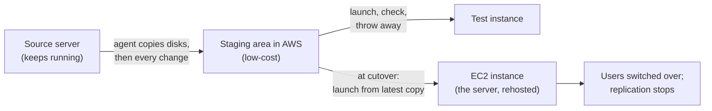
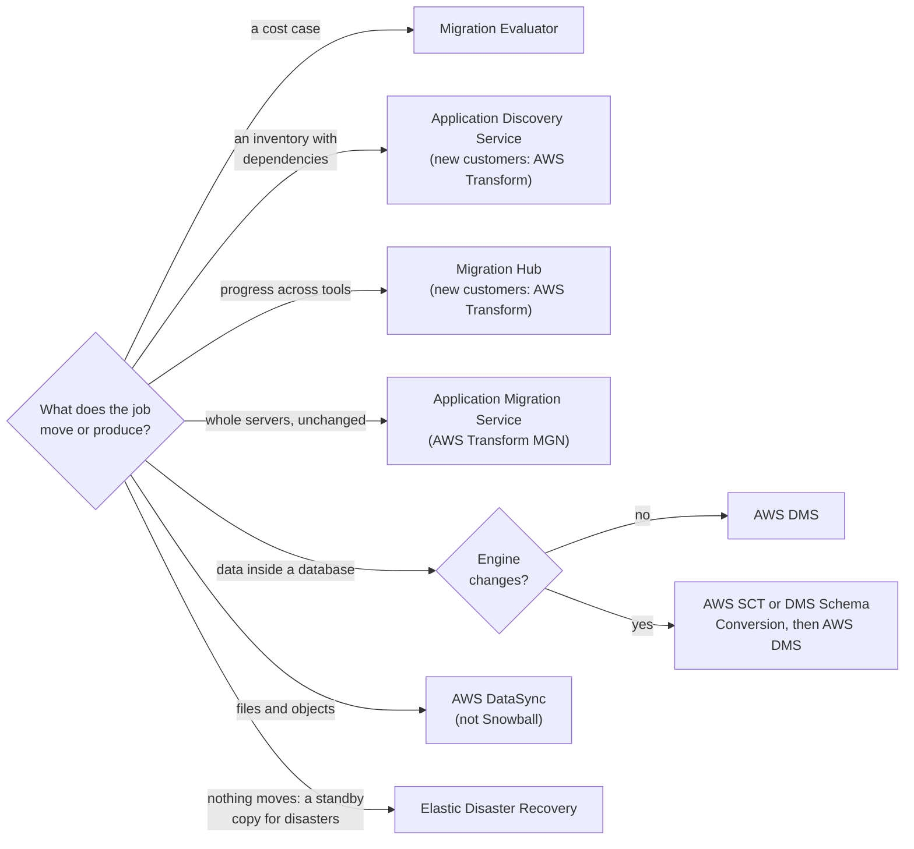

# Pick a migration tool by what it moves: a business case, whole servers, database data or files

The chain has a strategy for each of its ten applications. Now it needs the tools that carry those strategies out. Each AWS migration tool does one job, and the exam tests whether you can match the job to the tool. Two of the tools the exam names are closed to new customers, and one famous tool is being retired, so this lesson also tells you what AWS offers today.

**For:** an adult studying alone, possibly new to IT, who wants to understand AWS and use it safely. **Time:** about 35 minutes. Reading works on a phone.

**Before you start:** this lesson builds on [Seven migration strategies](02-seven-migration-strategies.md) (rehost, replatform and the rest), [Hybrid storage and backup](../05-storing-data/04-hybrid-storage-and-backup.md) (Elastic Disaster Recovery, DataSync, Snowball's retirement) and [Choosing a database](../05-storing-data/06-choosing-a-database.md) (DMS and SCT). If you skipped them, the key terms below are enough to follow. The chain's scenario is in the [module brief](00-brief.md).

## Warm-up: what you remember

Answer from memory before you read on.

1. From Module 12, "Getting help": the chain wants another company to carry out its server moves, and then to run the moved servers day to day. What kind of help is that, and how would the chain find one with proven migration skills?
2. From Module 11, "Paying for AWS": before you have built anything in AWS, which tool do you use to estimate its monthly cost, and which tool shows what you have already spent?
3. From lesson 04.01: the chain moves a server to AWS unchanged, and it now runs as an EC2 instance. Who patches its operating system?

Feedback

1. **An AWS Partner** that sells services, the exam's "system integrator"; one that runs systems day to day is a managed service provider ([lesson 12.04](../12-getting-help/04-partners-and-paid-help.md)). The chain can search the AWS Partner Solutions Finder for partners whose migration skills AWS has validated, such as AWS Migration Competency partners. AWS Professional Services could also do the move, but it is AWS's own team, not another company. Partners come up twice in this lesson: for discovery and for moving data on physical devices.
2. **The AWS Pricing Calculator** estimates before you build; **Cost Explorer** shows what you have spent ([lesson 11.03](../11-paying-for-aws/03-estimate-watch-analyze.md)). A migration business case needs a third kind of tool, one that starts from what you run today: Migration Evaluator, below.
3. **The chain.** On EC2 the customer patches the guest operating system. Moving a server doesn't move that job to AWS.

## What you'll learn

By the end of this lesson, you can choose a migration tool for a job and say why the likely alternatives are wrong (objective 13.03a). That means you can:

- say what Migration Evaluator, Application Discovery Service, Migration Hub, Application Migration Service, AWS DMS and AWS SCT each do;
- say which of them are closed to new customers, and what AWS points to instead;
- tell Application Migration Service apart from DMS, and from Elastic Disaster Recovery;
- explain why Snowball is not today's answer for moving large amounts of data.

Try these before you read on. Guess if you're unsure; the answers are in the lesson.

1. The chain wants to move the stock and ordering system's Linux servers to AWS without changing their software. Which tool copies whole servers?
2. Can a new AWS customer sign up for AWS Application Discovery Service today?

## The big picture: tools to plan, tools to move, and one to stay ready

A migration has a planning stage and a moving stage. Planning tools never move anything; moving tools each move one kind of thing.

![Three columns. Plan: Migration Evaluator prices the move; Application Discovery Service finds servers and dependencies; Migration Hub tracks progress. Discovery Service and Migration Hub are outlined as closed to new customers since 2025-11-07, with an arrow to AWS Transform. Move: Application Migration Service, now AWS Transform MGN, moves whole servers; AWS DMS moves database data, with AWS SCT or DMS Schema Conversion converting the schema first when the engine changes; AWS DataSync moves files. Stay ready: Elastic Disaster Recovery keeps copying servers so they can be launched after a disaster.](../../images/13-03-big-picture.svg)

*Notice the two outlined boxes in the planning column. The exam still names them; a new customer can't sign up for them, and AWS sends new customers to AWS Transform.*

**Long description.** Three columns, left to right: plan, move, stay ready. Plan holds three tools: Migration Evaluator, which prices the move and builds the business case; AWS Application Discovery Service, which finds servers, their use and their dependencies; AWS Migration Hub, which tracks each application's migration. Discovery Service and Migration Hub are highlighted as closed to new customers since 2025-11-07, and an arrow leads from both to AWS Transform, the service AWS points new customers to. Move holds three tools: AWS Application Migration Service, now called AWS Transform MGN, which copies whole servers and launches them on EC2; AWS DMS, which copies the data inside databases and can keep copying changes, with AWS SCT or DMS Schema Conversion converting the schema first when the engine changes; AWS DataSync, which copies files and objects over the network. Stay ready holds AWS Elastic Disaster Recovery, which keeps copying servers so they can be launched in AWS after a disaster. A note: Snowball is not on the chart, because it is being retired.

## Key terms (skip if you know them)

- **Source server:** a server you are moving or protecting, in your data center or in another cloud.
- **Cutover:** the moment you switch users from the old system to the new one in AWS. Not the same as "copying": copying can run for days; cutover is a short, planned switch.
- **Block-level replication:** copying a server's disks piece by piece, below the level of files, and then copying every change. The copy ends up identical to the disk, operating system included.
- **Dependency:** a link between servers or applications, such as an ordering app that calls a database. Servers that depend on each other usually move together.
- **AWS Transform:** an AWS service, launched in May 2025, that uses AI agents to help plan and carry out migrations and modernization. The exam guide doesn't list it.

## Migration Evaluator prices the move before anyone commits

**Migration Evaluator** builds the **business case**: what the chain's current servers would cost to run on AWS, and how much could be saved. It starts from data about what you run today, not from guesses:

- **How it collects data.** An agentless collector runs on one Windows Server virtual machine on your network and reads inventory and use from the systems you already have, or you upload exports from your own inventory tools. Nothing is installed on each server ([Migration Evaluator FAQs](https://aws.amazon.com/migration-evaluator/faqs/), checked 2026-10-24).
- **What it finds.** Servers bought bigger than they need. It matches each one to an EC2 instance based on its size, its software licenses and how much of it is really used.
- **What it reports.** A quick report of projected one-year EC2, EBS and operating system license costs, and a fuller business case that you ask AWS's migration solutions architects to prepare with you. It can model bringing your own Windows Server and SQL Server licenses.
- **What it doesn't do.** It covers x86 servers only, and it doesn't map dependencies between applications.

You request an assessment from AWS rather than switching it on in the console. The product page doesn't state a price (checked 2026-10-24). Lesson 13.04 uses its kind of output to build the chain's business case.

Older material sends you to the "AWS TCO Calculator" for this job. That tool is gone: its address now opens the AWS Pricing Calculator. Lesson 13.04 explains what to use instead.

> **Your turn:** The chain's finance director asks, "Before the board votes, what would the servers behind the applications we're moving cost on AWS, including the loyalty database's SQL Server licenses?" Which tool fits, and why not the AWS Pricing Calculator alone?

Model answer

**Migration Evaluator.** It starts from measured data about the servers, finds the over-sized ones, and models license options such as bringing the SQL Server licenses. The Pricing Calculator would price whatever you type in, but someone would first have to work out the right size and license for each server by hand.

## The discovery and tracking tools are closed to new customers

The exam guide lists two planning tools that new customers can no longer get. Learn what they do, because questions use them, and learn their status, because real work does.

- **AWS Application Discovery Service** collects data about on-premises servers and databases: their configuration, how busy they are, and the network connections between them. You use it to group servers into applications and to spot dependencies before you plan the move.
- **AWS Migration Hub** is one place to track the status of each application's migration, whichever tool does the moving. It moves nothing itself.

Both stopped accepting new customers on **2025-11-07**. Existing customers can keep using them to finish their projects. AWS recommends **AWS Transform** instead, and says the discovery and tracking features are available there with no data to migrate ([Application Discovery Service availability change](https://docs.aws.amazon.com/application-discovery/latest/userguide/application-discovery-service-availability-change.html); [Migration Hub availability change](https://docs.aws.amazon.com/migrationhub/latest/ug/migrationhub-availability-change.html), checked 2026-10-24).

### "The discovery tools are open to new customers" is wrong

You may read, in courses written before late 2025, that any team planning a migration should turn on Application Discovery Service and track the work in Migration Hub. That's out of date. A team starting today can't sign up for either; it would use AWS Transform, or a Partner's discovery tool.

It's tempting because the exam guide still lists both, their documentation is still online, and existing customers still use them. On the exam, "collect server inventory and dependencies" still points to Application Discovery Service, and "track migrations across tools" to Migration Hub. In real work, check a service's status page before you plan around it.

> **Dated (checked 2026-10-24):** Application Discovery Service and Migration Hub have been closed to new customers since 2025-11-07, and their product pages redirect to AWS Transform. Application Migration Service has been renamed AWS Transform MGN. None of the three is shut down; existing customers keep using them. See the [AWS Transform](https://aws.amazon.com/transform/) page for what it offers now.

> **Check:** Which tool collects data about on-premises servers and the connections between them, so you can group them into applications?
>
> A. AWS Migration Hub\
> B. AWS Application Discovery Service, closed to new customers, with AWS Transform as the current choice\
> C. Migration Evaluator\
> D. AWS DMS

Feedback

**B is right.** Discovery Service collects inventory, use and dependencies; a new customer would do this in AWS Transform.

- **A is wrong.** Migration Hub tracks migration status; it shows discovery data but doesn't collect it.
- **C is wrong.** Migration Evaluator prices the move. It doesn't map dependencies.
- **D is wrong.** DMS moves database data.

## Application Migration Service, now AWS Transform MGN, rehosts whole servers

**AWS Application Migration Service** is AWS's tool for the **rehost** strategy from lesson 13.02. AWS now calls it **AWS Transform MGN** ("MGN" is short for migration); the exam uses the old name ([AWS Transform MGN](https://aws.amazon.com/application-migration-service/), checked 2026-10-24). It copies whole servers, with their operating system, applications and data, from physical machines, VMware vSphere, Microsoft Hyper-V or another cloud, and turns them into EC2 instances. The applications aren't changed.

*Notice that the source server keeps running until cutover. Testing doesn't disturb it, and downtime is only the short switch at the end.*

**Long description.** A flow from left to right. The source server keeps running. An agent on it copies its disks block by block, then every change, into a low-cost staging area in AWS. From the staging area you can launch test instances, check them and throw them away, as often as you like. At cutover you launch the final EC2 instance from the latest copy, switch users to it, and stop replicating.

Three things to remember:

- **It replicates continuously** at block level, so the copy in AWS stays current while you test. AWS says cutover windows are typically measured in minutes ([What is AWS Transform MGN?](https://docs.aws.amazon.com/mgn/latest/ug/what-is-mgn.html)).
- **It works in groups.** You can group servers into applications, and applications into **waves**, and cut over a whole group at once: useful for servers that depend on each other.
- **Rehosting is a first step.** AWS presents it as a fast first step toward modernizing; you can replatform or refactor once you're in AWS.

> **Your turn:** The stock and ordering system is custom software on Linux servers. It works well, the data center lease ends in 18 months, and there's no time to change it, so 13.02 chose rehost. Why does Application Migration Service suit this job better than rebuilding each server by hand on EC2?

Model answer

It copies each server as it is, operating system and all, so nobody has to reinstall and reconfigure custom software that nobody has time to touch. It keeps the copies current while the team tests, moves the system's servers together in one wave, and keeps the cutover to a short switch, so the shops' ordering stops only briefly. Rebuilding by hand would be slower and would risk missing settings nobody documented.

## MGN moves servers; DMS moves the data inside databases

In lesson 05.06 you met the database pair: **AWS DMS** copies the data in a database while the source keeps running, and can keep copying every change; **AWS SCT**, or **DMS Schema Conversion** in the DMS console, converts the schema first when the engine changes. That ongoing copy is the "database replication" strategy that task [1.3](https://docs.aws.amazon.com/aws-certification/latest/cloud-practitioner-02/cloud-practitioner-02-domain1.html#cloud-practitioner-02-task1.3) names as an example.

MGN and DMS both copy continuously and both cut over with little downtime, so they're easy to confuse. The difference is **what lands in AWS**.

*Notice the bottom row of each panel: after MGN you still run a server; after DMS you run only a database, and AWS runs the software under it.*

**Long description.** Two side-by-side panels. Left, Application Migration Service, now AWS Transform MGN: it copies a whole server, its operating system, its installed software including any database, and its disks, block by block; it arrives as an EC2 instance; afterwards you still patch the operating system and the database software. This is rehost. Right, AWS DMS: it copies only the data inside a database, then every change; it arrives in a managed database such as Amazon RDS or Aurora, or in another target such as S3; afterwards AWS runs and patches the database software. If the engine changes, AWS SCT or DMS Schema Conversion converts the schema first. Moving a database into RDS this way is a replatform.

| | Application Migration Service (AWS Transform MGN) | AWS DMS (with SCT when the engine changes) |
|---|---|---|
| **Copies** | Whole servers: operating system, software, disks | The data inside a database |
| **Lands as** | EC2 instances | A database such as RDS, Aurora or Redshift, or S3 |
| **Usual strategy** | Rehost | Replatform; also database replication |
| **Keeps copying after the move?** | No: it stops after cutover | It can, for as long as you need |

**What's the same:** both copy while the source runs, and both keep downtime short. **What differs:** the unit that moves, and what you run afterwards. **The principle:** if the job is "the whole server, unchanged", choose MGN; if it is "the data, into a managed or different database", choose DMS, with SCT or DMS Schema Conversion first when the engine changes.

The loyalty database shows the choice. MGN could copy its whole SQL Server machine onto EC2, but then the chain would still spend days each month patching and backing it up, which is the problem 13.02 set out to fix. That's why 13.02 chose to replatform it into Amazon RDS for SQL Server, with DMS.

> **Check:** The loyalty database moves from SQL Server in the data center to Amazon RDS for SQL Server, and shops keep adding customers' points during the move. Which tool or tools does the move need?
>
> A. Application Migration Service\
> B. AWS SCT (or DMS Schema Conversion), then AWS DMS\
> C. AWS DMS alone\
> D. AWS DataSync

Feedback

**C is right.** The engine stays SQL Server, so the schema fits as it is (a homogeneous migration). DMS copies the data, then every new change, until cutover.

- **A is wrong.** MGN would land the whole server on EC2, not the data in RDS, and the chain would keep the patching it wants to end.
- **B is wrong.** SCT converts a schema between engines; here the engine doesn't change. Had the chain chosen Aurora PostgreSQL instead, B would be right.
- **D is wrong.** DataSync copies files and objects, not live database tables.

## Files move over the network with DataSync; Snowball is no longer the answer

Lesson 05.04 introduced **AWS DataSync**: it copies files and objects over the network, between on-premises storage, other clouds, and AWS storage such as S3, EFS and FSx, with encryption and checks that the copy is complete ([What is AWS DataSync?](https://docs.aws.amazon.com/datasync/latest/userguide/what-is-datasync.html)). For a migration, it moves file shares and archives that no application keeps open as a database.

### "Snowball migrates large data sets" is wrong

You may have learned that for tens of terabytes or more, you order an AWS Snowball device, fill it and ship it back. That's no longer a current answer. Snowball Edge has been closed to new customers since 2025-11-07 ([AWS Snowball FAQs](https://aws.amazon.com/snowball/faqs/)), and AWS ends support for Snowball devices in its commercial Regions on **2026-12-31** ([AWS Snowball](https://aws.amazon.com/snowball/), checked 2026-10-24). For new customers AWS points to DataSync for online transfers, **AWS Data Transfer Terminal** (AWS sites where you bring your own storage devices and upload over a fast connection) for physical transfers, or AWS Partners ([Snowball Edge availability change](https://docs.aws.amazon.com/snowball/latest/developer-guide/snowball-edge-availability-change.html)). The current exam guide (checked 2026-10-24) no longer lists the Snow Family among its services.

It's tempting because Snowball was the textbook answer for years, and it still shows up in older courses and question banks.

For the chain, the files are the recipes from the recipe archive, which 13.02 retires: the application goes, the recipes are kept in an S3 archive storage class. If they fit in a few gigabytes, uploading them straight to S3 is enough; a large file share is a job for DataSync.

When a file share is large, whether the network is fast enough is arithmetic, not guesswork. Take a company outside the chain's portfolio with 60 TB of files to move:

*Notice how fast the time falls as the link gets faster: at 1 Gbps, 60 TB takes about a week. That is why "large" alone no longer means "ship a device".*

**Long description.** A horizontal bar chart, our own arithmetic, not AWS figures: the days needed to copy 60 TB (decimal terabytes) over a network link, using 80 percent of the link's speed. At 100 Mbps, 69.4 days. At 500 Mbps, 13.9 days. At 1 Gbps, 6.9 days. At 10 Gbps, 0.7 days, about 17 hours. The formula: terabytes × 8,000,000 megabits ÷ (link speed in Mbps × 0.8) gives seconds; divide by 86,400 for days.

> **Your turn:** That company's office has a 1 Gbps internet link that is busy during the day, and its 60 TB of files must be in S3 within a month. Recommend a way, in two sentences, and say what you would check.

Model answer

Use **AWS DataSync** over the network: at 80% of 1 Gbps the copy takes about a week, so even using the link only at night should finish within the month. Check how much of the link you can really use, and set a bandwidth limit on the DataSync task ([Setting bandwidth limits](https://docs.aws.amazon.com/datasync/latest/userguide/configure-bandwidth.html)) so daytime traffic isn't slowed; only if the network truly can't finish in time would you look at Data Transfer Terminal or a Partner, not Snowball.

## MGN or Elastic Disaster Recovery: same copying, different ending

Lesson 05.04 taught **AWS Elastic Disaster Recovery**: an agent copies a server's disks continuously into a staging area in AWS, and after a disaster you launch recovery servers in minutes. That sounds exactly like MGN, and the mechanics are similar. The difference is the ending.

*Notice the arrow at the end of each timeline: MGN's line stops at cutover; Elastic Disaster Recovery's line loops back, because protection never ends.*

**Long description.** Two timelines. Application Migration Service, now AWS Transform MGN: install the agent; replicate continuously; launch test instances; cut over; replication stops and the source server is retired. The line ends: it's a one-time move. AWS Elastic Disaster Recovery: install the agent; replicate continuously; run drills that don't stop replication; a disaster happens; recover by launching servers in AWS within minutes; fail back to the repaired source site when ready, or stay in AWS; keep replicating. The line loops: it's ongoing protection.

| | Application Migration Service (AWS Transform MGN) | AWS Elastic Disaster Recovery |
|---|---|---|
| **Goal** | Move servers to AWS, once | Get servers running again after a disaster |
| **After the switch** | Replication stops; the old server is retired | Replication continues; you can fail back |
| **Practice runs** | Test launches before cutover | Drills, repeated for as long as you protect the server |
| **Strategy it serves** | Rehost | None of the 7 Rs: it protects, it doesn't migrate |

**The principle:** ask whether the old server should still exist afterwards. If no, it's a migration: MGN. If yes, and AWS is the place to recover it, it's disaster recovery: Elastic Disaster Recovery.

> **Check:** Accounting got new servers eight months ago, so 13.02 retains it until its next refresh. Suppose the finance director wants it running again within minutes if the data center fails before then. Which tool?
>
> A. Application Migration Service\
> B. AWS Elastic Disaster Recovery\
> C. AWS DMS\
> D. AWS Backup alone

Feedback

**B is right.** The servers stay where they are; Elastic Disaster Recovery keeps a current copy in AWS and launches it within minutes when needed.

- **A is wrong.** MGN is for moving the servers, which the plan postpones.
- **C is wrong.** DMS copies database data; it doesn't give back a running server.
- **D is wrong.** A backup gives back data, and someone still has to rebuild the server (lesson 05.04).

## Worked example: a tool for each of the chain's jobs

The chain's migration lead lists the jobs ahead. Here is how an expert picks a tool for each, starting from one question: **what is being moved, or produced?**

*Notice that only one branch asks a second question. For databases, the engine decides whether a schema conversion comes first.*

**Long description.** A decision flowchart from one question: what does the job move or produce? A cost case: Migration Evaluator. An inventory with dependencies: Application Discovery Service, or AWS Transform for new customers. Progress across tools: Migration Hub, or AWS Transform for new customers. Whole servers, unchanged: Application Migration Service, now AWS Transform MGN. Data inside a database: if the engine stays the same, AWS DMS; if it changes, AWS SCT or DMS Schema Conversion, then AWS DMS. Files and objects: AWS DataSync, not Snowball. Nothing moves, but a server needs a standby copy for disasters: Elastic Disaster Recovery.

| Job | Tool | The expert's reasoning |
|---|---|---|
| Price the servers behind the applications that move, with their licenses | Migration Evaluator | It produces a cost case from measured use; nothing moves yet |
| Find what the stock and ordering servers connect to | AWS Transform today; Application Discovery Service on the exam | Dependencies decide which servers move together in one wave |
| Rehost stock and ordering's Linux servers | Application Migration Service (AWS Transform MGN) | Whole servers, unchanged, with a short cutover |
| Loyalty database: SQL Server into RDS for SQL Server | AWS DMS | Data, not servers; same engine, so no schema conversion |
| Chain website: MySQL into a managed MySQL database | AWS DMS | Data again, same engine; the web servers are rebuilt the bakery's way |
| Recipe archive: keep the recipes, retire the application | Upload to S3, or AWS DataSync if the share is large | Files only; Snowball is being retired |
| Accounting, retained: recoverable until it moves | Elastic Disaster Recovery, if the board wants it | It stays where it is; AWS is the recovery site |
| Track every wave in one place | AWS Transform today; Migration Hub on the exam | Tracking moves nothing |

Two habits show in the reasoning. The expert names **the unit that moves** before naming any tool, and checks **each tool's status** before putting it in a plan. The other applications need none of these tools: oven control stays put; email and payroll move their data into the new vendors' services; and the shop tools relocate as a whole VMware platform to a VMware-based service on AWS (lesson 13.02). If the loyalty database had been heading for Aurora PostgreSQL, its row would have read "AWS SCT or DMS Schema Conversion, then AWS DMS". To sort the whole portfolio yourself, try [Simulation S16: the portfolio sorter](05-sim-portfolio-sorter.md).

## Your side of the line

The migration tools are AWS's to run and secure: the agents' software, the replication service, the staging infrastructure. What you choose stays yours, as lesson [04.01](../04-shared-responsibility-and-access/01-security-of-vs-in-the-cloud.md) taught. You decide which network path replication uses (AWS's MGN documentation says data is encrypted in transit, and it can run over a VPN or Direct Connect), who in your account may launch servers, and how the new instances are set up. After cutover, a rehosted server is an EC2 instance like any other: you patch its operating system, set its security groups, and back it up.

## What you pay for

> **What you pay for (as of 2026-10-24):** **Migration Evaluator:** no price on its product page; you request an assessment. **Application Migration Service (AWS Transform MGN):** each source server gets 2,160 hours of replication free, which is 90 days of continuous use; after that, an hourly charge per server while it keeps replicating. Throughout, you pay for the AWS resources it uses: the replication infrastructure, and the EC2 and EBS for test and cutover instances ([AWS Transform MGN FAQs](https://aws.amazon.com/application-migration-service/faqs/)). **AWS DMS:** the replication capacity it runs on, while you use it; DMS Schema Conversion is free apart from storage ([AWS DMS FAQs](https://aws.amazon.com/dms/faqs/)). **AWS DataSync:** per gigabyte copied (plus a fee for each task run in its Enhanced mode), and the storage and requests of the services you copy into ([AWS DataSync pricing](https://aws.amazon.com/datasync/pricing/)). This module has no lab: DMS and MGN bill while they run, and the discovery tools are closed to new customers.

## In real work: plan by unit, move in small waves

Migration teams build a plan from an inventory, group dependent servers into waves, rehost or replatform each wave with the matching tool, and track progress in one place. Moving in waves, with test launches before each cutover, is the operational excellence design principle "[Make frequent, small, reversible changes](https://docs.aws.amazon.com/wellarchitected/latest/framework/oe-design-principles.html)" applied to a migration: a failed test launch costs an afternoon, not a weekend outage. Keeping Elastic Disaster Recovery for the servers that stay is the reliability pillar at work, and pricing the move from measured data before committing is cost optimization, which lesson 13.04 takes further.

## Summary

- **Planning tools move nothing.** Migration Evaluator builds the cost case from measured data; Application Discovery Service collects inventory and dependencies; Migration Hub tracks progress.
- **Discovery Service and Migration Hub have been closed to new customers since 2025-11-07.** The exam still names them; AWS points new customers to AWS Transform.
- **Application Migration Service, now AWS Transform MGN, rehosts whole servers** onto EC2 by block-level replication, with test launches and short cutovers.
- **MGN moves servers; DMS moves database data,** with SCT or DMS Schema Conversion first when the engine changes.
- **Files move with DataSync.** Snowball is closed to new customers and its support ends on 2026-12-31; check the arithmetic before assuming the network is too slow.
- **MGN ends at cutover; Elastic Disaster Recovery keeps copying** so a server that stays can be recovered in AWS.

## Practice

1. **Which tool rehosts physical and virtual servers onto Amazon EC2 with minimal downtime?**

   A. AWS DMS\
   B. AWS Application Migration Service (AWS Transform MGN)\
   C. AWS Migration Hub\
   D. AWS DataSync

   

Feedback

   **B is right.** It copies whole servers block by block and launches them as EC2 instances.

   - **A is wrong.** DMS moves the data inside databases, not whole servers.
   - **C is wrong.** Migration Hub tracks migrations; it moves nothing, and it's closed to new customers.
   - **D is wrong.** DataSync copies files and objects.

   

2. **A company wants to keep an on-premises SQL Server database and a copy in Amazon RDS in step for six months while it tests the new system. Which tool keeps them in step?**

   

Feedback

   **AWS DMS**, with ongoing replication (change data capture). It keeps copying every change for as long as needed; this is the "database replication" migration strategy. SCT isn't needed because the engine doesn't change, and SCT doesn't replicate data anyway.

   

3. **A colleague's plan says: "Step 1, sign up for AWS Application Discovery Service." The company has never used it. What do you tell them?**

   

Feedback

   **It's closed to new customers** (since 2025-11-07), so the company can't sign up. AWS points new customers to AWS Transform for discovery and assessment. On the exam, Application Discovery Service is still the answer for "collect on-premises inventory and dependencies".

   

4. **Which pair is correctly matched?**

   A. Elastic Disaster Recovery: a one-time move that ends at cutover\
   B. Migration Evaluator: a business case from data about current servers\
   C. AWS SCT: ongoing replication of data\
   D. Snowball: the current answer for moving 100 TB

   

Feedback

   **B is right.**

   - **A is wrong.** That describes Application Migration Service; Elastic Disaster Recovery keeps replicating for recovery and failback.
   - **C is wrong.** SCT converts schemas; DMS replicates data.
   - **D is wrong.** Snowball is closed to new customers and its support ends on 2026-12-31; DataSync, Data Transfer Terminal or a Partner are the current choices.

   

5. **In two sentences, explain why a team would choose DMS rather than Application Migration Service for a database server, even though MGN could copy that server.**

   

Feedback

   **Model answer:** MGN would land the database server on EC2 unchanged, so the team would still run, patch and back up the database software itself. DMS puts only the data into a managed service such as RDS or Aurora, where AWS runs the database software, and it can change the engine with SCT's help.

   

6. **(From lesson 05.04.) What does a backup give back that Elastic Disaster Recovery doesn't, and the other way round?**

   

Feedback

   A **backup** gives back data from a point in time, kept for as long as the rules say, which protects against mistakes and attacks on the data. **Elastic Disaster Recovery** gives back running servers within minutes. Teams use both.

   

**Next:** [The business case](04-the-business-case.md).

## Where to check the current details

- [Migration Evaluator](https://aws.amazon.com/migration-evaluator/) and its [FAQs](https://aws.amazon.com/migration-evaluator/faqs/) (checked 2026-10-24)
- [Application Discovery Service availability change](https://docs.aws.amazon.com/application-discovery/latest/userguide/application-discovery-service-availability-change.html) and [Migration Hub availability change](https://docs.aws.amazon.com/migrationhub/latest/ug/migrationhub-availability-change.html) (checked 2026-10-24)
- [AWS Transform](https://aws.amazon.com/transform/) (checked 2026-10-24)
- [AWS Transform MGN](https://aws.amazon.com/application-migration-service/), its [FAQs](https://aws.amazon.com/application-migration-service/faqs/) and [user guide](https://docs.aws.amazon.com/mgn/latest/ug/what-is-mgn.html) (checked 2026-10-24)
- [AWS DMS FAQs](https://aws.amazon.com/dms/faqs/) (checked 2026-10-24)
- [What is AWS DataSync?](https://docs.aws.amazon.com/datasync/latest/userguide/what-is-datasync.html) and [DataSync pricing](https://aws.amazon.com/datasync/pricing/) (checked 2026-10-24)
- [AWS Snowball](https://aws.amazon.com/snowball/), its [FAQs](https://aws.amazon.com/snowball/faqs/), the [availability change](https://docs.aws.amazon.com/snowball/latest/developer-guide/snowball-edge-availability-change.html), [What is Snowball Edge?](https://docs.aws.amazon.com/snowball/latest/developer-guide/whatisedge.html) and [AWS Data Transfer Terminal](https://aws.amazon.com/data-transfer-terminal/) (checked 2026-10-24)
- [What is Elastic Disaster Recovery?](https://docs.aws.amazon.com/drs/latest/userguide/what-is-drs.html) and its [FAQs](https://aws.amazon.com/disaster-recovery/faqs/) (checked 2026-10-24)
- [AWS Certified Cloud Practitioner (CLF-C02) exam guide](https://docs.aws.amazon.com/aws-certification/latest/cloud-practitioner-02/cloud-practitioner-02.html), tasks [1.3](https://docs.aws.amazon.com/aws-certification/latest/cloud-practitioner-02/cloud-practitioner-02-domain1.html#cloud-practitioner-02-task1.3) and [3.4](https://docs.aws.amazon.com/aws-certification/latest/cloud-practitioner-02/cloud-practitioner-02-domain3.html#cloud-practitioner-02-task3.4) (checked 2026-10-24)

---

"Migration tools" by Automate the Cloud Inc., licensed under CC BY-NC 4.0 with the Additional Permission for Internal Training from Automate the Cloud Inc.
License: https://creativecommons.org/licenses/by-nc/4.0/
Permission: https://automatethe.cloud/licenses/atc-internal-training-permission.txt
