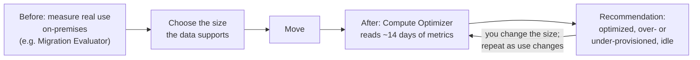

# A business case weighs the whole cost of staying against the whole cost of moving, and rightsizing and licensing often decide it

The chain has a strategy for each application and a tool for each move. The board now asks the question every migration meets: is it worth it? A **business case** answers with a full comparison: every cost of staying, every cost of moving, including the move itself, and the value money doesn't capture. In this lesson you build one, and you see why two decisions often swing the result: what size to run, and whose software licenses to use.

**For:** an adult studying alone, possibly new to IT, who wants to understand AWS and use it safely. **Time:** about 35 minutes. Reading works on a phone.

**Before you start:** this lesson builds on [What a data center really costs](../02-why-the-cloud/04-what-a-data-center-really-costs.md) (the seven on-premises cost groups, fixed and variable costs, rightsizing) and [Migration tools](03-migration-tools.md) (Migration Evaluator). Module 11, "Paying for AWS", teaches Dedicated Hosts ([lesson 11.02](../11-paying-for-aws/02-purchasing-options.md)) and the AWS Pricing Calculator ([lesson 11.03](../11-paying-for-aws/03-estimate-watch-analyze.md)); the key terms below give you enough if you haven't read it. The chain's scenario is in the [module brief](00-brief.md).

## Warm-up: what you remember

Answer from memory before you read on.

1. From Module 12, "Getting help": AWS Trusted Advisor has a cost optimization category. What kind of thing do its checks point out?
2. From Module 11, "Paying for AWS": a Dedicated Host and a Dedicated Instance both run on hardware used only by you. Which one is billed per host and shows you the server's physical cores?
3. From lesson 04.02: a company brings its own software licenses to AWS. Is staying within the license terms an inherited control, a shared control or a customer-specific control?

Feedback

1. **Resources you pay for but barely use**, such as underused instances, and other ways to cut waste ([lesson 12.02](../12-getting-help/02-tools-that-watch-your-account.md)). This lesson adds a tool that goes deeper on size: Compute Optimizer.
2. **The Dedicated Host** ([lesson 11.02](../11-paying-for-aws/02-purchasing-options.md)). That visibility matters for licenses counted per core or per socket, as you'll see below.
3. **Customer-specific,** by lesson 04.02's method: the customer has work to do, and AWS has no matching half of it, because the terms come from the customer's own agreements. AWS says the customer is responsible for complying with its license terms when it brings its own licenses. With licenses included in the price, AWS handles the licensing for you.

## What you'll learn

By the end of this lesson, you can build a cost comparison between staying on-premises and moving to AWS, and make and defend a licensing decision for a workload (objective 13.04a). That means you can:

- list the costs on each side of a business case, including one-time migration costs, and the value beyond cost;
- name the tools for a migration cost case today, and say why the TCO Calculator isn't one;
- explain how rightsizing before and after a move changes the result, and what AWS Compute Optimizer does;
- compare license-included and bring-your-own-license options, and choose between them for a stated case.

Try these before you read on. Guess if you're unsure; the answers are in the lesson.

1. Which AWS tool would you use today for a total cost of ownership comparison?
2. True or false: bringing licenses you already own to AWS is always cheaper than paying for licenses included in the price.

## The big picture: three ways to spend the next three years

A business case compares options, not just "cloud or not". Here are the chain's three, over three years, with made-up numbers for teaching:

*Notice that moving everything at its current size and licensing costs more than staying. The same move, with servers rightsized and licenses chosen with care, costs the least. The move didn't save the money; the two decisions did.*

**Long description.** Three stacked columns of three-year costs, made-up figures for teaching. Stay on-premises, $930,000: hardware and its refresh $240,000, facilities (space, power, cooling, network) $180,000, staff $300,000, licenses $210,000. Move as it is, with every server at its current size and every license bought from AWS, $1,070,000: AWS usage $450,000, licenses $260,000, staff $210,000, one-time migration costs $150,000. Move, rightsized and relicensed, $750,000: AWS usage $250,000, licenses $140,000, staff $210,000, one-time migration costs $150,000. The table in the next section gives the same figures.

## Key terms (skip if you know them)

- **Business case:** a document that compares the costs and benefits of the options for a decision, so the people paying can choose. Not the same as a price quote: it covers every option, over years.
- **One-time migration cost:** money spent once to move: planning, tools, people's time, running old and new systems side by side during the move, and training.
- **License-included:** the price of an EC2 instance or database already covers the software license, such as Windows Server or SQL Server. You pay as you go.
- **Bring your own license (BYOL):** using software licenses you already own on AWS, so AWS doesn't charge you for them. The license terms still apply.
- **Software Assurance:** a Microsoft program, paid on top of a license, that adds rights such as **License Mobility**: moving eligible licenses to a cloud provider's shared servers.
- **Dedicated Host:** a whole physical EC2 server for your use, billed per host per hour, which shows its sockets and physical cores. Module 11 covers it.
- **SQL Server edition:** the version of Microsoft SQL Server you license, such as Enterprise or Standard. Enterprise has more features and costs much more.

## Count every cost on both sides, including the move itself

Lesson 02.04 listed seven groups of on-premises cost: hardware and its refresh, space, power, cooling, network, staff and licenses. The "stay" column needs all of them, plus the next hardware refresh if it falls inside the period: that refresh is often what starts the conversation. The "move" columns need four things:

| Cost (made-up, three years) | Stay | Move as it is | Move, rightsized and relicensed |
|---|---|---|---|
| Hardware and its refresh | $240,000 | — | — |
| Facilities: space, power, cooling, network | $180,000 | — | — |
| Staff | $300,000 | $210,000 | $210,000 |
| Licenses (from AWS or from vendors) | $210,000 | $260,000 | $140,000 |
| AWS usage: compute, storage, data transfer | — | $450,000 | $250,000 |
| One-time migration costs | — | $150,000 | $150,000 |
| **Total** | **$930,000** | **$1,070,000** | **$750,000** |

Three things an expert checks in a table like this:

- **The one-time costs are there.** Leaving them out flatters the move. Running both environments during the move is part of them, and it lasts as long as the slowest wave.
- **Licenses are their own line,** whether AWS bills them or a vendor does. Otherwise a license-included price looks like expensive computing.
- **Staff doesn't drop to zero.** People stop racking servers and replacing disks, but they still run, secure and improve what's in AWS.

Money isn't the whole case. AWS's Cloud Economics Center describes cloud value in five dimensions: Cost Savings (TCO), Staff Productivity, Operational Resilience, Business Agility and Sustainability ([Cloud Economics Center](https://aws.amazon.com/economics/), checked 2026-10-24). They line up with the business outcomes you met in the [Cloud Adoption Framework](01-the-cloud-adoption-framework.md): reduced business risk, better ESG performance, more revenue and more efficient operations. A strong business case states those benefits in the board's terms, such as "the online shop can add a region in weeks", next to the numbers.

> **Your turn:** A manager's draft says, "AWS will cost us $250,000 over three years against $930,000 on-premises." Name three things missing from the comparison.

Model answer

Any three of: licenses (included or brought); staff, who still run the systems; the one-time migration costs, including running both environments during the move; storage and data transfer if the $250,000 is compute only; and, on the positive side, the value beyond cost, such as faster launches or better resilience. As written, the draft compares a partial bill with a full one.

## There is no TCO Calculator: use Migration Evaluator for the case, and the Pricing Calculator for estimates

> **Misconception:** "To compare on-premises and AWS costs, use the AWS TCO Calculator."
>
> That's out of date. AWS's TCO Calculator no longer exists: its old address now opens the AWS Pricing Calculator (checked 2026-10-24). Today a migration cost case comes from two places. **Migration Evaluator** (lesson 13.03) starts from measured data about the servers you run and projects what they would cost on AWS, including license options. The **AWS Pricing Calculator** (Module 11) prices an AWS setup you describe, service by service; it doesn't price your data center for you. The on-premises side is your own numbers, from your finance team.
>
> It's tempting because "total cost of ownership" is still the right idea, older courses and question banks name the calculator, and AWS's Cloud Economics Center still uses "TCO" as a label. The idea lives on; that tool doesn't.

> **Dated (checked 2026-10-24):** the address of the old TCO Calculator, `aws.amazon.com/tco-calculator`, redirects to the AWS Pricing Calculator at `calculator.aws`. We found no retirement notice with a date.

## Rightsize twice: before the move from measured data, and after it with Compute Optimizer

On-premises servers are bought for a guess about the future, years ahead, so many are far bigger than their work needs. Copy them at the same size and you pay for that guess every hour. That's most of the gap between the two "move" columns.

*Notice the loop at the end. Rightsizing isn't a step you finish; use changes, and so does the right size.*

**Long description.** A flow from left to right. Before the move, measure each server's real use on-premises, for example with Migration Evaluator, and choose the size the data supports. Then move. After the move, AWS Compute Optimizer reads about 14 days of CloudWatch metrics and recommends: optimized, over-provisioned, under-provisioned or idle. You change the size, and the loop repeats as use changes.

**AWS Compute Optimizer** analyzes the configuration and use of your AWS resources and recommends better sizes ([What is AWS Compute Optimizer?](https://docs.aws.amazon.com/compute-optimizer/latest/ug/what-is-compute-optimizer.html), checked 2026-10-24):

- **It covers more than EC2:** Auto Scaling groups, EBS volumes, Lambda functions, RDS and Aurora databases, ECS on Fargate and others, including commercial software licenses.
- **You opt in first.** It then reads the last 14 days of CloudWatch metrics by default, or 32 days if you choose, at no charge; a paid option, enhanced infrastructure metrics, looks back up to 93 days.
- **It recommends; it doesn't resize anything.** You decide, and you make the change. (Since 2025-11-21 it can apply a few EBS volume actions for you, such as upgrading the volume type, but only if you set up its [automation rules](https://docs.aws.amazon.com/compute-optimizer/latest/ug/automation-rules.html).)
- **For SQL Server, it can recommend a cheaper edition.** If an instance pays for SQL Server Enterprise but uses none of its Enterprise features, it reports the license as not optimized and shows the saving from moving to Standard ([license recommendations](https://docs.aws.amazon.com/compute-optimizer/latest/ug/view-license-recommendations.html)).

Keep it apart from its neighbors: **Auto Scaling** (Module 06) changes how *many* instances run, automatically; **Trusted Advisor** (Module 12) runs broad checks in several categories; **Compute Optimizer** gives deep, metric-based advice on the *size* and type of each resource. The Cost Optimization Pillar's [COST06-BP02 Select resource type, size, and number based on data](https://docs.aws.amazon.com/wellarchitected/latest/cost-optimization-pillar/cost_type_size_number_resources_data.html) is this habit.

> **Check:** Six weeks after the move, the chain wants to know which of its new EC2 instances are bigger than their work needs. What should it use?
>
> A. EC2 Auto Scaling\
> B. AWS Compute Optimizer, after opting in\
> C. The AWS TCO Calculator\
> D. AWS License Manager

Feedback

**B is right.** It reads the instances' CloudWatch metrics and reports which are over-provisioned, with a suggested size.

- **A is wrong.** Auto Scaling changes the number of instances, not their size, and it doesn't report on waste.
- **C is wrong.** It no longer exists, and it never analyzed running instances.
- **D is wrong.** License Manager tracks licenses, not instance sizes.

## License-included or bring your own license: who pays the software vendor

For Windows Server and SQL Server, AWS offers two routes ([Microsoft licensing on AWS](https://aws.amazon.com/windows/resources/licensing/), checked 2026-10-24):

- **License-included.** You launch an EC2 instance from an AWS Windows Server image, or Windows Server with SQL Server, or use Amazon RDS for SQL Server, and the hourly price includes the licenses. You pay as you go with no long-term commitment, AWS handles license compliance, and Windows Server client access licenses aren't needed.
- **Bring your own license.** You use licenses you already own, and AWS charges only for the infrastructure. How you may bring them depends on the license terms:
  - **With active Software Assurance**, eligible products such as SQL Server can move to ordinary shared EC2 instances under **License Mobility**, after a verification form to Microsoft. Windows Server isn't on the eligible list.
  - **On Amazon RDS for SQL Server**, the same split exists: license-included, or **Bring Your Own Media** for SQL Server 2019 or later, Enterprise or Standard edition, with active Software Assurance. AWS then charges no SQL Server license fee, you still pay for the infrastructure and the Windows fee, and RDS still handles patching and backups ([Licensing SQL Server on Amazon RDS](https://docs.aws.amazon.com/AmazonRDS/latest/UserGuide/SQLServer.Concepts.General.Licensing.html), checked 2026-10-24).
  - **Without Software Assurance**, SQL Server licenses can go on **Dedicated Hosts** only if they were bought before 2019-10-01 (or added as a true-up under an Enterprise Enrollment effective before then), and can only be upgraded to versions available before that date ([SQL Server licensing on EC2](https://docs.aws.amazon.com/sql-server-ec2/latest/userguide/sql-server-on-ec2-licensing.html), checked 2026-10-24). AWS states the 2019-10-01 cut-off for Microsoft licenses generally, so Windows Server licenses you bring follow the same Dedicated Hosts route ([Microsoft licensing on AWS](https://aws.amazon.com/windows/resources/licensing/), checked 2026-10-24).

How much of the hourly price is license? A lot, for SQL Server:

*Notice the last bar: on a license-included SQL Server Enterprise instance, nearly 90 cents of every dollar pays for software licenses, and only about 11 cents for the machine.*

**Long description.** Four stacked horizontal bars, one hour of an m7i.xlarge instance (4 vCPUs, 16 GiB of memory), On-Demand, US East (N. Virginia), from AWS's price list published 2026-10-23. Each bar starts with the instance itself at $0.2016, the price of the same instance running Linux. Linux: $0.2016 in total. Windows Server, license-included: plus $0.1840 for Windows, $0.3856 in total. Windows with SQL Server Standard, license-included: plus $0.1840 for Windows and $0.4800 for SQL Server, $0.8656 in total. Windows with SQL Server Enterprise, license-included: plus $0.1840 for Windows and $1.5000 for SQL Server, $1.8856 in total. The license parts are the difference between each price and the Linux price.

| m7i.xlarge, per hour | Instance | Windows license | SQL Server license | Total |
|---|---|---|---|---|
| Linux | $0.2016 | — | — | $0.2016 |
| Windows Server, license-included | $0.2016 | $0.1840 | — | $0.3856 |
| Windows + SQL Server Standard, license-included | $0.2016 | $0.1840 | $0.4800 | $0.8656 |
| Windows + SQL Server Enterprise, license-included | $0.2016 | $0.1840 | $1.5000 | $1.8856 |

> **Dated (checked 2026-10-24):** prices are On-Demand for US East (N. Virginia), from AWS's EC2 price list published 2026-10-23, for compute and licenses only, with no storage. They change; check [Amazon EC2 On-Demand pricing](https://aws.amazon.com/ec2/pricing/on-demand/) or the AWS Pricing Calculator for today's figures.

Two more pieces complete the picture:

- **AWS License Manager** tracks the licenses you bring, across accounts, and can stop a launch that would take you over what you own. It can also switch some EC2 instances between license-included and BYOL without rebuilding them ([What is AWS License Manager?](https://docs.aws.amazon.com/license-manager/latest/userguide/license-manager.html)).
- **Compliance is yours with BYOL.** AWS's licensing page says plainly that you are responsible for following your license terms, and it isn't legal advice. With license-included, AWS handles the licensing. That's the control you placed in the warm-up.

| | License-included | Bring your own license |
|---|---|---|
| **You pay AWS for** | The instance and the license, by the hour | The instance or the Dedicated Host |
| **You pay the vendor for** | Nothing more | What your agreement requires, such as Software Assurance |
| **Flexibility** | Change size or stop at any time | Bound by license terms; some need Dedicated Hosts |
| **Compliance** | Handled by AWS | Yours, with License Manager to help |
| **Usually wins when** | Workloads are small, short-lived or changing, or licenses aren't eligible | You own eligible licenses already paid for, and can use them fully |

**What's the same:** both run the same software on the same instances. **What differs:** who you pay for the license, and who carries the compliance work. **The principle:** BYOL saves money only when the licenses you own are eligible and you'd be paying for them anyway; otherwise license-included is simpler and often cheaper.

> **Your turn:** Answer the second prequestion. Is BYOL always cheaper? Give one case where it isn't.

Model answer

**No.** Licenses without Software Assurance may need a Dedicated Host, and a whole host for two small servers can cost more than license-included instances, as the worked example below shows. BYOL also stops paying off if you'd have to keep paying Software Assurance only to move a few servers, or if the workload will shrink or be retired soon.

## Worked example: licensing a distributor's reporting database

This example comes from outside the chain's portfolio, a food distributor, so that the chain's own licensing decisions stay for you to make in Simulation S17. The distributor's sales reporting system runs on two on-premises Windows Server virtual machines with SQL Server Enterprise, each with 8 virtual CPUs and 32 GB of memory. The licenses were bought in 2018, and the distributor stopped paying for Software Assurance in 2021. Migration Evaluator's data shows the servers average 12% CPU and peak at 30%, using under 12 GB of memory. The database team confirms that no Enterprise-only features are in use. The plan is to rehost them. What should they run on?

**Step 1: list the options the license terms allow.** No Software Assurance means no License Mobility. The licenses were bought before 2019-10-01, so BYOL on a Dedicated Host is allowed. License-included is always allowed.

**Step 2: rightsize first.** A 30% peak on 8 vCPUs is about 2.4 vCPUs of work, which fits 4 vCPUs with room to spare, and 12 GB fits in 16 GiB. So m7i.xlarge (4 vCPUs, 16 GiB) instead of m7i.2xlarge (8 vCPUs, 32 GiB).

**Step 3: price each option for both servers, for a month of 730 hours.**

![Horizontal bar chart: monthly cost of the two reporting servers under five options, On-Demand, US East (N. Virginia), price list of 2026-10-23. A, as-is size, license-included Enterprise: $5,506. B, rightsized, license-included Enterprise: $2,753. C, rightsized, license-included Standard: $1,264, highlighted as the choice. D, BYOL on one m7i Dedicated Host: $7,770 for the host. E, only with Software Assurance, Windows license-included plus SQL Server brought under License Mobility: $563 plus Software Assurance fees; not open to the distributor.](../../images/13-04-five-options.svg)

*Notice that the most expensive option is the one that reuses licenses the distributor already owns. A whole Dedicated Host for two small servers costs more than buying the licenses by the hour.*

**Long description.** A horizontal bar chart of the monthly cost, 730 hours, of the two reporting servers under five options. Prices are On-Demand for US East (N. Virginia), from AWS's price list published 2026-10-23, compute and licenses only. A: the current size, m7i.2xlarge, license-included Windows and SQL Server Enterprise, $5,506. B: rightsized to m7i.xlarge, license-included Enterprise, $2,753. C, highlighted: rightsized, license-included SQL Server Standard, $1,264. D: bring the owned licenses to one m7i Dedicated Host, $7,770 for the host, before any question about whether the licenses cover the host's 96 physical cores. E, shown dashed as not available to the distributor: rightsized, Windows license-included, with SQL Server brought under License Mobility, $563 a month plus Software Assurance fees paid to Microsoft. The table below gives the same figures.

| Option | What runs | Hourly price | Two servers, 730 hours |
|---|---|---|---|
| A. As-is, license-included Enterprise | 2 × m7i.2xlarge | $3.7712 each | $5,506 |
| B. Rightsized, license-included Enterprise | 2 × m7i.xlarge | $1.8856 each | $2,753 |
| C. Rightsized, license-included Standard | 2 × m7i.xlarge | $0.8656 each | $1,264 |
| D. BYOL on a Dedicated Host | 1 m7i host (96 physical cores) | $10.644 | $7,770 |
| E. License Mobility (needs Software Assurance) | 2 × m7i.xlarge, Windows license-included | $0.3856 each | $563 + Software Assurance |

**Step 4: weigh what the numbers leave out.** The expert's thinking:

- **D looks attractive and isn't.** The licenses are already paid for, but a Dedicated Host is billed as a whole server, and an m7i host has room for far more than two small instances. Worse, licenses counted per core may have to cover the host's 96 physical cores, far more than the distributor owns. A host pays off when you can fill it, for example with dozens of Windows servers, not two.
- **E is the cheapest, but not open to them.** Restarting Software Assurance costs money every year, paid to Microsoft, not shown here. It's worth asking the price only if many SQL Server workloads would use it.
- **C beats B by about $1,490 a month,** but only because no Enterprise features are used. If the reports later need an Enterprise-only feature, the team can change edition. After the move, Compute Optimizer can watch for exactly this.
- **Owned licenses are a sunk cost.** What the distributor paid in 2018 doesn't change which option is cheapest from today.

**The decision:** option C, about $1,264 a month instead of $5,506 at the current size, a 77% cut, while keeping the plan to rehost. A whole Dedicated Host, the "reuse what we own" option, would have cost the most. Rightsizing and the edition choice did the work, which is what the big-picture chart showed for the chain's whole portfolio. Now make the same kind of decisions for the chain's loyalty database, accounting servers and stock and ordering system in [Simulation S17: rightsizing and licensing](06-sim-rightsizing-and-licensing.md).

## What you pay for

> **What you pay for (as of 2026-10-24):** **AWS Compute Optimizer:** no additional charge; you pay for the resources and any CloudWatch monitoring. Its paid option, enhanced infrastructure metrics, costs $0.0003360215 per resource per hour while the resource runs, about $0.25 a month for one that runs all month ([Compute Optimizer pricing](https://aws.amazon.com/compute-optimizer/pricing/)). **AWS License Manager:** no additional charge; you pay for the resources you use. **Dedicated Hosts:** per host per hour, however many instances run on it; the m7i host in the worked example was $10.644 an hour in US East (N. Virginia) ([Dedicated Hosts pricing](https://aws.amazon.com/ec2/dedicated-hosts/pricing/)). **Migration Evaluator:** its product page shows no price; you request an assessment.

## In real work: finance and technology build the case together

A migration business case is built by finance and technical staff together, as [COST01-BP02 Establish a partnership between finance and technology](https://docs.aws.amazon.com/wellarchitected/latest/cost-optimization-pillar/cost_cloud_financial_management_partnership.html) asks: finance owns the on-premises numbers and the license agreements, and engineers own the measured use and the instance choices. Two more best practices from the Cost Optimization Pillar show up in every case: [COST05-BP04 Select software with cost-effective licensing](https://docs.aws.amazon.com/wellarchitected/latest/cost-optimization-pillar/cost_select_service_licensing.html), which is the licensing decision you just made, and [COST06-BP02 Select resource type, size, and number based on data](https://docs.aws.amazon.com/wellarchitected/latest/cost-optimization-pillar/cost_type_size_number_resources_data.html), which is rightsizing. Rightsizing also serves the sustainability pillar: a server sized to its work uses less energy. Teams keep the case alive after the move, comparing the real bill with the forecast, so the next wave is priced better.

## Summary

- **Count every cost on both sides.** Staying includes the hardware refresh; moving includes AWS usage, licenses, staff and one-time migration costs. Add the value beyond cost, such as agility and resilience.
- **There is no TCO Calculator.** Use Migration Evaluator for a migration cost case from measured data, and the AWS Pricing Calculator to estimate an AWS setup.
- **Rightsize twice:** before the move from measured use, and after it with AWS Compute Optimizer, which recommends but doesn't change anything.
- **License-included or BYOL:** license-included is simple and pay-as-you-go; BYOL depends on license terms, such as Software Assurance for License Mobility, or Dedicated Hosts for older licenses, and makes compliance yours.
- **In the worked example,** rightsizing and the right edition cut the monthly cost by 77%, while reusing owned licenses on a Dedicated Host would have cost the most.

## Practice

1. **A company asks for the AWS tool that builds a data-driven business case for migrating its on-premises servers, including license options. What do you recommend?**

   A. The AWS TCO Calculator\
   B. Migration Evaluator\
   C. AWS Compute Optimizer\
   D. AWS License Manager

   

Feedback

   **B is right.** It collects data about the servers you run and projects AWS costs, including bringing your own Windows Server and SQL Server licenses.

   - **A is wrong.** It no longer exists; its address opens the AWS Pricing Calculator.
   - **C is wrong.** Compute Optimizer analyzes resources already running in AWS.
   - **D is wrong.** License Manager tracks licenses; it doesn't price a migration.

   

2. **Which statement about license-included instances is correct?**

   A. You must own the licenses before you launch them\
   B. They always need a Dedicated Host\
   C. The hourly price covers the software license, and AWS handles license compliance\
   D. They cost the same per hour as Linux instances

   

Feedback

   **C is right.**

   - **A is wrong.** That describes bringing your own license.
   - **B is wrong.** They run on ordinary shared instances; Dedicated Hosts are one route for some BYOL cases.
   - **D is wrong.** The license adds to the price: $0.1840 an hour for Windows on an m7i.xlarge in US East (N. Virginia), as of the price list of 2026-10-23.

   

3. **What does AWS Compute Optimizer do, and what doesn't it do? Answer in two sentences.**

   

Feedback

   **Model answer:** After you opt in, it analyzes about 14 days of CloudWatch metrics for resources such as EC2 instances, EBS volumes, Lambda functions and RDS databases, and reports which are over-provisioned, under-provisioned, optimized or idle, with recommended sizes. It doesn't resize anything itself; you decide and make the change.

   

4. **A company owns SQL Server licenses with active Software Assurance and wants to run SQL Server on ordinary shared EC2 instances, bringing those licenses. Which route makes this possible?**

   

Feedback

   **License Mobility through Software Assurance.** It lets eligible products such as SQL Server move to default (shared) tenancy EC2 instances, after a verification with Microsoft. Without Software Assurance, older licenses would need a Dedicated Host.

   

5. **A business case shows "Move" cheaper than "Stay", but it has no line for running both environments during the six-month move. Is the conclusion still safe? Explain in two sentences.**

   

Feedback

   **Not yet.** Running both environments is a real one-time migration cost, and over six months it can be large enough to change the answer. Add it with the other one-time costs, then compare again.

   

6. **(From lesson 02.04.) Moving to the cloud turns which kind of expense into which?**

   

Feedback

   **Fixed into variable.** You pay for what you use instead of paying for capacity whether you use it or not. Whether the total falls depends on matching what you run to what you need, which is why rightsizing mattered so much in this lesson.

   

**Next:** practice the whole module in [Simulation S16: the portfolio sorter](05-sim-portfolio-sorter.md) and [Simulation S17: rightsizing and licensing](06-sim-rightsizing-and-licensing.md).

## Where to check the current details

- [Cloud Economics Center](https://aws.amazon.com/economics/) (checked 2026-10-24)
- [Migration Evaluator FAQs](https://aws.amazon.com/migration-evaluator/faqs/) (checked 2026-10-24)
- [What is AWS Compute Optimizer?](https://docs.aws.amazon.com/compute-optimizer/latest/ug/what-is-compute-optimizer.html), its [license recommendations](https://docs.aws.amazon.com/compute-optimizer/latest/ug/view-license-recommendations.html) and [pricing](https://aws.amazon.com/compute-optimizer/pricing/) (checked 2026-10-24)
- [Microsoft licensing on AWS](https://aws.amazon.com/windows/resources/licensing/) and [Licensing options for SQL Server on Amazon EC2](https://docs.aws.amazon.com/sql-server-ec2/latest/userguide/sql-server-on-ec2-licensing.html) (checked 2026-10-24)
- [Amazon EC2 Dedicated Hosts](https://docs.aws.amazon.com/AWSEC2/latest/UserGuide/dedicated-hosts-overview.html) and [Dedicated Hosts pricing](https://aws.amazon.com/ec2/dedicated-hosts/pricing/) (checked 2026-10-24)
- [What is AWS License Manager?](https://docs.aws.amazon.com/license-manager/latest/userguide/license-manager.html) (checked 2026-10-24)
- [Amazon EC2 On-Demand pricing](https://aws.amazon.com/ec2/pricing/on-demand/); the figures in this lesson come from AWS's EC2 price list for US East (N. Virginia), published 2026-10-23
- [AWS Certified Cloud Practitioner (CLF-C02) exam guide](https://docs.aws.amazon.com/aws-certification/latest/cloud-practitioner-02/cloud-practitioner-02.html), task [1.4](https://docs.aws.amazon.com/aws-certification/latest/cloud-practitioner-02/cloud-practitioner-02-domain1.html#cloud-practitioner-02-task1.4) (checked 2026-10-24)

---

"The business case" by Automate the Cloud Inc., licensed under CC BY-NC 4.0 with the Additional Permission for Internal Training from Automate the Cloud Inc.
License: https://creativecommons.org/licenses/by-nc/4.0/
Permission: https://automatethe.cloud/licenses/atc-internal-training-permission.txt
