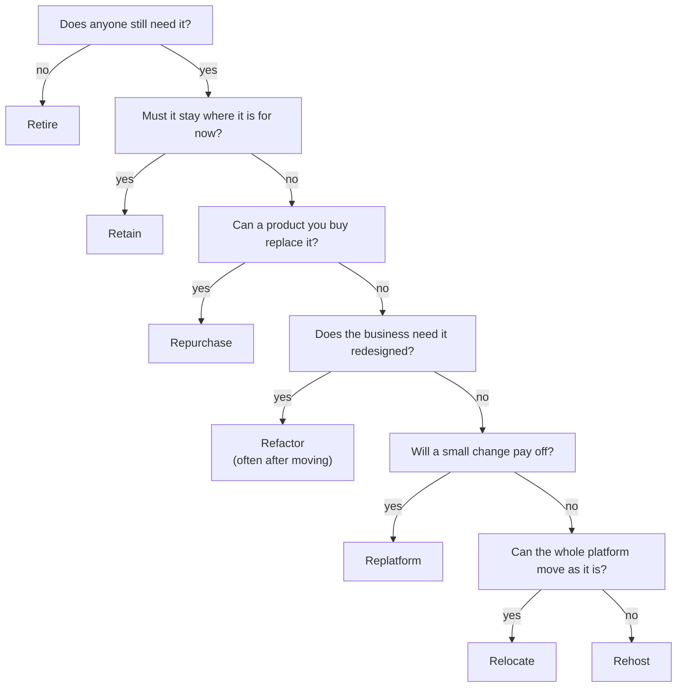

# Simulation S16: Choose a migration strategy for each of the chain's ten applications, and name who worries about what

## Before you start: your account, your responsibility

This guide is provided as is, without warranty. We work hard to keep it correct and current, but AWS changes often, and its services, prices, and free offers may differ from what is written here. The labs run in your own AWS account. You are responsible for that account, for its security, and for any charges it incurs, including charges from resources you forget to delete. Automate the Cloud Inc. is not liable for any costs, losses, or security incidents that result from following, or failing to follow, this material. Technical guidance here is general information, not advice about your specific systems.

**Who this is for:** you have read [13.01 The Cloud Adoption Framework](01-the-cloud-adoption-framework.md), [13.02 Seven migration strategies](02-seven-migration-strategies.md) and [13.03 Migration tools](03-migration-tools.md). **Time:** about 35 minutes. **Cost:** $0; no AWS account is used.

**Why a simulation:** migration tools bill while they run, and sorting applications happens on paper, before anything moves.

**Goal:** give each of the chain's ten applications one of the 7 Rs, with a reason, then match each manager's worry to a perspective of the AWS Cloud Adoption Framework (AWS CAF). **End state:** a ten-row strategy table and a list of concerns by perspective, in your notes.

**Why this matters:** an **application portfolio** is the full list of applications an organization runs, with the facts that decide what to do with each. Sorting it starts every migration plan ([About the migration strategies](https://docs.aws.amazon.com/prescriptive-guidance/latest/large-migration-guide/migration-strategies.html)).

## The chain's portfolio

The ten applications from the [module brief](00-brief.md), made up for teaching, with a few more facts. The data center lease ends in 18 months.

| # | Application | What you know about it | More facts |
|---|---|---|---|
| 1 | **Recipe archive** | No sign-ins for over a year; operating system out of support; old recipes must be kept | Average processor and memory use about 2% |
| 2 | **Oven control** | Talks directly to the controllers on the central bakery's ovens | |
| 3 | **Accounting** | New servers and license eight months ago | |
| 4 | **Email and calendars** | Its own mail servers take two staff much of their week | |
| 5 | **Payroll** | A vendor's package; the vendor now sells it as a service | |
| 6 | **Stock and ordering** | Custom, on Linux servers; works well; no time to change it before the lease ends | Its database software is licensed per physical processor core |
| 7 | **Loyalty database** | Microsoft SQL Server; days each month go on patches and backups | SQL Server 2019 Standard; the licenses have Software Assurance |
| 8 | **Shop tools** | About 30 small internal apps on a VMware cluster; the team knows VMware well | The cluster's hardware is due for replacement |
| 9 | **Wholesale portal** | One large program; each release takes a month; the business wants five times the café customers | The developers work for the chain |
| 10 | **Chain website** | Two servers that slow down every December; the bakery's AWS site does much the same job | Linux, PHP and MySQL |

## A working order for the questions

AWS gives each strategy's use cases but no order of questions. This order is ours, the same as in lesson 13.02: it settles the cheap answers first.

*Notice that rehost is what remains when no question gives a reason to do more.*

**Long description.** Six yes-or-no questions, top to bottom. No one needs it: retire. It must stay for now (compliance, high risk, a dependency, a recent upgrade, special hardware, a mainframe): retain. A product can replace it: repurchase. The business needs a redesign: refactor, often after moving the application first. A small change, such as a managed database, pays off: replatform. The whole platform can move as it is: relocate. Otherwise: rehost.

## Part 1: a strategy for each application

### Worked example: the recipe archive

1. *Does anyone need it?* No sign-ins for a year is well past the 90 days without connections that AWS's guide treats as a sign to retire, and use of about 2% is below its 5% mark for "zombie" applications.
2. *Anything to keep?* The recipes, not the application. Its operating system gets no security updates, which is a risk wherever it runs.
3. **Retire.** Export the recipes to an archive storage class (Module 05), shut the servers down, and take their cost out of the business case.

### Decision 1: give each of the other nine applications a strategy and a one-line reason

Model answer

*Notice that three applications don't move at all, and only one is redesigned, most likely after it has moved.*

**Long description.** Seven columns in three groups. Doesn't move to AWS: Retire (recipe archive), Retain (oven control, accounting). Moves as it is: Rehost (stock and ordering), Relocate (shop tools). Changes on the way: Replatform (loyalty database, chain website), Repurchase (email and calendars, payroll), Refactor (wholesale portal, rehosted first). A note says the wholesale portal can be rehosted first and refactored on AWS.

| # | Application | Strategy | Why |
|---|---|---|---|
| 2 | Oven control | **Retain** | It depends on hardware with no cloud equivalent. |
| 3 | Accounting | **Retain** | It was just upgraded. Move it at its next refresh. |
| 4 | Email and calendars | **Repurchase** | A subscription service ends the mail-server work. |
| 5 | Payroll | **Repurchase** | The vendor's service replaces the package; only the data moves. |
| 6 | Stock and ordering | **Rehost** | It works, and there's no time to change it. AWS Application Migration Service (now AWS Transform MGN) copies the servers to EC2. |
| 7 | Loyalty database | **Replatform** | SQL Server to Amazon RDS for SQL Server, AWS's own example, ends the patching. AWS Database Migration Service (AWS DMS) copies the data and its changes while the old database runs: the exam's "database replication". |
| 8 | Shop tools | **Relocate** | Changing 30 small apps one by one wouldn't pay off, so all 30 move at once to a VMware-based service on AWS, such as Amazon Elastic VMware Service (not on the exam), and the team keeps its tools. |
| 9 | Wholesale portal | **Refactor**, probably after a rehost | Strong demand to scale and release faster, and developers to do it. With the lease deadline and nine other applications, AWS's advice is to move it first (rehost now) and refactor once it runs on AWS, as lesson 13.02 concluded. Refactoring during the move is defensible only if the chain can staff it without risking the deadline. |
| 10 | Chain website | **Replatform** | The bakery's pattern: a managed database, and servers that scale out for December. **Retire** is also fair if the board folds it into the bakery's site. |

**Rehost isn't "wrong but quick":** an application is easier to improve once it runs in the cloud. **Refactor isn't "best":** AWS calls it the most complex and costly strategy.

## Part 2: who worries about what

During the Align phase, managers raise these concerns.

### Decision 2: match each concern to Business, People, Governance, Platform, Security or Operations

| | Who | Concern |
|---|---|---|
| a | Finance director | "How will we know the move paid off, and who watches the monthly bill?" |
| b | Office manager | "Staff have used the old email for years. Who trains them on the new service?" |
| c | Chief executive | "Which of these projects helps us win five times the café customers?" |
| d | Security lead | "The loyalty database holds customers' contact details. Who can read it, and is it encrypted?" |
| e | Operations lead | "When the overnight ordering run fails at 2 a.m., who gets the alert, and who patches the servers?" |
| f | Lead architect | "How do we build the network and every new environment the same way each time?" |
| g | Program manager | "Eighteen months, ten applications. How do we track the schedule and the risks?" |

Model answer

- **a Governance:** benefits and cloud financial management.
- **b People:** training staff through change.
- **c Business:** which investments serve the strategy.
- **d Security:** who can reach data, and protecting it.
- **e Operations:** alerts, incidents and patching.
- **f Platform:** architecture and repeatable environments.
- **g Governance:** program management and risk.

*Notice that c and g both mention projects: Business picks which to fund; Governance keeps them on track.*

**Long description.** Two panels. Business: "Are we investing in the right things?" Capabilities: strategy, portfolio and product management. Concern c. Governance: "Is the work on plan, on budget, within risk limits, and paying off?" Capabilities: program and project, benefits, risk, and cloud financial management. Concerns a and g.

### Decision 3: link each of the chain's goals to a CAF business outcome

1. "No more slow website every December."
2. "Five times the café customers."
3. "Free the two staff who run the mail servers."
4. "Report our energy use to investors."

Model answer

1. **Reduce business risk.**
2. **Grow revenue.**
3. **Increase operational efficiency.**
4. **Improve environmental, social and governance (ESG) performance.**

## Part 3: review a consultant's slide

### Decision 4: the slide below has five errors; find them

> "The six Rs are rehost, replatform, repurchase, refactor, retire and retain. Our assessment covers the six CAF perspectives: business, process, people, platform, operations and security. We will inventory the servers with AWS Application Discovery Service, prove the savings with the TCO Calculator, and ship the archived files on an AWS Snowball device."

Model answer

1. **Seven Rs, not six:** **relocate** is missing, and the shop tools need it.
2. **"Process" is a transformation domain, not a perspective.** The missing perspective is **Governance**.
3. **Application Discovery Service** has been closed to new customers since 2025-11-07, like AWS Migration Hub; AWS points to AWS Transform.
4. **The TCO Calculator** address now leads to the AWS Pricing Calculator. Use **Migration Evaluator** for a business case.
5. **Snowball** has been closed to new customers since 2025-11-07, and support ends on 2026-12-31. AWS points new customers to AWS DataSync over the network, or to AWS Data Transfer Terminal or a Partner for physical transfers.

> **Dated (checked 2026-10-24):** closures and names change; check AWS's pages, cited in this page's sources.

## Recap

Ask the cheap questions first: retire what nobody needs, retain what can't move yet, repurchase when a product exists, and refactor only for real business demand, usually after the move. Replatform when a small change pays off, relocate whole platforms, and rehost the rest. In the CAF, Business chooses what to fund and Governance keeps it on track.

**Next:** [Simulation S17](06-sim-rightsizing-and-licensing.md) sizes the servers and settles their licenses.

---

"Simulation S16: Sort the chain's ten applications into the 7 Rs" by Automate the Cloud Inc., licensed under CC BY-NC 4.0 with the Additional Permission for Internal Training from Automate the Cloud Inc.
License: https://creativecommons.org/licenses/by-nc/4.0/
Permission: https://automatethe.cloud/licenses/atc-internal-training-permission.txt
