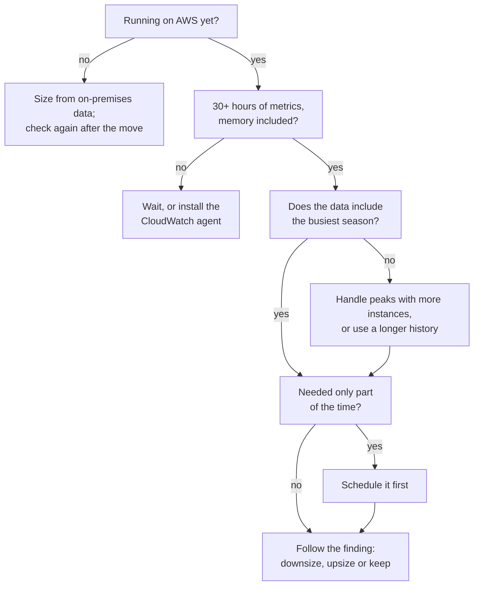
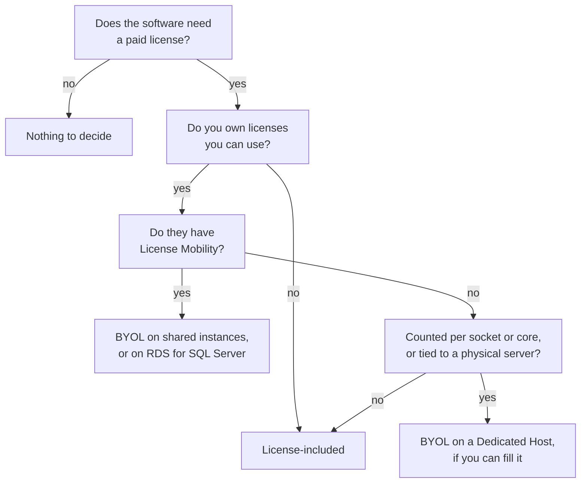

# Simulation S17: Rightsize the chain's servers from their data, and choose how to pay for each license

## Before you start: your account, your responsibility

This guide is provided as is, without warranty. We work hard to keep it correct and current, but AWS changes often, and its services, prices, and free offers may differ from what is written here. The labs run in your own AWS account. You are responsible for that account, for its security, and for any charges it incurs, including charges from resources you forget to delete. Automate the Cloud Inc. is not liable for any costs, losses, or security incidents that result from following, or failing to follow, this material. Technical guidance here is general information, not advice about your specific systems.

**Who this is for:** you have read [13.04 The business case](04-the-business-case.md) and done [Simulation S16](05-sim-portfolio-sorter.md); [06.01](../06-running-applications/01-ec2.md) taught instance types. **Time:** about 35 minutes. **Cost:** $0; no AWS account is used.

**Why a simulation:** rightsizing needs weeks of metrics from servers that bill by the hour.

**Goal:** decide what to do with five servers from their utilization data, then choose a licensing route for four workloads. **End state:** a rightsizing list with a monthly saving, and a license decision for each workload, in your notes.

**Why this matters:** [COST06-BP02 Select resource type, size, and number based on data](https://docs.aws.amazon.com/wellarchitected/latest/cost-optimization-pillar/cost_type_size_number_resources_data.html) asks for sizes chosen from data, not guesses. [COST07-BP03 Select third-party agreements with cost-efficient terms](https://docs.aws.amazon.com/wellarchitected/latest/cost-optimization-pillar/cost_pricing_model_third_party.html) covers licenses. A smaller server also uses less energy, which serves the sustainability pillar.

## Part 1: rightsizing

### How the data gets made

Before a move, size servers from on-premises data: Migration Evaluator collects it and flags servers that are larger than they need to be. After a move, **AWS Compute Optimizer** reads an instance's CloudWatch metrics and labels it **over-provisioned**, **under-provisioned** or **optimized** (separately, it can also flag idle resources). It also gives each option a **performance risk**: how likely the new type is to fall short of the workload, from very low to very high.

> **Dated (checked 2026-10-24):** you opt in first. Compute Optimizer needs at least 30 hours of metrics within the last 14 days for an EC2 instance. It sees memory only if the CloudWatch agent runs on the instance. Recommendations are free and look back 14 days, or 32 if you choose; a paid option, enhanced infrastructure metrics, looks back 93 days ([resource requirements](https://docs.aws.amazon.com/compute-optimizer/latest/ug/requirements.html), [pricing](https://aws.amazon.com/compute-optimizer/pricing/)).

*Notice that the tree checks the data before acting on any finding.*

**Long description.** Start: is the server running on AWS yet? No: size it from on-premises utilization data and check again after the move. Yes: are there at least 30 hours of metrics, memory included? No: wait, or install the CloudWatch agent. Yes: does the data include the busiest season? No: handle peaks with more instances (Auto Scaling) or use a longer history; then continue. Is the server needed only part of the time? Yes: schedule it to run only then, then follow the finding. No: follow the finding: downsize when over-provisioned and the performance risk is low, upsize when under-provisioned, keep when optimized.

### The chain's servers after the first wave

The data is made up and shaped like Compute Optimizer's output. Three weeks of October, US East (N. Virginia), On-Demand.

| Server | Runs | Type | Peak CPU | Peak memory | Finding and top option |
|---|---|---|---|---|---|
| web-1 | The chain website's web server, in an Auto Scaling group | `m7i.large` | 18% | 31% | Over-provisioned: `t3.medium`, risk low |
| test-1 | The chain website's test copy, used 9:00–19:00 on weekdays | `m7i.large` | 25% | 28% | Over-provisioned: `t3.medium`, risk low |
| stock-1 | Stock and ordering, rehosted; runs the overnight ordering batch | `m5.large` | 97% each night | 88% | Under-provisioned: a larger type |
| stock-2 | Stock and ordering's second server | `m5.large` | 9% | no data | Over-provisioned on CPU |
| stock-test | A test copy of stock and ordering, started 20 hours ago | `m7i.large` | — | — | No finding yet |

*Notice the gap in stock-2's memory: without the agent, nobody knows whether a smaller type has enough memory.*

**Long description.** A bar chart of peak use over three weeks, two bars per server. web-1: CPU 18%, memory 31%. test-1: CPU 25%, memory 28%. stock-1: CPU 97%, memory 88%. stock-2: CPU 9%, memory no data.

### Decision 1: for each server, choose downsize, upsize, keep, schedule or wait, and say why

Model answer

- **web-1: downsize to `t3.medium`.** The risk is low. October has no holiday rush, but the Auto Scaling group adds instances for December, so each instance can stay small.
- **test-1: schedule, then downsize.** It works 50 hours of a 168-hour week, so stopping it the rest of the time saves the most. Then the smaller type.
- **stock-1: upsize.** At 97% the ordering batch risks finishing late, and the shops wait. Rightsizing can cost more; the aim is the right size, not the smallest.
- **stock-2: wait.** Install the CloudWatch agent, collect 30 hours or more, then decide. Downsizing blind could leave it short of memory.
- **stock-test: wait.** It has 20 of the 30 hours Compute Optimizer needs.

| Change | Before, a month | After, a month |
|---|---|---|
| web-1 to `t3.medium` | $73.58 | $30.37 |
| test-1 scheduled | $73.58 | $21.84 |
| test-1 scheduled and `t3.medium` | $73.58 | $9.01 |

Together, web-1 and test-1 drop from $147.17 to $39.38 a month, a saving of $107.79.

*Notice that the schedule saves more on test-1 than the smaller type does.*

**Long description.** Horizontal bars of monthly On-Demand cost. web-1: now $73.58, downsized $30.37. test-1: now $73.58, scheduled $21.84, scheduled and downsized $9.01.

> **Dated (checked 2026-10-24):** Linux On-Demand prices in US East (N. Virginia): `m7i.large` $0.1008 an hour, `t3.medium` $0.0416 ([Amazon EC2 On-Demand pricing](https://aws.amazon.com/ec2/pricing/on-demand/)). A month here is 730 hours; the schedule is 50 hours a week, about 216.7 hours a month.

**Rightsize before you commit.** A Savings Plan or Reserved Instance (Module 11, Paying for AWS) bought for an oversized server locks the waste in for one or three years.

## Part 2: licensing

Lesson 13.04 defined license-included, bring your own license (BYOL), Software Assurance and License Mobility. Windows Server itself isn't eligible for License Mobility.

*Notice that a Dedicated Host appears only on the path where the license depends on physical hardware.*

**Long description.** Start: does the software need a paid license? No: nothing to decide. Yes: do you own licenses you can use? No: license-included. Yes: do they have License Mobility? Yes: BYOL on shared (default tenancy) instances, or on Amazon RDS for SQL Server. No: are they counted per socket or core, or tied to a physical server? Yes: BYOL on a Dedicated Host, if you can fill it. No: license-included. Whatever you bring, AWS License Manager can track it.

> **Dated (checked 2026-10-24):** per AWS's Microsoft licensing page (last updated in 2019), Windows Server licenses without Software Assurance can come to AWS only on Dedicated Hosts, and only if bought before 2019-10-01. A Dedicated Host is a whole physical server, billed per host, that shows its sockets and cores; a Dedicated Instance doesn't. RDS for SQL Server accepts your own SQL Server 2019 or later licenses with active Software Assurance ("bring your own media"). Microsoft's and other vendors' terms decide; check them.

### Decision 2: choose a route for each workload

| Workload | Software | Licenses owned |
|---|---|---|
| Loyalty database, moving to Amazon RDS for SQL Server | SQL Server 2019 Standard | Yes, with active Software Assurance |
| Accounting's two servers, when they move at the next refresh | Windows Server | Yes, bought eight months ago, no Software Assurance |
| Stock and ordering's database server, rehosted to EC2 | Commercial database software on Linux | Yes, priced per physical core, 16 cores; the vendor allows any hardware dedicated to the chain |
| Chain website on EC2 and RDS for MySQL | Linux, PHP, MySQL | None needed |

Model answer

- **Loyalty database: BYOL on RDS, or license-included.** Both work. With your own licenses, RDS charges no SQL Server fee, but you still pay for the hardware and the Windows fee, and you must keep Software Assurance active. Compare that renewal with the license-included price. If the chain renews Software Assurance anyway, BYOL is often the cheaper route.
- **Accounting: license-included.** Windows Server isn't covered by License Mobility, and licenses bought after 2019-10-01 miss the Dedicated Host cut-off, so these licenses have no route to AWS.
- **Stock and ordering's database: a Dedicated Host.** The license counts physical cores, and only a Dedicated Host shows how many the server has. Check the host's core count before you choose it: a whole host often has far more than 16 cores (an m7i host has 96), and if the vendor counts every core on the host, the chain must buy more licenses or pick a host type with fewer cores. Track the licenses with AWS License Manager (no additional charge).
- **Chain website: nothing to decide.** Open-source software has no license fee; you pay the Linux price.

### Decision 3 (challenge): the IT manager's spare licenses

"Retiring the recipe archive and the mail servers frees 40 Windows Server licenses from 2018, without Software Assurance. Should accounting's two servers go on Dedicated Hosts to use them?"

Model answer

**Probably not.** The licenses qualify: bought before 2019-10-01, on a Dedicated Host. But a host bills for the whole server whether you fill it or not. Two small accounting servers would leave most of it idle. License-included costs less unless the chain has enough Windows servers to fill a host. Price both with the [Dedicated Hosts pricing page](https://aws.amazon.com/ec2/dedicated-hosts/pricing/) and the Windows On-Demand prices before deciding.

## Recap

Rightsize from data you trust: enough hours, memory included, and the busy season covered or handled by scaling out. Schedule what isn't needed all the time, upsize what struggles, and commit to discounts only after sizing. For licenses, follow the tree: no license, no decision; no licenses owned, license-included; mobility rights, BYOL on shared hardware or RDS; hardware-bound licenses, a Dedicated Host you can fill.

**Next:** finish the business case in [13.04](04-the-business-case.md) with your saving and license choices, then take [the Module 13 mastery check](07-check.md).

---

"Simulation S17: Rightsize the chain's servers and settle their licenses" by Automate the Cloud Inc., licensed under CC BY-NC 4.0 with the Additional Permission for Internal Training from Automate the Cloud Inc.
License: https://creativecommons.org/licenses/by-nc/4.0/
Permission: https://automatethe.cloud/licenses/atc-internal-training-permission.txt
