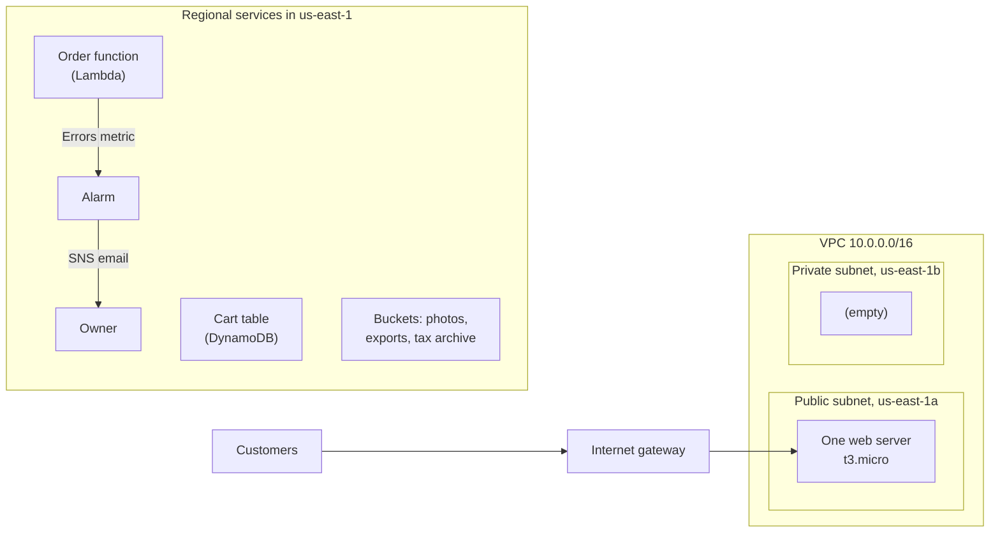

# Module 14: Review the bakery's workload against all six pillars, price the fixes, and recommend a Support plan

This module asks you to do the whole job the course has been building towards: look at a running workload, find what could hurt the business, and say what to do about it and what it costs.

**For:** an adult studying alone, possibly new to IT, who wants to understand AWS and use it safely. You have finished Modules 02 to 13 and Labs 05 to 11. **Time:** about 3 hours, over two or three sessions.

## The scenario: the owner asks, "Is it built well?"

December is coming, and the bakery's owner wants an outside view before the busiest month. You review the parts you built in Labs 05 to 11 as one workload against the six pillars of the Well-Architected Framework ([lesson 02.05](../02-why-the-cloud/05-the-well-architected-framework.md)). You hand her a one-page review: the high-risk issues, a priced fix for each, and a Support plan.

Each lab deleted what it built, so you review the workload from the inventory below, as the labs built it. Picture it all running at once, all month, as the whole of the bakery's production account in `us-east-1`.

## The workload you're reviewing

| Part | Lab | As built |
|---|---|---|
| Order exports bucket | [05](../05-storing-data/07-lab-05-versions-and-lifecycle.md) | S3, versioning on; rule for `exports/`: Standard-IA at 30 days, delete at 365, old versions deleted after 30 |
| Tax archive bucket | 05 | Versioning on; Glacier Deep Archive after 1 day; delete after 2,557 days; old versions after 180 |
| Cart table | [06](../05-storing-data/08-lab-06-a-dynamodb-table.md) | DynamoDB, on-demand; point-in-time recovery off |
| Order function | [07](../06-running-applications/05-lab-07-a-lambda-function.md), [11](../08-building-and-operating/06-lab-11-alarm-on-errors.md) | Lambda, Python 3.14, x86_64; its role can only write logs; bad input crashes it; logs never expire (Lab 11 rebuilt it without Lab 07's one-week retention) |
| Web server | [08](../06-running-applications/06-lab-08-launch-and-terminate-an-instance.md), 09 | One `t3.micro`, chosen because it was free-tier eligible, with a public IPv4 address, an encrypted 8 GiB gp3 disk (the size Lab 08 assumed), IMDSv2 required and no key pair. Lab 08 ran it in the default VPC with no inbound rules; here it sits in Lab 09's public subnet with Lab 09's web security group |
| Network | [09](../07-connecting-it/05-lab-09-build-a-small-vpc.md) | One VPC; a public subnet in `us-east-1a` routed to the internet gateway; a private subnet in `us-east-1b`; web group allows HTTPS from anywhere; a database group accepts port 5432 only from the web group, with no database behind it; a network ACL on the public subnet blocks one bad range |
| Photo bucket | [10](../08-building-and-operating/05-lab-10-same-bucket-three-ways.md) | Built from a CloudFormation template: private, encrypted by default, tagged; no versioning, no lifecycle rule |
| Error alarm | 11 | One or more function errors in a minute emails one address through SNS, on ALARM and on OK |
| Account | [primer](https://github.com/AutomateTheCloud/atc-study-aws_account_guardrails/blob/main/primer/00-read-this-first.md) | Root MFA; an IAM admin user with MFA in an `Admins` group; budgets, a billing alarm and anomaly alerts; the safe defaults and a free external access analyzer; CloudTrail Event history only, no trail |

Everything except the photo bucket was built by hand in the console. **Not there:** a load balancer, Auto Scaling, a second web server, backups, a trail, CloudFront, a NAT gateway. The RDS order database is outside the review: no lab built it.

*Notice that one box holds the only path to every customer's order.*

**Long description.** Customers reach the internet gateway, then the single web server in the public subnet in `us-east-1a`, inside the VPC. The private subnet in `us-east-1b` is empty. Outside the VPC, as Regional services: the order function, whose Errors metric feeds the alarm, which emails the owner through SNS; the cart table; and three buckets.

## You'll be able to

Tags: the kind of knowledge (J judgment, P procedure) and what you do with it (Ap apply, Ev evaluate).

| Objective | Lesson or lab |
|---|---|
| **14.01a** Assemble a pillar-by-pillar review of a workload, price the fixes and recommend a Support plan, justifying each choice [J·Ev] | 14.01 |
| **14.02a** Record a review in the Well-Architected Tool and read its risks [P·Ap] | Lab 18 |
| **14.03a** Close out an AWS account safely: find every leftover, check the bill and keep the guardrails [P·Ap] | Lab 19 |

## What this covers on the exam

Task [1.2](https://docs.aws.amazon.com/aws-certification/latest/cloud-practitioner-02/cloud-practitioner-02-domain1.html#cloud-practitioner-02-task1.2), the Well-Architected Framework, applied with what you learned for the other tasks, including [4.1](https://docs.aws.amazon.com/aws-certification/latest/cloud-practitioner-02/cloud-practitioner-02-domain4.html#cloud-practitioner-02-task4.1) pricing and [4.3](https://docs.aws.amazon.com/aws-certification/latest/cloud-practitioner-02/cloud-practitioner-02-domain4.html#cloud-practitioner-02-task4.3) Support. Doing a review goes beyond the exam, which only asks you to recognize the pillars. We checked the exam guide on 2026-10-24.

## How the module is laid out

1. [The capstone review](01-the-capstone-review.md): the method, a worked example, the rubric and a model answer.
2. [Lab 18: record the bakery's review in the AWS Well-Architected Tool](02-lab-18-well-architected-tool-review.md), which is free: answer four of its questions, read the risks, save a milestone, then delete the workload.
3. [Lab 19: close out the account you used for the course](03-lab-19-close-out.md): sweep every Region for lab tags, check the bill, and decide what to do with your account.

**Scoring:** the rubric in lesson 14.01, instead of a mastery check.

## Coming back

Everything: the pillars (Module 02), shared responsibility (04), storage and databases (05), compute (06), networks (07), templates and alarms (08), logging (09), costs (11) and Support plans (12).

---

"Module 14: Capstone: a Well-Architected review" by Automate the Cloud Inc., licensed under CC BY-NC 4.0 with the Additional Permission for Internal Training from Automate the Cloud Inc.
License: https://creativecommons.org/licenses/by-nc/4.0/
Permission: https://automatethe.cloud/licenses/atc-internal-training-permission.txt
