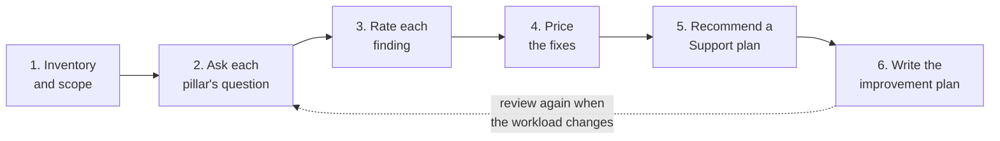
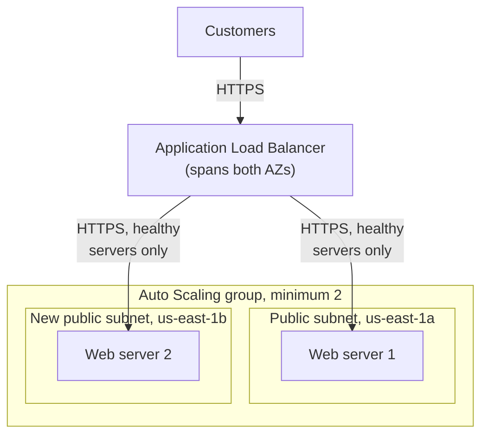

# A Well-Architected review asks each pillar's questions of a real workload, rates what it finds by the harm to the business, and prices every fix

Now you use all six pillars on one workload: the bakery's, as you built it in Labs 05 to 11. A review isn't a test the workload passes or fails. It's a short list of what could hurt the business most, what to do about each item, and what that costs.

**For:** an adult studying alone, possibly new to IT, who wants to understand AWS and use it safely. **Time:** about 40 minutes to read, then about 90 minutes for your own review. Reading works on a phone; the write-up is easier on a laptop.

**Before you start:** keep the inventory in the [module brief](00-brief.md) open in another tab. This lesson uses the pillars from [lesson 02.05](../02-why-the-cloud/05-the-well-architected-framework.md), costing from lessons [11.01](../11-paying-for-aws/01-how-aws-charges.md) and [11.03](../11-paying-for-aws/03-estimate-watch-analyze.md), and the Support plans from [lesson 12.01](../12-getting-help/01-support-plans.md); if one is hazy, reread its summary. No AWS account is needed; [Lab 18](02-lab-18-well-architected-tool-review.md) records part of your review in AWS's tool afterwards.

## Warm-up: what you remember

Answer from memory before you read on.

1. From Module 13, "Moving to AWS": what must you do before AWS Compute Optimizer recommends a size for an instance, and how much history does it read by default?
2. From Module 09, lesson ["Who did what"](../09-protecting-and-governing/01-who-did-what.md): how far back does CloudTrail Event history go, and how do you keep records for longer?
3. From lesson 04.01: on an EC2 web server, who patches the operating system: AWS or the customer?

Feedback

1. **Opt in;** it then reads 14 days of CloudWatch metrics by default ([lesson 13.04](../13-moving-to-aws/04-the-business-case.md)).
2. **90 days.** A **trail** delivers events to an S3 bucket, kept as long as you like; the first copy of management events costs nothing from CloudTrail. The bakery has none.
3. **The customer** ([lesson 04.01](../04-shared-responsibility-and-access/01-security-of-vs-in-the-cloud.md)). Nobody in the inventory owns that job yet.

## What you'll learn

By the end of this lesson, you can assemble a pillar-by-pillar review of a workload and justify each fix you recommend (objective 14.01a): set its scope, ask each pillar's questions, rate the findings, price the fixes, recommend a Support plan, and write it up as an improvement plan.

Try these before you read on. Guess if you're unsure; the answers are in the lesson.

1. Does a Well-Architected review give the workload a score out of 100?
2. If one fix costs $0 and another costs $37 a month, should you always do the cheap one first?

## The big picture: six steps from inventory to write-up

*Notice the dotted arrow. A review describes the workload on one day; the Framework expects you to repeat it as the workload changes.*

**Long description.** Six boxes in order: inventory and scope; ask each pillar's question; rate each finding; price the fixes; recommend a Support plan; write the improvement plan. A dotted arrow from the last back to the second reads "review again when the workload changes".

## Key terms (skip if you know them)

- **Workload inventory:** a list of every part of the workload and how it is set up. The module brief holds the bakery's.
- **Review scope:** what the review covers and what it leaves out, written down: a boundary, not the size of the job.
- **Review question:** one of the Framework's numbered questions, such as REL 10. Each pillar has between five and thirteen, and each question has its own best practices.
- **Improvement plan:** the list of risks you decided to fix, in order, each with its fix, cost and owner.
- **Accepted risk:** a risk the business decides not to fix, with the reason and who decided, written down.
- **Scoring rubric:** a table that describes weak, good and strong work for each part of a task.

## Step 1: start from the inventory, and write down what's out of scope

A review is only as good as its picture of the workload. Before asking any question, read the inventory twice: once for what is there, once for what isn't. Missing parts are often the findings: no second server, no backups, no trail.

Then write the scope in one or two sentences. Ours: "The bakery's production account in `us-east-1`, as built in Labs 05 to 11, running all month. Out of scope: the RDS order database, which no lab built." The owner then knows what you didn't look at. The Framework expects a review to take hours, not days, and to be a conversation with the people who built the workload ([The review process](https://docs.aws.amazon.com/wellarchitected/latest/framework/the-review-process.html)). You built this one, so your lab logs answer those questions.

> **Your turn:** From the inventory alone, list three things that aren't there and that you expect to matter. Don't judge them yet.

Model answer

Any three of: a second web server or a load balancer; backups of the cart table, and versioning on the photo bucket; a CloudTrail trail; an alarm on the web server; templates for anything but the photo bucket; log retention for the function. CloudFront and a NAT gateway are missing too, but nothing in the scenario needs them. Not every gap is a risk.

## Step 2: ask each pillar's own question

The Framework's appendix lists every pillar's questions with their best practices ([Questions and best practices](https://docs.aws.amazon.com/wellarchitected/latest/framework/appendix.html), checked 2026-10-24). A full review answers them all. Here, start with the one question per pillar that hits the bakery hardest, and follow a finding into a neighboring question when it leads there.

| Pillar | Starter question | Look at | Best practices to check |
|---|---|---|---|
| [Operational excellence](https://docs.aws.amazon.com/wellarchitected/latest/framework/operational-excellence.html) | [OPS 8. How do you utilize workload observability in your organization?](https://docs.aws.amazon.com/wellarchitected/latest/framework/ops-08.html) | The error alarm; the web server; who gets told | [OPS08-BP04 Create actionable alerts](https://docs.aws.amazon.com/wellarchitected/latest/operational-excellence-pillar/ops_workload_observability_create_alerts.html) |
| [Security](https://docs.aws.amazon.com/wellarchitected/latest/framework/security.html) | [SEC 4. How do you detect and investigate security events?](https://docs.aws.amazon.com/wellarchitected/latest/framework/sec-04.html) | CloudTrail; the function's logs | [SEC04-BP01 Configure service and application logging](https://docs.aws.amazon.com/wellarchitected/latest/security-pillar/sec_detect_investigate_events_app_service_logging.html) |
| [Reliability](https://docs.aws.amazon.com/wellarchitected/latest/framework/reliability.html) | [REL 10. How do you use fault isolation to protect your workload?](https://docs.aws.amazon.com/wellarchitected/latest/framework/rel-10.html) | Which parts sit in one AZ | [REL10-BP01 Deploy the workload to multiple locations](https://docs.aws.amazon.com/wellarchitected/latest/reliability-pillar/rel_fault_isolation_multiaz_region_system.html) |
| [Performance efficiency](https://docs.aws.amazon.com/wellarchitected/latest/framework/performance-efficiency.html) | [PERF 2. How do you select and use compute resources in your workload?](https://docs.aws.amazon.com/wellarchitected/latest/framework/perf-02.html) | Why `t3.micro`; what is measured | [PERF02-BP04 Configure and right-size compute resources](https://docs.aws.amazon.com/wellarchitected/latest/performance-efficiency-pillar/perf_compute_hardware_configure_and_right_size_compute_resources.html) |
| [Cost optimization](https://docs.aws.amazon.com/wellarchitected/latest/framework/cost-optimization.html) | [COST 7. How do you use pricing models to reduce cost?](https://docs.aws.amazon.com/wellarchitected/latest/framework/cost-07.html) | What runs every hour, On-Demand | [COST07-BP01 Perform pricing model analysis](https://docs.aws.amazon.com/wellarchitected/latest/cost-optimization-pillar/cost_pricing_model_analysis.html) |
| [Sustainability](https://docs.aws.amazon.com/wellarchitected/latest/framework/sustainability.html) | [SUS 2 How do you align cloud resources to your demand?](https://docs.aws.amazon.com/wellarchitected/latest/framework/sus-02.html) | What runs when nobody orders | [SUS02-BP01 Scale workload infrastructure dynamically](https://docs.aws.amazon.com/wellarchitected/latest/sustainability-pillar/sus_sus_user_a2.html) |

For each question, note what the workload does well, what it lacks, and which part of the inventory shows it. Strengths count: the buckets are private and encrypted, and the function's role can only write logs. A review that lists only faults doesn't tell the owner what to keep.

> **Misconception:** "A review scores the workload, and a good workload has no findings."
>
> That's not right. The Framework calls a review a conversation, not an audit; its outcome is a set of actions, not a grade ([The review process](https://docs.aws.amazon.com/wellarchitected/latest/framework/the-review-process.html)). The Tool counts high and medium risks, but nobody passes or fails. A review that finds nothing probably asked too few questions.
>
> It's tempting because exams and audits are scored, and the Tool's risk counts look like a score. They are a to-do list.

> **Your turn:** Ask the security starter question, SEC 4, of the inventory. Write one strength and one gap.

Model answer

**Strength:** the function writes its own logs, and its role allows nothing else. **Gap:** the only record of who did what is Event history, which keeps 90 days and nobody watches. A change made in August would leave no trace by December.

## Step 3: rate each finding by what it would do to the business

Each finding needs a rating, and the rating needs a reason. In the Well-Architected Tool, a high-risk issue is a choice that might do a business significant harm, and a medium-risk issue less. Each best practice's page states which level applies if it's missing. AWS calls these guidelines: your business's reasons can make a risk lower, if you write them down ([Workloads](https://docs.aws.amazon.com/wellarchitected/latest/userguide/workloads.html), checked 2026-10-24). So start from the page's level, then ask two questions in the owner's terms:

1. **What happens to the bakery if this goes wrong?** Orders stop, money is lost, data is gone, or someone is embarrassed.
2. **How likely is it, and would anyone notice?** A problem nobody would notice for hours is worse than one that sends an email.

A finding that stops orders and could happen any week is high. One that loses a few shopping carts, or a few dollars a year, is medium.

> **Check:** Which of these is the better reason for rating "the cart table has no point-in-time recovery" as medium rather than high risk?
>
> A. DynamoDB copies data across three Availability Zones, so backups aren't needed\
> B. Losing carts annoys some customers, but orders and payments live elsewhere\
> C. Backups are expensive\
> D. The Tool says so

Feedback

**B is right.** It rates the finding by its harm to the business, which is the method.

- **A is wrong.** Copies in three AZs protect against a failed AZ, not against a bad write or a deletion, which reaches every copy ([Simulation S2](../03-aws-around-the-world/06-sim-blast-radius.md)).
- **C is wrong.** At the bakery's size it costs about 20 cents a month, as step 4 shows. Price is a reason for ordering fixes, not for rating risk.
- **D is wrong.** The best practice's page, and so the Tool, rates a missing backup as high. Those levels are guidelines: AWS asks you to judge the impact on your business and write down why you differ.

## Step 4: price each fix with dated rates, and count people's time

Use lesson 11.01's method: every charge is a quantity times a rate, on one of four meters. The AWS Pricing Calculator checks the arithmetic ([Lab 15](../11-paying-for-aws/05-lab-15-pricing-calculator.md)). Three habits keep the price honest: **find the hourly lines**, which bill all month with or without customers; **count the work**, since a $0 fix can still take a day; and **compare with the harm avoided**: not "is $37 a lot?" but "is it less than the risk would cost us?" The rates this lesson uses:

| Item | Rate, US East (N. Virginia) |
|---|---|
| `t3.micro` instance, On-Demand | $0.0104 an hour |
| `t4g.micro` (Graviton), On-Demand; 1-year Standard Reserved Instance, No Upfront | $0.0084; $0.0053 an hour |
| Public IPv4 address, including a load balancer's | $0.005 an hour |
| EBS gp3 disk | $0.08 per GB-month |
| Application Load Balancer | $0.0225 an hour, plus $0.008 per capacity unit-hour |
| S3 Standard; Standard-IA; Glacier Deep Archive | $0.023; $0.0125; $0.00099 per GB-month |
| S3 requests | $0.005 per 1,000 writes; $0.0004 per 1,000 reads |
| DynamoDB on-demand requests | $0.625 per million writes; $0.125 per million reads |
| DynamoDB point-in-time recovery | $0.20 per GB-month |
| CloudTrail, first copy of management events | No charge from CloudTrail; you pay for the S3 storage |
| CloudWatch alarms | 10 alarm metrics free a month, then $0.10 each |

> **Dated (checked 2026-10-24):** EC2, VPC, load balancer and S3 rates are from AWS's Price List files retrieved 2026-10-24; DynamoDB requests and point-in-time recovery from the US East examples on [DynamoDB pricing](https://aws.amazon.com/dynamodb/pricing/on-demand/); CloudTrail and CloudWatch from their pricing pages. [VPC pricing](https://aws.amazon.com/vpc/pricing/) charges load balancers' public IPv4 addresses too. Check the [EC2](https://aws.amazon.com/ec2/pricing/on-demand/), [load balancer](https://aws.amazon.com/elasticloadbalancing/pricing/), [S3](https://aws.amazon.com/s3/pricing/), [CloudTrail](https://aws.amazon.com/cloudtrail/pricing/) and [CloudWatch](https://aws.amazon.com/cloudwatch/pricing/) pages before you quote a figure.

As built, the workload costs about $13.19 a month: $11.88 for the web server (instance, address and disk) and $1.31 for storage and requests. That second figure rests on made-up usage: 50 GB of photos and 1 GB of exports in S3 Standard, 2 GB of older exports in Standard-IA, 1 GB of tax archives in Deep Archive, 200,000 reads and 2,000 writes to S3, and 100,000 reads and 20,000 writes to the cart table, whose 1 GB fits DynamoDB's free 25 GB. Each line is rounded to the cent before adding, as a bill does. Lambda, the alarms, SNS email and the first 100 GB of data out stay inside their free allowances; the VPC parts are free.

> **Your turn:** Price this fix: turn on point-in-time recovery for a cart table of about 1 GB, and turn on versioning for the photo bucket, expecting about 2 GB of replaced photos kept for 30 days. What does it add each month?

Model answer

**About $0.25 a month.** Point-in-time recovery: 1 GB × $0.20 = $0.20. Old photo versions: 2 GB × $0.023 = $0.046. Add a lifecycle rule that deletes noncurrent versions after 30 days, or the $0.05 grows every month (Lab 05). The work: a setting on the table, and two changes to the photo bucket's template, since that bucket is built from one.

## Worked example: the reliability pillar

Here is one pillar done in full, with the expert's thinking visible. You do the other five.

**1. Read the question and its best practices.** [REL 10. How do you use fault isolation to protect your workload?](https://docs.aws.amazon.com/wellarchitected/latest/framework/rel-10.html) Its first two best practices fit: [REL10-BP01 Deploy the workload to multiple locations](https://docs.aws.amazon.com/wellarchitected/latest/reliability-pillar/rel_fault_isolation_multiaz_region_system.html), and [REL10-BP02 Automate recovery for components constrained to a single location](https://docs.aws.amazon.com/wellarchitected/latest/reliability-pillar/rel_fault_isolation_single_az_system.html).

**2. Walk the inventory, part by part.** The order function, the cart table and the S3 buckets are Regional services; AWS spreads them across Availability Zones for you. The network has subnets in two AZs, but only `us-east-1a` has a public subnet. The web server is one instance in `us-east-1a`. **Strength:** most of the workload already survives an AZ failure without any work. **Gap:** the one part that doesn't is the one every order passes through.

**3. Rate it.** If the instance fails, or `us-east-1a` has a problem, the site stops taking orders. Nothing replaces the server; someone has to notice, then rebuild it by hand from memory, because it wasn't built from a template. In December that could be a weekend of lost orders. **High risk.**

**4. List the options and price them.**

*Notice that option B costs nothing extra but still leaves gaps, and that most of option C's extra cost is hourly: the load balancer and its addresses bill whether or not anyone orders.*

**Long description.** Three bars, dollars per month, On-Demand, US East (N. Virginia), price lists retrieved 2026-10-24, 730 hours. A, as built: one `t3.micro` with its public IPv4 address and 8 GiB gp3 disk, $11.88; down until someone rebuilds it. B, the same server in an Auto Scaling group of one, at no extra charge, $11.88; a replacement in minutes, but with a new public address customers can't find until the site's address is updated. C, outlined: two servers, $23.76, plus an Application Load Balancer, $24.90 (hours $16.43, two public IPv4 addresses $7.30, an assumed 0.2 capacity units $1.17), $48.66; stays up, because the load balancer stops sending orders to a failed server and Auto Scaling replaces it. C adds $36.78 a month.

**5. Weigh the options in the owner's terms.** C costs $36.78 a month more, about $441 a year. Say online orders bring in $150 an hour on a December Saturday (made up; ask the owner). Three hours of outage on one Saturday cost about a year of the fix. B is a fair step if money is tight, but a failure still needs a person. The expert's other checks:

- **A second public subnet.** An Application Load Balancer needs subnets in at least two Availability Zones ([Application Load Balancers](https://docs.aws.amazon.com/elasticloadbalancing/latest/application/application-load-balancers.html)); the private subnet in `us-east-1b` can't serve. Subnets are free.
- **Servers behind the load balancer.** Their security group accepts HTTPS only from the load balancer's group, as Lab 09's database group accepted only the web group.
- **A launch template,** which Auto Scaling needs (lesson 06.02), so no server is rebuilt from memory.
- **The trade-off, named.** Two servers all night use more energy and money than one. The Framework lets you pay more for reliability where the business depends on it (lesson 02.05); write that down for the sustainability finding.

*Notice the new subnet. The fix needs a public subnet in the second AZ, not just a second server.*

**Long description.** Customers send HTTPS to an Application Load Balancer spanning both AZs. It forwards only to healthy servers: web server 1 in the public subnet in `us-east-1a`, web server 2 in a new public subnet in `us-east-1b`, both in one Auto Scaling group with a minimum of 2.

**6. Write the row.**

| Pillar | Finding | Risk | Best practice | Fix | Per month | Work |
|---|---|---|---|---|---|---|
| Reliability | The only web server sits in one AZ, and nothing replaces it | High | [REL10-BP01 Deploy the workload to multiple locations](https://docs.aws.amazon.com/wellarchitected/latest/reliability-pillar/rel_fault_isolation_multiaz_region_system.html) | Second public subnet; launch template; Auto Scaling group, minimum 2, across both AZs; Application Load Balancer | +$36.78 | About a day |

## Step 5: recommend a Support plan from the review's findings

Lesson 12.01's method: start at Basic and move up only for a reason; the review gives you the reasons. After the fixes the bill is about $50 a month. 9% of that is $4.53, below the Business Support+ minimum, so the fee is **$29 a month** per account, worked out on charges before credits and discounts, and once you sign up you pay for at least 30 days ([AWS Support Plan Pricing](https://aws.amazon.com/premiumsupport/pricing/), as of 2026-10-24). That's more than half the AWS bill, so weigh it like a fix. (Lesson 12.01's bakery had a $1,200 bill, with its order database and real traffic; this review prices only what the labs built.)

- **What it buys:** technical cases 24/7, a target of under 30 minutes for a first reply when a business-critical system is down, and all Trusted Advisor checks. The new load balancer and Auto Scaling group are what the owner can't fix alone on a Saturday night.
- **Why not Basic:** it can't open technical cases.
- **Why not Enterprise Support:** its $5,000 minimum is about 99 times the bill.

Our recommendation is Basic for now, with the gap written down as an accepted risk: $29 a month on a $50 bill is hard to justify. Move to Business Support+ once the bakery depends on the site for much of its revenue. Business Support+ today is also defensible with a reason; the rubric rewards the reasoning, not the plan's name.

> **Your turn:** The owner says, "$29 for support on a $50 bill? I'll take my chances." Write the one line that records her decision in the review.

Model answer

"**Accepted risk:** Support stays on Basic, so no technical cases can be opened; decided by the owner on (date), knowing Business Support+ would cost $29 a month. Revisit before next December." AWS's guidance asks for exactly this when a business chooses not to act.

## Step 6: write the improvement plan the owner can act on

The owner won't read six pages of notes. Give her one page, in this order:

1. **Scope:** one or two sentences, including what's out.
2. **Summary:** the high-risk issues in one line each, and the total change in the monthly bill.
3. **The findings table:** pillar, finding, risk, best practice, fix, cost per month, work, owner. High risks first; among risks of the same level, quick and cheap fixes first, so something improves this week. A cheap fix doesn't jump ahead of a high risk just because it's cheap.
4. **The Support plan,** with the one-line reason.
5. **Accepted risks,** each with who decided.
6. **Next review:** a date, and what would bring it forward.

*Notice that the load balancer, not the second server, is the biggest new line, and that the Support plan adds more than all the other fixes except the web tier.*

**Long description.** Four stacked horizontal bars, dollars per month, US East (N. Virginia), price lists retrieved 2026-10-24, usage made up. The table below gives every segment. The "later" bar uses two `t4g.micro` instances on 1-year Standard Reserved Instances, No Upfront, instead of two `t3.micro` On-Demand.

| Bill, per month | Web servers | Load balancer | Storage, requests, backups | Support | Total |
|---|---|---|---|---|---|
| As built | $11.88 | — | $1.31 | — | $13.19 |
| With the fixes | $23.76 | $24.90 | $1.70 | — | $50.36 |
| Plus Business Support+ | $23.76 | $24.90 | $1.70 | $29.00 | $79.36 |
| Later: Graviton, 1-year RIs | $16.32 | $24.90 | $1.70 | $29.00 | $71.92 |

## The scoring rubric

Score each row **1** developing, **2** proficient or **3** strong, and **0** if it's missing. You've met the capstone when every row scores at least 2. Score it a day after writing, when you read it more like the owner.

| Criterion | 1: Developing | 2: Proficient | 3: Strong |
|---|---|---|---|
| Scope | Lists the parts | States what's in and out | Also says what reviewing the rest would need |
| Operational excellence | Mentions monitoring | Finds that nothing watches the web server; links an OPS best practice | Also the hand-built parts, and an alarm that will be noisy at real volume |
| Security | Names a service without a reason | Finds the 90-day limit of Event history and proposes a trail | Also gives patching an owner, and records strengths |
| Reliability | Names one AZ as a problem | The single web server, rated high, options compared and priced | Also backups of carts and photos, and the sustainability trade-off |
| Performance efficiency | Says "make it faster" | Size chosen by a label, not data; measure first | Also says why there's no high risk here |
| Cost optimization | Says "buy Reserved Instances" | Fixes log retention; commits only after the redesign | Also prices the commitment, and chooses RI or Savings Plan with a reason |
| Sustainability | Says "use less" | Always-on servers for a demand that drops at night, with a fix | Also weighs it against reliability, and tests Graviton first |
| Risk ratings | Ratings without reasons | A business reason for every rating | Also what would change each rating |
| Costs | Some fixes priced | Every fix priced with dated rates, and hours of work | Also compares the largest cost with the harm avoided |
| Support plan | Names a plan | The cheapest plan that fits, fee worked out | Also why not the plans below and above |
| Write-up | Unordered notes | One page in the six-part order, high risks first | Also an owner per fix, and triggers for the next review |

> **Reflect:** Before you open the model answer, score your own write-up. Which row was hardest to reach 2 on, and why?

## Your review, then the model answer

Do the whole review now, steps 1 to 6 for all six pillars, taking the worked example's row as given. Write yours before opening the model: reading the answer first feels quicker and teaches much less.

Model answer

**Scope:** the bakery's production account in `us-east-1`, as built in Labs 05 to 11, running all month. Out of scope: the RDS order database, which needs its own review.

**Summary:** three high-risk issues: one web server in one AZ; nobody told if it stops; only 90 days of who-did-what. The fixes take the bill from about $13.19 to $50.36 a month, plus $29 for Support.

**Strengths to keep:** private, encrypted buckets; lifecycle rules on the exports and tax archives; a function role that can only write logs; DynamoDB and Lambda, spread across AZs by AWS; tags; budgets.

| # | Pillar | Finding | Risk | Best practice | Fix | Per month | Work |
|---|---|---|---|---|---|---|---|
| 1 | Reliability | Only web server in one AZ; nothing replaces it | High | [REL10-BP01 Deploy the workload to multiple locations](https://docs.aws.amazon.com/wellarchitected/latest/reliability-pillar/rel_fault_isolation_multiaz_region_system.html) | Two servers in two AZs, Auto Scaling, load balancer (worked example) | +$36.78 | 1 day |
| 2 | Operational excellence | Nothing watches the web tier; the only alarm watches the function, and emails one person | High | [OPS08-BP04 Create actionable alerts](https://docs.aws.amazon.com/wellarchitected/latest/operational-excellence-pillar/ops_workload_observability_create_alerts.html) | Alarm when the load balancer's healthy servers (`HealthyHostCount`) drop below 2, to the SNS topic; add a second address; loosen the error alarm to several minutes | $0 (one more alarm; the account then uses 3 of its 10 free) | 1 hour |
| 3 | Security | Only 90 days of Event history; nothing kept or watched | High | [SEC04-BP01 Configure service and application logging](https://docs.aws.amazon.com/wellarchitected/latest/security-pillar/sec_detect_investigate_events_app_service_logging.html) | A multi-Region trail to its own private bucket, with a rule to delete logs after a year | About $0.14 after a year, at 0.5 GB of logs a month | 1 hour |
| 4 | Reliability | Cart table has no point-in-time recovery; photo bucket has no versioning | Medium | [REL09-BP01 Identify and back up all data that needs to be backed up, or reproduce the data from sources](https://docs.aws.amazon.com/wellarchitected/latest/reliability-pillar/rel_backing_up_data_identified_backups_data.html) | Turn on recovery; add versioning and a 30-day rule for old versions to the photo template | +$0.25 | 1 hour |
| 5 | Operational excellence | Everything but the photo bucket was built by hand | Medium | [OPS05-BP03 Use configuration management systems](https://docs.aws.amazon.com/wellarchitected/latest/operational-excellence-pillar/ops_dev_integ_conf_mgmt_sys.html) | Templates for the network, web tier, function and alarms | $0 | 1 to 2 days |
| 6 | Security | Nobody owns patching the web servers' operating system | Medium; the load balancer now shields them | [SEC06-BP01 Perform vulnerability management](https://docs.aws.amazon.com/wellarchitected/latest/security-pillar/sec_protect_compute_vulnerability_management.html); the operational side is [OPS05-BP05 Perform patch management](https://docs.aws.amazon.com/wellarchitected/latest/operational-excellence-pillar/ops_dev_integ_patch_mgmt.html) | Monthly: update the launch template to the newest Amazon Linux image, and replace the servers | $0 | 1 hour a month |
| 7 | Cost optimization | The function's logs never expire, and the photo bucket has no lifecycle rule | Medium | [COST04-BP05 Enforce data retention policies](https://docs.aws.amazon.com/wellarchitected/latest/cost-optimization-pillar/cost_decomissioning_resources_data_retention.html) | 30-day retention on the logs; fix 4's rule for old photo versions | $0, and stops a slow rise | 5 minutes |
| 8 | Performance efficiency | `t3.micro` was chosen because it was free-tier eligible, not from data | Medium | [PERF02-BP04 Configure and right-size compute resources](https://docs.aws.amazon.com/wellarchitected/latest/performance-efficiency-pillar/perf_compute_hardware_configure_and_right_size_compute_resources.html) | After the redesign, opt in to Compute Optimizer and read the servers' metrics for a month | $0 | 1 hour |

**Later, once a month of data shows the floor of two servers is steady:**

- **Sustainability (SUS 2, then SUS 5):** the servers run all night for little demand, doubled by the reliability fix, an accepted trade-off. Under [SUS05-BP02 Use instance types with the least impact](https://docs.aws.amazon.com/wellarchitected/latest/sustainability-pillar/sus_sus_hardware_a3.html), whose page says Graviton-based instances give the best performance per watt in EC2, test the site on `t4g.micro`: $12.26 a month for two, against $15.18. The function can move to Arm too.
- **Cost:** under [COST07-BP01 Perform pricing model analysis](https://docs.aws.amazon.com/wellarchitected/latest/cost-optimization-pillar/cost_pricing_model_analysis.html), commit the floor of two servers for a year. Two `t4g.micro` on 1-year Standard Reserved Instances, No Upfront, cost $7.74 a month against $15.18 for two `t3.micro` On-Demand, saving about $7.44. Commit only after the Graviton test: a Standard RI is tied to its instance family, while a Compute Savings Plan would follow a change (lesson 11.02).

**Support plan:** Basic, recorded as an accepted risk: Business Support+ would cost $29 a month, more than half the bill. Move to Business Support+, at its $29 minimum, once the site carries much of the bakery's revenue, because it now has parts the owner can't fix alone; review that before December's peak. Enterprise Support's $5,000 minimum doesn't fit.

**Accepted risks:** a Region-wide outage stops the site (a second Region is out of proportion at this size); the order database is unreviewed.

**Next review:** after the fixes and before next December; sooner if the site adds payments, or the bill passes about $322 a month, where 9% exceeds the Support minimum.

Two ratings are lower than the level on the best practice's page, high for both [REL09-BP01](https://docs.aws.amazon.com/wellarchitected/latest/reliability-pillar/rel_backing_up_data_identified_backups_data.html) and [SEC06-BP01](https://docs.aws.amazon.com/wellarchitected/latest/security-pillar/sec_protect_compute_vulnerability_management.html): carts are low-value, photos can be uploaded again if the owner keeps the originals (ask her), and after fix 1 only the load balancer reaches the servers. [COST07-BP01](https://docs.aws.amazon.com/wellarchitected/latest/cost-optimization-pillar/cost_pricing_model_analysis.html)'s page says high too; the plan waits a month on purpose. Each reason goes in the write-up. Your review can differ, rating finding 3 medium or putting patching first, and still score 2 or 3 on every row, as long as each rating has a reason and each fix a price.

## In real work: review early, review again, and keep the list short

The Framework recommends reviews early in design, before launch, and after big changes, so hard-to-reverse decisions get the most attention. Teams keep the answers in the Well-Architected Tool, which saves milestones so the next review starts where this one ended; the Tool itself has no additional charge ([AWS Well-Architected Tool FAQs](https://aws.amazon.com/well-architected-tool/faqs/), checked 2026-10-24). Every pillar is in play, but reviewing is itself operational excellence: it is how a team learns and improves.

## Summary

- **Start from the inventory:** read it for what's missing, and write down what's out of scope.
- **Ask each pillar's own question,** such as REL 10, and record strengths as well as gaps.
- **Rate by harm to the business,** starting from the best practice's level, with a reason for every rating.
- **Price every fix** with dated rates and hours of work, against the harm avoided. Two servers behind a load balancer add $36.78 a month, most of it hourly.
- **Recommend the cheapest Support plan that fits,** or record an accepted risk: for the bakery today, Basic with a written accepted risk, and Business Support+ at its $29 minimum once the site carries much of its revenue.
- **Write one page,** high risks first, score it with the rubric, and review again when the workload changes.

## Practice

1. **What does a Well-Architected review produce?**

   A. A pass or fail result from AWS\
   B. A list of risks, ordered by business impact, with actions to fix them\
   C. A certificate that the workload is well-architected\
   D. An audit report that AWS publishes in AWS Artifact

   

Feedback

   **B is right.** The Framework calls the outcome a set of actions to improve the workload.

   - **A is wrong.** It's a conversation, not an audit, and nobody passes or fails.
   - **C is wrong.** No such certificate comes from a review.
   - **D is wrong.** AWS Artifact holds AWS's own compliance reports, not your reviews.

   

2. **A reviewer finds that a company's internal reporting tool, used once a week by two people, runs on a single instance in one AZ. Should that be a high-risk issue, as it was for the bakery's web server? Explain in two sentences.**

   

Feedback

   **Probably not.** The same gap does less harm: if the tool is down for a few hours, two people wait and no money is lost. It could be medium, or an accepted risk with the reason written down.

   

3. **Why does the model answer wait a month before buying Reserved Instances for the web servers?**

   

Feedback

   **Because the design is still changing.** The redesign doubles the servers, and a test may move them to Graviton. A Standard RI is tied to its instance family, so an early one could pay for a commitment that no longer matches what runs.

   

4. **The bakery's bill is $50 a month. What would Business Support+ cost, and why?**

   

Feedback

   **$29 a month,** as of 2026-10-24. The fee is the greater of $29 or a share of the account's charges, 9% of the first $10,000; 9% of $50 is $4.50, below the minimum.

   

5. **(From Module 03.) The fixed bakery runs in two Availability Zones. Which event does that still not protect against: a failed server, a failed Availability Zone, or a Region-wide outage? Which kind of plan covers it?**

   

Feedback

   **A Region-wide outage.** Two AZs give high availability within the Region; surviving a Region's loss needs disaster recovery in a second one (lesson 03.03). The model answer accepts that risk at the bakery's size.

   

**Next:** [Lab 18: record the bakery's review in the AWS Well-Architected Tool](02-lab-18-well-architected-tool-review.md), then [Lab 19: close out the account you used for the course](03-lab-19-close-out.md).

## Where to check the current details

- [The review process](https://docs.aws.amazon.com/wellarchitected/latest/framework/the-review-process.html) and [Questions and best practices](https://docs.aws.amazon.com/wellarchitected/latest/framework/appendix.html), AWS Well-Architected Framework (checked 2026-10-24)
- [Workloads](https://docs.aws.amazon.com/wellarchitected/latest/userguide/workloads.html), AWS Well-Architected Tool User Guide, for high and medium risks (checked 2026-10-24); [AWS Well-Architected Tool FAQs](https://aws.amazon.com/well-architected-tool/faqs/) (checked 2026-10-24)
- [Application Load Balancers](https://docs.aws.amazon.com/elasticloadbalancing/latest/application/application-load-balancers.html) and [CloudWatch metrics for your Application Load Balancer](https://docs.aws.amazon.com/elasticloadbalancing/latest/application/load-balancer-cloudwatch-metrics.html) (checked 2026-10-24)
- [Amazon EC2 On-Demand pricing](https://aws.amazon.com/ec2/pricing/on-demand/), [Reserved Instance pricing](https://aws.amazon.com/ec2/pricing/reserved-instances/pricing/), [Amazon VPC pricing](https://aws.amazon.com/vpc/pricing/), [Elastic Load Balancing pricing](https://aws.amazon.com/elasticloadbalancing/pricing/) and [Amazon S3 pricing](https://aws.amazon.com/s3/pricing/); the figures come from AWS's Price List files retrieved 2026-10-24
- [Amazon DynamoDB pricing](https://aws.amazon.com/dynamodb/pricing/on-demand/), [AWS CloudTrail pricing](https://aws.amazon.com/cloudtrail/pricing/) and [Amazon CloudWatch pricing](https://aws.amazon.com/cloudwatch/pricing/) (checked 2026-10-24)
- [AWS Support Plan Pricing](https://aws.amazon.com/premiumsupport/pricing/) (checked 2026-10-24)
- [AWS Certified Cloud Practitioner (CLF-C02) exam guide](https://docs.aws.amazon.com/aws-certification/latest/cloud-practitioner-02/cloud-practitioner-02.html), task [1.2](https://docs.aws.amazon.com/aws-certification/latest/cloud-practitioner-02/cloud-practitioner-02-domain1.html#cloud-practitioner-02-task1.2) (checked 2026-10-24)

---

"The capstone review" by Automate the Cloud Inc., licensed under CC BY-NC 4.0 with the Additional Permission for Internal Training from Automate the Cloud Inc.
License: https://creativecommons.org/licenses/by-nc/4.0/
Permission: https://automatethe.cloud/licenses/atc-internal-training-permission.txt
