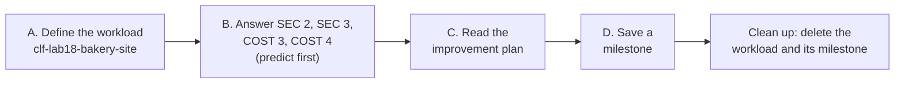
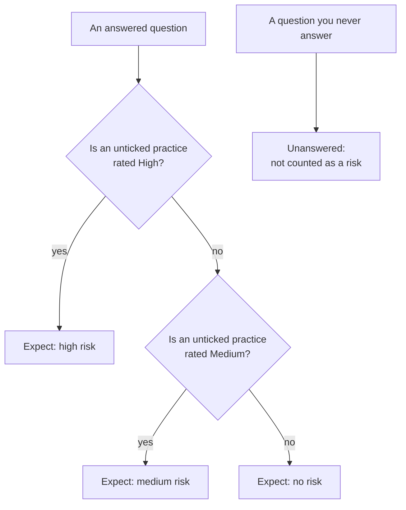

# Lab 18: Record the bakery's review in the AWS Well-Architected Tool

## Before you start: your account, your responsibility

This guide is provided as is, without warranty. We work hard to keep it correct and current, but AWS changes often, and its services, prices, and free offers may differ from what is written here. The labs run in your own AWS account. You are responsible for that account, for its security, and for any charges it incurs, including charges from resources you forget to delete. Automate the Cloud Inc. is not liable for any costs, losses, or security incidents that result from following, or failing to follow, this material. Technical guidance here is general information, not advice about your specific systems.

**Who this is for:** you have read [02.05 The Well-Architected Framework](../02-why-the-cloud/05-the-well-architected-framework.md), and ideally done the pillar-by-pillar [capstone review](01-the-capstone-review.md) of the workload in the [module brief](00-brief.md). **Time:** about 50 minutes. This is a challenge lab: Part B gives you the owner's request and the rules, not the clicks.

**Goal:** you turn your review of the bakery's site into a record in the **AWS Well-Architected Tool**: four questions answered from evidence, the risks the Tool finds, and a saved milestone. Then you delete it. **End state:** your lab log holds your predictions, the Tool's results and one improvement you would make first; your account holds nothing from this lab.

*Notice that you predict the risks before the Tool shows them. Comparing the two is how you learn what the Tool is really measuring.*

**Long description.** Five steps, left to right: define the workload; answer SEC 2, SEC 3, COST 3 and COST 4, predicting each risk first; read the improvement plan; save a milestone; delete the workload and its milestone.

**What it creates:** one workload in the Well-Architected Tool, in US East (N. Virginia), `us-east-1`, tagged `guide` = `clf` and `lab` = `18`, with one milestone inside it. In the Tool a workload is a written description plus your answers; nothing in AWS is built or run. Deleting the workload deletes its milestones ([Delete a workload](https://docs.aws.amazon.com/wellarchitected/latest/userguide/workloads-delete.html)).

**What it costs:** $0. AWS says there is no additional charge for the Tool; you pay only for the resources a workload uses ([AWS Well-Architected Tool FAQs](https://aws.amazon.com/well-architected-tool/faqs/), checked 2026-10-24), and this one uses none. **Worst case on a Paid plan** if you forget to clean up: still $0. **Free plan:** nothing here upgrades your plan. Never choose **Upgrade plan** during a lab.

> **Warning:** the same console offers the **AWS Well-Architected Agent**, an AI service in preview that scans deployed resources. AWS says it needs the Business Support+ plan or higher (as of 2026-10-24, [What is AWS Well-Architected Agent](https://docs.aws.amazon.com/wellarchitected/latest/userguide/agent.html)). Don't create an agent profile, and never change your Support plan to try it.

**Before you start, you need these guardrails in place:** [root MFA](https://github.com/AutomateTheCloud/atc-study-aws_account_guardrails/blob/main/primer/02-secure-the-root-user.md) (primer page 02), [an IAM admin user with MFA](https://github.com/AutomateTheCloud/atc-study-aws_account_guardrails/blob/main/primer/03-your-everyday-admin-identity.md), which you use for this lab (page 03), [budgets and billing alerts](https://github.com/AutomateTheCloud/atc-study-aws_account_guardrails/blob/main/primer/05-money-alarms.md) (page 05), and [the habits for every lab](https://github.com/AutomateTheCloud/atc-study-aws_account_guardrails/blob/main/primer/07-habits-for-every-lab.md), including your lab log (page 07).

**Why this matters:** task [1.2](https://docs.aws.amazon.com/aws-certification/latest/cloud-practitioner-02/cloud-practitioner-02-domain1.html#cloud-practitioner-02-task1.2) asks you to understand the Well-Architected Framework, and the Tool is where teams apply it to one workload. A review is a conversation that ends in a short, ranked list of risks, not a pass or fail ([The review process](https://docs.aws.amazon.com/wellarchitected/latest/framework/the-review-process.html)).

> **New sign-up path:** AWS lists the Well-Architected Tool among the services on that path's Free Tier (as of 2026-10-23, [Supported AWS services](https://docs.aws.amazon.com/accounts/latest/reference/supported-services-sign-up-new.html)). IAM users can't sign in to the console there, and your Region is fixed, so choose your assigned Region wherever this lab says `us-east-1`, and sign in the way that path gives you. We haven't run this lab on that path.

**About the screens:** the labels in **bold** come from AWS's [Tutorial: Document an AWS Well-Architected Tool workload](https://docs.aws.amazon.com/wellarchitected/latest/userguide/tutorial.html) and its related pages, checked 2026-10-24. We haven't yet run this lab, so if a label differs, look for the option with the same meaning.

## Steps

### Get ready

1. In your lab log, write today's date, `us-east-1`, the tags `guide` = `clf` and `lab` = `18`, the workload name `clf-lab18-bakery-site`, and this table to fill in:

   | Question | Choices you ticked | Your predicted risk | Risk the Tool shows |
   |---|---|---|---|
   | SEC 2 | | | |
   | SEC 3 | | | |
   | COST 3 | | | |
   | COST 4 | | | |

2. Sign in to the console as your **IAM admin user** and check that the Region selector shows N. Virginia. Workloads belong to the Region you create them in ([Tagging your AWS WA Tool resources](https://docs.aws.amazon.com/wellarchitected/latest/userguide/tagging.html)).

### Part A: define the workload (follow-along)

3. In the console search bar, type `Well-Architected` and open the **AWS Well-Architected Tool**. On a first visit, an introduction page has a **Define a workload** section; choose **Define workload**. Otherwise choose **Workloads** in the left menu, then **Define workload**.
4. Fill in the required boxes:
   - **Name:** `clf-lab18-bakery-site`.
   - **Description:** `Lab 18 - the bakery's site as Labs 05 to 11 built it: one EC2 web server, Lambda, DynamoDB carts, S3 buckets, one VPC`.
   - **Review owner:** `Bakery owner (lab)`. The box accepts a name or an email address; a role keeps your personal details out of the record.
   - **Environment:** **Production**, because the bakery's real site serves customers.
   - **Regions:** under **AWS Regions**, choose US East (N. Virginia).
5. Leave every optional box empty: **Account IDs**, **Application**, the architectural design link, **Industry type** and **Industry**. Don't choose **Activate Trusted Advisor**, and leave the **Jira** settings alone. Under **Tags**, add `guide` = `clf` and `lab` = `18`. Choose **Next**.
   > **If something went wrong:** the page won't continue while a required box is empty or invalid. Names and descriptions need at least 3 characters ([Defining a workload](https://docs.aws.amazon.com/wellarchitected/latest/userguide/define-workload.html)).
6. On the **Apply profile** step, choose **Next** without a profile. On the lens step, keep only the **AWS Well-Architected Framework** lens, which is selected by default. Choose **Define workload**.
   **You should see:** your workload's page, with a button such as **Start reviewing**.

### Part B: answer four questions from evidence (challenge)

For each question, the Tool lists choices that match the question's best practices, and you tick the ones the bakery really follows. Each best-practice page in the Framework states the "level of risk" if that practice is missing: High, Medium or Low. The Tool's **Improvement plan** tab is its version of the improvement plan from [lesson 14.01](01-the-capstone-review.md): a list of the questions where your answers show a risk, with the missing best practices that would remove it, but without your costs, order or owners. The diagram shows how we expect your ticks to become a risk. We haven't confirmed this rule in the Tool, so treat it as a prediction to test, and trust what the Tool shows.

*Notice that the risk comes from what is missing, not from what you ticked, and that skipping a question hides nothing: it simply stays unanswered.*

**Long description.** For each answered question, check the best practices left unticked. If any is rated High, expect a high risk; otherwise, if any is rated Medium, expect a medium risk; otherwise expect no risk. A separate box shows that a question you never answer stays unanswered. AWS's API lists "unanswered" as its own risk value, apart from high, medium and none ([Answer](https://docs.aws.amazon.com/wellarchitected/latest/APIReference/API_Answer.html)).

**The owner's request:** "Tell me honestly where our security and our cost control are weakest, and keep a record we can compare next quarter."

**Constraints:**

- Answer four questions: [SEC 2. How do you manage authentication for people and machines?](https://docs.aws.amazon.com/wellarchitected/latest/framework/sec-02.html), [SEC 3. How do you manage permissions for people and machines?](https://docs.aws.amazon.com/wellarchitected/latest/framework/sec-03.html), [COST 3. How do you monitor your cost and usage?](https://docs.aws.amazon.com/wellarchitected/latest/framework/cost-03.html) and [COST 4. How do you decommission resources?](https://docs.aws.amazon.com/wellarchitected/latest/framework/cost-04.html). Leave all others unanswered. (The titles are the Framework's; the Tool's may be worded a little differently.)
- Tick a choice only when you can name the evidence. Write that evidence in the question's **Notes** box, such as "Lab 16: tags activated". Never write personal details there.
- Where a best practice can't apply to a one-account bakery, such as sharing within an organization, mark it as not applicable and give the reason, rather than leaving it unticked.
- Before you look at any result, open each question's page linked above, read the risk level of each missing practice, and write your predicted risk in your lab log.

Use your capstone review notes. If you haven't done the review, use this evidence from the course:

| What the bakery has | Where it came from |
|---|---|
| Root user with MFA; daily work as an IAM admin user with MFA, in the `Admins` group; no access keys | Primer pages 02 to 04 |
| Staff permissions written to fit the job and tested in the policy simulator | Labs 03 and 04 |
| A free external access analyzer; IAM last accessed information read once | Primer page 06; Lab 12 |
| The order function's execution role can only write logs | Labs 07 and 11 |
| The tags `guide` and `lab` on everything, activated as cost allocation tags | Primer page 07; Lab 16 |
| Budgets, a billing alarm, Cost Explorer and cost anomaly detection | Primer page 05 |
| A lab log and a cleanup checklist for every lab, with a next-day check | Primer page 07 |
| Lifecycle rules on the exports and tax archive buckets; a stack whose deletion removes what it made | Labs 05 and 10 |
| **Not in place:** central sign-in through IAM Identity Center; a secrets store; regular credential audits; a written emergency-access process; detailed cost and usage reports; cost categories or business metrics for cost; any lifecycle rule on the photo bucket; log retention on the order function, whose logs never expire | Primer page 03 explains the first; no lab set up the others; the [module brief](00-brief.md) lists the last two |

7. Choose **Start reviewing**, answer the four questions, and choose **Save and exit**. Then fill in your predictions.

Hints, if you need them

- **Moving around:** the left panel lists questions by pillar; choose one to jump to it. **Next** moves to the next question.
- **Not applicable:** look for **Mark best practice(s) that don't apply to this workload**, select the practice, and choose a reason. For a whole question, there is **Question does not apply to this workload**.
- **Help:** **Info** opens guidance for a question or choice. **Ask an expert** opens a public AWS re:Post community; don't post details of your account there.
- **Coming back:** after **Save and exit**, open the workload from **Workloads** and choose **Continue reviewing**.

Model answer

Risk levels are those on each best practice's page, checked 2026-10-24.

| Question | Tick | Leave unticked (risk level) | Predicted risk |
|---|---|---|---|
| SEC 2 | [SEC02-BP01 Use strong sign-in mechanisms](https://docs.aws.amazon.com/wellarchitected/latest/security-pillar/sec_identities_enforce_mechanisms.html); [SEC02-BP06 Employ user groups and attributes](https://docs.aws.amazon.com/wellarchitected/latest/security-pillar/sec_identities_groups_attributes.html) | [SEC02-BP02 Use temporary credentials](https://docs.aws.amazon.com/wellarchitected/latest/security-pillar/sec_identities_unique.html) (High); [SEC02-BP03 Store and use secrets securely](https://docs.aws.amazon.com/wellarchitected/latest/security-pillar/sec_identities_secrets.html) (High); [SEC02-BP04 Rely on a centralized identity provider](https://docs.aws.amazon.com/wellarchitected/latest/security-pillar/sec_identities_identity_provider.html) (High); [SEC02-BP05 Audit and rotate credentials periodically](https://docs.aws.amazon.com/wellarchitected/latest/security-pillar/sec_identities_audit.html) (High) | High |
| SEC 3 | [SEC03-BP01 Define access requirements](https://docs.aws.amazon.com/wellarchitected/latest/security-pillar/sec_permissions_define.html); [SEC03-BP02 Grant least privilege access](https://docs.aws.amazon.com/wellarchitected/latest/security-pillar/sec_permissions_least_privileges.html); [SEC03-BP07 Analyze public and cross-account access](https://docs.aws.amazon.com/wellarchitected/latest/security-pillar/sec_permissions_analyze_cross_account.html) | [SEC03-BP03 Establish emergency access process](https://docs.aws.amazon.com/wellarchitected/latest/security-pillar/sec_permissions_emergency_process.html) (Medium); [SEC03-BP04 Reduce permissions continuously](https://docs.aws.amazon.com/wellarchitected/latest/security-pillar/sec_permissions_continuous_reduction.html) (Medium); [SEC03-BP06 Manage access based on lifecycle](https://docs.aws.amazon.com/wellarchitected/latest/security-pillar/sec_permissions_lifecycle.html) (Medium). BP05, BP08 and BP09 concern an organization and third parties: mark them not applicable. Left unticked instead, they are Medium too | Medium |
| COST 3 | [COST03-BP02 Add organization information to cost and usage](https://docs.aws.amazon.com/wellarchitected/latest/cost-optimization-pillar/cost_monitor_usage_org_information.html); [COST03-BP05 Configure billing and cost management tools](https://docs.aws.amazon.com/wellarchitected/latest/cost-optimization-pillar/cost_monitor_usage_config_tools.html) | [COST03-BP01 Configure detailed information sources](https://docs.aws.amazon.com/wellarchitected/latest/cost-optimization-pillar/cost_monitor_usage_detailed_source.html) (High); [COST03-BP03 Identify cost attribution categories](https://docs.aws.amazon.com/wellarchitected/latest/cost-optimization-pillar/cost_monitor_usage_define_attribution.html) (High); [COST03-BP04 Establish organization metrics](https://docs.aws.amazon.com/wellarchitected/latest/cost-optimization-pillar/cost_monitor_usage_define_kpi.html) (High); [COST03-BP06 Allocate costs based on workload metrics](https://docs.aws.amazon.com/wellarchitected/latest/cost-optimization-pillar/cost_monitor_usage_allocate_outcome.html) (Low) | High |
| COST 4 | [COST04-BP01 Track resources over their lifetime](https://docs.aws.amazon.com/wellarchitected/latest/cost-optimization-pillar/cost_decomissioning_resources_track.html); [COST04-BP02 Implement a decommissioning process](https://docs.aws.amazon.com/wellarchitected/latest/cost-optimization-pillar/cost_decomissioning_resources_implement_process.html); [COST04-BP03 Decommission resources](https://docs.aws.amazon.com/wellarchitected/latest/cost-optimization-pillar/cost_decomissioning_resources_decommission.html) | [COST04-BP05 Enforce data retention policies](https://docs.aws.amazon.com/wellarchitected/latest/cost-optimization-pillar/cost_decomissioning_resources_data_retention.html) (Medium): two buckets have rules, but the photo bucket and the function's logs don't; [COST04-BP04 Decommission resources automatically](https://docs.aws.amazon.com/wellarchitected/latest/cost-optimization-pillar/cost_decomissioning_resources_decomm_automated.html) (Low) | Medium |

Three calls need judgment. First, people sign in as IAM users, whose passwords are long-term credentials, so [SEC02-BP02](https://docs.aws.amazon.com/wellarchitected/latest/security-pillar/sec_identities_unique.html) stays unticked even though Lambda's role uses temporary ones; say so in Notes. Second, one look at IAM last accessed information in Lab 12 isn't a continuous process, so [SEC03-BP04](https://docs.aws.amazon.com/wellarchitected/latest/security-pillar/sec_permissions_continuous_reduction.html) stays unticked. Third, retention that covers some data but not all is not yet a policy, so [COST04-BP05](https://docs.aws.amazon.com/wellarchitected/latest/cost-optimization-pillar/cost_decomissioning_resources_data_retention.html) stays unticked.

### Part C: read the improvement plan (follow-along)

8. On the workload's page, in the **Lenses** section, choose **AWS Well-Architected Framework**, then the **Improvement plan** tab.
   **You should see:** improvement items for the questions that show a risk, each marked high or medium. We haven't confirmed the order the Tool lists them in. Write each question's risk in the last column of your lab log.
   > **If something went wrong:** no items at all means every answered question has no risk, or your answers weren't saved. Open the workload, choose **Continue reviewing**, and check the four questions.
9. Compare the Tool's results with your predictions. For any that differ, open the question and look again at which practices you ticked and their risk levels. SEC 2 and COST 3 weren't among the capstone's starter questions, so a high risk there is a new finding: add it to your improvement plan.
10. Expand the recommended improvement items for one high risk, open the guidance for one missing practice, and write one sentence in your lab log: what the bakery would have to do, and whether anything stops it. For example, the guardrails primer keeps you off IAM Identity Center on the Free plan, because creating an organization upgrades the plan ([primer page 03](https://github.com/AutomateTheCloud/atc-study-aws_account_guardrails/blob/main/primer/03-your-everyday-admin-identity.md#why-we-dont-use-iam-identity-center-on-the-free-plan)).
11. Choose **Workloads** in the left menu and find your workload's row.
    **You should see:** columns for **Questions answered**, **High risks** and **Medium risks** ([Workloads](https://docs.aws.amazon.com/wellarchitected/latest/userguide/workloads.html)). Expect 4 questions answered.

### Part D: save a milestone (follow-along)

12. Open the workload and choose **Save milestone**. In **Milestone name**, type `clf-lab18 initial review`, then choose **Save**.
    **You should see:** the milestone listed on the workload's **Milestones** tab. A saved milestone can't be changed ([Saving a milestone](https://docs.aws.amazon.com/wellarchitected/latest/userguide/milestones-save.html)).
13. Optional, about 3 minutes: see why that matters. Open COST 4, tick [COST04-BP05](https://docs.aws.amazon.com/wellarchitected/latest/cost-optimization-pillar/cost_decomissioning_resources_data_retention.html) as if the bakery had made fix 7 of the capstone review (log retention, and a rule for old photo versions), and choose **Save and exit**. Only a Low practice is then missing, so we expect COST 4's medium risk to go and the workload's **Medium risks** count to drop by one; open the milestone and its counts don't change. That is how a team proves progress next quarter.

## Check your work

- [ ] Your lab log has a prediction and the Tool's result for all four questions, and a reason for each one that differs.
- [ ] Each ticked choice has evidence in its **Notes** box.
- [ ] The workload has one milestone, `clf-lab18 initial review`.

## Clean up

14. If you want a copy of the review, look on the workload's page for **Generate report**, which downloads a PDF to your computer.
15. Choose **Workloads**, select `clf-lab18-bakery-site`, and choose **Delete**. In the window that opens, choose **Delete** again. This also deletes the milestone and can't be undone.
    **You should see:** the workload gone from the list.
16. **Confirm:** the **Workloads** list in N. Virginia shows nothing named `clf-lab18`. Tag Editor can't help here: AWS's list of resource types marks Well-Architected workloads as not supported by Tag Editor ([Resource types you can use with AWS Resource Groups and Tag Editor](https://docs.aws.amazon.com/ARG/latest/userguide/supported-resources.html), checked 2026-10-24), so the Tool's own list is the check. Tick the workload off in your lab log. No next-day check is needed: nothing here was billed.

## Recap

You turned a review into evidence-backed answers, predicted the risks from the Framework's own risk levels, and checked your prediction against the Tool. The Tool doesn't inspect your account; it records what you tell it, so its list is only as honest as your Notes.

> **Reflect:** the owner can fund one fix this quarter. Which of your high risks would you fix first, and why? Write two sentences, naming what it would cost.
>
> 

Model answer

>
> One good answer is SEC 2, starting with [SEC02-BP05](https://docs.aws.amazon.com/wellarchitected/latest/security-pillar/sec_identities_audit.html): a monthly look at IAM's credential report and last accessed information costs nothing and protects the account that every other fix depends on. COST 3's detailed reports matter less while the bill is small. Any choice is sound if it weighs impact on the business against effort and cost.
>
> 

**Next:** [Lab 19](03-lab-19-close-out.md), where you close out the account you have used for the whole course.

## Where to check the current details

- [Tutorial: Document an AWS Well-Architected Tool workload](https://docs.aws.amazon.com/wellarchitected/latest/userguide/tutorial.html), [Defining a workload](https://docs.aws.amazon.com/wellarchitected/latest/userguide/define-workload.html), [Saving a milestone](https://docs.aws.amazon.com/wellarchitected/latest/userguide/milestones-save.html) and [Delete a workload](https://docs.aws.amazon.com/wellarchitected/latest/userguide/workloads-delete.html), AWS Well-Architected User Guide (checked 2026-10-24)
- [AWS Well-Architected Tool FAQs](https://aws.amazon.com/well-architected-tool/faqs/) (checked 2026-10-24)
- The Framework's question pages: [SEC 2](https://docs.aws.amazon.com/wellarchitected/latest/framework/sec-02.html), [SEC 3](https://docs.aws.amazon.com/wellarchitected/latest/framework/sec-03.html), [COST 3](https://docs.aws.amazon.com/wellarchitected/latest/framework/cost-03.html) and [COST 4](https://docs.aws.amazon.com/wellarchitected/latest/framework/cost-04.html) (checked 2026-10-24)

---

"Lab 18: Record the bakery's review in the AWS Well-Architected Tool" by Automate the Cloud Inc., licensed under CC BY-NC 4.0 with the Additional Permission for Internal Training from Automate the Cloud Inc.
License: https://creativecommons.org/licenses/by-nc/4.0/
Permission: https://automatethe.cloud/licenses/atc-internal-training-permission.txt
