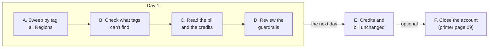
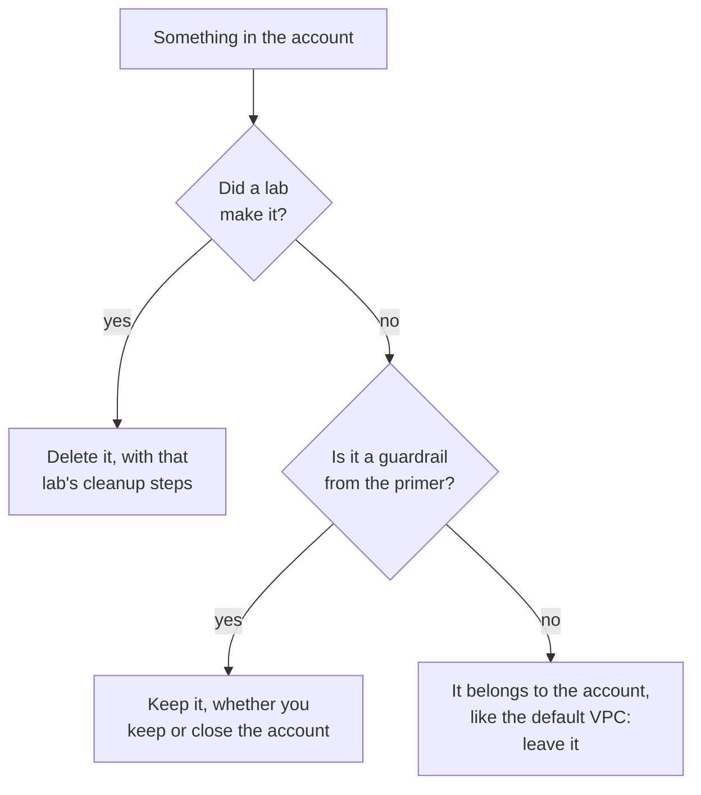

# Lab 19: Close out the account you used for the course

## Before you start: your account, your responsibility

This guide is provided as is, without warranty. We work hard to keep it correct and current, but AWS changes often, and its services, prices, and free offers may differ from what is written here. The labs run in your own AWS account. You are responsible for that account, for its security, and for any charges it incurs, including charges from resources you forget to delete. Automate the Cloud Inc. is not liable for any costs, losses, or security incidents that result from following, or failing to follow, this material. Technical guidance here is general information, not advice about your specific systems.

**Who this is for:** you have finished the course's labs, or as many as you plan to do. **Time:** about 45 minutes, plus 10 minutes the next day.

**Goal:** every lab ended with its own cleanup. This **close-out** is the final sweep of the whole account: you prove nothing from the course is left in any Region, read the bill, decide what happens to your guardrails, and check again the next day. **End state:** your lab log shows an empty sweep and a credit balance that stopped falling. Then you keep the account, let the Free plan end, or close it.

*Notice that the tag search is only the first of three nets. Part B catches what Tag Editor can't find, and the bill in Parts C and E catches anything both nets missed, in any Region.*

**Long description.** Day 1, left to right: A, sweep by tag in all Regions; B, check what tags can't find; C, read the bill and the credits; D, review the guardrails. An arrow labeled "the next day" leads to E, credits and bill unchanged. A dotted arrow labeled "optional" leads from E to F, close the account by following primer page 09.

**What it creates:** nothing. You delete only leftovers from earlier labs.

**What it costs:** $0. Tag Editor and the billing pages cost nothing to use ([primer page 07](https://github.com/AutomateTheCloud/atc-study-aws_account_guardrails/blob/main/primer/07-habits-for-every-lab.md), habit 2, checked 2026-10-23). **Worst case on a Paid plan:** a leftover you find keeps costing until you delete it, which is why you look. **Free plan:** nothing here upgrades your plan. Never choose **Upgrade plan** during a lab.

> **Warning:** this lab never asks you to change your Support plan, your payment methods or AWS Organizations. A close-out deletes lab leftovers; it doesn't remove the account's settings. Closing the account, if you choose to, follows primer page 09 and nothing more.

**Before you start, you need these guardrails in place:** [root MFA](https://github.com/AutomateTheCloud/atc-study-aws_account_guardrails/blob/main/primer/02-secure-the-root-user.md) (primer page 02), [an IAM admin user with MFA](https://github.com/AutomateTheCloud/atc-study-aws_account_guardrails/blob/main/primer/03-your-everyday-admin-identity.md), which you use for this lab (page 03), [budgets and billing alerts](https://github.com/AutomateTheCloud/atc-study-aws_account_guardrails/blob/main/primer/05-money-alarms.md) (page 05), [the habits for every lab](https://github.com/AutomateTheCloud/atc-study-aws_account_guardrails/blob/main/primer/07-habits-for-every-lab.md) and your lab log (page 07), and, if you plan to close the account, [leaving cleanly](https://github.com/AutomateTheCloud/atc-study-aws_account_guardrails/blob/main/primer/09-leaving-cleanly.md) (page 09).

**Why this matters:** a workload you no longer need should be found and removed on purpose, not left to run out: [COST04-BP02 Implement a decommissioning process](https://docs.aws.amazon.com/wellarchitected/latest/cost-optimization-pillar/cost_decomissioning_resources_implement_process.html), [COST04-BP03 Decommission resources](https://docs.aws.amazon.com/wellarchitected/latest/cost-optimization-pillar/cost_decomissioning_resources_decommission.html) and, because idle resources waste energy too, [SUS02-BP03 Stop the creation and maintenance of unused assets](https://docs.aws.amazon.com/wellarchitected/latest/sustainability-pillar/sus_sus_user_a4.html). The next-day check is [COST01-BP06 Monitor cost proactively](https://docs.aws.amazon.com/wellarchitected/latest/cost-optimization-pillar/cost_cloud_financial_management_proactive_process.html).

> **New sign-up path:** IAM users can't sign in to the console there, so sign in the way that path gives you. The sweep works the same way, in your assigned Region. Closing differs: you close each project first, then the management account, and AWS says you can't close a project while a spend limit has paused it (as of 2026-10-23, [Close a project](https://docs.aws.amazon.com/accounts/latest/reference/close-project.html); [Close your account in AWS Settings](https://docs.aws.amazon.com/accounts/latest/reference/close-account-new-experience.html)). We haven't run this lab on that path.

**About the screens:** labels in **bold** for Parts A to D are what we saw when we ran them in our test account on 2026-10-25, at the end of a day of labs. AWS changes its console often. If a label differs, look for the option with the same meaning.

## Steps

### Get ready

1. In your lab log, write today's date and "Lab 19: close-out". Keep the log of every earlier lab open beside it: it lists what each lab made.
2. Sign in to the console as your **IAM admin user** and check that the Region selector shows N. Virginia.

### Part A: sweep every Region by tag

3. In the console search bar, type `Tag Editor` and open it. (On 2026-10-24 a banner said tag management is moving to the AWS Resource Explorer console; if it has moved, use the same search there.) In **Regions**, choose **All regions**. In **Resource types**, choose **All supported resource types** (the console's wording on 2026-10-25), which covers every type Tag Editor supports; the search won't run without a resource type. Under **Tags**, enter the key `guide` and the value `clf`, choose **Add**, then **Search resources**.
   **You should see:** no resources. Items deleted in the last few hours can still appear: on the day we ran every lab, Tag Editor still listed Lab 08's terminated instance and its deleted volume two hours later. Before you hunt for a listed item, open it in its own console; if it's gone or terminated there, it's only the index catching up.
   > **If something went wrong:** for each result, open it and read its `lab` tag. Delete it with that lab's own cleanup steps (table below), in the order they give; Tag Editor only edits tags, it doesn't delete. Then search again.
4. Remove the tag filter, enter only the key `lab` with no value, and search again. Tag Editor's value box is optional, so this finds anything tagged `lab` whatever its value, including a resource where the `guide` tag was mistyped ([Finding resources to tag](https://docs.aws.amazon.com/tag-editor/latest/userguide/find-resources-to-tag.html)).
   **You should see:** no resources. Tags are case sensitive, so `Lab` or `Guide` would slip past; your lab logs show whether you ever typed one.

| Lab | Clean-up steps | Lab | Clean-up steps |
|---|---|---|---|
| 01 | [Lab 01](../02-why-the-cloud/06-lab-01-first-resource.md#clean-up) | 09 | [Lab 09](../07-connecting-it/05-lab-09-build-a-small-vpc.md#clean-up) |
| 03 | [Lab 03](../04-shared-responsibility-and-access/06-lab-03-a-group-and-a-policy.md#clean-up) | 10 | [Lab 10](../08-building-and-operating/05-lab-10-same-bucket-three-ways.md#clean-up) |
| 04 | [Lab 04](../04-shared-responsibility-and-access/07-lab-04-finish-and-fix-a-policy.md#clean-up) | 11 | [Lab 11](../08-building-and-operating/06-lab-11-alarm-on-errors.md#clean-up) |
| 05 | [Lab 05](../05-storing-data/07-lab-05-versions-and-lifecycle.md#clean-up) | 12 | [Lab 12](../09-protecting-and-governing/07-lab-12-answer-the-auditor.md#clean-up) |
| 06 | [Lab 06](../05-storing-data/08-lab-06-a-dynamodb-table.md#clean-up) | 13 | [Lab 13](../10-data-ai-and-more/04-lab-13-athena-query.md#clean-up) |
| 07 | [Lab 07](../06-running-applications/05-lab-07-a-lambda-function.md#clean-up) | 16 | [Lab 16](../11-paying-for-aws/06-lab-16-cost-allocation-tags.md#clean-up) |
| 08 | [Lab 08](../06-running-applications/06-lab-08-launch-and-terminate-an-instance.md#clean-up) | 18 | [Lab 18](02-lab-18-well-architected-tool-review.md#clean-up) |

Labs 02, 14, 15 and 17 created nothing.

### Part B: check what tags can't find

A tag search finds only resources that carry the tag and whose type Tag Editor supports. AWS's list of types marks IAM roles, CloudWatch Logs log groups, Glue databases and Well-Architected workloads as not supported in Tag Editor, and IAM users and groups aren't on it at all ([Resource types you can use with AWS Resource Groups and Tag Editor](https://docs.aws.amazon.com/ARG/latest/userguide/supported-resources.html), checked 2026-10-24). So check those in each service's own list, by the `clf-lab` names the labs gave them.

5. Open each place in this table and compare it with the "should be there" column. Tick each row in your lab log.

   | Where to look | What should be there | A leftover looks like | From |
   |---|---|---|---|
   | **S3**, general purpose buckets (one list for every Region): search `clf-` | Nothing | A bucket named `clf-lab…` | Labs 01, 03, 05, 10, 12, 13, 16 |
   | **IAM**, user groups | Your admins group from primer page 03 | `clf-lab03-…` or `clf-lab04-…` | Labs 03, 04 |
   | **IAM**, policies, filtered to customer managed | Nothing the labs made | `clf-lab…`, or an unattached `AWSLambdaBasicExecutionRole-…` | Labs 03, 04, 07, 11 |
   | **IAM**, roles: search `clf-lab` | No match. Leave roles starting `AWSServiceRoleFor`: AWS manages those for its services | A Lambda execution role | Labs 07, 11 |
   | **CloudWatch**, log groups | No `/aws/lambda/clf-lab…` | A log group still holding logs | Labs 07, 11 |
   | **CloudWatch**, alarms | Your billing alarm from primer page 05 | `clf-lab11-box-count-errors` | Lab 11 |
   | **SNS**, topics and subscriptions | Your billing alarm's topic and its confirmed subscription | The topic `clf-lab11-orders-failing`. Its subscription can stay listed for hours after the topic is deleted; it sends nothing | Lab 11 |
   | **Athena** or **AWS Glue**, databases | No `clf_lab13`. A database named `default`, which Athena created, can stay | The `clf_lab13` database or its table | Lab 13 |
   | **Well-Architected Tool**, workloads, in N. Virginia | Nothing | `clf-lab18-bakery-site` | Lab 18 |
   | **EC2**, in N. Virginia: instances, volumes, snapshots, Elastic IPs | Nothing running; a terminated instance may linger for a while | A volume, a snapshot or an Elastic IP | Lab 08 |
   | **VPC**, your VPCs, in N. Virginia | Only the default VPC | `clf-lab09-…` | Lab 09 |

   > **If something went wrong:** delete a leftover with the cleanup steps of the lab in the last column. Never delete your admin user, its group, the service-linked roles, the default VPC, or the guardrails from primer pages 05 and 06.
6. Optional second look: open **AWS Resource Explorer** in N. Virginia and search `tag.key:guide`. Resource Explorer searches your current Region unless someone has set up cross-Region search, and it doesn't index tags on IAM resources ([Search query syntax reference](https://docs.aws.amazon.com/resource-explorer/latest/userguide/using-search-query-syntax.html)), so an empty result here supports Part A rather than replacing it. Don't change its settings.

### Part C: read the bill and the credits

The bill sees every Region and every service, tagged or not. It runs about a day behind ([primer page 07](https://github.com/AutomateTheCloud/atc-study-aws_account_guardrails/blob/main/primer/07-habits-for-every-lab.md), habit 4), which is why Part E repeats it.

7. In the console search bar, type `Billing` and open **Billing and Cost Management**. Choose **Bills**, keep the current **Billing period**, and choose the **Charges by service** tab.
8. For each service listed, choose the `+` next to it to see its charges by **Region** ([Understanding your bill](https://docs.aws.amazon.com/awsaccountbilling/latest/aboutv2/getting-viewing-bill.html)). Write each service and Region in your lab log.
   **You should see:** only services and Regions you used in the labs, with small amounts. A service you never set up can appear at $0.00 for a few API requests the console made for you (we saw Secrets Manager, SQS and KMS that way); open its row to the usage line to check. On the Free plan, credits pay them, so read which services appear, not only the total.
   > **If something went wrong:** a service or Region you don't recognize is the lead to follow. Go to that Region, find the resource in that service's console, and delete it, using [primer page 08, Track down an unexpected charge](https://github.com/AutomateTheCloud/atc-study-aws_account_guardrails/blob/main/primer/08-when-something-goes-wrong.md#track-down-an-unexpected-charge).
9. Choose **Credits** in the left menu. Write the remaining balance and today's date in your lab log. Tomorrow you compare against this number. The list may show more credits than you started with: some labs complete AWS's "Explore AWS" activities, each worth $20 (as of 2026-10-25). Our Labs 07 and 08 earned "Create a web app using AWS Lambda" and "Launch an instance using EC2".

### Part D: review your guardrails, and keep them

Your guardrails cost nothing and watch the account until its last bill. So the answer to "keep or remove?" is keep, whichever way you leave.

*Notice that nothing in the primer's guardrails ever lands on "delete". They go only when the account itself goes.*

**Long description.** For each thing in the account, a first question asks whether a lab made it; if yes, delete it with that lab's cleanup steps. If no, a second question asks whether it is a guardrail from the primer; if yes, keep it, whether you keep or close the account. If no, it belongs to the account, like the default VPC, and you leave it.

10. Check that each guardrail still works, and tick it in your lab log:

    | Guardrail | Where | Healthy looks like | Cost (as of 2026-10-23) |
    |---|---|---|---|
    | Zero-spend and $5 monthly budgets | **Budgets** | Both listed; email **Verified** | $0 |
    | Cost anomaly monitor with the $5 alert | **Cost Anomaly Detection** | One monitor; your address on the subscription | $0 |
    | Billing alarm and its topic | **CloudWatch**, **Alarms**, in N. Virginia | State **OK**; subscription **Confirmed** in SNS | $0 within 10 free alarms |
    | External access analyzer | **IAM**, **Access analyzer** | One external access analyzer, no other kind | $0 |
    | Your IAM admin user and root user | **IAM**, **Users**; your MFA devices | MFA on both | $0 |

    The `guide` and `lab` cost allocation tags you activated in Lab 16 can stay active; they cost nothing either way.
    > **If something went wrong:** a budget email showing **Pending**, or an SNS subscription not **Confirmed**, means alerts aren't reaching you. Fix it as on [primer page 05](https://github.com/AutomateTheCloud/atc-study-aws_account_guardrails/blob/main/primer/05-money-alarms.md). An analyzer of another kind is billed; delete it as on [primer page 06](https://github.com/AutomateTheCloud/atc-study-aws_account_guardrails/blob/main/primer/06-safe-defaults.md).
11. Sign out.

### Part E: the next day

12. Sign in as your IAM admin user and open **Credits**. Compare the balance with yesterday's number in your lab log. On a Paid plan with no credits, compare the month-to-date total on **Bills** instead.
    **You should see:** the same balance (or total), or a few cents different as yesterday's usage arrives.
    > **If something went wrong:** if it keeps falling a second day, something is still running. Repeat Part C, then Parts A and B for that service and Region.
13. Repeat steps 7 and 8. Check your inbox for budget or anomaly alerts. Confirm that your Free plan end date is in your calendar ([primer page 05](https://github.com/AutomateTheCloud/atc-study-aws_account_guardrails/blob/main/primer/05-money-alarms.md#write-down-your-credits-and-the-plans-end-date)).

### Part F (optional): leave the account

14. Choose one way, and follow the primer, not your memory:
    - **Close it now:** follow [Close your account early](https://github.com/AutomateTheCloud/atc-study-aws_account_guardrails/blob/main/primer/09-leaving-cleanly.md#close-your-account-early) on primer page 09. You have already done its "delete your resources first" step.
    - **Let the Free plan end:** follow [Get ready for the end of the Free plan](https://github.com/AutomateTheCloud/atc-study-aws_account_guardrails/blob/main/primer/09-leaving-cleanly.md#get-ready-for-the-end-of-the-free-plan) about two weeks before your end date.
    - **Keep learning in it:** change nothing. Your guardrails keep watching.

## Check your work

- [ ] Tag Editor, all Regions, found nothing for `guide` = `clf` or for the key `lab`.
- [ ] Every row of the Part B table is ticked.
- [ ] Your lab log has the bill's services and Regions, and two credit balances (or bill totals) a day apart that match.
- [ ] Every guardrail in step 10 is healthy, and you chose how to leave.

## Clean up

This lab created nothing. Anything you deleted in Parts A to C is confirmed by Part E. Tick "Lab 19: close-out" in your lab log.

## Recap

You checked the account three ways: by tag, by name where tags can't reach, and by the bill, which misses nothing but arrives late. That is the decommissioning habit professionals apply to a whole workload: find everything, delete on purpose, keep the alarms until the very end, and check the next day.

> **Reflect:** the bakery's owner decides to shut down an old promotional site. Using this lab, write three sentences on how you would make sure it costs nothing next month.
>
> 

Model answer

>
> I would start by listing everything the site used by its tag across all Regions, then check by name the resource types Tag Editor can't find, such as its roles and log groups. Next I'd delete them in dependency order with a written checklist, keeping the account's budgets and alarms. The next day, and again at month end, I would read the bill by service and Region and investigate any charge that remains.
>
> 

**Next:** your course is complete. Revisit the [capstone review](01-the-capstone-review.md) and your lab log when you prepare for the exam.

## Where to check the current details

- [Finding resources to tag](https://docs.aws.amazon.com/tag-editor/latest/userguide/find-resources-to-tag.html) and [Resource types you can use with AWS Resource Groups and Tag Editor](https://docs.aws.amazon.com/ARG/latest/userguide/supported-resources.html), AWS Resource Groups User Guide (checked 2026-10-24)
- [What is AWS Resource Explorer?](https://docs.aws.amazon.com/resource-explorer/latest/userguide/welcome.html), AWS Resource Explorer User Guide (checked 2026-10-24)
- [Understanding your bill](https://docs.aws.amazon.com/awsaccountbilling/latest/aboutv2/getting-viewing-bill.html) and [Understanding unexpected charges](https://docs.aws.amazon.com/awsaccountbilling/latest/aboutv2/checklistforunwantedcharges.html), AWS Billing User Guide (checked 2026-10-24)
- [Close an AWS account](https://docs.aws.amazon.com/accounts/latest/reference/manage-acct-closing.html), AWS Account Management Reference Guide (checked 2026-10-23)

---

"Lab 19: Close out the account you used for the course" by Automate the Cloud Inc., licensed under CC BY-NC 4.0 with the Additional Permission for Internal Training from Automate the Cloud Inc.
License: https://creativecommons.org/licenses/by-nc/4.0/
Permission: https://automatethe.cloud/licenses/atc-internal-training-permission.txt
