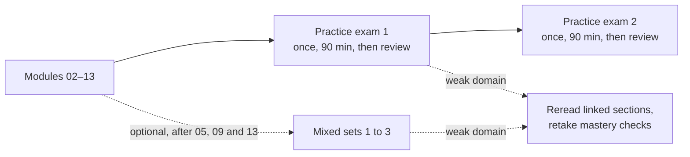

# How to use the exam preparation: two practice exams on the main path, mixed sets if you want more

The main path ends with two **practice exams**, each taken once and then reviewed, to show whether you're ready. Three **mixed sets** are optional extra practice during the course, for learners who want more questions that make them tell topics apart. Score every page by domain, and treat the result as a guide to what to study, never as a forecast of your exam score.

**For:** an adult studying alone, possibly new to IT, who wants to know when to use each page of this section. **Time:** about 10 minutes to read. The main path's exam preparation takes about 5 hours: two practice exams of 90 minutes, about 1 hour 45 minutes to review them, and this page.

## What's in this section

| Page | What it is | When to take it | Time | What its score is for |
|---|---|---|---|---|
| [Practice exam 1](05-practice-exam-1.md) | A full form: 65 questions in the exam's format | After Module 13, once | 90 minutes, plus about an hour to review | Readiness, by domain |
| [Practice exam 2](06-practice-exam-2.md) | A second full form, with different questions | A few days after practice exam 1, once | 90 minutes, plus about 45 minutes to review | Readiness, by domain |
| [Optional mixed set 1](02-mixed-set-1.md) | 30 questions from Modules 02 to 05, shuffled together | After Module 05, if you want more practice | About 45 minutes, plus the answer key | Learning: which ideas you still mix up |
| [Optional mixed set 2](03-mixed-set-2.md) | 30 questions from Modules 02 to 09, weighted by domain | After Module 09, if you want more practice | About 45 minutes, plus the answer key | Learning |
| [Optional mixed set 3](04-mixed-set-3.md) | 30 questions from Modules 02 to 13, weighted 24/30/34/12 like the exam | After Module 13, before the practice exams, if you want more practice | About 45 minutes, plus the answer key | Learning |

Every question on these five pages was written for this section, separately from the lessons' practice and the mastery checks. The questions follow the exam's style: one correct answer out of four, or "(Select TWO.)" with two correct answers out of five. They use the exam's names for services, with today's names in the answer keys ([The exam at a glance](../00-start-here/03-the-exam-at-a-glance.md) describes the real exam's format).

## When to use each part

*Notice that the main path needs only the two practice exams. The mixed sets hang off to the side: extra practice you can add while you study.*

**Long description.** A flowchart from left to right. Modules 02 to 13 lead to Practice exam 1, taken once in 90 minutes and then reviewed, which leads to Practice exam 2, taken the same way. A dashed arrow labeled "optional, after 05, 09 and 13" leads from the modules to Mixed sets 1 to 3. Dashed arrows labeled "weak domain" lead from Practice exam 1 and from the mixed sets to a box: reread the linked sections and retake the mastery checks.

**The practice exams are for readiness.** Take them after Module 13 (Module 14, the close-out, adds no new exam content, so it can come before or after):

- **Each one once, unseen.** A practice exam shows readiness only the first time, while every question is new to you, as on the real exam. Don't read its questions or its answer key beforehand.
- **In 90 minutes, in one sitting,** closed book, as on exam day. If you'll take the exam in English as a non-native speaker with the extra 30 minutes AWS allows, give yourself 120.
- **Then review it.** Score it by domain and read the explanation for every miss and every lucky guess. The review is where most of the learning happens, so it is part of the main path.
- **A few days apart,** with study of your weak domains in between. Practice exam 2 then tells you whether that study worked.
- **Answer every question.** On the exam a blank counts as wrong and a wrong guess costs nothing, so practice guessing well rather than skipping.

**The mixed sets are optional practice for learning.** Each module's mastery check tests one module, so you always know what a question is about. The exam doesn't tell you, and the hardest part of many questions is noticing which idea they test. A mixed set shuffles everything you've studied so far, so you practice that choice, and it brings back older modules before you forget them. If you want that extra practice, take each one when you reach it: Mixed set 1 after Module 05, Mixed set 2 after Module 09, and Mixed set 3 after Module 13, before the practice exams. Each assumes only the modules up to that point.

You can come back to a mixed set later. A second try still helps you learn, but your score on it then measures memory of the questions as much as understanding.

## How to score by domain

The exam guide splits the exam into four domains with fixed shares of the scored questions. Every page in this section scores you domain by domain, because a total hides where the gaps are.

| Domain | Share of the exam |
|---|---|
| 1 Cloud Concepts | 24% |
| 2 Security and Compliance | 30% |
| 3 Cloud Technology and Services | 34% |
| 4 Billing, Pricing, and Support | 12% |

1. **Mark each answer** right or wrong with the answer key. A "(Select TWO.)" question counts as right only if both of your choices are right, as on the exam.
2. **Count the right answers in each domain.** Every page lists which questions belong to which domain.
3. **Find your band** in the page's table: below 60% means restudy the domain, 60% to 79% means review the sections linked from the questions you missed, and 80% or more means ready on that domain for now.
4. **Reread the linked section for every miss, and every lucky guess.** Each explanation in the answer keys links to the section that teaches the idea.

> **Example:** On Practice exam 1 you get 14 of 16 in Domain 1 (88%, ready), 13 of 20 in Domain 2 (65%, review), 19 of 22 in Domain 3 (86%, ready) and 4 of 7 in Domain 4 (57%, restudy). Your total, 50 of 65, looks fine, but the domain view says what to do: restudy Module 11's and 12's lessons for Domain 4, reread the sections linked from your seven Domain 2 misses, and leave Domains 1 and 3 for later review.

With few questions in a domain, one answer moves the percentage a long way: Domain 4 has only 7 questions on a practice exam and 2 to 4 on a mixed set. Read the bands as pointers, and trust the practice exams more than the mixed sets, since they have more questions in every domain.

## Why a practice score isn't a prediction

No practice score here predicts your exam score, and none of these pages claims to. The reasons:

- **The real exam reports a scaled score** from 100 to 1,000, with 700 to pass, adjusted so different forms are equally hard. A percentage of right answers on our questions can't be turned into that scale.
- **Passing is compensatory:** you pass on your total, not domain by domain, and each real form mixes questions differently. A weak domain can be made up elsewhere on one form and not on another.
- **15 of the exam's 65 questions are unscored,** and you can't tell which. Our pages score every question.
- **Our questions aren't AWS's.** They're written from the public exam guide, never from real exam questions, so they can be easier or harder than the exam in ways nobody can measure.
- **Seen questions inflate scores.** That's why only a first attempt at a practice exam counts for readiness.

So read your two practice-exam results as a **range for each domain**, from your lower score to your higher one. If both are in the ready band in every domain, you're probably prepared; if a domain falls below 60% on either, it needs more study before you book or sit the exam. Either way, the decision is yours, and the [exam page](https://aws.amazon.com/certification/certified-cloud-practitioner/) and [The exam at a glance](../00-start-here/03-the-exam-at-a-glance.md) tell you what the real exam involves.

## What to do with a weak domain

1. **Find the pages.** The [blueprint map](../99-reference/06-blueprint-map.md) lists, for each of the exam's task statements, every lesson, lab and simulation in this guide that covers it. The answer keys name the task statement of each question, so you can go from a missed question to its task, and from the task to every page that teaches it.
2. **Reread the linked sections first,** then the lessons around them if the idea still isn't clear. The [commonly confused pairs](../99-reference/03-commonly-confused.md) page helps when you keep picking a neighbor of the right answer.
3. **Retake the module's mastery check.** Each module ends with a mastery check whose correction map points every question to a section or a lab, and whose Check B is a parallel retest with new questions. Start from the module's brief, for example [Module 09](../09-protecting-and-governing/00-brief.md) for most of Domain 2.
4. **Do the labs** the correction map lists, and, if you want more practice, its optional simulations. Doing a task makes the ideas easier to tell apart than rereading does.
5. **Then go on,** to the next module or practice exam 2. Don't retake a practice exam to check the study worked: you've seen its questions, so it would flatter you.

AWS changes names, plans and services often. Where an answer key gives today's name next to the exam's, learn both ([AWS changes fast](../00-start-here/04-aws-changes-fast.md) and [exam names and current names](../99-reference/02-names-exam-vs-current.md)).

---

"How to use the exam preparation" by Automate the Cloud Inc., licensed under CC BY-NC 4.0 with the Additional Permission for Internal Training from Automate the Cloud Inc.
License: https://creativecommons.org/licenses/by-nc/4.0/
Permission: https://automatethe.cloud/licenses/atc-internal-training-permission.txt
