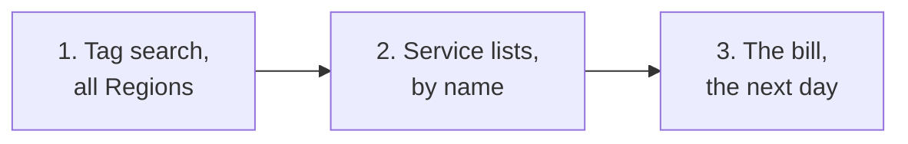

# Find everything a lab left behind, in every Region

> **Your account, your responsibility.** These steps act on your own AWS account. Read the [notice](../00-start-here/05-before-your-first-lab.md#before-you-start-your-account-your-responsibility) before you follow them.

**Goal:** you know that nothing from one lab still exists, in any Region, including the things a tag search can't see.

**Use this when:** you finish a lab's cleanup, a budget alert arrives, or you're unsure about a lab weeks ago.

**Before you start:** your lab log for that lab (what you made, and its `lab` number). Sign in as your IAM admin user.

Three nets catch different things. Use all three:

*Notice that each net covers the gap in the one before, and only the bill sees everything that costs.*

**Long description.** Three steps from left to right: a tag search in Tag Editor across all Regions; each service's own list, searched by the lab's `clf-labNN` name, for types tags can't find; and the bill, a day later, for anything costing money in any Region.

## Steps

### Net 1: search by tag

1. In the console search bar, type `Tag Editor` and open it. (On 2026-10-24 a banner said tag management is moving to the AWS Resource Explorer console; if it has moved, use the same search there.)
2. In **Regions**, choose **All regions**: Tag Editor starts with only your current Region ([Finding resources to tag](https://docs.aws.amazon.com/tag-editor/latest/userguide/find-resources-to-tag.html)). In **Resource types**, choose **All resource types**.
3. Under **Tags**, enter the key `lab` and the lab's number, such as `07`. Choose **Add**, then **Search resources**.
   **You should see:** no resources, if cleanup worked. A deleted item can linger for a few minutes.
4. Repeat with only the key `lab` and no value. That finds anything tagged `lab`, whatever its number. The search is case sensitive, so `Lab` slips past.

### Net 2: check what tags can't find

Tag Editor can't see IAM user groups (they can't be tagged) or IAM users, and AWS's list marks IAM roles, log groups, Glue databases and Well-Architected workloads as unsupported ([supported resource types](https://docs.aws.amazon.com/ARG/latest/userguide/supported-resources.html); [Tags for IAM resources](https://docs.aws.amazon.com/IAM/latest/UserGuide/id_tags.html); both checked 2026-10-24). Parts a service makes for you, such as an instance's disk, may also lack your tags. Search each list for `clf-lab` and the number:

| Look in | For | Labs that make them |
|---|---|---|
| **IAM**: user groups, users, roles, customer managed policies | `clf-labNN-…`; for roles, also a Lambda execution role | 03, 04, 07, 11 |
| **CloudWatch**: log groups | `/aws/lambda/clf-labNN-…` | 07, 11 |
| **Athena** or **AWS Glue**: databases | `clf_lab13` | 13 |
| **Well-Architected Tool**: workloads, in N. Virginia | `clf-lab18-…` | 18 |
| **EC2**, in N. Virginia: volumes, snapshots, Elastic IPs | anything from the lab | 08 |

**Leave alone:** roles starting `AWSServiceRoleFor` (AWS manages them), the default VPC, your admin user and its group, and your guardrails from primer pages 05 and 06.

### Net 3: read the bill the next day

5. The next day, open **Billing and Cost Management**, **Bills**, **Charges by service**, and expand each service to see its Regions ([Understanding your bill](https://docs.aws.amazon.com/awsaccountbilling/latest/aboutv2/getting-viewing-bill.html)). Step-by-step: [Read this month's bill by service and Region](08-read-this-months-bill.md).
   **You should see:** only services and Regions your labs used. Cost data runs about a day behind ([primer page 07](https://github.com/AutomateTheCloud/atc-study-aws_account_guardrails/blob/main/primer/07-habits-for-every-lab.md#habit-4-check-again-the-next-day), habit 4).

## Check it worked

All three nets come up empty for the lab, and you tick it off in your lab log.

## If something went wrong

- **Something turns up:** delete it with its lab's cleanup steps, in order; Tag Editor doesn't delete. [Lab 19](../14-capstone/03-lab-19-close-out.md#part-a-sweep-every-region-by-tag) links every lab's cleanup.
- **A service or Region on the bill you don't recognize:** go to that Region and that service's console, and follow [primer page 08, Track down an unexpected charge](https://github.com/AutomateTheCloud/atc-study-aws_account_guardrails/blob/main/primer/08-when-something-goes-wrong.md#track-down-an-unexpected-charge).

**Why it matters:** this is [COST04-BP03 Decommission resources](https://docs.aws.amazon.com/wellarchitected/latest/cost-optimization-pillar/cost_decomissioning_resources_decommission.html), done thoroughly ([primer habit 2](https://github.com/AutomateTheCloud/atc-study-aws_account_guardrails/blob/main/primer/07-habits-for-every-lab.md#habit-2-find-what-you-made-in-every-region)).

## Used in

- The **Confirm** step of every lab's cleanup, from [Lab 01](../02-why-the-cloud/06-lab-01-first-resource.md#clean-up) on.
- [Lab 19](../14-capstone/03-lab-19-close-out.md), which runs this sweep for the whole course.
- Reference: [Cost traps](../99-reference/05-cost-traps.md), for what keeps billing.

---

"Find everything a lab left behind, in every Region" by Automate the Cloud Inc., licensed under CC BY-NC 4.0 with the Additional Permission for Internal Training from Automate the Cloud Inc.
License: https://creativecommons.org/licenses/by-nc/4.0/
Permission: https://automatethe.cloud/licenses/atc-internal-training-permission.txt
