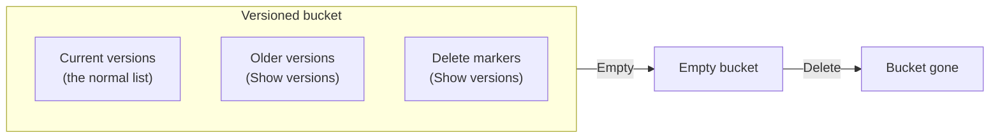

# Empty a versioned S3 bucket, then delete it

> **Your account, your responsibility.** These steps act on your own AWS account. Read the [notice](../00-start-here/05-before-your-first-lab.md#before-you-start-your-account-your-responsibility) before you follow them.

**Goal:** a bucket that had versioning turned on is gone, with every version and delete marker in it.

**Use this when:** S3 says a bucket isn't empty although its **Objects** list looks empty; or a lab's cleanup tells you to empty a bucket ([Lab 05](../05-storing-data/07-lab-05-versions-and-lifecycle.md#clean-up)).

**Before you start:** make sure nothing in the bucket is needed. Emptying can't be undone, even with versioning on ([Emptying a general purpose bucket](https://docs.aws.amazon.com/AmazonS3/latest/userguide/empty-bucket.html)). Sign in as your IAM admin user.

A versioned bucket holds more than its list shows:

*Notice that two of the three boxes are hidden until you turn on **Show versions**: that is why a bucket can look empty and still refuse to be deleted.*

**Long description.** A box labeled "Versioned bucket" holds three things: current versions, which the normal list shows; older versions; and delete markers, both visible only with **Show versions** on. An arrow labeled Empty leads to an empty bucket, and an arrow labeled Delete leads to the bucket gone.

## Steps

1. Open **S3** and choose **General purpose buckets**. Open the bucket and turn on **Show versions** next to the search box.
   **You should see:** every version and delete marker. Every older version is billed in full as stored data until it's gone ([S3 Versioning](https://docs.aws.amazon.com/AmazonS3/latest/userguide/Versioning.html); [Cost traps](../99-reference/05-cost-traps.md#old-versions-are-billed-in-full)). Check the names: is this the right bucket?
2. Go back to **General purpose buckets**. Select the option next to the bucket and choose **Empty**.
3. On the **Empty bucket** page, type `permanently delete` (the confirmation the page asked for on 2026-10-25), then choose **Empty**. If the bucket holds nothing, not even old versions, the page says no objects were found.
   **You should see:** a status page that reports the bucket emptied. In a versioned bucket, Empty removes every version and every delete marker.
4. Leave the status page (it may offer a button such as **Exit**) and go back to **General purpose buckets**. Select the bucket again and choose **Delete**.
5. Type the bucket name to confirm, and choose **Delete bucket** ([Deleting a general purpose bucket](https://docs.aws.amazon.com/AmazonS3/latest/userguide/delete-bucket.html)).
   **You should see:** a success message, and the bucket gone from the list. Once deleted, the name can be taken by another account.

## Check it worked

- Search the bucket list for the name: nothing found. The list covers every Region.
- Search Tag Editor in all Regions for the lab's tag ([Find everything a lab left behind](03-find-what-a-lab-left-behind.md)): no bucket.
- The next day, check that S3 isn't adding cost ([Read this month's bill](08-read-this-months-bill.md)).

## If something went wrong

- **S3 still says the bucket isn't empty:** something wrote to the bucket while it was emptying. Objects added during Empty might or might not be deleted ([Emptying a general purpose bucket](https://docs.aws.amazon.com/AmazonS3/latest/userguide/empty-bucket.html)). Run Empty again, then delete.
- **Access denied on Empty or Delete:** a policy may deny deletes. Open the bucket's **Permissions** tab and read its bucket policy for a `"Deny"`; an explicit deny beats your allow, as in [Lab 04](../04-shared-responsibility-and-access/07-lab-04-finish-and-fix-a-policy.md). Never weaken Block Public Access to get past an error.
- **A huge bucket in real work:** AWS suggests a lifecycle rule that expires current versions, older versions, delete markers and unfinished uploads. It runs over a day or more, and you stop paying once objects are marked for expiry. Labs don't need this.
- **The command line instead:** `aws s3 rm --recursive` doesn't empty a versioned bucket; it only adds delete markers. Use the console.

**Why it matters:** old versions bill in full until something removes them, so deleting a versioned bucket properly is [COST04-BP05 Enforce data retention policies](https://docs.aws.amazon.com/wellarchitected/latest/cost-optimization-pillar/cost_decomissioning_resources_data_retention.html) in miniature. Primer [habit 3](https://github.com/AutomateTheCloud/atc-study-aws_account_guardrails/blob/main/primer/07-habits-for-every-lab.md#habit-3-delete-dont-just-stop) lists this leftover.

## Used in

- Lesson: [S3 in practice](../05-storing-data/02-s3-in-practice.md#versioning-lets-you-undo-an-overwrite-or-a-delete), with its section on [lifecycle rules](../05-storing-data/02-s3-in-practice.md#lifecycle-rules-move-and-delete-objects-for-you).
- Labs: [Lab 05](../05-storing-data/07-lab-05-versions-and-lifecycle.md#clean-up); any lab whose bucket you uploaded to ([Lab 01](../02-why-the-cloud/06-lab-01-first-resource.md#clean-up), [Lab 13](../10-data-ai-and-more/04-lab-13-athena-query.md#clean-up)).

---

"Empty and delete a versioned S3 bucket" by Automate the Cloud Inc., licensed under CC BY-NC 4.0 with the Additional Permission for Internal Training from Automate the Cloud Inc.
License: https://creativecommons.org/licenses/by-nc/4.0/
Permission: https://automatethe.cloud/licenses/atc-internal-training-permission.txt
