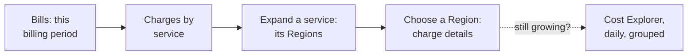

# Read this month's bill by service and Region

> **Your account, your responsibility.** These steps only read your account, but read the [notice](../00-start-here/05-before-your-first-lab.md#before-you-start-your-account-your-responsibility) before you follow them.

**Goal:** you know which services cost something this month, in which Regions, and whether any of it surprises you.

**Use this when:** the day after a lab; a budget or anomaly alert arrives; or your Free plan credit balance falls faster than your labs explain.

**Before you start:** sign in as your IAM admin user. It can open the billing pages only if the root user turned on IAM access to billing ([primer page 02](https://github.com/AutomateTheCloud/atc-study-aws_account_guardrails/blob/main/primer/02-secure-the-root-user.md#let-your-admin-user-see-billing)). Cost data runs about a day behind, so check the day after.

*Notice that the bill answers "where did the money go?", and Cost Explorer answers "is it still going?".*

**Long description.** Four steps from left to right on the Bills page: keep this billing period, open **Charges by service**, expand a service to see its Regions, and choose a Region for the charge details. A dashed arrow leads to Cost Explorer, set to daily and grouped, to see whether a cost is still growing.

## Steps

1. In the console search bar, type `Billing` and open **Billing and Cost Management**. In the left menu, choose **Bills**.
2. Keep **Billing period** on the current month.
   **You should see:** a bill status of **Pending**: the month hasn't closed, so the totals are estimates from usage metered so far. Past months show **Issued** ([Understanding your bill](https://docs.aws.amazon.com/awsaccountbilling/latest/aboutv2/getting-viewing-bill.html), checked 2026-10-24).
3. Open the **Charges by service** tab. Choose the `+` next to each service to see its charges by **Region**, and choose a Region to see the line items.
   **You should see:** only services and Regions your labs used. Write each service and Region, with its amount, in your lab log.
4. On the Free plan, open the **Savings** tab, or the **Credits** page in the left menu. Credits pay for your usage, so the total can read $0 while services still use credits. Read the service lines, not only the total.
5. For a daily view, open **Cost Explorer**. Set the granularity to **Daily** and the range to this month, then use **Group by** to choose **Service**, then **Region** ([Modifying your chart](https://docs.aws.amazon.com/cost-management/latest/userguide/ce-modify.html)). If credits flatten the chart, filter **Charge type** to **Usage** ([Filtering the data](https://docs.aws.amazon.com/cost-management/latest/userguide/ce-filtering.html)).
   **You should see:** a bar for each day; a service whose bars keep appearing after its lab ended is still running.

## Check it worked

You can name every service and Region on this month's bill and the lab that explains it. Anything you can't explain is your lead.

## If something went wrong

- **Access denied on Bills or Cost Explorer:** IAM access to billing isn't on. Do the step on [primer page 02](https://github.com/AutomateTheCloud/atc-study-aws_account_guardrails/blob/main/primer/02-secure-the-root-user.md#let-your-admin-user-see-billing).
- **Cost Explorer says to check back in 24 hours:** normal for a new account or for Cost Explorer's first use. Our new account still showed it 13 hours after sign-up (2026-10-24).
- **A service or Region you don't recognize:** go to that Region and that service, find the resource and delete it, using [primer page 08, Track down an unexpected charge](https://github.com/AutomateTheCloud/atc-study-aws_account_guardrails/blob/main/primer/08-when-something-goes-wrong.md#track-down-an-unexpected-charge). If you still can't explain it, [open an account and billing case](09-open-a-billing-support-case.md).
- **A charge from today isn't there:** wait a day.

**Why it matters:** checking spend against what you expected, regularly, is [COST01-BP06 Monitor cost proactively](https://docs.aws.amazon.com/wellarchitected/latest/cost-optimization-pillar/cost_cloud_financial_management_proactive_process.html). The bill also sees what tags can't: every Region and every service.

## Used in

- Lessons: [How AWS charges](../11-paying-for-aws/01-how-aws-charges.md); [Estimate, watch, analyze](../11-paying-for-aws/03-estimate-watch-analyze.md#cost-explorer-shows-where-the-money-went-and-forecasts-what-comes-next).
- Labs: the next-day check in every lab that creates something; [Lab 16](../11-paying-for-aws/06-lab-16-cost-allocation-tags.md#the-next-day-find-the-tags-in-cost-explorer), which groups by the `lab` tag; [Lab 19, Part C](../14-capstone/03-lab-19-close-out.md#part-c-read-the-bill-and-the-credits).
- Primer: [habit 4](https://github.com/AutomateTheCloud/atc-study-aws_account_guardrails/blob/main/primer/07-habits-for-every-lab.md#habit-4-check-again-the-next-day).

---

"Read this month's bill by service and Region" by Automate the Cloud Inc., licensed under CC BY-NC 4.0 with the Additional Permission for Internal Training from Automate the Cloud Inc.
License: https://creativecommons.org/licenses/by-nc/4.0/
Permission: https://automatethe.cloud/licenses/atc-internal-training-permission.txt
